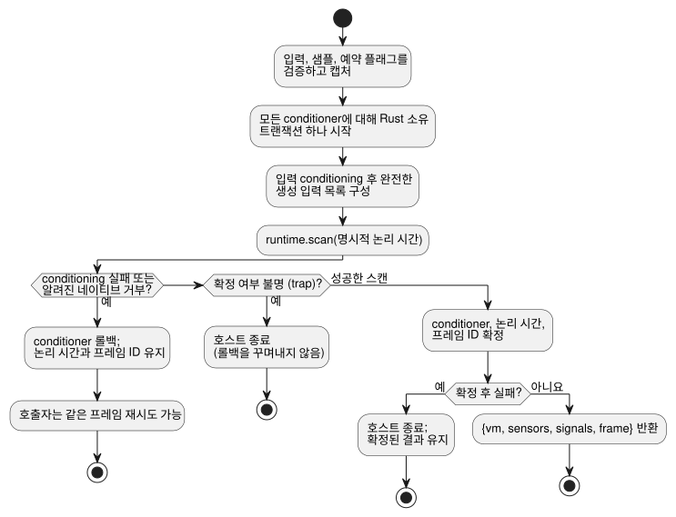

<!-- translation-source: docs/FRAMED-CONTROL-HOST.md -->
[영문 원문](FRAMED-CONTROL-HOST.md)

# Framed ControlRuntime 도입 (D6)

주요 설계, 2026-09-11. 선정 작업: callin2/farm_studio_frontend#69,
TASK-76.6, GF-INT-COMMON-SCAN-DRIVERS.

- **범위:** 모듈을 가로지르는 도입 작업 하나이며, 언어 호스트와 Web 소비자라는 두 구현
  단위로 나뉩니다.
- **기반:** language PR19 / 1b04529와 web PR71 / a6999ad.
- **범위 밖:** 장치와 물리 I/O.

*framed* 런타임은 각 스캔을 하나의 명시적 프레임으로 실행합니다. 호스트는 완전한 입력 집합과
명시적 논리 시간을 제공하고, 승인된 스캔에 대한 프레임 identity(`scanId`, `logicalTimeMs`)를
돌려받습니다.

## 언어 호스트 진입점

`ControlRuntime.instantiateFramed(wasmBytes, artifact, options = {})`를 추가합니다.

이 진입점은 현재 진입점과 같은 manifest 검증, 바이트코드 digest 검증, capability 바인딩,
기존 Rust 신호 conditioner를 사용합니다. 허용되는 manifest 버전은 다음과 같습니다.

- v1과 v4는 허용됩니다.
- v2는 `acceptSettings` opt-in이 필요합니다.
- v3은 opt-in 없이 허용됩니다.
- 현재 호스트 검증은 기능별 바이트코드 계약에 따라 v7, v8, v10도 허용합니다. (이후의 기능
  manifest도 허용되며, 정확한 목록은 `runtimes/wasm/control-runtime.mjs`의
  `validateManifest`가 기준입니다.)
- `acceptSolar` 옵션은 없습니다.

레거시 `instantiate`와 `instantiateSimulation`은 공개 결과 형태를 유지합니다. 이제 모든
진입점이 같은 원자적 conditioner 트랜잭션 경계를 사용합니다. 공유 생성자/helper를 사용하고,
conditioning 코드를 복사하거나 두 번째 evaluator를 추가해서는 안 됩니다.

`FramedGhostFlowRuntime`은 새 진입점만 소유합니다. 각 `step`에서는 다음이 일어납니다.

1. 호스트가 선언된 입력, 샘플, 예약 플래그 전체를 검증하고 캡처합니다. 원시 DI 값은
   conditioning 전에 한 번 캡처합니다.
2. 그다음 기존 conditioner가 센서/신호의 값+품질 입력을 만듭니다.

누락된 DI는 절대 false로 기본 처리되지 않습니다. 예약 플래그가 없으면 기존 호스트 계약에
따라 여전히 "제공된 발생 없음"을 뜻하며, 달력 시간 예약을 진행시키지 않습니다.

`__gf_now_ms`만 제외하고 선언된 입력과 생성된 입력의 완전한 목록 하나를 만듭니다. 타이머가
없는 프로그램이라도 명시적 논리 시간과 함께 `runtime.scan`을 정확히 한 번 호출합니다. framed
경로에서는 레거시 setter나 tick을 호출하지 말고, 구형 결과물로 대체하지도 마십시오. ABI
export가 없으면 컴파일 진단이 생기고 기존 reload/retry 경로를 사용할 수 있습니다.

**프레임 identity.** 호스트는 인스턴스별 비공개 프레임 순번을 소유하며, 이 값은 0에서
시작합니다.

- 스캔이 성공한 뒤에만 증가시킵니다.
- 호스트 서비스를 변경하기 전에 안전 정수 소진 여부를 강제로 검사합니다.
- 오류가 나면 마지막으로 승인된 시각과 결과를 유지합니다.

framed 진입점만 기존 `{vm, sensors, signals}`에 `frame: {scanId, logicalTimeMs}`를 더해
반환합니다. `vm`은 변경되지 않은 정본 TickRecord로 남으며, 그 레거시 tick 번호 공간은 프레임
ID와 별개입니다. `lastFrameOutcome`은 framed 런타임이 확정한 결과를 새 일반 데이터로 반환하는
읽기 전용 getter입니다. 첫 스캔 전과 레거시 모드에서는 `null`이며, dispose 후에는 거부합니다.
실행 모드와 프레임 카운터는 비공개로 유지됩니다.

**신호와 hold.** `signals`에는 conditioner 판독값이 들어갑니다. VM이 소유하는 `debounce`와
`hold_last` 상태는 `vm.stateAfter`에 있습니다. hold 관측에는 검증된 소스 추적 메타데이터와
`vm`을 `observeSourceTrace`에 전달합니다. `heldEvents`는 Rust가 계산한 Held 페이로드, 원래
샘플 identity, 그 경과 시간, 마스킹된 fault를 투영합니다. 어댑터와 observer는 hold 식을
실행하거나 TTL을 연장하지 않습니다.

### 시간 창

두 어댑터를 통한 시간 재생은 [TEMPORAL-REPLAY 문서](TEMPORAL-REPLAY.ko.md)에 규정되어
있습니다.

GFB4 창(window) 모듈에서는 `instantiate`와 `instantiateFramed` 모두 `options.temporal`을
요구합니다. 명시적인 실행 epoch, 물리 root 밀도 계약, 대상 시간 메모리 예산을 제공합니다.

```js
const options = {
  temporal: {
    timeEpoch: 5,
    rootDensity: [{ sourceTag: 1, maxObservations: 3, intervalMs: 1000 }],
    budget: { maxRetainedSamples: 12, maxBytes: 33554432 },
  },
};
const runtime = await ControlRuntime.instantiateFramed(wasmBytes, artifact, options);
```

이 옵션의 규칙은 다음과 같습니다.

- 위 값은 예시일 뿐이며 장치 기본값이 아닙니다.
- 소스 태그는 컴파일된 물리 root와 일치해야 합니다. root 태그는 오름차순이며 고유합니다.
- 밀도는 수집 상한이며, `sampleMs`가 이를 정하지는 않습니다.
- 예산 정수는 u32에 들어가야 하고, epoch와 간격은 정확한 안전 정수입니다.
- 창이 없는 모듈은 이 옵션을 거부합니다.
- 호스트는 비동기 초기화 전에 옵션을 캡처하므로, 이후 호출자가 값을 바꿔도 세션은 바뀌지
  않습니다.
- 다른 시간 epoch를 쓰려면 새 런타임 인스턴스가 필요합니다. 호스트는 매 스캔마다 캡처된
  `__gf_time_epoch`를 제공합니다.

**창 증거.** 창은 Rust 코어가 계산합니다. 그 소유 증거는 `vm.windowTrace`이며, 파생 품질,
직접 연결된 물리 또는 집계 identity, 선택적인 상위 fault를 담습니다. 이것은 `signals`의
conditioner 항목이 아닙니다.

- 중첩된 집계 기여자는 입력에 대한 소유 증명 트리를 유지합니다. observer는 이를 다른 평균으로
  평탄화하지 않습니다.
- 관측 시간은 가장 최근에 기여한 측정 시각으로 유지되며, 평가 시간은 별개입니다.
- 거부된 스캔은 창 이력과 conditioner를 함께 롤백하므로, 재시도할 때 같은 샘플 identity를 다시
  쓸 수 있습니다.
- `observeSourceTrace(verifiedMetadata, vm)`는 이를 작성된 선언과 연결된 `windowEvents`로
  투영합니다. 사용할 수 없는 집계는 자체 NotReady 위치를 보고하며, 상위 fault는 별도로
  남습니다.
- 소스 맵은 창 소스, identity 입력, 시계, 하위 창 의존성을 기록합니다. 소스 맵을 복원할 때 이
  연결을 정본 lowering과 대조합니다.

저수준 어댑터는 같은 프로필을 받는 `activateTemporal(profile)`을 노출합니다. 둘 다 제한된
GFTA 활성화 패킷과 독립적인 Rust 검증을 사용합니다. 예산에는 시간 저장소와 제한된 보존 추적이
포함됩니다. JSON 버퍼, 호스트 conditioner, 호출자가 보관한 사본은 그 예산 밖입니다. manifest
검증은 구조적 도메인과 바이트코드 digest를 검사합니다. 정본 소스/명목 descriptor의 동등성은
도구 체인/패키지 검증이 필요합니다.

**원자적 step 트랜잭션.** 일반적인 snapshot/타입/시간 검증은 모두 conditioner를 변경하기 전에
일어납니다. 이후의 Reference 4.15 원자적 tick 계약이 이 설계의 원래 "롤백 불가" 제한을
대체합니다.



다이어그램은 step 하나가 끝날 수 있는 세 가지 방식을 보여 줍니다.

- **알려진 거부 — 롤백.** conditioning 전에 호스트는 모든 센서와 신호 conditioner에 대해 Rust가
  소유하는 트랜잭션 하나를 시작합니다. conditioning, 생성 입력 준비, 또는 알려진 네이티브 거부
  때문에 step이 실패하면 모두 롤백됩니다. 승인된 논리 시간과 프레임 ID가 그대로이므로 호출자는
  재시도할 수 있습니다.
- **성공한 스캔 — 확정.** 성공한 네이티브 스캔은 결과를 디코딩하기 전에 모든 conditioner,
  논리 시간, 프레임 ID를 확정합니다. 이 경계 이후의 실패는 승인된 상태를 되돌릴 수 없으며
  호스트를 종료시킵니다.
- **확정 여부 불명 — 종료.** 네이티브 확정 상태를 알 수 없는 trap도 롤백을 꾸며내지 않고
  호스트를 종료시킵니다.

확정된 VM 결과는 어댑터를 읽을 수 있는 동안 계속 제공됩니다. false 출력을 내는 전역 제약은
호스트 fault가 아니라 성공한 스캔입니다. dispose는 소유한 모든 conditioner와 framed 핸들을
해제합니다.

## Web 소비자

**고정(pin)과 컴파일.**

- 검토된 언어 호스트 커밋을 고정하고, 기존의 엄격한 소스/결과물 guard를 거쳐 실제로 일치하는
  WASM을 빌드합니다.
- 언어 선행 작업이 독립 검토를 통과할 때까지 pin 갱신은 main이 맡습니다.
- `compilePlaygroundSource`는 `instantiateFramed`를 사용하고, 컴파일이 성공할 때마다 새
  `runEpoch`(UUID)를 부여합니다.
- 사용자의 preview 체크아웃은 수정하지 않습니다.

**스캔.** `runPlaygroundScan`은 값이 있는 Boolean DI 항목을 정확히 8개 받습니다.

- 호스트를 호출하기 전에 잘못된 길이, 빈 자리, Boolean이 아닌 값을 거부합니다.
- 분리된 snapshot을 사용합니다.
- 추론된 false 입력 대체를 제거합니다.
- UI 결과를 게시하기 전에 호스트가 승인한 프레임 identity/시각을 검증합니다.
- RO1..RO8은 오직 그 결과의 최종 `vm.safe` 뱅크에서 가져오며, 각각 명시적 Boolean입니다. 요청
  출력은 절대 사용하지 않으며, 결과가 없는 것을 false로 취급하지도 않습니다.

**추적 메타데이터.** ControlRuntime 안의 정본 VM 출력은 바꾸지 않습니다. Web 관측은 추적에
`scanFrame: {runEpoch, scanId, logicalTimeMs}`를 붙일 수 있습니다. 이를 변경된 Rust
TickRecord가 아니라 로컬 선언의 호스트 메타데이터로 문서화합니다.

- 기존 이력, 비교, 재생 레코드를 통해 이를 전달합니다.
- 별도의 실행은 의도적으로 서로 다르므로, 의미 비교는 run-epoch identity를 무시해야 합니다.
- 브라우저 검사에 유용하다면 현재 승인된 identity를 전송용 data attribute로 노출합니다. 별도의
  설명 문구나 새 레이아웃은 필요하지 않습니다.
- compile/reset은 epoch를 교체합니다. 재컴파일이 거부되면 마지막 정상 인스턴스와 identity를
  유지합니다. pause와 one-step은 epoch를 바꾸지도, 프레임 ID를 건너뛰지도 않습니다.

## 검증과 완료

| 단위 | 필수 검사 |
| --- | --- |
| 언어 | 실제 빌드한 WASM; 기존 모든 gate; 새 진입점의 완전/생성 입력 parity(타이머, 센서/신호, 예약, 제약); 타이머가 있는 프레임과 없는 프레임; 안전한 identity 진행과 거부; 레거시 export 호출 없음; 알려진 거부의 롤백과 같은 ID 재시도; 불명/확정 후 fault의 래치와 확정 결과 보존; 구형 결과물과 dispose 처리 |
| Web | 단위/타입/빌드/소스 guard; 재사용 없는 엄격한 브라우저 서버; 기존 lesson/replay/source-trace 및 속도 테스트; 승인된 프레임/epoch 연속성; 제약; 실패한 compile/reset; 호스트 호출 전 잘못된 DI 거부 |

언어 선행 작업은 자체 exact-head gate를 통과하면 병합할 수 있습니다. Web이 그 결과물을
고정하고 실제로 실행하기 전까지 상위 D6는 Done이 될 수 없습니다. D9(네이티브 framed-tape
parity)와 D7/D8/D11(장치 통합)은 별도 작업으로 남습니다.

## 달력 시간 예약 (issue #366)

framed 달력 시간 `Daily` 및 `DailySlots` 예약의 경우:

- 호스트는 `{bootEpoch, terminalCapacity}`로 예약 프로필을 활성화합니다.
- provider는 GFSF v2/v3 예약 사실 패킷을 스캔 시점에 별도로 제공합니다. 활성화는 패킷을 만들지
  않으며, 예약 사실은 일반적인 생성 입력 항목이 아닙니다.
- `clock.monotonicMs`는 `frame.logicalTimeMs`와 정확히 같아야 합니다.

런타임은 `gf_frame_activate_schedules`와 `gf_frame_scan_schedules`를 export하고,
JavaScript 호스트는 `activateSchedules`와 `dispatchSchedules`를 사용합니다. 호스트는 이
경로를 쓰기 전에 일치하는 WASM export가 있는지 반드시 확인해야 합니다.

발생 admission(수용)과 발생 ledger(원장)는 Rust가 소유합니다. 실행 전에 호스트는 선언된 입력과
생성된 입력의 완전한 집합, 그리고 예약 사실 패킷을 검증합니다. 호스트는 런타임 `due`, `ok`,
`fault` 결과를 도출하거나 제공해서는 안 됩니다.

거부된 프레임은 기존 확정 경계를 따릅니다.

- 알려진 거부는 롤백되며 같은 프레임 identity로 재시도할 수 있습니다. 예를 들어 유효하지 않은
  예약 사실 패킷은 프레임 확정 전에 거부되며, 유효한 재시도는 같은 프레임 identity를 사용합니다.
- 네이티브 확정 이후의 실패는 원래 확정된 프레임 결과를 보존하며, 그 프레임은 미확정 프레임처럼
  재시도할 수 없습니다.

회귀 테스트는 `tests/framed-control-host.test.mjs`와
`crates/ghostflow-core/tests/schedule_module.rs`에 있습니다.

framed Solar 예약은 여전히 지원하지 않습니다.

예방 규칙: mock을 전제로 삼기 전에 실제 공개 런타임 인터페이스를 확인하십시오. mock 테스트만으로는
런타임 capability가 입증되지 않습니다.
