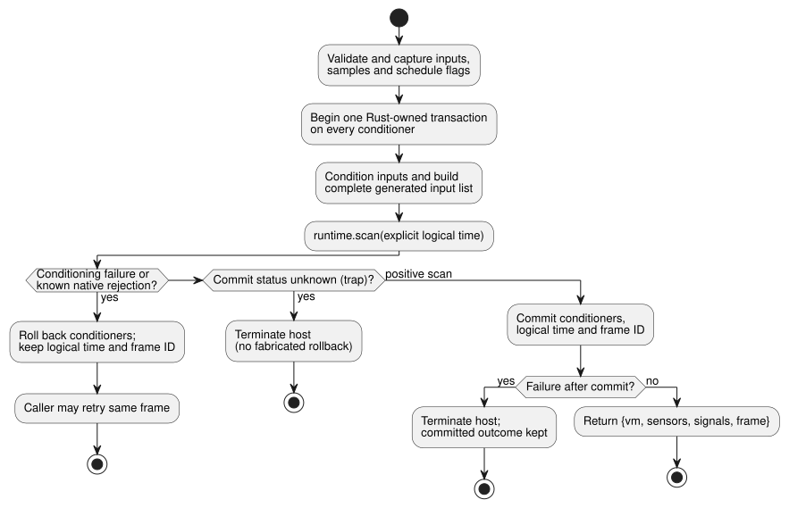

# Framed ControlRuntime adoption (D6)

Main design, 2026-09-11. Selected work: callin2/farm_studio_frontend#69,
TASK-76.6, GF-INT-COMMON-SCAN-DRIVERS.

- **Scope:** one cross-module adoption task, split into two implementation
  units: the language host and the Web consumer.
- **Builds on:** language PR19 / 1b04529 and web PR71 / a6999ad.
- **Out of scope:** devices and physical I/O.

A *framed* runtime runs each scan as one explicit frame: the host supplies the
complete input set and an explicit logical time, and gets back a frame identity
(`scanId`, `logicalTimeMs`) for the accepted scan.

## Language host entry

Add `ControlRuntime.instantiateFramed(wasmBytes, artifact, options = {})`.

It uses the same manifest validation, bytecode digest verification, capability
binding and existing Rust signal conditioners as the current entry. Accepted
manifest versions:

- v1 and v4 are accepted.
- v2 requires the `acceptSettings` opt-in.
- v3 is accepted without an opt-in.
- Current host validation also accepts v7, v8 and v10 under their
  feature-specific bytecode contracts. (Later feature manifests are also
  accepted; `validateManifest` in `runtimes/wasm/control-runtime.mjs` is the
  authoritative list.)
- There is no `acceptSolar` option.

Legacy `instantiate` and `instantiateSimulation` keep their public result shape.
Every entry now uses the same atomic conditioner transaction boundary. Use a
shared constructor/helper; do not copy the conditioning code or add a second
evaluator.

Only the new entry owns `FramedGhostFlowRuntime`. At each `step`:

1. The host validates and captures the complete declared inputs, samples and
   schedule flags. Primitive DI values are captured once, before conditioning.
2. The existing conditioners then produce sensor/signal value+quality inputs.

Missing DI never defaults to false. An absent schedule flag still means "no
supplied occurrence", per the existing host contract; it does not advance
civil-time scheduling.

Build one complete list of declared and generated inputs, excluding only
`__gf_now_ms`. Dispatch exactly once through `runtime.scan` with an explicit
logical time, even for programs with no timers. In the framed path, do not call
legacy setters or tick, and do not fall back to an old artifact. Missing ABI
exports produce a compilation diagnostic and allow the existing reload/retry
path.

**Frame identity.** The host owns a private per-instance frame sequence that
starts at zero.

- Increment it only after a successful scan.
- Enforce safe-integer exhaustion before any host service mutation.
- On errors, keep the last accepted time and outcome.

Only the framed entry returns the existing `{vm, sensors, signals}` plus
`frame: {scanId, logicalTimeMs}`. `vm` remains the unmodified canonical
TickRecord; its legacy tick namespace is distinct from the frame ID.
`lastFrameOutcome` is a read-only getter that returns the framed runtime's fresh
plain-data committed outcome. It is `null` before the first scan and `null` in
legacy mode, and it rejects after disposal. Execution mode and the frame counter
stay private.

**Signals and hold.** `signals` contains conditioner readings. VM-owned
`debounce` and `hold_last` states are in `vm.stateAfter`. For hold
observations, pass the verified source trace metadata and `vm` to
`observeSourceTrace`; `heldEvents` projects the Rust-computed Held payload, the
original sample identity, its age and the masked fault. The adapter and observer
do not execute the hold expression or extend its TTL.

### Temporal windows

Temporal replay through both adapters is specified in
[TEMPORAL-REPLAY.md](TEMPORAL-REPLAY.md).

Both `instantiate` and `instantiateFramed` require `options.temporal` for GFB4
window modules. Supply an explicit execution epoch, physical root density
contracts and target temporal memory budgets:

```js
const options = {
  temporal: {
    timeEpoch: 5,
    rootDensity: [{ sourceTag: 1, maxObservations: 3, intervalMs: 1000 }],
    budget: { maxRetainedSamples: 12, maxBytes: 33554432 },
  },
};
const runtime = await ControlRuntime.instantiateFramed(wasmBytes, artifact, options);
```

Rules for this option:

- These are illustrative values, not device defaults.
- Source tags must match the compiled physical roots. Root tags are ascending
  and unique.
- Density is an acquisition upper bound; `sampleMs` does not establish it.
- Budget integers fit u32; the epoch and intervals are exact safe integers.
- Non-window modules reject this option.
- The host captures the option before asynchronous initialization, so later
  caller mutation does not change the session.
- A different time epoch requires a new runtime instance. The host supplies the
  captured `__gf_time_epoch` on every scan.

**Window evidence.** The Rust core computes windows. Their owned evidence is
`vm.windowTrace`, with derived quality, immediate physical or aggregate
identities and an optional upstream fault. It is not a conditioner entry in
`signals`.

- Nested aggregate contributors keep owned proof trees of their inputs; the
  observer does not flatten them into a different average.
- Observation time remains the newest contributing measurement time; evaluation
  time is separate.
- A rejected scan rolls back window history and conditioners together, so a
  retry can reuse the same sample identity.
- `observeSourceTrace(verifiedMetadata, vm)` projects this as `windowEvents`
  linked to the authored declaration. Unavailable aggregates report their own
  NotReady site; an upstream fault remains separate.
- The source map records window sources, identity inputs, clocks and downstream
  window dependencies. Restoring a source map checks these links against
  canonical lowering.

Low-level adapters expose `activateTemporal(profile)` with the same profile.
Both use the bounded GFTA activation packet and independent Rust validation.
The budget accounts for temporal storage and bounded retained traces. JSON
buffers, host conditioners and caller-retained copies are outside that budget.
Manifest validation checks structural domains and the bytecode digest;
canonical source/nominal-descriptor equivalence requires toolchain/package
verification.

**Atomic step transaction.** All ordinary snapshot/type/time validation happens
before any conditioner mutation. The later Reference 4.15 atomic tick contract
supersedes this design's original no-rollback limitation.



The diagram shows the three possible endings of one step:

- **Known rejection — roll back.** Before conditioning, the host begins one
  Rust-owned transaction on every sensor and signal conditioner. If
  conditioning, generated-input preparation, or a known native rejection fails
  the step, all of them roll back. The accepted logical time and frame ID stay
  unchanged, so the caller can retry.
- **Positive scan — commit.** A positive native scan commits every conditioner,
  the logical time and the frame ID before the outcome is decoded. A failure
  after that boundary cannot undo accepted state, and terminates the host.
- **Unknown commit status — terminate.** A trap whose native commit status is
  unknown also terminates the host, without fabricating a rollback.

The committed VM outcome stays available while its adapter remains readable.
Global constraints that yield false outputs are successful scans, not host
faults. Dispose releases all owned conditioners and the framed handle.

## Web consumer

**Pinning and compilation.**

- Pin the reviewed language-host commit and build the actual matching WASM
  through the existing strict source/artifact guard.
- Main keeps ownership of the pin update until the language prerequisite has
  passed independent review.
- `compilePlaygroundSource` uses `instantiateFramed` and assigns a fresh
  `runEpoch` (UUID) per successful compilation.
- Do not edit user preview checkouts.

**Scanning.** `runPlaygroundScan` accepts exactly eight present Boolean DI
entries.

- Reject wrong lengths, holes or non-Booleans before calling the host.
- Use a detached snapshot.
- Remove the inferred-false input fallback.
- Validate the host's accepted frame identity/time before publishing the UI
  result.
- RO1..RO8 come only from that result's final `vm.safe` bank, each an explicit
  Boolean. Never use requested outputs, and never treat an absent result as
  false.

**Trace metadata.** Keep the canonical VM output unchanged inside
ControlRuntime. The Web observation may attach
`scanFrame: {runEpoch, scanId, logicalTimeMs}` to its trace. Document it as host
metadata in the local declaration, not as a changed Rust TickRecord.

- Carry it through the existing history, comparison and replay records.
- Semantic comparisons must ignore run-epoch identity, because separate runs
  intentionally differ.
- If useful for browser checks, expose the current accepted identity through
  transport data attributes. No extra explanatory copy or new layout is needed.
- Compile/reset replaces the epoch. A rejected recompile keeps the last good
  instance and identity. Pause and one-step neither replace an epoch nor skip
  frame IDs.

## Verification and completion

| Unit | Required checks |
| --- | --- |
| Language | real built WASM; all existing gates; new-entry complete/generated input parity (timer, sensor/signal, schedule, constraints); frames with and without timers; safe identity progression and rejection; no legacy export calls; known-rejection rollback and same-ID retry; unknown/post-commit fault latching and committed-outcome preservation; old-artifact and disposal handling |
| Web | unit/type/build/source guard; strict no-reuse browser server; existing lesson/replay/source-trace and speed tests; accepted frame/epoch continuity; constraints; failed compile/reset; invalid DI rejection before a host call |

The language prerequisite can merge after its own exact-head gates. Parent D6
cannot be Done until Web pins and exercises that artifact. D9 (native
framed-tape parity) and D7/D8/D11 (device integration) remain separate tasks.

## Civil schedules (issue #366)

For framed civil `Daily` and `DailySlots` schedules:

- The host activates the schedule profile with `{bootEpoch, terminalCapacity}`.
- The provider supplies GFSF v2/v3 schedule-fact packets separately, at scan
  time. Activation does not produce packets, and schedule facts are not
  ordinary generated input entries.
- `clock.monotonicMs` must equal `frame.logicalTimeMs` exactly.

The runtime exports `gf_frame_activate_schedules` and
`gf_frame_scan_schedules`; the JavaScript host uses `activateSchedules` and
`dispatchSchedules`. The host must require the matching WASM exports before
using this path.

Rust owns occurrence admission and the occurrence ledger. Before execution, the
host validates the complete declared and generated input set and the
schedule-fact packet. The host must not derive or supply runtime `due`, `ok` or
`fault` results.

A rejected frame follows the existing commit boundary:

- A known rejection rolls back and permits a retry with the same frame identity.
  For example, an invalid schedule-fact packet is rejected before frame commit;
  a valid retry uses the same frame identity.
- A failure after native commit preserves the original committed frame result,
  and that frame cannot be retried as an uncommitted frame.

Regression coverage is in `tests/framed-control-host.test.mjs` and
`crates/ghostflow-core/tests/schedule_module.rs`.

Framed Solar schedules remain unsupported.

Prevention rule: verify the actual public runtime interface before making mock
assumptions. Mock coverage alone does not establish runtime capability.
