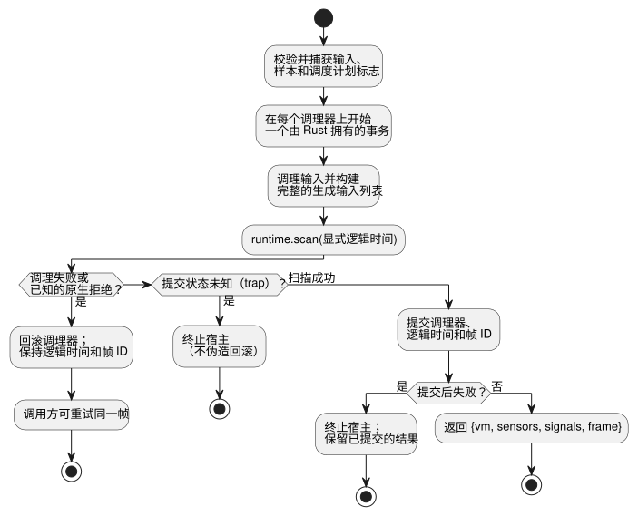

<!-- translation-source: docs/FRAMED-CONTROL-HOST.md -->
[英文原文](FRAMED-CONTROL-HOST.md)

# Framed ControlRuntime 的采用（D6）

主设计，2026-09-11。选定的工作：callin2/farm_studio_frontend#69、TASK-76.6、GF-INT-COMMON-SCAN-DRIVERS。

- **范围：** 一个跨模块的采用任务，拆分为两个实现单元：语言宿主和 Web 使用方。
- **基于：** 语言 PR19 / 1b04529 和 web PR71 / a6999ad。
- **不在范围内：** 设备和物理 I/O。

*framed*（分帧）运行时把每次扫描作为一个显式的帧来运行：宿主提供完整的输入集合和显式的逻辑时间，并为被接受的扫描取回一个帧身份标识（`scanId`、`logicalTimeMs`）。

## 语言宿主入口

新增 `ControlRuntime.instantiateFramed(wasmBytes, artifact, options = {})`。

它使用与当前入口相同的清单校验、字节码摘要验证、能力绑定和现有的 Rust 信号调理器。接受的清单版本：

- 接受 v1 和 v4。
- v2 需要选择启用 `acceptSettings`。
- v3 无需选择启用即被接受。
- 当前的宿主校验还在各自特性专属的字节码契约下接受 v7、v8 和 v10。（之后特性的清单同样会被接受；`runtimes/wasm/control-runtime.mjs` 中的 `validateManifest` 是权威列表。）
- 不存在 `acceptSolar` 选项。

旧版的 `instantiate` 和 `instantiateSimulation` 保持其公开的结果形状。现在每个入口都使用同一个原子的调理器事务边界。请使用共享的构造函数/辅助函数；不要复制调理代码，也不要添加第二个求值器。

只有新入口拥有 `FramedGhostFlowRuntime`。在每次 `step` 时：

1. 宿主校验并捕获完整的已声明输入、样本和调度计划标志。基本类型的 DI 值在调理之前只捕获一次。
2. 随后现有的调理器生成传感器/信号的“值+质量”输入。

缺失的 DI 绝不会默认为 false。按照现有的宿主契约，缺失的调度计划标志仍表示“未提供触发实例（occurrence）”；它不会推进民用时间调度。

构建一个包含已声明输入和生成输入的完整列表，只排除 `__gf_now_ms`。通过 `runtime.scan` 以显式的逻辑时间恰好分派一次，即使程序中没有定时器也是如此。在 framed 路径中，不要调用旧版的 setter 或 tick，也不要回退到旧的产物。缺少 ABI 导出会产生编译诊断，并允许走现有的重新加载/重试路径。

**帧身份标识。** 宿主拥有一个私有的、按实例划分的帧序列，从零开始。

- 只在扫描成功后递增它。
- 在任何宿主服务发生变更之前，强制检查安全整数是否耗尽。
- 出错时，保留最后被接受的时间和结果。

只有 framed 入口返回现有的 `{vm, sensors, signals}` 加上 `frame: {scanId, logicalTimeMs}`。`vm` 仍是未经修改的规范 TickRecord；其旧版的 tick 命名空间与帧 ID 是不同的。`lastFrameOutcome` 是一个只读 getter，返回 framed 运行时最新的、纯数据形式的已提交结果。在第一次扫描之前它为 `null`，在旧版模式下也为 `null`，释放（dispose）之后访问会被拒绝。执行模式和帧计数器保持私有。

**信号与保持。** `signals` 包含调理器的读数。由 VM 拥有的 `debounce` 和 `hold_last` 状态位于 `vm.stateAfter` 中。对于保持（hold）观测，把经过验证的源追踪元数据和 `vm` 传给 `observeSourceTrace`；`heldEvents` 投影由 Rust 计算的 Held 负载、原始样本的身份标识、其时龄以及被屏蔽的故障。适配器和观测器不会执行 hold 表达式，也不会延长其 TTL。

### 时间窗口

通过这两种适配器进行的时间重放在 [TEMPORAL-REPLAY.md](TEMPORAL-REPLAY.zh.md) 中规定。

对于 GFB4 窗口模块，`instantiate` 和 `instantiateFramed` 都需要 `options.temporal`。请提供显式的执行纪元（epoch）、物理根的密度契约，以及目标时间内存预算：

```js
const options = {
  temporal: {
    timeEpoch: 5,
    rootDensity: [{ sourceTag: 1, maxObservations: 3, intervalMs: 1000 }],
    budget: { maxRetainedSamples: 12, maxBytes: 33554432 },
  },
};
const runtime = await ControlRuntime.instantiateFramed(wasmBytes, artifact, options);
```

此选项的规则：

- 这些是示意值，不是设备默认值。
- 源标签必须与编译后的物理根匹配。根标签按升序排列且唯一。
- 密度是采集的上限；`sampleMs` 并不确立该上限。
- 预算整数须在 u32 范围内；纪元和间隔是精确的安全整数。
- 非窗口模块会拒绝此选项。
- 宿主在异步初始化之前捕获该选项，因此调用方之后的修改不会改变会话。
- 不同的时间纪元需要新的运行时实例。宿主在每次扫描时提供捕获的 `__gf_time_epoch`。

**窗口证据。** 窗口由 Rust 核心计算。其自有证据是 `vm.windowTrace`，包含派生的质量、直接的物理或聚合身份标识，以及可选的上游故障。它不是 `signals` 中的调理器条目。

- 嵌套的聚合贡献者会保留其输入的自有证明树；观测器不会把它们展平成另一种平均值。
- 观测时间仍是最新一个参与贡献的测量时间；求值时间是分开的。
- 被拒绝的扫描会同时回滚窗口历史和调理器，因此重试可以复用同一个样本身份标识。
- `observeSourceTrace(verifiedMetadata, vm)` 将其投影为与编写的声明相关联的 `windowEvents`。不可用的聚合会报告其自身的 NotReady 位置；上游故障保持独立。
- 源映射记录窗口的来源、身份标识输入、时钟以及下游窗口依赖。恢复源映射时，会对照规范降级（lowering）检查这些链接。

底层适配器以相同的 profile 暴露 `activateTemporal(profile)`。两者都使用有界的 GFTA 激活数据包，并由 Rust 独立校验。预算计入时间存储和有界的保留追踪。JSON 缓冲区、宿主调理器以及调用方保留的副本不在该预算之内。清单校验检查结构域和字节码摘要；规范源代码/名义描述符的等价性需要工具链/包验证。

**原子 step 事务。** 所有常规的快照/类型/时间校验都在任何调理器变更之前进行。后来的参考手册 4.15 原子 tick 契约取代了本设计最初“无回滚”的限制。



该图展示了一次 step 的三种可能结局：

- **已知拒绝——回滚。** 在调理之前，宿主在每个传感器和信号调理器上开始一个由 Rust 拥有的事务。如果调理、生成输入的准备或已知的原生拒绝使该 step 失败，它们全部回滚。已接受的逻辑时间和帧 ID 保持不变，因此调用方可以重试。
- **扫描成功——提交。** 一次成功的原生扫描会在解码结果之前提交每个调理器、逻辑时间和帧 ID。越过该边界之后的失败无法撤销已接受的状态，并会终止宿主。
- **提交状态未知——终止。** 原生提交状态未知的 trap 同样会终止宿主，且不会伪造回滚。

只要其适配器仍可读取，已提交的 VM 结果就保持可用。产生 false 输出的全局约束属于成功的扫描，而不是宿主故障。释放（dispose）会释放所有自有的调理器和 framed 句柄。

## Web 使用方

**版本固定与编译。**

- 固定经过评审的语言宿主提交，并通过现有严格的源代码/产物守卫构建实际匹配的 WASM。
- 在语言前置条件通过独立评审之前，由 Main 保有固定版本更新的所有权。
- `compilePlaygroundSource` 使用 `instantiateFramed`，并为每次成功编译分配一个新的 `runEpoch`（UUID）。
- 不要编辑用户的预览检出（checkout）。

**扫描。** `runPlaygroundScan` 只接受恰好八个存在的 Boolean DI 条目。

- 在调用宿主之前，拒绝长度错误、存在空洞或非 Boolean 的输入。
- 使用分离的快照。
- 删除推断为 false 的输入回退。
- 在发布 UI 结果之前，校验宿主已接受的帧身份标识/时间。
- RO1..RO8 只来自该结果最终的 `vm.safe` 组，每个都是显式的 Boolean。绝不使用请求的输出，也绝不把缺失的结果当作 false。

**追踪元数据。** 在 ControlRuntime 内部保持规范的 VM 输出不变。Web 观测可以在其追踪上附加 `scanFrame: {runEpoch, scanId, logicalTimeMs}`。在本地声明中将其记录为宿主元数据，而不是被修改的 Rust TickRecord。

- 让它贯穿现有的历史、比较和重放记录。
- 语义比较必须忽略运行纪元身份标识，因为不同的运行本来就有意不同。
- 如果对浏览器检查有用，可以通过传输用的 data 属性暴露当前已接受的身份标识。不需要额外的说明文字或新的布局。
- 编译/重置会替换纪元。被拒绝的重新编译会保留最后一个正常的实例和身份标识。暂停和单步既不替换纪元，也不跳过帧 ID。

## 验证与完成

| 单元 | 必需的检查 |
| --- | --- |
| 语言 | 真实构建的 WASM；全部现有关卡；新入口的完整/生成输入一致性（定时器、传感器/信号、调度计划、约束）；有定时器和无定时器的帧；安全的身份标识递进与拒绝；不调用旧版导出；已知拒绝的回滚与同 ID 重试；未知/提交后故障的锁存与已提交结果的保留；旧产物与释放的处理 |
| Web | 单元/类型/构建/源代码守卫；严格不复用的浏览器服务器；现有的课程/重放/源追踪和速度测试；已接受帧/纪元的连续性；约束；编译/重置失败；在调用宿主之前拒绝无效 DI |

语言前置条件可以在通过其自身精确 head 的关卡后合并。在 Web 固定并实际运行该产物之前，父任务 D6 不能标记为 Done。D9（原生 framed-tape 一致性）和 D7/D8/D11（设备集成）仍是独立的任务。

## 民用时间调度计划（issue #366）

对于 framed 的民用 `Daily` 和 `DailySlots` 调度计划：

- 宿主以 `{bootEpoch, terminalCapacity}` 激活调度计划 profile。
- provider 在扫描时单独提供 GFSF v2/v3 调度事实数据包。激活不会产生数据包，调度事实也不是普通的生成输入条目。
- `clock.monotonicMs` 必须与 `frame.logicalTimeMs` 完全相等。

运行时导出 `gf_frame_activate_schedules` 和 `gf_frame_scan_schedules`；JavaScript 宿主使用 `activateSchedules` 和 `dispatchSchedules`。宿主在使用此路径之前，必须要求存在匹配的 WASM 导出。

触发实例的准入和触发实例账本由 Rust 拥有。在执行之前，宿主校验完整的已声明和生成输入集合以及调度事实数据包。宿主不得推导或提供运行时的 `due`、`ok` 或 `fault` 结果。

被拒绝的帧遵循现有的提交边界：

- 已知拒绝会回滚，并允许以同一帧身份标识重试。例如，无效的调度事实数据包会在帧提交之前被拒绝；有效的重试使用同一帧身份标识。
- 原生提交之后的失败会保留原先已提交的帧结果，该帧不能再作为未提交的帧重试。

回归测试覆盖位于 `tests/framed-control-host.test.mjs` 和 `crates/ghostflow-core/tests/schedule_module.rs`。

framed 的 Solar 调度计划仍不受支持。

预防规则：在做 mock 假设之前，先验证实际的公开运行时接口。仅有 mock 覆盖并不能证明运行时具备该能力。
