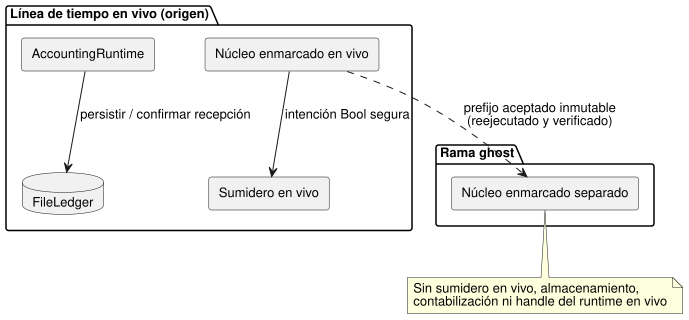

<!-- translation-source: docs/GHOST-TIMELINE.md -->
[Original en inglés](GHOST-TIMELINE.md)

# Línea de tiempo en vivo acotada y rebobinado ghost

`createGhostTimeline` en `runtimes/node/ghost-timeline.mjs` implementa el
límite de no interferencia de la Referencia §6.8 y REF-06-018. En términos
sencillos: se puede crear una rama con una copia "ghost" (ejecución fantasma) a
partir de una línea de tiempo en vivo, probar entradas diferentes y rebobinarla,
sin que la copia ghost afecte nunca a la ejecución en vivo.

Es un host de referencia de escritorio que usa los responsables reales en Rust
de decisiones, ocurrencias y contabilización. No opera hardware y no establece
la autenticidad de los recibos del renderizador.

**Perfil admitido.** El perfil seleccionado es un control GFB11 canónico
independiente `.ghost.md` con:

- programaciones Periodic;
- ajustes existentes opcionales; y
- una cuenta `on_time` aplicada/duradera en la misma fuente.

Las observaciones de entrada con calidad tipada explícita usan el productor y el
contrato de acondicionamiento existentes de ControlRuntime.

**Excluido.**

- Contextos externos, señales, controladores, objetivos y adaptadores
  posteriores a eventos.
- Las restricciones de presupuesto de contabilización y las vinculaciones de
  conteo de eventos. Se rechazan antes de crear cualquier responsable o
  almacenamiento: este perfil observa el uso aplicado sin conectar la
  contabilización con la aplicación de las decisiones.
- No amplía el perfil de control simple de `prepareWhatIfReplay`.
- Range y otros perfiles de programación, el reemplazo de la fuente, la
  autoridad de instalación, la publicación de identidades, el reinicio físico y
  la predicción ambiental siguen siendo trabajos separados.

El diagrama muestra el límite de no interferencia: solo la línea de tiempo en
vivo está conectada al sumidero (sink), al responsable de la contabilización y
al libro mayor de archivo.

**Entradas de la fábrica.** El llamador aporta:

- el nombre de archivo de la fuente compilada y los bytes WASM;
- identidades explícitas de línea de tiempo, instancia, ejecución, revisión de
  la fuente y revisión de la vinculación;
- la activación del contexto;
- el nombre de la cuenta, un ID de recurso estable y una configuración de
  contabilización acotada;
- un `FileLedger` real;
- una salida Bool con nombre; y
- un sumidero en vivo síncrono.

La compilación ocurre dentro de la fábrica. Tanto el responsable de las
decisiones como el responsable de la contabilización deben coincidir con los
mismos hashes de fuente y de artefacto. El mapeo de salida a recurso del
llamador es una vinculación de referencia explícita, no un emisor de
identidades de instalación.

**Almacenamiento.** El almacenamiento faltante se rechaza a menos que
`initializeEmpty: true` autorice explícitamente la inicialización de un libro
mayor vacío. Los bytes de archivo existentes restauran el responsable real de la
contabilización. **No** restauran la línea de tiempo de decisiones, los
temporizadores activos ni la identidad de la ejecución. Siguen aplicándose los
límites documentados de FileLedger en cuanto a durabilidad de escritorio y
escritor único.

**`append(frame)`** acepta `nowMs`, `inputs` escalares declaradas, `samples` de
calidad explícita opcionales y `contextFacts` completos. Hace lo siguiente:

1. ejecuta el núcleo enmarcado en vivo;
2. registra el punto de control (checkpoint) completo de resultado/contexto; y
   luego
3. envía la intención Bool segura seleccionada a través del sumidero en vivo
   conectado.

Si el sumidero falla, el registro de la decisión aceptada se conserva y se
bloquea cualquier despacho en vivo posterior a través de ese responsable. Un
fallo del sumidero no deshace el tick y no crea evidencia de aplicación. El
sumidero debe ser síncrono. La aplicación física y la confirmación son
observaciones separadas.

**Muestras.** Las tramas pueden registrar `samples` por nombre de entrada
declarada, cada una con `epoch`, `id`, `timestampMs`, `quality` y un `value`
tipado.

- El productor aporta la calidad. Los valores `false` y `0` saludables siguen
  siendo observaciones Good.
- Omitir una muestra solo hace avanzar el tiempo. El contrato de entradas
  existente conserva o envejece la evidencia anterior, o permanece en NotReady
  antes de la primera observación. El host nunca crea una observación Good nueva
  ni un diagnóstico de fallo físico.
- Las ramas Result escritas en la fuente deciden cómo afectan las entradas no
  disponibles a la intención.
- Los registros de muestras se copian antes de la ejecución, cuentan para los
  presupuestos de tramas y para los hashes de identidad de la rama, y deben
  coincidir exactamente en la reproducción grabada.
- Las ramas sintéticas pueden aportar muestras explícitas diferentes sin llegar
  al sumidero en vivo, al almacenamiento ni al responsable de la contabilización.

**Métodos de contabilización.**

| Método | Qué hace |
| --- | --- |
| `recordApplied(segment)` | Acepta intervalos de aplicación del renderizador que el llamador ha validado explícitamente, los pasa por el AccountingRuntime vinculado a la fuente y persiste/confirma la recepción de su instantánea real. Las solicitudes, la intención segura y el tiempo de la UI nunca fabrican estos intervalos. |
| `persistPending()` | Reintenta la persistencia pendiente. Las lecturas sin acuse de recibo mantienen el comportamiento Unknown del responsable de la contabilización. |
| `usedRolling(nowMs, windowMs)` | Consulta el recurso vinculado. |
| `observe()` | Devuelve copias de los recibos de la línea de tiempo, el punto de control de contexto actual, los bytes/revisión reales de la contabilización en memoria, los últimos bytes con acuse de recibo y los recibos de persistencia. |

El nuevo `snapshot()` de AccountingRuntime captura los bytes y la revisión sin
persistirlos ni confirmar su recepción.

**`branch({branchId, runId, at})`** captura un prefijo aceptado de la línea de
tiempo real.

- Ambas identidades de la rama deben diferir del origen.
- Un núcleo enmarcado separado reejecuta ese prefijo inmutable y verifica cada
  recibo de la línea base.
- La rama no recibe el sumidero en vivo ni el handle de almacenamiento, de
  contabilización o del runtime en vivo.
- Su `step(frame, {provenance})` requiere tramas explícitas completas. Una trama
  `recorded` debe coincidir con el futuro real capturado en ese desplazamiento;
  las tramas diferentes o nuevas deben etiquetarse como `synthetic`. Ninguna
  entrada faltante se predice ni toma un valor predeterminado.

**`rewind()`** recrea solo el núcleo de la rama, verifica su prefijo original y
luego borra las tramas futuras de la rama. Reconstruir a partir del prefijo
completo preserva la semántica de temporizadores y de acondicionamiento, en
lugar de fingir que un punto de control de contexto duradero contiene
temporizadores activos.

Seguridad y límites:

- Un paso o un rebobinado fallido deja sin cambios la rama consolidada
  previamente.
- Las copias devueltas y las mutaciones posteriores del llamador no pueden
  alterar los registros.
- Los responsables rechazan las operaciones concurrentes y deben liberarse
  después de usarlos.
- Cada línea de tiempo o rama tiene como máximo 256 tramas y un presupuesto de
  registro de entradas canónico de 1 MiB.

**Evidencia.** `tests/ghost-timeline-noninterference.test.mjs` demuestra
primero el despacho real al sumidero en vivo, una ocurrencia Periodic real y el
uso aplicado con acuse de recibo. Luego:

- La ejecución ghost cambia la intención, mientras que la ejecución y el
  rebobinado repetido preservan la línea de tiempo completa original, la
  identidad del punto de control de contexto/ocurrencia, la instantánea/revisión
  real de la contabilización, los recibos de persistencia, los bytes del archivo
  y el historial del sumidero.
- Después, la ejecución en vivo original continúa sin admisión duplicada y con
  una nueva ocurrencia siguiente.
- Los recibos de la cinta nativa `context-settings-periodic-v1` coinciden
  totalmente con el WASM enmarcado; el perfil separado preserva las
  restricciones existentes de la cinta de ajustes.

Estos son resultados del host de referencia de software y del núcleo portable,
no una prueba de actuación física.
