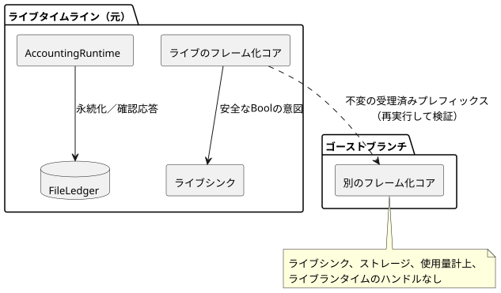

<!-- translation-source: docs/GHOST-TIMELINE.md -->
[英語の原文](GHOST-TIMELINE.md)

# 上限付きのライブタイムラインとゴーストの巻き戻し

`runtimes/node/ghost-timeline.mjs`の`createGhostTimeline`は、リファレンス§6.8とREF-06-018の非干渉境界を実装します。平たく言えば、ライブタイムラインから「ゴースト」のコピーをブランチし、異なる入力を試し、巻き戻すことができ、その間ゴーストがライブの実行に影響を与えることは決してありません。

これは、実際のRustの判断、発生、使用量計上の所有者を使うデスクトップ用のリファレンスホストです。ハードウェアを操作することはなく、レンダラーの受領記録の真正性を立証するものでもありません。

**サポートされるプロファイル。** 選択されたプロファイルは、次のものを持つ単独の正準`.ghost.md` GFB11コントロールです。

- Periodicスケジュール
- 省略可能な既存の設定
- 同じソース内の、適用済み（applied）かつ永続的な`on_time`アカウント

明示的に型付けされた品質付きの入力観測は、既存のControlRuntimeの生成側とコンディショニングの契約を使います。

**除外されるもの。**

- 外部コンテキスト、信号、コントローラ、目標、after-eventアダプタ。
- 使用量計上の予算制約とイベント数のバインディング。これらは、所有者やストレージが作られる前に拒否されます。このプロファイルは、使用量計上を判断の強制に接続することなく、適用済みの使用量を観測します。
- `prepareWhatIfReplay`のプレーンなコントロールのプロファイルを拡張するものではありません。
- Rangeやその他のスケジュールのプロファイル、ソースの置き換え、設置の権限、識別子の公開、物理的な再起動、環境の予測は、引き続き別の作業です。

この図は非干渉境界を示しています。シンク、使用量計上の所有者、ファイル台帳に接続されているのはライブタイムラインだけです。

**ファクトリの入力。** 呼び出し側は次のものを渡します。

- コンパイル済みソースのファイル名とWASMのバイト列
- タイムライン、インスタンス、実行（run）、ソースのリビジョン、バインディングのリビジョンの明示的な同一性
- コンテキストのアクティベーション
- アカウント名、安定したリソースID、上限付きの使用量計上の設定
- 実際の`FileLedger`
- 名前付きのBool出力
- 同期的なライブシンク

コンパイルはファクトリの内部で行われます。判断の所有者と使用量計上の所有者は、どちらも同じソースと成果物のハッシュに一致しなければなりません。呼び出し側による出力からリソースへの対応付けは、明示的な参照のバインディングであり、設置の同一性を発行するものではありません。

**ストレージ。** ストレージがない場合は、`initializeEmpty: true`が空の台帳の初期化を明示的に許可しない限り拒否されます。既存のファイルのバイト列は、実際の使用量計上の所有者を復元します。判断のタイムライン、動作中のタイマー、実行の同一性は復元**しません**。FileLedgerについて文書化されたデスクトップでの永続性と単一書き込み者の制限は、引き続き適用されます。

**`append(frame)`** は、`nowMs`、宣言されたスカラーの`inputs`、省略可能な明示的な品質付きの`samples`、完全な`contextFacts`を受け付けます。これは次のことを行います。

1. ライブのフレーム化コアを実行します。
2. 結果とコンテキストの完全なチェックポイントを記録します。その後、
3. 選択された安全なBoolの意図を、接続されたライブシンクに送ります。

シンクが失敗した場合、受理済みの判断のレコードは保持され、その所有者を通じたそれ以降のライブのディスパッチはブロックされます。シンクの失敗によってtickが取り消されることはなく、適用済みの証拠が作られることもありません。シンクは同期的でなければなりません。物理的な適用と確認は別の観測です。

**サンプル。** フレームは、宣言された入力名ごとに`samples`を記録できます。各サンプルは`epoch`、`id`、`timestampMs`、`quality`、型付きの`value`を持ちます。

- 品質は生成側が渡します。正常な`false`や`0`も、Goodの観測です。
- サンプルを省略すると、時間が進むだけです。既存の入力契約に従って、前の証拠が保持されるか経過時間が進むか、最初の観測の前であればNotReadyのままになります。ホストが新しいGoodの観測や物理的な故障の診断を作り出すことは決してありません。
- 利用できない入力が意図にどう影響するかは、ソースに記述されたResultの分岐が決めます。
- サンプルのレコードは実行前にコピーされ、フレームの予算とブランチの同一性のハッシュに算入され、記録済みのリプレイでは厳密に一致しなければなりません。
- 合成ブランチは、ライブシンク、ストレージ、使用量計上の所有者に届くことなく、異なる明示的なサンプルを渡せます。

**使用量計上のメソッド。**

| メソッド | 動作 |
| --- | --- |
| `recordApplied(segment)` | 呼び出し側が明示的に検証したレンダラーの適用区間を受け付け、ソースに結び付いたAccountingRuntimeに渡し、その実際のスナップショットを永続化・確認応答する。要求、安全意図、UIの時刻がこれらの区間を作り出すことは決してない。 |
| `persistPending()` | 保留中の永続化を再試行する。確認応答されていない読み取りは、使用量計上の所有者のUnknownの振る舞いを維持する。 |
| `usedRolling(nowMs, windowMs)` | 結び付けられたリソースを照会する。 |
| `observe()` | タイムラインの受領記録のコピー、現在のコンテキストのチェックポイント、実際のメモリ上の使用量計上のバイト列／リビジョン、最後に確認応答されたバイト列、永続化の受領記録を返す。 |

AccountingRuntimeの新しい`snapshot()`は、永続化や確認応答をせずに、バイト列とリビジョンを取り込みます。

**`branch({branchId, runId, at})`** は、実際のタイムラインの受理済みプレフィックスを取り込みます。

- 両方のブランチの同一性は、元のものと異ならなければなりません。
- 別のフレーム化コアがその不変のプレフィックスを再実行し、ベースラインのすべての受領記録を検証します。
- ブランチは、ライブシンクも、ストレージ、使用量計上、ライブランタイムのハンドルも受け取りません。
- その`step(frame, {provenance})`には、完全な明示的フレームが必要です。`recorded`フレームは、そのオフセットで取り込まれた実際の未来と一致しなければなりません。異なるフレームや新しいフレームには`synthetic`のラベルを付けなければなりません。欠けている入力が予測されたり既定値で埋められたりすることはありません。

**`rewind()`** は、ブランチのコアだけを作り直し、元のプレフィックスを検証してから、ブランチの未来のフレームをクリアします。完全なプレフィックスから再構築することで、永続的なコンテキストのチェックポイントに動作中のタイマーが含まれているかのように装うのではなく、タイマーとコンディショニングのセマンティクスを保ちます。

安全性と制限：

- stepや巻き戻しが失敗しても、以前に確定したブランチは変わりません。
- 返されたコピーや、その後の呼び出し側による変更がレコードを変えることはありません。
- 所有者は並行操作を拒否し、使用後は破棄しなければなりません。
- 各タイムラインまたはブランチは、最大256フレームと、1 MiBの正準入力レコード予算を持ちます。

**証拠。** `tests/ghost-timeline-noninterference.test.mjs`は、まず実際のライブシンクへのディスパッチ、実際のPeriodicの発生、確認応答された適用済みの使用量を証明します。その後、次のことを示します。

- ゴーストの実行は意図を変えますが、その実行と繰り返しの巻き戻しは、元の完全なタイムライン、コンテキストのチェックポイント／発生の同一性、実際の使用量計上のスナップショット／リビジョン、永続化の受領記録、ファイルのバイト列、シンクの履歴を保ちます。
- その後、元のライブ実行は、重複した受け入れなしに、新しい次の発生とともに続行します。
- ネイティブの`context-settings-periodic-v1`テープの受領記録は、フレーム化WASMと完全に一致します。別のプロファイルは、既存の設定テープの制限を保ちます。

これらはソフトウェアのリファレンスホストとポータブルコアの結果であり、物理的な作動の証明ではありません。
