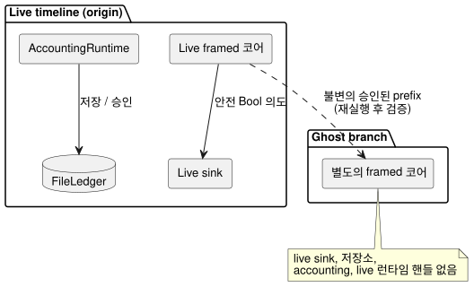

<!-- translation-source: docs/GHOST-TIMELINE.md -->
[영문 원문](GHOST-TIMELINE.md)

# 제한된 live timeline과 ghost 되감기

`runtimes/node/ghost-timeline.mjs`의 `createGhostTimeline`은 Reference §6.8과
REF-06-018의 비간섭 경계를 구현합니다. 쉽게 말해, live timeline에서 "ghost"(고스트 실행)
사본을 branch(분기)로 떼어 내어 다른 입력을 시험하고 되감을 수 있으며, 그 ghost가 live 실행에
영향을 주는 일은 절대 없습니다.

이것은 실제 Rust 판단, 발생(occurrence), accounting(사용량 집계) 소유자를 사용하는 데스크톱
reference host입니다. 하드웨어를 조작하지 않으며, 렌더러 receipt의 진위를 입증하지도 않습니다.

**지원 프로필.** 선택된 프로필은 다음을 갖춘 독립적인 정본 `.ghost.md` GFB11 `control`입니다.

- Periodic 예약
- 선택적인 기존 설정
- 같은 소스 안의 applied/durable `on_time` account

명시적으로 타입이 지정된 품질 입력 관측은 기존 ControlRuntime의 producer 및 conditioning
계약을 사용합니다.

**제외 대상.**

- 외부 context, 신호, 컨트롤러, objective, after-event 어댑터.
- accounting 예산 제약과 event-count 바인딩. 이들은 소유자나 저장소를 만들기 전에 거부됩니다.
  이 프로필은 accounting을 판단 강제에 연결하지 않고 applied 사용량만 관측하기 때문입니다.
- `prepareWhatIfReplay`의 plain-control 프로필을 확장하지 않습니다.
- Range와 그 밖의 예약 프로필, 소스 교체, 설치 권한, 게시 identity, 물리적 재시작, 환경
  예측은 별도 작업으로 남습니다.

다이어그램은 비간섭 경계를 보여 줍니다. sink, accounting 소유자, 파일 ledger(원장)에는 live
timeline만 연결됩니다.

**factory 입력.** 호출자는 다음을 제공합니다.

- 컴파일된 소스 파일 이름과 WASM 바이트
- 명시적인 timeline, instance, run, source-revision, binding-revision identity
- context 활성화
- account 이름, 안정적인 resource ID, 제한된 accounting 설정
- 실제 `FileLedger`
- 이름이 지정된 Bool 출력
- 동기식 live sink

컴파일은 factory 안에서 일어납니다. 판단 소유자와 accounting 소유자는 모두 같은 소스 및
결과물 해시와 일치해야 합니다. 호출자의 출력→resource 매핑은 명시적인 reference 바인딩일 뿐,
설치 identity 발급자가 아닙니다.

**저장소.** `initializeEmpty: true`로 빈 ledger 초기화를 명시적으로 허가하지 않는 한, 저장소가
없으면 거부됩니다. 기존 파일 바이트는 실제 accounting 소유자를 복원합니다. 그러나 판단
timeline, 실행 중인 타이머, run identity는 복원하지 **않습니다**. FileLedger에 문서화된
데스크톱 내구성 및 단일 writer 제한은 그대로 적용됩니다.

**`append(frame)`**은 `nowMs`, 선언된 스칼라 `inputs`, 선택적인 명시적 품질 `samples`, 완전한
`contextFacts`를 받습니다. 그리고 다음을 수행합니다.

1. live framed 코어를 실행합니다.
2. 전체 결과/context checkpoint를 기록합니다.
3. 그다음 선택된 안전 Bool 의도를 연결된 live sink로 보냅니다.

sink가 실패하면 이미 승인된 판단 기록은 유지되고, 그 소유자를 통한 이후 live dispatch는
차단됩니다. sink 실패는 tick을 취소하지 않으며 applied 증거를 만들지도 않습니다. sink는
반드시 동기식이어야 합니다. 물리적 적용과 확인은 별도의 관측입니다.

**샘플.** 프레임은 선언된 입력 이름별로 `samples`를 기록할 수 있으며, 각 샘플에는 `epoch`,
`id`, `timestampMs`, `quality`, 타입이 맞는 `value`가 있습니다.

- 품질은 producer가 제공합니다. 정상적인 `false`와 `0`도 여전히 Good 관측입니다.
- 샘플을 생략하면 시간만 진행합니다. 기존 입력 계약에 따라 이전 증거가 유지되거나 오래되며,
  첫 관측 전이라면 NotReady로 남습니다. 호스트는 새 Good 관측이나 물리 fault 진단을 절대
  만들지 않습니다.
- 입력을 사용할 수 없을 때 의도가 어떻게 되는지는 소스에 작성된 Result 분기가 결정합니다.
- 샘플 레코드는 실행 전에 복사되고, 프레임 예산과 branch identity 해시에 포함되며, 기록된
  재생에서는 정확히 일치해야 합니다.
- synthetic branch는 live sink, 저장소, accounting 소유자에 닿지 않고 다른 명시적 샘플을
  제공할 수 있습니다.

**accounting 메서드.**

| 메서드 | 하는 일 |
| --- | --- |
| `recordApplied(segment)` | 호출자가 명시적으로 검증한 렌더러 적용 구간을 받아, 소스에 묶인 AccountingRuntime에 전달하고, 그 실제 snapshot을 저장/승인합니다. 요청, 안전 의도, UI 시간으로 이런 구간을 만들어 내는 일은 절대 없습니다. |
| `persistPending()` | 보류 중인 저장을 다시 시도합니다. 승인되지 않은 읽기는 accounting 소유자의 Unknown 동작을 유지합니다. |
| `usedRolling(nowMs, windowMs)` | 바인딩된 resource를 조회합니다. |
| `observe()` | 복사된 timeline receipt, 현재 context checkpoint, 실제 메모리 내 accounting 바이트/revision, 마지막으로 승인된 바이트, 저장 receipt를 반환합니다. |

AccountingRuntime의 새 `snapshot()`은 바이트와 revision을 저장하거나 승인하지 않고 캡처만 합니다.

**`branch({branchId, runId, at})`**는 실제 timeline의 승인된 prefix를 캡처합니다.

- branch의 두 identity는 모두 origin과 달라야 합니다.
- 별도의 framed 코어가 그 불변 prefix를 재실행하고 모든 baseline receipt를 검증합니다.
- branch는 live sink도, 저장소·accounting·live 런타임 핸들도 받지 않습니다.
- branch의 `step(frame, {provenance})`는 완전하고 명시적인 프레임을 요구합니다. `recorded`
  프레임은 그 offset에서 캡처된 실제 미래와 일치해야 하며, 다르거나 새로운 프레임은
  `synthetic`으로 표시해야 합니다. 누락된 입력을 예측하거나 기본값으로 채우지 않습니다.

**`rewind()`**는 branch 코어만 다시 만들고, 원래 prefix를 검증한 다음, branch의 미래 프레임을
지웁니다. 전체 prefix로부터 다시 구성하므로, 영속 context checkpoint에 실행 중인 타이머가
들어 있다고 가장하지 않고도 타이머와 conditioning 의미가 보존됩니다.

안전성과 한계:

- 실패한 step이나 rewind는 이전에 확정된 branch를 바꾸지 않습니다.
- 반환된 사본이나 이후 호출자의 변경은 레코드를 바꿀 수 없습니다.
- 소유자는 동시 작업을 거부하며, 사용 후 반드시 dispose해야 합니다.
- 각 timeline 또는 branch는 최대 256개 프레임과 1 MiB의 정규 입력 레코드 예산을 가집니다.

**증거.** `tests/ghost-timeline-noninterference.test.mjs`는 먼저 실제 live sink dispatch,
실제 Periodic 발생, 승인된 applied 사용량을 증명합니다. 그다음 다음을 확인합니다.

- ghost 실행이 의도를 바꾸더라도, 실행과 반복된 rewind는 원래의 전체 timeline, context
  checkpoint/발생 identity, 실제 accounting snapshot/revision, 저장 receipt, 파일 바이트, sink
  이력을 보존합니다.
- 이후 원래 live 실행은 중복 admission(수용) 없이 이어지고 새로운 다음 발생을 맞습니다.
- 네이티브 `context-settings-periodic-v1` tape receipt는 framed WASM과 완전히 일치합니다. 별도
  프로필이므로 기존 settings tape 제한은 그대로 유지됩니다.

이것들은 소프트웨어 reference host와 이식 가능한 코어의 결과이며, 물리적 작동의 증명은
아닙니다.
