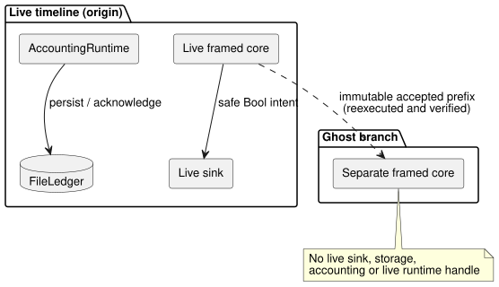

# Bounded live timeline and ghost rewind

`createGhostTimeline` in `runtimes/node/ghost-timeline.mjs` implements the
noninterference boundary of Reference §6.8 and REF-06-018. In plain terms: you
can branch a "ghost" copy from a live timeline, try different inputs, and
rewind it, without the ghost ever affecting the live run.

It is a desktop reference host that uses the actual Rust decision, occurrence
and accounting owners. It does not operate hardware, and it does not establish
the authenticity of renderer receipts.

**Supported profile.** The selected profile is a standalone canonical
`.ghost.md` GFB10 control with:

- Periodic schedules;
- optional existing settings; and
- an applied/durable `on_time` account in the same source.

Explicit typed-quality input observations use the existing ControlRuntime
producer and conditioning contract.

**Excluded.**

- External contexts, signals, controllers, objectives and after-event adapters.
- Accounting budget constraints and event-count bindings. These are rejected
  before any owner or storage is created: this profile observes applied usage
  without connecting accounting to decision enforcement.
- It does not extend the plain-control profile of `prepareWhatIfReplay`.
- Range and other schedule profiles, source replacement, installation
  authority, publishing identities, physical restart and environmental
  prediction remain separate work.

The diagram shows the noninterference boundary: only the live timeline is
connected to the sink, the accounting owner and the file ledger.

**Factory inputs.** The caller supplies:

- the compiled-source filename and WASM bytes;
- explicit timeline, instance, run, source-revision and binding-revision
  identities;
- context activation;
- the account name, a stable resource ID and a bounded accounting config;
- an actual `FileLedger`;
- a named Bool output; and
- a synchronous live sink.

Compilation happens inside the factory. Both the decision owner and the
accounting owner must match the same source and artifact hashes. The caller's
output-to-resource mapping is an explicit reference binding, not an installation
identity issuer.

**Storage.** Missing storage is rejected unless `initializeEmpty: true`
explicitly authorizes empty ledger initialization. Existing file bytes restore
the actual accounting owner. They do **not** restore the decision timeline,
active timers or the run identity. FileLedger's documented desktop durability
and single-writer limits still apply.

**`append(frame)`** accepts `nowMs`, declared scalar `inputs`, optional explicit
quality `samples` and complete `contextFacts`. It:

1. executes the live framed core;
2. records the full outcome/context checkpoint; then
3. sends the selected safe Bool intent through the connected live sink.

If the sink fails, the accepted decision record is kept and further live
dispatch through that owner is blocked. A sink failure does not undo the tick
and does not create applied evidence. The sink must be synchronous. Physical
application and confirmation are separate observations.

**Samples.** Frames may record `samples` by declared input name, each with
`epoch`, `id`, `timestampMs`, `quality` and a typed `value`.

- The producer supplies quality. Healthy `false` and `0` are still Good
  observations.
- Omitting a sample advances time only. The existing input contract keeps or
  ages the previous evidence, or stays NotReady before the first observation.
  The host never creates a fresh Good observation or a physical fault diagnosis.
- Source-authored Result branches decide how unavailable inputs affect intent.
- Sample records are copied before execution, count toward frame budgets and
  branch identity hashes, and must match exactly for recorded replay.
- Synthetic branches can supply different explicit samples without reaching the
  live sink, storage or accounting owner.

**Accounting methods.**

| Method | What it does |
| --- | --- |
| `recordApplied(segment)` | Accepts renderer application intervals that the caller has explicitly validated, passes them through the source-bound AccountingRuntime, and persists/acknowledges its real snapshot. Requests, safe intent and UI time never manufacture these intervals. |
| `persistPending()` | Retries pending persistence. Unacknowledged reads keep the accounting owner's Unknown behavior. |
| `usedRolling(nowMs, windowMs)` | Queries the bound resource. |
| `observe()` | Returns copied timeline receipts, the current context checkpoint, the actual in-memory accounting bytes/revision, the last acknowledged bytes and persistence receipts. |

AccountingRuntime's new `snapshot()` captures bytes and revision without
persisting or acknowledging them.

**`branch({branchId, runId, at})`** captures an accepted prefix of the real
timeline.

- Both branch identities must differ from the origin.
- A separate framed core reexecutes that immutable prefix and verifies every
  baseline receipt.
- The branch receives neither the live sink nor the storage, accounting or live
  runtime handle.
- Its `step(frame, {provenance})` requires complete explicit frames. A
  `recorded` frame must match the captured actual future at that offset;
  differing or new frames must be labelled `synthetic`. No missing input is
  predicted or defaulted.

**`rewind()`** recreates only the branch core, verifies its original prefix,
and then clears the branch's future frames. Rebuilding from the full prefix
preserves timer and conditioning semantics, instead of pretending that a durable
context checkpoint contains active timers.

Safety and limits:

- A failed step or rewind leaves the previously committed branch unchanged.
- Returned copies and later caller mutation cannot alter records.
- Owners reject concurrent operations and must be disposed after use.
- Each timeline or branch has at most 256 frames and a 1 MiB canonical
  input-record budget.

**Evidence.** `tests/ghost-timeline-noninterference.test.mjs` first proves
actual live sink dispatch, a real Periodic occurrence and acknowledged applied
usage. Then:

- Ghost execution changes intent, while execution and repeated rewind preserve
  the original full timeline, the context checkpoint/occurrence identity, the
  actual accounting snapshot/revision, persistence receipts, file bytes and
  sink history.
- Original live execution then continues with no duplicate admission and a new
  next occurrence.
- Native `context-settings-periodic-v1` tape receipts match framed WASM in full;
  the separate profile preserves existing settings tape restrictions.

These are software reference-host and portable-core results, not physical
actuation proof.
