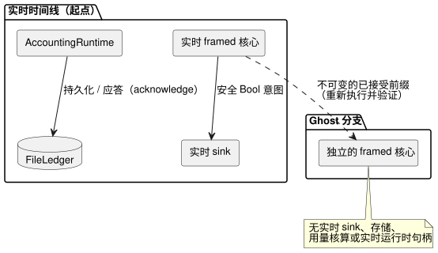

<!-- translation-source: docs/GHOST-TIMELINE.md -->
[英文原文](GHOST-TIMELINE.md)

# 有界实时时间线与 ghost 倒带

`runtimes/node/ghost-timeline.mjs` 中的 `createGhostTimeline` 实现了参考手册 §6.8 和 REF-06-018 的互不干扰边界。通俗地说：你可以从实时时间线分出一个“ghost”（影子运行）副本，尝试不同的输入并将其倒带，而 ghost 永远不会影响实时运行。

它是一个桌面参考宿主，使用真实的 Rust 判定、触发实例（occurrence）和用量核算的所有者。它不操作硬件，也不确立渲染器回执的真实性。

**支持的 profile。** 所选 profile 是一个独立的规范 `.ghost.md` GFB11 `control`，具有：

- Periodic 调度计划；
- 可选的现有设置；以及
- 同一源文件中的 applied/持久 `on_time` 账户。

显式的带类型质量输入观测使用现有的 ControlRuntime 生产方和调理契约。

**不包括的内容。**

- 外部上下文、信号、控制器、目标和事后事件（after-event）适配器。
- 用量核算的预算约束和事件计数绑定。这些会在创建任何所有者或存储之前被拒绝：本 profile 只观测已应用的用量，而不把用量核算接入判定的执行。
- 它不扩展 `prepareWhatIfReplay` 的纯 control profile。
- Range 及其他调度计划 profile、源替换、安装权限、发布身份标识、物理重启和环境预测仍属于其他工作。

该图展示了互不干扰边界：只有实时时间线连接到 sink、用量核算所有者和文件账本。

**工厂输入。** 调用方提供：

- 编译源的文件名和 WASM 字节；
- 显式的时间线、实例、运行、源修订版和绑定修订版身份标识；
- 上下文激活；
- 账户名、稳定的资源 ID 和有界的用量核算配置；
- 一个真实的 `FileLedger`；
- 一个具名的 Bool 输出；以及
- 一个同步的实时 sink。

编译在工厂内部进行。判定所有者和用量核算所有者都必须与同一个源哈希和产物哈希匹配。调用方提供的输出到资源的映射是显式的参考绑定，而不是安装身份标识的签发方。

**存储。** 缺失的存储会被拒绝，除非 `initializeEmpty: true` 显式授权初始化空账本。已有的文件字节会恢复真实的用量核算所有者。它们**不会**恢复判定时间线、活动中的定时器或运行身份标识。FileLedger 文档中说明的桌面持久性和单写入者限制仍然适用。

**`append(frame)`** 接受 `nowMs`、已声明的标量 `inputs`、可选的显式质量 `samples` 以及完整的 `contextFacts`。它：

1. 执行实时 framed 核心；
2. 记录完整的结果/上下文检查点；然后
3. 通过已连接的实时 sink 发送所选的安全 Bool 意图。

如果 sink 失败，已接受的判定记录会被保留，并阻止之后通过该所有者进行的实时分派。sink 失败不会撤销该 tick，也不会产生已应用（applied）的证据。sink 必须是同步的。物理应用和确认是独立的观测。

**样本。** 帧可以按已声明的输入名记录 `samples`，每个样本带有 `epoch`、`id`、`timestampMs`、`quality` 和带类型的 `value`。

- 质量由生产方提供。健康的 `false` 和 `0` 仍然是 Good 观测。
- 省略样本只会推进时间。现有的输入契约会保持或老化之前的证据，或者在第一次观测之前保持 NotReady。宿主绝不会创建新的 Good 观测或物理故障诊断。
- 不可用的输入如何影响意图，由源代码中编写的 Result 分支决定。
- 样本记录在执行前被复制，计入帧预算和分支身份标识哈希，并且在记录重放时必须完全匹配。
- 合成（synthetic）分支可以提供不同的显式样本，而不会触及实时 sink、存储或用量核算所有者。

**用量核算方法。**

| 方法 | 作用 |
| --- | --- |
| `recordApplied(segment)` | 接受调用方已显式校验的渲染器应用区间，将其传入绑定到源的 AccountingRuntime，并对其真实快照进行持久化/应答。请求、安全意图和 UI 时间绝不会制造这些区间。 |
| `persistPending()` | 重试待处理的持久化。未应答的读取保持用量核算所有者的 Unknown 行为。 |
| `usedRolling(nowMs, windowMs)` | 查询已绑定的资源。 |
| `observe()` | 返回复制的时间线回执、当前上下文检查点、实际内存中的用量核算字节/修订版、最后一次已应答的字节以及持久化回执。 |

AccountingRuntime 新增的 `snapshot()` 捕获字节和修订版，但不进行持久化或应答。

**`branch({branchId, runId, at})`** 捕获真实时间线的一个已接受前缀。

- 两个分支身份标识都必须与起点不同。
- 一个独立的 framed 核心重新执行该不可变前缀，并验证每一个基线回执。
- 分支既不会得到实时 sink，也不会得到存储、用量核算或实时运行时句柄。
- 其 `step(frame, {provenance})` 要求完整的显式帧。`recorded` 帧必须与该偏移处捕获的实际未来帧匹配；不同的帧或新帧必须标记为 `synthetic`。缺失的输入不会被预测或使用默认值。

**`rewind()`** 只重建分支核心，验证其原始前缀，然后清除分支的未来帧。从完整前缀重建可以保留定时器和调理语义，而不是假装持久的上下文检查点中包含活动的定时器。

安全性与限制：

- 失败的 step 或倒带会使之前已提交的分支保持不变。
- 返回的副本以及调用方之后的修改都不能改变记录。
- 所有者会拒绝并发操作，并且使用后必须释放（dispose）。
- 每条时间线或分支最多 256 帧，规范输入记录预算为 1 MiB。

**证据。** `tests/ghost-timeline-noninterference.test.mjs` 首先证明实际的实时 sink 分派、一个真实的 Periodic 触发实例以及已应答的已应用用量。然后：

- ghost 执行会改变意图，而执行和重复倒带都会保留原始的完整时间线、上下文检查点/触发实例身份标识、实际的用量核算快照/修订版、持久化回执、文件字节和 sink 历史。
- 之后原始的实时执行继续进行，没有重复准入，并产生新的下一个触发实例。
- 原生 `context-settings-periodic-v1` tape 回执与 framed WASM 完全匹配；独立的 profile 保留现有设置 tape 的限制。

这些是软件参考宿主和可移植核心的结果，不是物理执行的证明。
