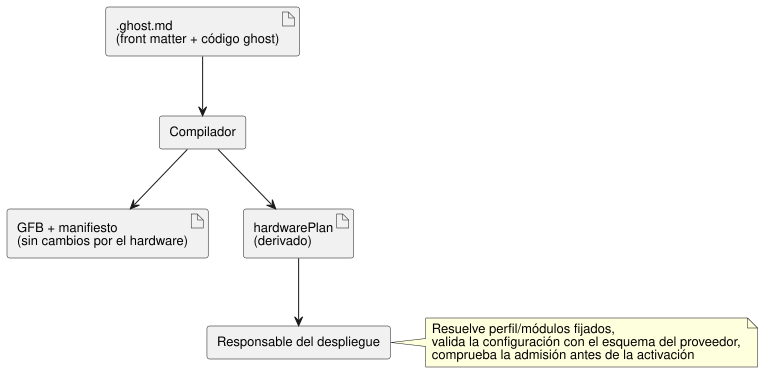

<!-- translation-source: docs/HARDWARE-FRONT-MATTER.md -->
[Original en inglés](HARDWARE-FRONT-MATTER.md)

# Declaraciones de hardware en la fuente canónica

[한국어](HARDWARE-FRONT-MATTER.ko.md) · [Referencia 1.1](reference/01-source-and-syntax.es.md)

> **Estado.** Para una escritura compacta con valores predeterminados
> reutilizables de placa/driver, lea el
> [diseño y propósito de los perfiles](PROFILE-FRONT-MATTER.es.md). La forma
> explícita `hardware` que se describe a continuación se mantiene para la ruta
> actual de empaquetado de Device desplegado mientras se implementan los
> perfiles reales y el adaptador de empaquetado compacto. Esta forma de autoría
> se retirará tras una migración de instalación verificada; el contrato de
> despliegue derivado aún puede contener datos de hardware expandidos.

El campo YAML reservado de nivel superior `hardware` en un documento `.ghost.md`
declara:

- las dependencias de instalación (perfil de placa y módulos de driver); y
- las vinculaciones lógicas de las entradas y salidas del programa con los
  drivers de entrada y los renderizadores de salida.

El documento fuente sigue siendo la referencia autorizada. El compilador
devuelve un `hardwarePlan` derivado. La declaración no ejecuta código y no
cambia los bytes GFB, la ABI del runtime ni el formato de paquete portable.
Trabajo: [#555](https://github.com/callin2/ghostflow-language/issues/555).



Como muestra el diagrama, el plan es una salida lateral para el responsable del
despliegue; el bytecode de control es el mismo con o sin él.

## Declaración

Este ejemplo muestra un medidor JSY como módulo de entrada y un banco de relés
como módulo de salida. Los resúmenes (digests) del ejemplo son marcadores de
posición: el despliegue requiere los resúmenes reales de bytes exactos de
perfil/módulo y revisiones inmutables revisadas.

```yaml
hardware:
  schema: GhostFlow/hardware-v1
  profile:
    id: ess3h32
    revision: r1
    sha256: aaaaaaaaaaaaaaaaaaaaaaaaaaaaaaaaaaaaaaaaaaaaaaaaaaaaaaaaaaaaaaaa
  modules:
    meter:
      id: jsy-mk
      revision: r1
      sha256: bbbbbbbbbbbbbbbbbbbbbbbbbbbbbbbbbbbbbbbbbbbbbbbbbbbbbbbbbbbbbbbb
    relay:
      id: relay-bank
      revision: r1
      sha256: cccccccccccccccccccccccccccccccccccccccccccccccccccccccccccccccc
  buses:
    serial:
      service: modbus-rtu
      config: { port: 1, baud: 9600, parity: none }
  instances:
    power:
      module: meter
      role: input
      config: { bus: serial, address: 1 }
    panel:
      module: relay
      role: output
      config: { channels: [{ pin: 3, inverted: false }] }
  bindings:
    inputs:
      current: { instance: power, channel: current }
    outputs:
      pump: { instance: panel, channel: relay1 }
```

Coloque el YAML entre una línea `---` de apertura y otra de cierre al comienzo
del documento, seguido de Markdown y bloques `ghost` normales. También se acepta
una línea de cierre `...`. Las declaraciones lógicas correspondientes pueden ser:

```ghost
control MeterRequest {
  input current: Number;
  output pump: Bool;
  pump <- (current |> recover(0.0)) > 1.0;
}
```

Aquí la vinculación `inputs.current` conecta la entrada lógica `current` con el
canal `current` de la instancia `power`, y `outputs.pump` conecta la salida
lógica `pump` con `relay1` de la instancia `panel`.

**Reglas de los campos.**

- Los seis campos de hardware son obligatorios.
- `profile` y cada valor de `modules` contienen exactamente `id`, `revision` y
  un `sha256` de 64 caracteres hexadecimales en minúsculas. `latest` se rechaza.
- Patrones de nombres:

| Nombres | Patrón |
| --- | --- |
| Alias de módulos, nombres de buses/instancias, nombres de vinculaciones lógicas | `[A-Za-z_][A-Za-z0-9_.:-]{0,127}` |
| ID de pines, revisiones, cadenas de servicio y de canal | `[A-Za-z0-9][A-Za-z0-9._:/@+-]{0,255}` |

- Se permiten mapas con nombre vacíos.
- Cada bus tiene `service` y `config`. Cada instancia tiene `module`, `role`
  (`input` u `output`) y `config`. Cada vinculación tiene `instance` y
  `channel`.
- Los campos estructurales son cerrados: un campo mal escrito o faltante hace
  fallar la compilación.

**`config` es opaco para el lenguaje.** Es un objeto que contiene datos
arbitrarios anidados compatibles con JSON. El lenguaje no da un tratamiento
especial a JSY, las velocidades en baudios, las direcciones, GPIO ni los tipos de
canal. Antes de la activación, el responsable del despliegue debe:

1. resolver el perfil y los módulos fijados;
2. validar cada configuración usando el esquema aportado por su proveedor;
3. validar la disponibilidad de servicios, las referencias a buses, la identidad
   de los canales y los tipos;
4. comprobar la admisión.

El análisis sintáctico no es una validación del proveedor, una instalación de
módulos ni una verificación física.

**Vinculaciones.** Las vinculaciones hacen referencia a las entradas y salidas
lógicas declaradas en el manifiesto del compilador.

- Fallan: módulos/instancias faltantes, roles de instancia incorrectos, puertos
  lógicos no declarados y vinculaciones duplicadas de instancia/canal dentro de
  cualquiera de los roles.
- Los puertos lógicos sin vincular pueden usar un contexto de host declarado por
  separado; el lenguaje no sintetiza vinculaciones.
- Dos entradas lógicas Number pueden seleccionar drivers diferentes de forma
  independiente.
- La calidad de adquisición de las entradas y la evidencia
  requested/applied/confirmed de las salidas conservan sus contratos existentes.
- La composición de imports ejecutables que tenga `hardware` en la raíz o en un
  documento importado se rechaza hasta que exista la semántica de composición.

## Función auxiliar pública y diagnósticos

`parseHardwareFrontMatter(source, { filename })` de
`tools/hardware-frontmatter.mjs` devuelve:

- `null` cuando el campo reservado está ausente;
- en caso contrario, `{ format: 'GhostFlow/hardware-plan-v1', source: { filename, sha256 },
  hardware, locations }`.

En ese resultado:

- `hardware` es la declaración validada.
- `locations` asigna punteros JSON como
  `/hardware/instances/power/config/address` a
  `{ filename, line, column, endLine, endColumn }` en el documento canónico.
  Las ubicaciones empiezan en uno; los finales son exclusivos.
- El resumen cubre los bytes exactos de la fuente, incluidos la prosa y los
  finales de línea.

`validateHardwareBindings(plan, manifest)` comprueba por separado la pertenencia
de los puertos lógicos. `compileSource` y `compileSourceSync` devuelven
`hardwarePlan` solo cuando existe la declaración.

**Seguridad del YAML.** El parser YAML fijado exige claves únicas. Un front
matter que contiene `hardware` rechaza alias, anclas, etiquetas explícitas,
claves de fusión, claves que no son cadenas, valores no finitos y claves de
objeto sensibles al prototipo, y limita la profundidad de anidamiento y el
número de nodos. Los errores llevan la línea/columna canónica y una envoltura
`GhostFlow/diagnostics-v1` con `GF_HARDWARE` y el resumen de la fuente. Un front
matter sin `hardware` conserva su comportamiento no ejecutable existente.

Por qué: mantener la intención de instalación junto a la fuente de control hace
que la selección de drivers sea revisable y quede vinculada a una revisión, sin
crear otro programa de control editable. El límite genérico del proveedor da
cabida a drivers de medición, interruptores, relés, motores y pantallas sin
incrustar el comportamiento de la placa en el lenguaje.
