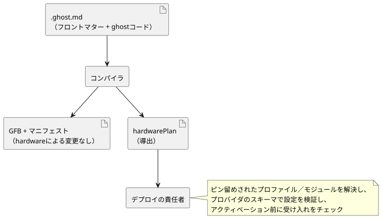

<!-- translation-source: docs/HARDWARE-FRONT-MATTER.md -->
[英語の原文](HARDWARE-FRONT-MATTER.md)

# 正準ソースにおけるハードウェア宣言

[한국어](HARDWARE-FRONT-MATTER.ko.md) · [リファレンス1.1](reference/01-source-and-syntax.ja.md)

> **状況。** 再利用可能なボード／ドライバの既定値を使って簡潔に記述する方法については、[プロファイルの設計と目的](PROFILE-FRONT-MATTER.ja.md)を参照してください。以下の明示的な`hardware`形式は、実際のプロファイルと簡潔なパッケージングアダプタが実装されるまでの間、現在デプロイされているDeviceのパッケージング経路のために維持されています。この記述形式は、検証済みの設置の移行が完了した後に廃止されます。導出されるデプロイ契約には、展開されたハードウェアの事実が引き続き含まれることがあります。

`.ghost.md`文書の予約済みトップレベルYAMLフィールド`hardware`は、次のものを宣言します。

- 設置の依存関係（ボードのプロファイルとドライバモジュール）
- プログラムの入力と出力から、入力ドライバと出力レンダラーへの論理的なバインディング

ソース文書が正本のままです。コンパイラは導出された`hardwarePlan`を返します。この宣言はコードを実行せず、GFBのバイト列、ランタイムABI、ポータブルパッケージのフォーマットも変更しません。作業：[#555](https://github.com/callin2/ghostflow-language/issues/555)。



図に示すように、計画はデプロイの責任者向けの副次的な出力です。制御のバイトコードは、計画の有無にかかわらず同じです。

## 宣言

この例では、JSYメーターを1つの入力モジュールとして、リレーバンクを出力モジュールとして示しています。例のダイジェストはプレースホルダです。デプロイには、実際のバイト単位で厳密なプロファイル／モジュールのダイジェストと、レビュー済みの不変のリビジョンが必要です。

```yaml
hardware:
  schema: GhostFlow/hardware-v1
  profile:
    id: ess3h32
    revision: r1
    sha256: aaaaaaaaaaaaaaaaaaaaaaaaaaaaaaaaaaaaaaaaaaaaaaaaaaaaaaaaaaaaaaaa
  modules:
    meter:
      id: jsy-mk
      revision: r1
      sha256: bbbbbbbbbbbbbbbbbbbbbbbbbbbbbbbbbbbbbbbbbbbbbbbbbbbbbbbbbbbbbbbb
    relay:
      id: relay-bank
      revision: r1
      sha256: cccccccccccccccccccccccccccccccccccccccccccccccccccccccccccccccc
  buses:
    serial:
      service: modbus-rtu
      config: { port: 1, baud: 9600, parity: none }
  instances:
    power:
      module: meter
      role: input
      config: { bus: serial, address: 1 }
    panel:
      module: relay
      role: output
      config: { channels: [{ pin: 3, inverted: false }] }
  bindings:
    inputs:
      current: { instance: power, channel: current }
    outputs:
      pump: { instance: panel, channel: relay1 }
```

このYAMLは、文書の先頭にある開始と終了の`---`行の間に置き、その後にMarkdownと通常の`ghost`フェンスを続けます。終了行として`...`も受け付けます。対応する論理的な宣言は、たとえば次のようになります。

```ghost
control MeterRequest {
  input current: Number;
  output pump: Bool;
  pump <- (current |> recover(0.0)) > 1.0;
}
```

ここで、バインディング`inputs.current`は論理入力`current`をインスタンス`power`の`current`チャネルに接続し、`outputs.pump`は論理出力`pump`をインスタンス`panel`の`relay1`に接続します。

**フィールドのルール。**

- 6つのハードウェアフィールドはすべて必須です。
- `profile`と各`modules`の値には、`id`、`revision`、小文字64桁16進の`sha256`がちょうど含まれます。`latest`は拒否されます。
- 名前のパターン：

| 名前 | パターン |
| --- | --- |
| モジュールの別名、バス／インスタンス名、論理バインディング名 | `[A-Za-z_][A-Za-z0-9_.:-]{0,127}` |
| ピンID、リビジョン、サービスとチャネルの文字列 | `[A-Za-z0-9][A-Za-z0-9._:/@+-]{0,255}` |

- 空の名前付きマップは許可されます。
- すべてのバスは`service`と`config`を持ちます。すべてのインスタンスは`module`、`role`（`input`または`output`）、`config`を持ちます。すべてのバインディングは`instance`と`channel`を持ちます。
- 構造的なフィールドは閉じています。綴りの誤ったフィールドや欠けたフィールドがあるとコンパイルに失敗します。

**`config`は言語にとって不透明です。** これは、任意に入れ子になったJSON互換のデータを含むオブジェクトです。言語は、JSY、ボーレート、アドレス、GPIO、チャネルの種類を特別扱いしません。アクティベーションの前に、デプロイの責任者は次のことをしなければなりません。

1. ピン留めされたプロファイルとモジュールを解決します。
2. プロバイダが提供するスキーマを使って、各設定を検証します。
3. サービスの利用可能性、バスの参照、チャネルの同一性と型を検証します。
4. 受け入れ（アドミッション）をチェックします。

パースは、プロバイダによる検証、モジュールのインストール、物理的な検証のいずれでもありません。

**バインディング。** バインディングは、コンパイラのマニフェストで宣言された論理入力と論理出力を参照します。

- 次のものは失敗します。存在しないモジュール／インスタンス、誤ったインスタンスのロール、宣言されていない論理ポート、いずれかのロール内でのインスタンス／チャネルのバインディングの重複。
- バインドされていない論理ポートは、別途宣言されたホストのコンテキストを使ってもかまいません。言語がバインディングを合成することはありません。
- 2つの論理Number入力は、それぞれ独立に異なるドライバを選択できます。
- 入力の取得品質と、出力のrequested／applied／confirmedの証拠は、既存の契約を維持します。
- ルートまたはインポートされた文書に`hardware`を持つ実行可能なインポートの合成は、合成のセマンティクスが定まるまで拒否されます。

## 公開ヘルパーと診断

`tools/hardware-frontmatter.mjs`の`parseHardwareFrontMatter(source, { filename })`は次のものを返します。

- 予約済みフィールドがない場合は`null`
- それ以外の場合は`{ format: 'GhostFlow/hardware-plan-v1', source: { filename, sha256 }, hardware, locations }`

その結果において：

- `hardware`は検証済みの宣言です。
- `locations`は、`/hardware/instances/power/config/address`のようなJSONポインタを、正準文書内の`{ filename, line, column, endLine, endColumn }`に対応付けます。位置は1始まりで、終端は排他的です。
- ダイジェストは、散文と改行コードを含む、厳密なソースのバイト列を対象とします。

`validateHardwareBindings(plan, manifest)`は、論理ポートへの所属を別途チェックします。`compileSource`と`compileSourceSync`は、宣言が存在する場合にだけ`hardwarePlan`を返します。

**YAMLの安全性。** ピン留めされたYAMLパーサは、キーの一意性を強制します。`hardware`を含むフロントマターでは、エイリアス、アンカー、明示的なタグ、マージキー、文字列以外のキー、有限でない値、プロトタイプに影響するオブジェクトキーが拒否され、入れ子の深さとノード数に上限が設けられます。エラーには、正準の行／列と、`GF_HARDWARE`およびソースのダイジェストを含む`GhostFlow/diagnostics-v1`エンベロープが付きます。`hardware`を含まないフロントマターは、既存の実行されない振る舞いを維持します。

理由：設置の意図を制御ソースのすぐ隣に置くことで、編集可能な制御プログラムをもう1つ作ることなく、ドライバの選択をレビュー可能にし、リビジョンに結び付けられます。汎用的なプロバイダ境界は、ボードの振る舞いを言語に埋め込むことなく、測定ドライバ、スイッチ、リレー、モーター、画面に対応します。
