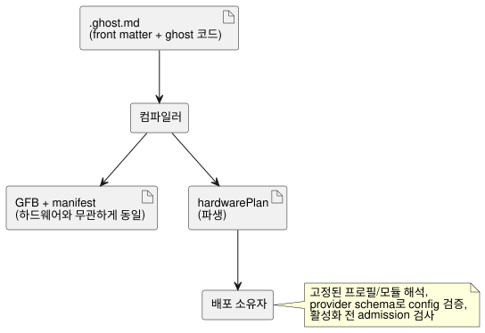

<!-- translation-source: docs/HARDWARE-FRONT-MATTER.md -->
[영문 원문](HARDWARE-FRONT-MATTER.md)

# 정본 소스의 하드웨어 선언

[English](HARDWARE-FRONT-MATTER.md) · [Reference 1.1](reference/01-source-and-syntax.md)

> **상태.** 재사용 가능한 보드/드라이버 기본값으로 간결하게 작성하려면
> [프로필 설계와 목적](PROFILE-FRONT-MATTER.md)을 읽으십시오. 아래의 명시적 `hardware`
> 형식은 실제 프로필과 간결한 패키징 어댑터를 구현하는 동안, 현재 배포된 Device 패키징 경로를
> 위해 유지됩니다. 이 작성 형식은 검증된 설치 이행 이후에 폐지됩니다. 파생 배포 계약에는
> 여전히 확장된 하드웨어 사실이 들어 있을 수 있습니다.

`.ghost.md` 문서의 최상위 예약 YAML 필드 `hardware`는 다음을 선언합니다.

- 설치 의존성(보드 프로필과 드라이버 모듈)
- 프로그램의 입력과 출력을 입력 드라이버와 출력 렌더러에 잇는 논리 바인딩

소스 문서가 계속 정본입니다. 컴파일러는 파생된 `hardwarePlan`을 반환합니다. 이 선언은 코드를
실행하지 않으며, GFB 바이트, 런타임 ABI, 이식 가능한 패키지 형식을 바꾸지 않습니다. 작업:
[#555](https://github.com/callin2/ghostflow-language/issues/555).



다이어그램처럼 plan은 배포 소유자를 위한 부가 출력입니다. 제어 바이트코드는 plan이 있든 없든
같습니다.

## 선언

이 예제는 JSY 계량기를 입력 모듈 하나로, 릴레이 뱅크를 출력 모듈로 보여 줍니다. 예제의 digest는
자리표시자입니다. 배포에는 실제 바이트 단위로 정확한 프로필/모듈 digest와 검토된 불변
revision(판본)이 필요합니다.

```yaml
hardware:
  schema: GhostFlow/hardware-v1
  profile:
    id: ess3h32
    revision: r1
    sha256: aaaaaaaaaaaaaaaaaaaaaaaaaaaaaaaaaaaaaaaaaaaaaaaaaaaaaaaaaaaaaaaa
  modules:
    meter:
      id: jsy-mk
      revision: r1
      sha256: bbbbbbbbbbbbbbbbbbbbbbbbbbbbbbbbbbbbbbbbbbbbbbbbbbbbbbbbbbbbbbbb
    relay:
      id: relay-bank
      revision: r1
      sha256: cccccccccccccccccccccccccccccccccccccccccccccccccccccccccccccccc
  buses:
    serial:
      service: modbus-rtu
      config: { port: 1, baud: 9600, parity: none }
  instances:
    power:
      module: meter
      role: input
      config: { bus: serial, address: 1 }
    panel:
      module: relay
      role: output
      config: { channels: [{ pin: 3, inverted: false }] }
  bindings:
    inputs:
      current: { instance: power, channel: current }
    outputs:
      pump: { instance: panel, channel: relay1 }
```

YAML은 문서 맨 앞의 여는 `---` 줄과 닫는 `---` 줄 사이에 두고, 그 뒤에 Markdown과 일반
`ghost` fence를 씁니다. 닫는 줄로 `...`도 허용됩니다. 대응하는 논리 선언은 다음과 같을 수
있습니다.

```ghost
control MeterRequest {
  input current: Number;
  output pump: Bool;
  pump <- (current |> recover(0.0)) > 1.0;
}
```

여기서 바인딩 `inputs.current`는 논리 입력 `current`를 instance `power`의 `current` 채널에
연결하고, `outputs.pump`는 논리 출력 `pump`를 instance `panel`의 `relay1`에 연결합니다.

**필드 규칙.**

- 여섯 개의 hardware 필드는 모두 필수입니다.
- `profile`과 각 `modules` 값은 정확히 `id`, `revision`, 소문자 64자리 16진수 `sha256`을
  가집니다. `latest`는 거부됩니다.
- 이름 패턴:

| 이름 | 패턴 |
| --- | --- |
| 모듈 별칭, bus/instance 이름, 논리 바인딩 이름 | `[A-Za-z_][A-Za-z0-9_.:-]{0,127}` |
| pin ID, revision, service 및 channel 문자열 | `[A-Za-z0-9][A-Za-z0-9._:/@+-]{0,255}` |

- 이름 붙은 map은 비어 있어도 됩니다.
- 모든 bus에는 `service`와 `config`가 있습니다. 모든 instance에는 `module`, `role`(`input`
  또는 `output`), `config`가 있습니다. 모든 binding에는 `instance`와 `channel`이 있습니다.
- 구조 필드는 닫혀 있습니다. 필드 이름의 오타나 누락은 컴파일 실패로 이어집니다.

**`config`는 언어에 불투명합니다.** `config`는 임의로 중첩된 JSON 호환 데이터를 담는
객체입니다. 언어는 JSY, baud rate, 주소, GPIO, 채널 타입을 특별 취급하지 않습니다. 활성화
전에 배포 소유자는 반드시 다음을 해야 합니다.

1. 고정된 프로필과 모듈을 해석합니다.
2. provider가 제공한 schema로 각 설정을 검증합니다.
3. service 사용 가능 여부, bus 참조, 채널 identity와 타입을 검증합니다.
4. admission(수용)을 검사합니다.

파싱은 provider 검증, 모듈 설치, 물리적 검증이 아닙니다.

**바인딩.** 바인딩은 컴파일러 manifest에 선언된 논리 입력과 출력을 참조합니다.

- 다음은 실패합니다. 없는 모듈/instance, 잘못된 instance 역할, 선언되지 않은 논리 포트, 그리고
  각 역할 안에서 중복된 instance/channel 바인딩.
- 바인딩되지 않은 논리 포트는 별도로 선언된 호스트 context를 사용할 수 있습니다. 언어가
  바인딩을 합성하지는 않습니다.
- 두 논리 Number 입력은 서로 다른 드라이버를 독립적으로 선택할 수 있습니다.
- 입력 취득 품질과 출력의 requested/applied/confirmed 증거는 기존 계약을 그대로 따릅니다.
- root 문서나 가져온 문서에 `hardware`가 있는 실행 가능한 import 합성은, 합성 의미가 정해질
  때까지 거부됩니다.

## 공개 helper와 진단

`tools/hardware-frontmatter.mjs`의 `parseHardwareFrontMatter(source, { filename })`는 다음을
반환합니다.

- 예약 필드가 없으면 `null`
- 그렇지 않으면 `{ format: 'GhostFlow/hardware-plan-v1', source: { filename, sha256 },
  hardware, locations }`

이 결과에서:

- `hardware`는 검증된 선언입니다.
- `locations`는 `/hardware/instances/power/config/address` 같은 JSON pointer를 정본 문서의
  `{ filename, line, column, endLine, endColumn }`에 대응시킵니다. 위치는 1부터 시작하며, 끝
  위치는 포함되지 않습니다.
- digest는 설명 문장과 줄 끝을 포함한 정확한 소스 바이트 전체를 대상으로 합니다.

`validateHardwareBindings(plan, manifest)`는 논리 포트 소속을 따로 검사합니다. `compileSource`와
`compileSourceSync`는 선언이 있을 때만 `hardwarePlan`을 반환합니다.

**YAML 안전성.** 고정된 YAML 파서는 키의 고유성을 강제합니다. `hardware`를 담은 front matter는
alias, anchor, 명시적 tag, merge key, 문자열이 아닌 키, 유한하지 않은 값, prototype에 민감한
객체 키를 거부하고, 중첩 깊이와 노드 수를 제한합니다. 오류에는 정본 line/column과, `GF_HARDWARE`
및 소스 digest를 담은 `GhostFlow/diagnostics-v1` envelope가 들어 있습니다. `hardware`가 없는
front matter는 기존의 비실행 동작을 유지합니다.

이유: 설치 의도를 제어 소스 옆에 두면, 편집 가능한 제어 프로그램을 하나 더 만들지 않고도 드라이버
선택을 검토할 수 있고 revision에 묶을 수 있습니다. 범용 provider 경계 덕분에 보드 동작을 언어에
내장하지 않고도 측정 드라이버, 스위치, 릴레이, 모터, 화면을 수용할 수 있습니다.
