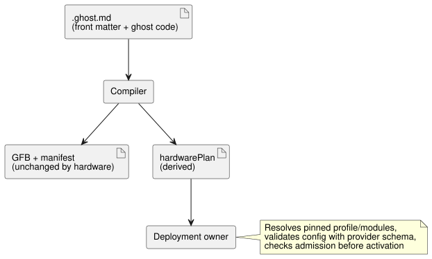

# Hardware declarations in canonical source

[한국어](HARDWARE-FRONT-MATTER.ko.md) · [Reference 1.1](reference/01-source-and-syntax.en.md)

> **Status.** For compact authoring with reusable board/driver defaults, read
> the [profile design and purpose](PROFILE-FRONT-MATTER.en.md). The explicit
> `hardware` form below is kept for the current deployed Device packaging path
> while actual profiles and the compact packaging adapter are being
> implemented. This authored form will be retired after a verified installation
> migration; the derived deployment contract may still contain expanded
> hardware facts.

The reserved top-level YAML field `hardware` in a `.ghost.md` document declares:

- the installation dependencies (board profile and driver modules); and
- the logical bindings from the program's inputs and outputs to input drivers
  and output renderers.

The source document remains authoritative. The compiler returns a derived
`hardwarePlan`. The declaration does not execute code, and it does not change
GFB bytes, the runtime ABI, or the portable package format. Work:
[#555](https://github.com/callin2/ghostflow-language/issues/555).



As the diagram shows, the plan is a side output for the deployment owner; the
control bytecode is the same with or without it.

## Declaration

This example shows a JSY meter as one input module and a relay bank as an
output module. The example digests are placeholders: deployment requires the
actual exact-byte profile/module digests and reviewed immutable revisions.

```yaml
hardware:
  schema: GhostFlow/hardware-v1
  profile:
    id: ess3h32
    revision: r1
    sha256: aaaaaaaaaaaaaaaaaaaaaaaaaaaaaaaaaaaaaaaaaaaaaaaaaaaaaaaaaaaaaaaa
  modules:
    meter:
      id: jsy-mk
      revision: r1
      sha256: bbbbbbbbbbbbbbbbbbbbbbbbbbbbbbbbbbbbbbbbbbbbbbbbbbbbbbbbbbbbbbbb
    relay:
      id: relay-bank
      revision: r1
      sha256: cccccccccccccccccccccccccccccccccccccccccccccccccccccccccccccccc
  buses:
    serial:
      service: modbus-rtu
      config: { port: 1, baud: 9600, parity: none }
  instances:
    power:
      module: meter
      role: input
      config: { bus: serial, address: 1 }
    panel:
      module: relay
      role: output
      config: { channels: [{ pin: 3, inverted: false }] }
  bindings:
    inputs:
      current: { instance: power, channel: current }
    outputs:
      pump: { instance: panel, channel: relay1 }
```

Place the YAML between an opening and a closing `---` line at the start of the
document, followed by Markdown and normal `ghost` fences. A closing `...` line
is also accepted. The matching logical declarations can be:

```ghost
control MeterRequest {
  input current: Number;
  output pump: Bool;
  pump <- (current |> recover(0.0)) > 1.0;
}
```

Here the binding `inputs.current` connects the logical input `current` to the
`current` channel of instance `power`, and `outputs.pump` connects the logical
output `pump` to `relay1` of instance `panel`.

**Field rules.**

- All six hardware fields are required.
- `profile` and each `modules` value contain exactly `id`, `revision`, and a
  lowercase 64-hex `sha256`. `latest` is rejected.
- Name patterns:

| Names | Pattern |
| --- | --- |
| Module aliases, bus/instance names, logical binding names | `[A-Za-z_][A-Za-z0-9_.:-]{0,127}` |
| Pin IDs, revisions, service and channel strings | `[A-Za-z0-9][A-Za-z0-9._:/@+-]{0,255}` |

- Empty named maps are allowed.
- Every bus has `service` and `config`. Every instance has `module`, `role`
  (`input` or `output`) and `config`. Every binding has `instance` and
  `channel`.
- Structural fields are closed: a misspelled or missing field fails compilation.

**`config` is opaque to the language.** It is an object containing arbitrary
nested JSON-compatible data. The language does not special-case JSY, baud rates,
addresses, GPIO or channel types. Before activation, the deployment owner must:

1. resolve the pinned profile and modules;
2. validate each configuration using its provider-supplied schema;
3. validate service availability, bus references, channel identity and types;
4. check admission.

Parsing is not provider validation, module installation or physical
verification.

**Bindings.** Bindings refer to the declared logical inputs and outputs in the
compiler manifest.

- These fail: missing modules/instances, wrong instance roles, undeclared
  logical ports, and duplicate instance/channel bindings within either role.
- Unbound logical ports may use separately declared host context; the language
  does not synthesize bindings.
- Two logical Number inputs can independently select different drivers.
- Input acquisition quality and output requested/applied/confirmed evidence keep
  their existing contracts.
- Executable import composition that has `hardware` in the root or in an
  imported document is rejected until composition semantics exist.

## Public helper and diagnostics

`parseHardwareFrontMatter(source, { filename })` from
`tools/hardware-frontmatter.mjs` returns:

- `null` when the reserved field is absent;
- otherwise `{ format: 'GhostFlow/hardware-plan-v1', source: { filename, sha256 },
  hardware, locations }`.

In that result:

- `hardware` is the validated declaration.
- `locations` maps JSON pointers such as
  `/hardware/instances/power/config/address` to
  `{ filename, line, column, endLine, endColumn }` in the canonical document.
  Locations are one-based; ends are exclusive.
- The digest covers the exact source bytes, including prose and line endings.

`validateHardwareBindings(plan, manifest)` checks logical port membership
separately. `compileSource` and `compileSourceSync` return `hardwarePlan` only
when the declaration exists.

**YAML safety.** The pinned YAML parser enforces unique keys. Front matter that
contains `hardware` rejects aliases, anchors, explicit tags, merge keys,
non-string keys, non-finite values and prototype-sensitive object keys, and it
bounds nesting depth and node counts. Errors carry the canonical line/column and
a `GhostFlow/diagnostics-v1` envelope with `GF_HARDWARE` and the source digest.
Front matter without `hardware` keeps its existing non-executable behavior.

Why: keeping installation intent next to the control source makes driver
selection reviewable and revision-bound, without creating another editable
control program. The generic provider boundary accommodates measurement drivers,
switches, relays, motors and screens without embedding board behavior in the
language.
