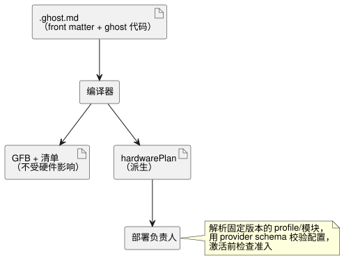

<!-- translation-source: docs/HARDWARE-FRONT-MATTER.md -->
[英文原文](HARDWARE-FRONT-MATTER.md)

# 规范源文件中的硬件声明

[한국어](HARDWARE-FRONT-MATTER.ko.md) · [参考手册 1.1](reference/01-source-and-syntax.zh.md)

> **状态。** 如需借助可复用的板卡/驱动程序默认值进行紧凑编写，请阅读 [profile 的设计与目的](PROFILE-FRONT-MATTER.zh.md)。下面显式的 `hardware` 形式是为当前已部署的 Device 打包路径而保留的，同时实际的 profile 和紧凑打包适配器仍在实现中。在经过验证的安装迁移之后，这种编写形式将被淘汰；派生的部署契约中仍可能包含展开后的硬件事实。

`.ghost.md` 文档中保留的顶层 YAML 字段 `hardware` 声明：

- 安装依赖（板卡 profile 和驱动程序模块）；以及
- 从程序的输入和输出到输入驱动程序和输出渲染器的逻辑绑定。

源文档仍具有权威性。编译器返回一个派生的 `hardwarePlan`。该声明不执行代码，也不改变 GFB 字节、运行时 ABI 或可移植包格式。相关工作：[#555](https://github.com/callin2/ghostflow-language/issues/555)。



如图所示，该计划是提供给部署负责人的附带输出；无论有没有它，控制字节码都是相同的。

## 声明

本示例将一个 JSY 电表作为输入模块，将一组继电器作为输出模块。示例中的摘要只是占位符：部署时需要实际的、逐字节精确的 profile/模块摘要以及经过评审的不可变修订版。

```yaml
hardware:
  schema: GhostFlow/hardware-v1
  profile:
    id: ess3h32
    revision: r1
    sha256: aaaaaaaaaaaaaaaaaaaaaaaaaaaaaaaaaaaaaaaaaaaaaaaaaaaaaaaaaaaaaaaa
  modules:
    meter:
      id: jsy-mk
      revision: r1
      sha256: bbbbbbbbbbbbbbbbbbbbbbbbbbbbbbbbbbbbbbbbbbbbbbbbbbbbbbbbbbbbbbbb
    relay:
      id: relay-bank
      revision: r1
      sha256: cccccccccccccccccccccccccccccccccccccccccccccccccccccccccccccccc
  buses:
    serial:
      service: modbus-rtu
      config: { port: 1, baud: 9600, parity: none }
  instances:
    power:
      module: meter
      role: input
      config: { bus: serial, address: 1 }
    panel:
      module: relay
      role: output
      config: { channels: [{ pin: 3, inverted: false }] }
  bindings:
    inputs:
      current: { instance: power, channel: current }
    outputs:
      pump: { instance: panel, channel: relay1 }
```

将这段 YAML 放在文档开头的起始 `---` 行和结束 `---` 行之间，其后是 Markdown 和普通的 `ghost` 围栏。结束行也可以使用 `...`。对应的逻辑声明可以是：

```ghost
control MeterRequest {
  input current: Number;
  output pump: Bool;
  pump <- (current |> recover(0.0)) > 1.0;
}
```

这里，绑定 `inputs.current` 把逻辑输入 `current` 连接到实例 `power` 的 `current` 通道，`outputs.pump` 把逻辑输出 `pump` 连接到实例 `panel` 的 `relay1`。

**字段规则。**

- 全部六个硬件字段都是必需的。
- `profile` 以及 `modules` 的每个值恰好包含 `id`、`revision` 和小写 64 位十六进制的 `sha256`。`latest` 会被拒绝。
- 名称模式：

| 名称 | 模式 |
| --- | --- |
| 模块别名、总线/实例名称、逻辑绑定名称 | `[A-Za-z_][A-Za-z0-9_.:-]{0,127}` |
| 引脚 ID、修订版、服务和通道字符串 | `[A-Za-z0-9][A-Za-z0-9._:/@+-]{0,255}` |

- 允许空的具名映射。
- 每条总线都有 `service` 和 `config`。每个实例都有 `module`、`role`（`input` 或 `output`）和 `config`。每个绑定都有 `instance` 和 `channel`。
- 结构字段是封闭的：拼写错误或缺失的字段会导致编译失败。

**`config` 对语言而言是不透明的。** 它是一个包含任意嵌套 JSON 兼容数据的对象。语言不会对 JSY、波特率、地址、GPIO 或通道类型做特殊处理。在激活之前，部署负责人必须：

1. 解析固定版本的 profile 和模块；
2. 使用 provider 提供的 schema 校验每项配置；
3. 校验服务可用性、总线引用、通道身份标识和类型；
4. 检查准入。

解析并不等于 provider 校验、模块安装或物理验证。

**绑定。** 绑定引用编译器清单中已声明的逻辑输入和输出。

- 以下情况会失败：缺失的模块/实例、错误的实例角色、未声明的逻辑端口，以及在同一角色内重复的实例/通道绑定。
- 未绑定的逻辑端口可以使用单独声明的宿主上下文；语言不会合成绑定。
- 两个逻辑 Number 输入可以各自独立地选择不同的驱动程序。
- 输入采集质量以及输出的 requested/applied/confirmed 证据保持其现有契约。
- 在组合语义确立之前，根文档或被导入文档中带有 `hardware` 的可执行导入组合会被拒绝。

## 公开辅助函数与诊断

`tools/hardware-frontmatter.mjs` 中的 `parseHardwareFrontMatter(source, { filename })` 返回：

- 当保留字段不存在时返回 `null`；
- 否则返回 `{ format: 'GhostFlow/hardware-plan-v1', source: { filename, sha256 },
  hardware, locations }`。

在该结果中：

- `hardware` 是经过校验的声明。
- `locations` 将 `/hardware/instances/power/config/address` 这样的 JSON 指针映射到规范文档中的 `{ filename, line, column, endLine, endColumn }`。位置从 1 开始计数；结束位置不包含在内。
- 摘要覆盖精确的源字节，包括正文和换行符。

`validateHardwareBindings(plan, manifest)` 单独检查逻辑端口的成员关系。只有在声明存在时，`compileSource` 和 `compileSourceSync` 才返回 `hardwarePlan`。

**YAML 安全性。** 固定版本的 YAML 解析器强制键唯一。包含 `hardware` 的 front matter（前置元数据）会拒绝别名、锚点、显式标签、合并键、非字符串键、非有限值以及对原型敏感的对象键，并限制嵌套深度和节点数量。错误会带有规范的行/列，以及包含 `GF_HARDWARE` 和源摘要的 `GhostFlow/diagnostics-v1` 封装。不含 `hardware` 的 front matter 保持其现有的非可执行行为。

原因：把安装意图放在控制源代码旁边，可以让驱动程序的选择可审查并与修订版绑定，而无需再创建一个可编辑的控制程序。通用的 provider 边界可以容纳测量驱动程序、开关、继电器、电机和屏幕，而无需把板卡行为嵌入语言之中。
