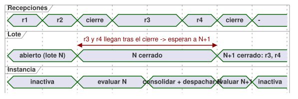
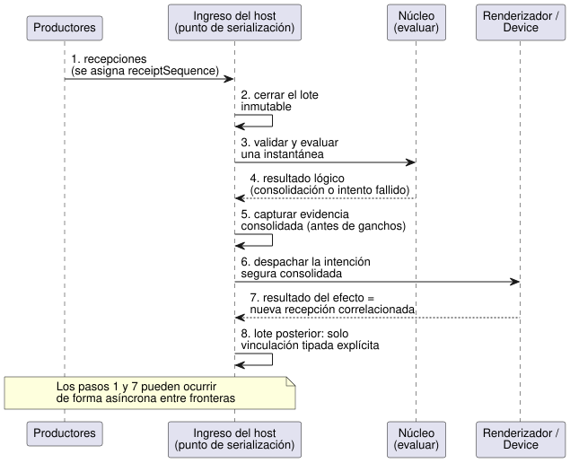

<!-- translation-source: docs/HOST-EVENT-ORDERING-CONTRACT.md -->
[Original en inglés](HOST-EVENT-ORDERING-CONTRACT.md)

# Contrato de ordenación de eventos del host

[한국어](HOST-EVENT-ORDERING-CONTRACT.ko.md)

**Estado:** un contrato más un **modelo** de conformidad ejecutable para
[#115](https://github.com/callin2/ghostflow-language/issues/115).

Este documento define cómo un host ordena los eventos entrantes (recepciones) y
cómo los agrupa en escaneos. Ningún host implementa todavía la cola de ingreso
ni las reglas de frontera descritas a continuación; cada host debe adoptarlas en
el futuro.

Este cambio **no** añade ningún motor de eventos de producción, gramática de
fuente, vinculación (binding) de descriptores, política de firmware, esquema de
transporte ni ABI. No depende de la implementación de descriptores de
comando/alarma ni de ningún frontend en particular.

**En este documento**

- **Autoridad e implementación actual**: en qué se apoya este contrato y qué existe hoy.
- **Recepción local a la ejecución y frontera de lote**: cómo se numeran las recepciones y cómo se agrupan en lotes.
- **Orden requerido**: los ocho pasos desde la recepción hasta la siguiente decisión.
- **Fallo, correlación y seguridad**: qué ocurre cuando falla la evaluación o un efecto.
- **Casos límite y evidencia**: los vectores de prueba que un host debe superar.

Términos clave usados a continuación:

| Término | Significado |
| --- | --- |
| Recepción (receipt) | Un evento cuya titularidad ha aceptado el host |
| Lote (batch) | Un grupo inmutable y contiguo de recepciones que evalúa un escaneo |
| Cierre (latch) | El acto atómico de cerrar un lote en una frontera de escaneo |
| Efecto | Una acción externa (por ejemplo, una escritura del renderizador) despachada a partir de un resultado consolidado |

## Autoridad e implementación actual

Este contrato solo ordena las recepciones del host y las fronteras de escaneo.
No redefine los ciclos de vida que pertenecen a otros documentos:

- [Referencia 2.8](reference/02-types-expressions-state.es.md#28-tick-e-instantánea-de-estado)
  define la instantánea (snapshot) inmutable de entradas de un tick y la
  consolidación atómica del estado lógico y de las salidas.
- [Referencia 4.7](reference/04-sensors-constraints-control.es.md#47-requested-safe-applied-confirmed)
  separa la evidencia requested, safe, applied y confirmed.
- [Referencia 5.3](reference/05-settings-and-observation.es.md)
  y el [diseño del flujo de interacción](INTERACTION-STREAM-CONTRACT.es.md)
  distinguen las instantáneas completadas de los eventos ordenados y de los
  resultados de comandos.

Lo que existe hoy:

- `runtimes/wasm/framed-runtime.mjs` captura una trama tipada completa antes del
  despacho síncrono.
- `crates/ghostflow-core/src/scan.rs` valida la identidad y el tiempo del
  escaneo. Un escaneo fallido no hace avanzar la identidad ni el tiempo del
  escaneo exitoso.
- `crates/ghostflow-core/src/lib.rs` calcula el estado candidato y la intención
  antes de consolidar los resultados lógicos exitosos.
- `runtimes/wasm/control-runtime.mjs` distingue la reversión durante la
  preparación/preconsolidación del fallo del adaptador posterior a la
  consolidación.

Estas interfaces **no** implementan una cola compartida de recepciones
externas, un cierre de lote ni un criterio de desempate de eventos. Sus pruebas
existentes son evidencia para el núcleo y los adaptadores. No son evidencia de
que este nuevo contrato de ingreso ya esté desplegado.

La [secuencia física](LLM-TOOLCHAIN-ARCHITECTURE.es.md)
documenta que el host se detiene ante un fallo de salida del Device sin revertir
la consolidación lógica. Para este contrato no se inspeccionó ninguna revisión
del firmware del Device. Este contrato no sustituye esa política ni afirma que
el comportamiento físico se haya verificado.

## Recepción local a la ejecución y frontera de lote

**Numeración de recepciones.** Un único punto de serialización del host asigna
a cada recepción aceptada un `receiptSequence` local a la ejecución (run). La
secuencia es contigua y nunca se reutiliza. El host la asigna cuando acepta la
titularidad de la recepción, antes de que se ejecute cualquier observador.

- Dos recepciones con marcas de tiempo de reloj de pared o monotónicas iguales
  siguen siendo recepciones distintas. La secuencia deshace el empate.
- El tiempo del evento del productor, la secuencia del productor y la época de
  la fuente se conservan como evidencia propia y separada.
- Una recepción que lleva una marca de tiempo de productor anterior pero que
  llega más tarde nunca pasa a un lote que ya está cerrado.
- Los productores independientes no tienen un orden causal global implícito más
  allá del orden de recepción del host.

**Cierre de un lote.** En una frontera de escaneo, el host cierra
atómicamente el prefijo contiguo más largo de recepciones aceptadas desde el
cierre anterior. El prefijo puede estar vacío cuando corresponda. El host
registra:

- una identidad distinta de intento/frontera;
- la identidad exacta de fuente/módulo/vinculación/ejecución;
- el rango de recepciones;
- el candidato de escaneo/tiempo.

Después cierra un lote inmutable. Ninguna recepción puede abarcar dos lotes.
Una recepción que llega después del cierre pertenece a un lote posterior,
aunque llegue durante la evaluación, la consolidación lógica, el despacho de
efectos o los ganchos de observación. Las devoluciones de llamada reentrantes
usan el mismo punto de serialización. No pueden modificar el lote actual ni
iniciar una evaluación superpuesta de la misma instancia.

La línea de tiempo siguiente muestra dos recepciones que llegan mientras el
lote N se evalúa y se despacha; ambas esperan al lote N+1.

**El orden no es significado.** Esto es el orden de recepción, no un reductor
universal. Cada vinculación declarada de entrada/evento define su propia
validación, su manejo de duplicados, su orden de protocolo y su proyección en
la instantánea.

- No infiera "gana el último valor", prioridad de comandos, significado de
  alarma ni un ACK físico a partir de nombres o valores Bool.
- El protocolo de eventos ordenados de una fuente sigue siendo la autoridad
  dentro de su vinculación.
- La evidencia contradictoria o faltante se diagnostica explícitamente.

**Límites.** Los límites de almacenamiento y de carga útil son finitos y los
selecciona el perfil del host. Ante un desbordamiento, el host rechaza la
admisión *antes* de aceptar una recepción. Nunca descarta ni renumera una
recepción aceptada. Una pérdida posterior a la aceptación requiere evidencia
explícita de brecha/fallo.

## Orden requerido

Un host debe procesar cada lote en el orden siguiente.

| Orden | Frontera | Resultado requerido |
| --- | --- | --- |
| 1 | Aceptar recepciones | Serializar identidades y conservar la evidencia original; no evaluar contra una cola abierta |
| 2 | Cerrar el lote (latch) | Congelar un prefijo contiguo de recepciones y el contexto completo de trama tipada, reloj y estado previo |
| 3 | Validar y evaluar | Estado siguiente propiedad del núcleo, intención solicitada e intención segura restringida a partir de esa única instantánea |
| 4 | Resultado lógico | El éxito consolida juntos el estado y los resultados lógicos; el fallo registra el intento fallido sin instantánea completada ni efectos nuevos |
| 5 | Capturar la evidencia consolidada | Vincular la finalización/intención de salida al escaneo realmente consolidado antes de invocar ganchos o el despacho físico |
| 6 | Despachar efectos externos | Despachar la intención segura consolidada según la política existente de renderizador/perfil; la aplicación física parcial sigue siendo posible |
| 7 | Aceptar resultados de efectos | Registrar recepciones correlacionadas separadas para el éxito, fallo o incertidumbre reales; admitirlas solo en una frontera futura permitida |
| 8 | Siguiente decisión permitida | Una vinculación tipada explícita puede usar las recepciones nuevas; sin modificación retroactiva de la decisión de origen |

El diagrama de secuencia muestra los mismos ocho pasos entre los participantes.

Notas sobre el orden:

- Los pasos 1 y 7 pueden ocurrir de forma asíncrona, entre las fronteras
  serializadas.
- La captura de la evidencia consolidada (paso 5) va antes de los ganchos. Sin
  embargo, la exportación por red no necesita terminar antes del despacho
  físico.
- Los errores de exportación no deben deshacer una consolidación ni inventar un
  efecto que no se observó.
- La pertenencia a un lote y la secuencia de eventos son distintas de la
  identidad del escaneo completado. También son distintas de la secuencia de
  ocurrencias que el flujo de interacción asigna de forma independiente.

## Fallo, correlación y seguridad

**Fallo de evaluación o de validación.** Se conserva el estado lógico
consolidado anteriormente, y el candidato fallido no emite ningún efecto nuevo.

- Conserve el lote fallido, su pertenencia de recepciones, la identidad del
  intento y el motivo como evidencia del fallo. La pertenencia de recepciones no
  es un manejo exitoso de comandos ni es un escaneo completado.
- El host finaliza explícitamente el lote fallido o reintenta ese mismo lote
  inmutable según su política de reintentos.
- En ninguno de los dos casos puede el host reproducir silenciosamente
  solicitudes no idempotentes ni añadir llegadas nuevas a un reintento. Las
  recepciones posteriores permanecen en cola.
- El núcleo actual puede reintentar un ID/tiempo de escaneo. Esa capacidad por
  sí sola no autoriza el reintento de solicitudes.

**Correlación de los resultados de efectos.** Un resultado de efecto identifica
su escaneo consolidado de origen, la ejecución, la fuente/módulo/vinculación
exactos y la identidad del efecto/intento.

- Los efectos múltiples y los reintentos necesitan identidades distintas. Un
  reintento no puede fabricar una segunda consolidación original.
- Un registro de aceptación del renderizador solo prueba la aceptación del
  registro/escritura indicada. No prueba el movimiento del relé ni una
  confirmación física.
- Una aplicación fallida o incierta no revierte el estado lógico de origen.
  Tampoco reemplaza la intención segura/solicitada de ese estado por un valor
  histórico falso.
- Conserve la aplicación parcial y el motivo de cada resultado. La
  retroalimentación faltante sigue siendo desconocida.

**Cola llena cuando llega un resultado de efecto.** Las llegadas tardías pueden
llenar la cola antes de que se pueda admitir un resultado de efecto. En ese
caso, conserve la consolidación de origen y una evidencia separada del
resultado/fallo de admisión, sin inventar una secuencia de recepción aceptada.
El modelo se detiene ante este fallo en la ruta de registro. Un host que adopte
el contrato debe definir una política de cierre seguro (fail-closed) y no debe
perder el resultado silenciosamente.

**Detenerse o continuar.**

- Si la política de fallos existente del host es detenerse, registre el
  resultado y deténgase. No hay reinicio automático ni siguiente escaneo.
- Si la continuación está permitida explícitamente, un resultado de efecto
  aceptado después del cierre de origen solo puede influir en una decisión
  *futura*, y solo a través de una vinculación tipada declarada. No se convierte
  automáticamente en una alarma, una finalización de comando ni una entrada de
  fuente arbitraria.

Este contrato de ordenación no pone en cola una parada de emergencia ni un
watchdog independientes detrás de los lotes ordinarios. No cambia ninguna ruta
de seguridad fuera de banda existente.

## Casos límite y evidencia

`tests/host-event-ordering-contract.test.mjs` es un modelo de referencia local
a la prueba, no un adaptador de host. Su reductor simple de solicitudes y su
vinculación de entrada para fallos de efectos son fixtures ficticios y
explícitos. No son una política universal del producto ni sintaxis de fuente.
Sus objetos de recepción y de frontera son notación del modelo, no formatos de
registro aprobados.

| Vector | Obligación de conformidad |
| --- | --- |
| Normal | Orden aceptar/cerrar/evaluar/consolidar/despachar/resultado; el efecto ve el estado consolidado y la identidad de origen inmutable |
| Empate y tiempo de productor antiguo | Tiempos de recepción iguales conservan la secuencia; las marcas de tiempo tardías de la fuente no reordenan la pertenencia |
| Llegada durante la evaluación o el despacho | El lote cerrado no cambia; la nueva recepción entra exactamente en el siguiente lote permitido |
| Fallo de evaluación | Estado previo intacto, sin resultado/efecto completado; disposición explícita del lote fallido, contador de escaneos exitosos sin cambios |
| Fallo de efecto con continuación permitida | El origen permanece consolidado; el resultado es un ingreso posterior, correlacionado con el origen; la siguiente decisión usa solo una vinculación explícita del fixture |
| Fallo de efecto con política de detención | Resultado conservado, evaluación posterior rechazada; sin continuación automática |
| Límites y reentrada | El desbordamiento se rechaza antes de asignar la secuencia; se imponen la captura inmutable y la evaluación de instancia única; un fallo de admisión del resultado posterior a la consolidación conserva la evidencia de origen/resultado y detiene el modelo |

Las pruebas focalizadas del modelo solo establecen estos oráculos del contrato.
Para adoptar el contrato, cada host todavía debe:

1. implementar su cierre de lote, su almacenamiento acotado, su proyección
   tipada, su política de fallos/reintentos y sus registros; y
2. demostrar los mismos casos a través de su adaptador real.

La titularidad del núcleo, el ABI actual y la evidencia física no cambian.
