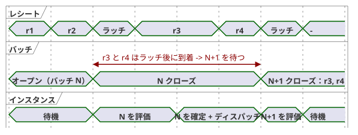
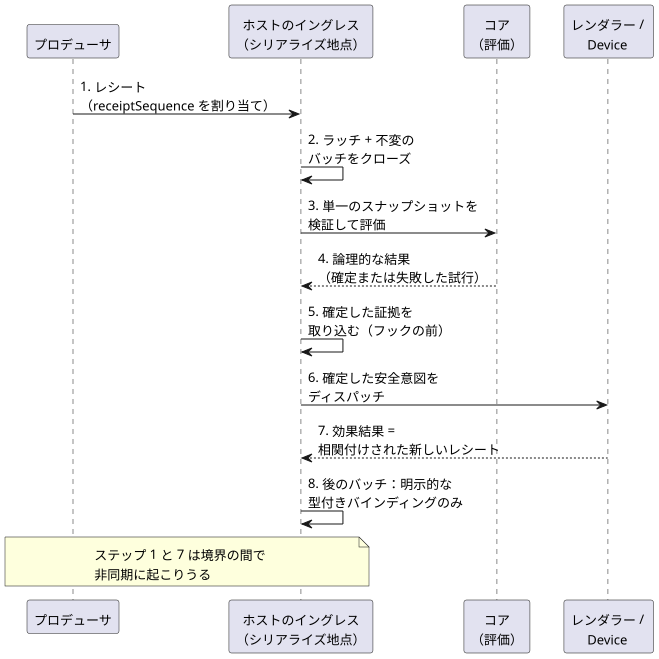

<!-- translation-source: docs/HOST-EVENT-ORDERING-CONTRACT.md -->
[英語の原文](HOST-EVENT-ORDERING-CONTRACT.md)

# ホストイベント順序契約

[English](HOST-EVENT-ORDERING-CONTRACT.md) | [한국어](HOST-EVENT-ORDERING-CONTRACT.ko.md) | 日本語

**ステータス：**[#115](https://github.com/callin2/ghostflow-language/issues/115) のための契約と、実行可能な適合性**モデル**です。

この文書は、ホストが受信したイベント（レシート）をどのように順序付け、どのようにスキャンへまとめるかを定義します。以下のイングレスキューと境界の規則は、まだどのホストにも実装されていません。各ホストは今後これらを採用しなければなりません。

この変更は、本番用のイベントエンジン、ソース文法、ディスクリプタのバインディング、ファームウェアポリシー、転送スキーマ、ABI のいずれも**追加しません**。コマンド／アラームのディスクリプタ実装や、特定のフロントエンドにも依存しません。

**この文書の内容**

- **権限と現在の実装**：この契約が何を土台にしているか、現時点で何が存在するか。
- **実行ローカルなレシートとバッチ境界**：レシートにどう番号を付け、どうバッチにまとめるか。
- **必須の順序**：レシートから次の判断までの 8 つのステップ。
- **失敗、相関、安全**：評価や効果が失敗したときに何が起きるか。
- **境界ケースと証拠**：ホストが合格しなければならないテストベクタ。

以下で使う主要な用語：

| 用語 | 意味 |
| --- | --- |
| レシート（Receipt） | ホストが所有権を引き受けた 1 件のイベント |
| バッチ（Batch） | 1 回のスキャンが評価する、不変で連続したレシートのまとまり |
| ラッチ（Latch） | スキャン境界でバッチをアトミックに閉じる操作 |
| 効果（Effect） | 確定した結果からディスパッチされる外部アクション（たとえばレンダラーへの書き込み） |

## 権限と現在の実装

この契約が順序付けるのは、ホストのレシートとスキャン境界だけです。他の文書が所有するライフサイクルを再定義するものではありません。

- [Reference 2.8](reference/02-types-expressions-state.ja.md#28-tickと状態スナップショット) は、tick（論理判断の単位）の不変な入力スナップショットと、論理状態および出力のアトミックな確定を定義します。
- [Reference 4.7](reference/04-sensors-constraints-control.ja.md#47-requestedsafeappliedconfirmed) は、requested、safe、applied、confirmed の各証拠を区別します。
- [Reference 5.3](reference/05-settings-and-observation.ja.md) と[インタラクションストリームの設計](INTERACTION-STREAM-CONTRACT.ja.md)は、完了したスナップショットを、順序付きのイベントやコマンド結果から区別します。

現時点で存在するもの：

- `runtimes/wasm/framed-runtime.mjs` は、同期ディスパッチの前に、型付きの完全なフレームを取り込みます。
- `crates/ghostflow-core/src/scan.rs` は、スキャンの同一性と時刻を検証します。失敗したスキャンは、成功スキャンの同一性や時刻を進めません。
- `crates/ghostflow-core/src/lib.rs` は、成功した論理結果を確定する前に、候補状態と意図を計算します。
- `runtimes/wasm/control-runtime.mjs` は、準備／確定前のロールバックと、確定後のアダプタ失敗とを区別します。

これらのインターフェースは、共有の外部レシートキュー、バッチのラッチ、イベントのタイブレーカーを実装して**いません**。既存のテストはコアとアダプタの証拠です。この新しいイングレス契約がすでに展開済みであることの証拠ではありません。

[物理シーケンス](LLM-TOOLCHAIN-ARCHITECTURE.ja.md)には、Device の出力が失敗したとき、ホストが論理的な確定をロールバックせずに停止することが記載されています。この契約のために Device のファームウェアリビジョンを調査したことはありません。この契約は、そのポリシーを置き換えるものではなく、物理的な振る舞いが検証済みであると主張するものでもありません。

## 実行ローカルなレシートとバッチ境界

**レシートへの番号付け。**ホストの 1 つのシリアライズ地点が、受け入れた各レシートに実行（run）ローカルな `receiptSequence` を割り当てます。このシーケンスは連続しており、再利用されることはありません。ホストは、レシートの所有権を引き受けた時点、つまりどのオブザーバーが動くよりも前に、これを割り当てます。

- 壁時計や単調時間のタイムスタンプが等しい 2 つのレシートも、別々のレシートです。シーケンスがタイを解消します。
- プロデューサのイベント時刻、プロデューサのシーケンス、ソースのエポックは、それぞれ独立した別の証拠として保持されます。
- 早いプロデューサタイムスタンプを持ちながら遅れて到着したレシートが、すでに閉じたバッチへ移ることは決してありません。
- 独立したプロデューサの間には、ホストの受信順を超える暗黙のグローバルな因果順序はありません。

**バッチを閉じる。**スキャン境界で、ホストは前回のラッチ以降に受け入れたレシートのうち、最大の連続した先頭部分をアトミックにラッチします。適切な場合、この先頭部分は空でもかまいません。ホストは次のものを記録します。

- 個別の試行／境界の同一性
- 正確なソース／モジュール／バインディング／実行の同一性
- レシートの範囲
- スキャン／時刻の候補

その後、不変のバッチを閉じます。2 つのバッチにまたがるレシートはありません。ラッチの後に到着したレシートは、評価、論理的な確定、効果のディスパッチ、観測フックのいずれの最中に到着したとしても、後のバッチに属します。再入するコールバックは同じシリアライズ地点を使います。それらは現在のバッチを変更することも、同じインスタンスの評価を重複して開始することもできません。

以下のタイムラインは、バッチ N の評価とディスパッチの最中に到着した 2 つのレシートを示しています。どちらもバッチ N+1 を待ちます。

**順序は意味ではありません。**これは受信順であって、汎用的なリデューサではありません。宣言された各入力／イベントのバインディングが、それぞれの検証、重複の扱い、プロトコル順序、スナップショットへの射影を定義します。

- 名前や Bool 値から、後勝ち（last-value-wins）、コマンドの優先度、アラームの意味、物理的な ACK を推論してはなりません。
- ソースの順序付きイベントプロトコルは、そのバインディング内では引き続き権威を持ちます。
- 矛盾する証拠や欠落した証拠は、明示的に診断されます。

**上限。**ストレージとペイロードの上限は有限で、ホストのプロファイルによって選択されます。オーバーフローしたとき、ホストはレシートを受け入れる*前に*受け入れ（アドミッション）を拒否します。受け入れたレシートを破棄したり番号を振り直したりすることは決してありません。受け入れ後に喪失が起きた場合は、明示的なギャップ／故障の証拠が必要です。

## 必須の順序

ホストは各バッチを次の順序で処理しなければなりません。

| 順序 | 境界 | 必須の結果 |
| --- | --- | --- |
| 1 | レシートの受け入れ | 同一性をシリアライズし、元の証拠を保持する。開いたキューに対して評価しない |
| 2 | バッチのラッチとクローズ | 連続したレシートの先頭部分と、型付きの完全なフレーム、クロック、前状態のコンテキストを固定する |
| 3 | 検証と評価 | その単一のスナップショットから、コアが所有する次状態、要求意図、制約を適用した安全意図を得る |
| 4 | 論理的な結果 | 成功すれば論理状態／結果をまとめて確定する。失敗すれば、完了したスナップショットや新しい効果なしで、失敗した試行を記録する |
| 5 | 確定した証拠の取り込み | フックや物理ディスパッチを呼び出す前に、完了／出力意図を実際に確定したスキャンへ結び付ける |
| 6 | 外部効果のディスパッチ | 確定した安全意図を、既存のレンダラー／プロファイルのポリシーに従ってディスパッチする。物理的な部分適用は起こりうる |
| 7 | 効果結果の受け入れ | 実際の成功／失敗／不確実について、相関付けされた別個のレシートを記録する。それらは将来の許可された境界でのみ受け入れる |
| 8 | 次の許可された判断 | 明示的な型付きバインディングは新しいレシートを使ってよい。元の判断を遡って変更することはない |

シーケンス図は、同じ 8 つのステップを参加者ごとに示しています。

順序に関する注記：

- ステップ 1 と 7 は、シリアライズされた境界の間で非同期に起こりえます。
- 確定した証拠の取り込み（ステップ 5）はフックより前に行います。ただし、ネットワークへのエクスポートは、物理ディスパッチの前に完了している必要はありません。
- エクスポートのエラーによって確定を取り消したり、観測されていない効果をでっち上げたりしてはなりません。
- バッチの所属とイベントのシーケンスは、完了したスキャンの同一性とは別物です。また、インタラクションストリームが独立に割り当てる発生（オカレンス）シーケンスとも別物です。

## 失敗、相関、安全

**評価または検証の失敗。**以前に確定した論理状態は保持され、失敗した候補は新しい効果を出しません。

- 失敗したバッチ、そのレシートの所属、試行の同一性、理由を失敗の証拠として保持します。レシートの所属は、コマンドの処理成功ではなく、完了したスキャンでもありません。
- ホストは、失敗したバッチを明示的に確定処理するか、リトライポリシーに従って同じ不変のバッチをリトライします。
- いずれの場合も、ホストは非冪等なリクエストを黙ってリプレイしたり、新たな到着分をリトライに追加したりしてはなりません。後続のレシートはキューに残ります。
- 現在のコアはスキャン ID／時刻をリトライできます。その能力だけでは、リクエストのリトライは認められません。

**効果結果の相関付け。**効果結果は、その発端となった確定済みスキャン、実行、正確なソース／モジュール／バインディング、効果／試行の同一性を特定します。

- 複数の効果やリトライには、それぞれ別個の同一性が必要です。リトライによって 2 つ目の元の確定をでっち上げることはできません。
- レンダラーの受理記録が証明するのは、記載されたレジスタ／書き込みの受理だけです。リレーの動作や物理的な確認を証明するものではありません。
- 適用の失敗や不確実な適用は、発端となった論理状態をロールバックしません。また、その状態の安全意図／要求意図を、偽りの過去の値で置き換えることもありません。
- 部分適用と各結果の理由を保持します。フィードバックの欠落は不明のままです。

**効果結果の到着時にキューが満杯の場合。**効果結果を受け入れる前に、遅れて到着したものでキューが埋まることがあります。その場合は、受け入れたレシートのシーケンスをでっち上げることなく、発端となった確定と、結果／受け入れ失敗の別個の証拠を保持します。モデルは、この記録経路の故障で停止します。この契約を採用するホストは、フェイルクローズのポリシーを定義しなければならず、結果を黙って失ってはなりません。

**停止か継続か。**

- ホストの既存の失敗ポリシーが停止である場合は、結果を記録して停止します。自動再起動や次のスキャンはありません。
- 継続が明示的に許可されている場合、発端のラッチ後に受け入れた効果結果は、*将来の*判断にのみ、しかも宣言された型付きバインディングを通じてのみ影響を与えられます。それが自動的にアラーム、コマンドの完了、任意のソース入力になることはありません。

この順序契約は、独立した非常停止やウォッチドッグを通常のバッチの後ろに並べることはありません。既存の帯域外の安全経路を変更することもありません。

## 境界ケースと証拠

`tests/host-event-ordering-contract.test.mjs` は、テストローカルな参照モデルであり、ホストアダプタではありません。その単純なリクエストリデューサと、効果失敗の入力バインディングは、架空の明示的なフィクスチャです。汎用的な製品ポリシーやソース構文ではありません。そのレシートや境界のオブジェクトはモデル上の表記であり、承認された記録形式ではありません。

| ベクタ | 適合性の義務 |
| --- | --- |
| 通常 | 受け入れ／ラッチ／評価／確定／ディスパッチ／結果の順序。効果は確定した状態と不変の発端同一性を参照する |
| タイと古いプロデューサ時刻 | 等しい受信時刻でもシーケンスを保持する。遅いソースタイムスタンプは所属を並べ替えない |
| 評価中またはディスパッチ中の到着 | 閉じたバッチは変わらない。新しいレシートは、ちょうど次の許可されたバッチに入る |
| 評価の故障 | 前状態はそのまま。完了した結果／効果はない。失敗したバッチの明示的な処理。成功スキャンのカウンタは変わらない |
| 継続が許可された効果の失敗 | 発端は確定したまま。結果は後のイングレスとなり、発端に相関付けされる。次の判断は明示的なフィクスチャのバインディングのみを使う |
| 停止ポリシーでの効果の失敗 | 結果は保持され、以後の評価は拒否される。自動的な継続はない |
| 上限と再入 | オーバーフローはシーケンス割り当ての前に拒否する。不変の取り込みと単一インスタンスの評価を強制する。確定後の結果の受け入れに失敗した場合は、発端／結果の証拠を保持してモデルを停止する |

焦点を絞ったモデルテストが確立するのは、これらの契約のオラクルだけです。この契約を採用するために、各ホストはさらに次のことを行わなければなりません。

1. ラッチ、上限付きストレージ、型付きの射影、失敗／リトライのポリシー、記録を実装する。
2. 実際のアダプタを通じて、同じケースを実証する。

コアの所有権、現在の ABI、物理的な証拠は変わりません。
