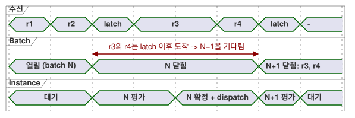
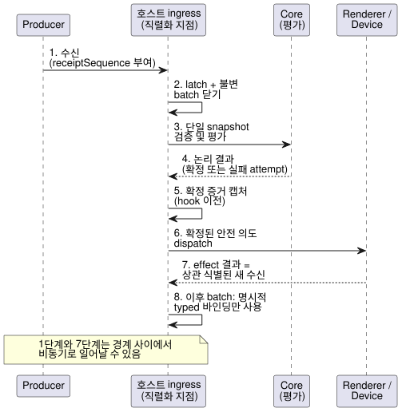

<!-- translation-source: docs/HOST-EVENT-ORDERING-CONTRACT.md -->
[영문 원문](HOST-EVENT-ORDERING-CONTRACT.md)

# 호스트 이벤트 순서 계약

**상태:** [#115](https://github.com/callin2/ghostflow-language/issues/115)를 위한 계약과
실행 가능한 conformance(적합성) **모델**입니다.

이 문서는 호스트가 들어오는 이벤트(수신, receipt)의 순서를 어떻게 정하고, 이를 어떻게
scan 단위로 묶는지 정의합니다. 아래의 ingress queue와 경계 규칙은 아직 어떤 호스트도
구현하지 않았습니다. 각 호스트는 앞으로 이 규칙을 도입해야 합니다.

이 변경은 제품용 이벤트 엔진, 소스 문법, descriptor 바인딩, 펌웨어 정책, 전송 schema나
ABI를 **추가하지 않습니다**. command/alarm descriptor 구현이나 특정 frontend에도
의존하지 않습니다.

**이 문서의 내용**

- **권위와 현재 구현**: 이 계약이 기반으로 삼는 문서와 현재 존재하는 구현.
- **Run 안의 수신 순서와 batch 경계**: 수신에 번호를 매기고 batch로 묶는 방법.
- **필수 순서**: 수신부터 다음 판단까지의 여덟 단계.
- **실패, 상관 식별과 안전**: 평가나 effect가 실패했을 때 일어나는 일.
- **경계 사례와 증거**: 호스트가 통과해야 하는 테스트 vector.

아래에서 사용하는 핵심 용어는 다음과 같습니다.

| 용어 | 의미 |
| --- | --- |
| 수신(receipt) | 호스트가 책임을 넘겨받은 이벤트 하나 |
| Batch | 한 번의 scan이 평가하는, 변경할 수 없는 연속된 수신 묶음 |
| Latch | scan 경계에서 batch를 원자적으로 닫는 동작 |
| Effect | 확정된 결과로부터 내보내는 외부 동작(예: renderer 쓰기) |

## 권위와 현재 구현

이 계약은 호스트 수신과 scan 경계의 순서만 정합니다. 다른 문서가 소유하는 생명주기를
다시 정의하지 않습니다.

- [Reference 2.8](reference/02-types-expressions-state.md)은 tick(논리 판단 단위)의
  변경할 수 없는 입력 snapshot과, 논리 상태와 출력의 원자적 확정을 정의합니다.
- [Reference 4.7](reference/04-sensors-constraints-control.md)은 requested, safe,
  applied, confirmed 증거를 구분합니다.
- [Reference 5.3](reference/05-settings-and-observation.md)과
  [interaction stream 설계](INTERACTION-STREAM-CONTRACT.ko.md)는 완료된 snapshot을
  순서 있는 이벤트 및 명령 결과와 구별합니다.

현재 존재하는 구현은 다음과 같습니다.

- `runtimes/wasm/framed-runtime.mjs`는 동기 dispatch 전에 완전한 typed frame을
  캡처합니다.
- `crates/ghostflow-core/src/scan.rs`는 scan 식별자와 시간을 검증합니다. 실패한 scan은
  성공한 scan의 식별자나 시간을 전진시키지 않습니다.
- `crates/ghostflow-core/src/lib.rs`는 성공한 논리 결과를 확정하기 전에 후보 상태와
  의도를 계산합니다.
- `runtimes/wasm/control-runtime.mjs`는 준비/precommit rollback과 postcommit 어댑터
  실패를 구분합니다.

이 인터페이스들은 공유 외부 수신 queue, batch latch, 이벤트 동률 처리 규칙을
구현하지 **않습니다**. 기존 테스트는 core와 어댑터에 대한 증거입니다. 이 새로운
ingress 계약이 이미 배포되었다는 증거는 아닙니다.

[물리 순서](LLM-TOOLCHAIN-ARCHITECTURE.ko.md) 문서는 Device 출력이 실패하면 호스트가
논리 확정을 되돌리지 않고 중단한다고 설명합니다. 이 계약을 작성하면서 Device 펌웨어
revision은 검사하지 않았습니다. 이 계약은 그 정책을 대체하지 않으며, 물리 동작이
검증되었다고 주장하지도 않습니다.

## Run 안의 수신 순서와 batch 경계

**수신에 번호 매기기.** 하나의 호스트 직렬화 지점이 받아들인 수신마다 run 내부의
`receiptSequence`를 부여합니다. 이 sequence는 연속적이며 재사용하지 않습니다. 호스트는
수신의 책임을 넘겨받는 시점, 즉 어떤 관찰자도 실행되기 전에 이 번호를 부여합니다.

- 벽시계 timestamp나 단조 timestamp가 같은 두 수신도 별개의 수신입니다. 동률은
  sequence가 해소합니다.
- producer 이벤트 시간, producer sequence, source epoch는 각자 별도의 증거로
  보존합니다.
- 더 이른 producer timestamp를 가졌지만 늦게 도착한 수신은 이미 닫힌 batch로 절대
  옮겨지지 않습니다.
- 독립된 producer 사이에는 호스트 수신 순서 외에 암묵적인 전역 인과 순서가 없습니다.

**Batch 닫기.** scan 경계에서 호스트는 이전 latch 이후에 받아들인 수신 중 가장 긴 연속
prefix를 원자적으로 latch합니다. 적절한 경우 이 prefix는 비어 있을 수 있습니다. 호스트는
다음을 기록합니다.

- 별개의 attempt/boundary 식별자
- 정확한 source/module/binding/run 식별자
- 수신 범위
- scan/time 후보

그런 다음 변경할 수 없는 batch를 닫습니다. 하나의 수신이 두 batch에 걸칠 수는 없습니다.
latch 이후에 도착한 수신은 평가, 논리 확정, effect dispatch, 관찰 hook 도중에 도착했더라도
나중 batch에 속합니다. 재진입 callback도 같은 직렬화 지점을 사용합니다. 재진입
callback은 현재 batch를 변경하거나 같은 instance의 평가를 겹쳐 시작할 수 없습니다.

아래 타임라인은 batch N을 평가하고 dispatch하는 동안 도착한 두 수신을 보여 줍니다. 두
수신은 모두 batch N+1을 기다립니다.

**순서는 의미가 아닙니다.** 이것은 수신 순서일 뿐, 보편적인 reducer가 아닙니다. 선언된
각 입력/event 바인딩이 자체 검증, 중복 처리, protocol 순서, snapshot projection을
정의합니다.

- 이름이나 Bool 값으로부터 last-value-wins, 명령 우선순위, 알람 의미, 물리 ACK를 추론하지
  마십시오.
- source의 순서 있는 이벤트 protocol은 해당 바인딩 안에서 권위를 유지합니다.
- 충돌하거나 누락된 증거는 명시적으로 진단합니다.

**한계.** 저장 공간과 payload의 한계는 유한하며 호스트 프로필이 선택합니다. overflow가
발생하면 호스트는 수신을 받아들이기 *전에* admission(수용)을 거부합니다. 이미 받아들인
수신을 버리거나 번호를 다시 매기지 않습니다. 받아들인 뒤에 손실이 생기면 명시적인
gap/fault 증거가 필요합니다.

## 필수 순서

호스트는 각 batch를 다음 순서로 처리해야 합니다.

| 순서 | 경계 | 필수 결과 |
| --- | --- | --- |
| 1 | 수신 수락 | 식별자를 직렬화하고 원본 증거를 보존합니다. 열린 queue를 대상으로 평가하지 않습니다 |
| 2 | Batch latch 및 닫기 | 연속된 수신 prefix와 완전한 typed frame, 시계, 이전 상태 문맥을 동결합니다 |
| 3 | 검증 및 평가 | 그 단일 snapshot에서 core가 소유하는 다음 상태, 요청 의도, 제약을 적용한 안전 의도를 계산합니다 |
| 4 | 논리 결과 | 성공하면 논리 상태와 결과를 함께 확정합니다. 실패하면 완료된 snapshot이나 새 effect 없이 실패한 attempt를 기록합니다 |
| 5 | 확정 증거 캡처 | hook을 호출하거나 물리 dispatch를 하기 전에 완료/출력 의도를 실제로 확정된 scan에 연결합니다 |
| 6 | 외부 effect dispatch | 기존 renderer/프로필 정책에 따라 확정된 안전 의도를 내보냅니다. 부분적인 물리 적용은 여전히 가능합니다 |
| 7 | Effect 결과 수신 | 실제 성공/실패/불확실성을 상관 식별된 별도 수신으로 기록합니다. 이후의 허용된 경계에서만 수용합니다 |
| 8 | 다음 허용 판단 | 명시적 typed 바인딩은 새 수신을 사용할 수 있습니다. 원래 판단을 소급하여 변경하지 않습니다 |

시퀀스 다이어그램은 같은 여덟 단계를 참여자별로 보여 줍니다.

순서에 대한 참고 사항은 다음과 같습니다.

- 1단계와 7단계는 직렬화된 경계 사이에서 비동기로 일어날 수 있습니다.
- 확정 증거 캡처(5단계)는 hook보다 먼저 일어납니다. 하지만 네트워크 export가 물리
  dispatch보다 먼저 끝날 필요는 없습니다.
- export 오류는 확정을 되돌리거나 관측하지 않은 effect를 만들어 내서는 안 됩니다.
- batch 소속과 이벤트 sequence는 완료된 scan 식별자와 다릅니다. 또한 interaction
  stream이 독립적으로 부여하는 occurrence sequence와도 다릅니다.

## 실패, 상관 식별과 안전

**평가 또는 검증 실패.** 이전에 확정된 논리 상태를 보존하며, 실패한 후보는 새 effect를
내보내지 않습니다.

- 실패한 batch, 그 수신 소속, attempt 식별자, 사유를 실패 증거로 보존합니다. 수신
  소속은 명령의 성공적인 처리가 아니며, 완료된 scan도 아닙니다.
- 호스트는 실패한 batch를 명시적으로 종결하거나, 재시도 정책에 따라 같은 불변 batch를
  재시도합니다.
- 어느 경우에도 호스트는 멱등이 아닌 요청을 조용히 다시 재생하거나, 재시도에 새로
  도착한 수신을 덧붙여서는 안 됩니다. 이후의 수신은 queue에 남습니다.
- 현재 core는 scan ID/time을 재시도할 수 있습니다. 그 능력만으로 요청 재시도가
  허용되지는 않습니다.

**Effect 결과의 상관 식별.** effect 결과는 자신을 발생시킨 확정 scan, run, 정확한
source/module/binding, effect/attempt 식별자를 가리킵니다.

- 여러 effect와 재시도에는 별개의 식별자가 필요합니다. 재시도가 두 번째 원래 확정을
  만들어 낼 수는 없습니다.
- renderer 수락 기록은 명시된 register/write 수락만 증명합니다. 릴레이 동작이나 물리적
  확인(confirmed)을 증명하지 않습니다.
- 적용이 실패하거나 불확실해도 원래의 논리 상태를 되돌리지 않습니다. 또한 그 상태의
  safe/requested 의도를 거짓 과거 값으로 바꾸지 않습니다.
- 부분 적용과 각 결과의 사유를 보존합니다. 피드백이 없으면 여전히 알 수 없음(unknown)
  입니다.

**Effect 결과가 도착했을 때 queue가 가득 찬 경우.** 늦게 도착한 수신이 queue를 채워서
effect 결과를 수용하지 못할 수 있습니다. 이때는 원래의 확정과, 별도의 결과/수용 실패
증거를 보존하며, 받아들인 receipt sequence를 만들어 내지 않습니다. 모델은 이 기록 경로
고장에서 중단합니다. 이 계약을 도입하는 호스트는 fail-closed 정책을 정의해야 하며,
결과를 조용히 잃어서는 안 됩니다.

**중단 또는 계속.**

- 호스트의 기존 실패 정책이 중단이면 결과를 기록하고 중단합니다. 자동 재시작이나 다음
  scan은 없습니다.
- 계속 실행이 명시적으로 허용되면, 원래 latch 이후에 받아들인 effect 결과는 *이후의*
  판단에만, 그리고 선언된 typed 바인딩을 통해서만 영향을 줄 수 있습니다. 이 결과가
  자동으로 알람, 명령 완료, 임의의 source 입력이 되지는 않습니다.

이 순서 계약은 독립된 비상정지나 watchdog을 일반 batch 뒤에 대기시키지 않습니다. 기존의
out-of-band 안전 경로도 변경하지 않습니다.

## 경계 사례와 증거

`tests/host-event-ordering-contract.test.mjs`는 테스트 내부의 reference 모델이며,
호스트 어댑터가 아닙니다. 그 안의 단순한 request reducer와 effect-failure 입력 바인딩은
명시적인 가상 fixture입니다. 보편적인 제품 정책이나 소스 문법이 아닙니다. 수신과 경계
객체도 모델 표기일 뿐, 승인된 기록 형식이 아닙니다.

| Vector | Conformance 의무 |
| --- | --- |
| 정상 | 수락/latch/평가/확정/dispatch/결과 순서. effect는 확정된 상태와 변경할 수 없는 origin 식별자를 봅니다 |
| 동률과 과거 producer 시간 | 같은 수신 시간은 sequence를 보존합니다. 늦은 source timestamp가 소속 순서를 바꾸지 않습니다 |
| 평가 또는 dispatch 중 도착 | 닫힌 batch는 변하지 않습니다. 새 수신은 정확히 다음 허용 batch에 들어갑니다 |
| 평가 fault | 이전 상태가 유지되고 완료된 결과나 effect가 없습니다. 실패 batch를 명시적으로 처분하며 성공 scan counter는 변하지 않습니다 |
| 계속 실행이 허용된 effect 실패 | origin은 확정된 상태로 남습니다. 결과는 origin과 상관 식별된 이후의 ingress입니다. 다음 판단은 명시적 fixture 바인딩만 사용합니다 |
| 중단 정책의 effect 실패 | 결과를 보존하고 이후 평가를 거부합니다. 자동으로 계속 실행하지 않습니다 |
| 한계와 재진입 | overflow는 sequence 할당 전에 거부됩니다. 불변 캡처와 단일 instance 평가를 강제합니다. 확정 이후 결과 수용이 실패하면 origin/결과 증거를 보존하고 모델이 중단합니다 |

집중된 모델 테스트는 이 계약 oracle만 확립합니다. 계약을 도입하려면 각 호스트는 여전히
다음을 해야 합니다.

1. 자체 latch, 제한된 저장 공간, typed projection, 실패/재시도 정책과 기록을 구현합니다.
2. 실제 어댑터를 통해 같은 사례를 입증합니다.

core 소유권, 현재 ABI, 물리 증거는 변하지 않습니다.
