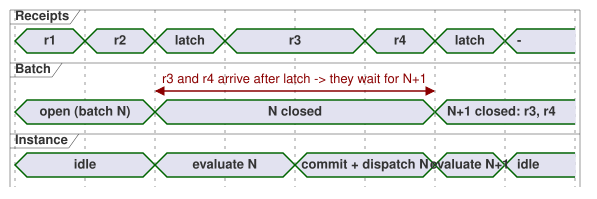
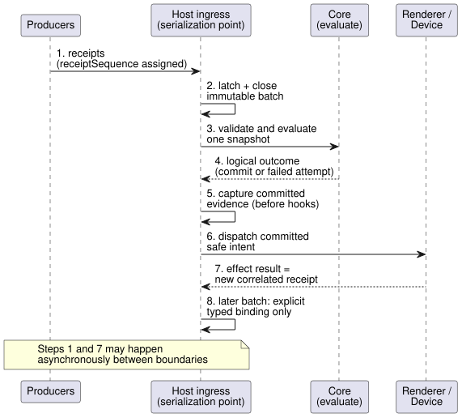

# Host event ordering contract

[한국어](HOST-EVENT-ORDERING-CONTRACT.ko.md)

**Status:** a contract plus an executable conformance **model** for
[#115](https://github.com/callin2/ghostflow-language/issues/115).

This document defines how a host orders incoming events (receipts) and how it
groups them into scans. The ingress queue and boundary rules below are not yet
implemented by any host; each host must adopt them in the future.

This change adds **no** production event engine, source grammar, descriptor
binding, firmware policy, transport schema or ABI. It does not depend on the
command/alarm descriptor implementation or on any particular frontend.

**In this document**

- **Authority and current implementation**: what this contract builds on and what exists today.
- **Run-local receipt and batch boundary**: how receipts are numbered and grouped into batches.
- **Required order**: the eight steps from receipt to the next decision.
- **Failure, correlation and safety**: what happens when evaluation or an effect fails.
- **Boundary cases and evidence**: the test vectors that a host must pass.

Key terms used below:

| Term | Meaning |
| --- | --- |
| Receipt | One event that the host has accepted ownership of |
| Batch | An immutable, contiguous group of receipts that one scan evaluates |
| Latch | The atomic act of closing a batch at a scan boundary |
| Effect | An external action (for example, a renderer write) dispatched from a committed result |

## Authority and current implementation

This contract only orders host receipt and scan boundaries. It does not
redefine the lifecycles that other documents own:

- [Reference 2.8](reference/02-types-expressions-state.en.md#28-tick-and-state-snapshot)
  defines a tick's immutable input snapshot and the atomic commit of logical
  state and outputs.
- [Reference 4.7](reference/04-sensors-constraints-control.en.md#47-requested-safe-applied-confirmed)
  separates requested, safe, applied and confirmed evidence.
- [Reference 5.3](reference/05-settings-and-observation.en.md#53-cabinet-view-independent-observation-model)
  and the [interaction stream design](INTERACTION-STREAM-CONTRACT.md)
  distinguish completed snapshots from ordered events and command results.

What exists today:

- `runtimes/wasm/framed-runtime.mjs` captures a complete typed frame before
  synchronous dispatch.
- `crates/ghostflow-core/src/scan.rs` validates scan identity and time. A failed
  scan does not advance the successful scan identity or time.
- `crates/ghostflow-core/src/lib.rs` computes candidate state and intent before
  it commits successful logical results.
- `runtimes/wasm/control-runtime.mjs` distinguishes preparation/precommit
  rollback from postcommit adapter failure.

These interfaces do **not** implement a shared external receipt queue, a batch
latch, or an event tie-breaker. Their existing tests are evidence for the core
and the adapters. They are not evidence that this new ingress contract is
already deployed.

The [physical sequence](LLM-TOOLCHAIN-ARCHITECTURE.md#physical-driver-and-device-boundary)
documents that the host halts on a Device output failure without rolling back
the logical commit. No Device firmware revision was inspected for this
contract. This contract neither replaces that policy nor claims that physical
behavior has been verified.

## Run-local receipt and batch boundary

**Numbering receipts.** One host serialization point assigns each accepted
receipt a run-local `receiptSequence`. The sequence is contiguous and never
reused. The host assigns it when it accepts ownership of the receipt, before
any observer runs.

- Two receipts with equal wall-clock or monotonic timestamps are still separate
  receipts. The sequence breaks the tie.
- Producer event time, producer sequence and source epoch are kept as their own,
  separate evidence.
- A receipt that carries an earlier producer timestamp but arrives later never
  moves into a batch that is already closed.
- Independent producers have no implied global causal order beyond the order of
  host receipt.

**Closing a batch.** At a scan boundary the host atomically latches the largest
contiguous prefix of receipts accepted since the previous latch. The prefix may
be empty when appropriate. The host records:

- a distinct attempt/boundary identity;
- the exact source/module/binding/run identity;
- the receipt range;
- the scan/time candidate.

It then closes an immutable batch. No receipt can straddle two batches. A
receipt that arrives after the latch belongs to a later batch, even if it arrives
during evaluation, logical commit, effect dispatch or observation hooks.
Reentrant callbacks use the same serialization point. They cannot mutate the
current batch or start an overlapping evaluation of the same instance.

The timeline below shows two receipts that arrive while batch N is being
evaluated and dispatched; both wait for batch N+1.

**Order is not meaning.** This is receipt order, not a universal reducer. Each
declared input/event binding defines its own validation, duplicate handling,
protocol order and snapshot projection.

- Do not infer last-value-wins, command priority, alarm meaning or a physical
  ACK from names or Bool values.
- A source's ordered event protocol remains authoritative within its binding.
- Conflicting or missing evidence is diagnosed explicitly.

**Bounds.** Storage and payload bounds are finite and selected by the host
profile. On overflow the host rejects admission *before* it accepts a receipt.
It never drops or renumbers an accepted receipt. A loss after acceptance
requires explicit gap/fault evidence.

## Required order

A host must process each batch in the following order.

| Order | Boundary | Required result |
| --- | --- | --- |
| 1 | Accept receipts | Serialize identities and preserve original evidence; do not evaluate against an open queue |
| 2 | Latch and close batch | Freeze a contiguous receipt prefix and complete typed frame, clock and prior-state context |
| 3 | Validate and evaluate | Core-owned next state, requested intent and constrained safe intent from that single snapshot |
| 4 | Logical outcome | Success commits logical state/results together; failure records the failed attempt without a completed snapshot or new effects |
| 5 | Capture committed evidence | Bind completion/output intent to the actual committed scan before invoking hooks or physical dispatch |
| 6 | Dispatch external effects | Dispatch the committed safe intent under the existing renderer/profile policy; partial physical application remains possible |
| 7 | Accept effect results | Record separate correlated receipts for actual success/failure/uncertainty; admit them only at a future permitted boundary |
| 8 | Next permitted decision | Explicit typed binding may use new receipts; no retrospective mutation of the originating decision |

The sequence diagram shows the same eight steps across the participants.

Notes on the order:

- Steps 1 and 7 can happen asynchronously, between the serialized boundaries.
- Capturing committed evidence (step 5) comes before hooks. Network export,
  however, does not need to finish before physical dispatch.
- Export errors must not undo a commit or invent an effect that was not observed.
- Batch membership and event sequence are distinct from the completed scan
  identity. They are also distinct from the occurrence sequence that the
  interaction stream assigns independently.

## Failure, correlation and safety

**Evaluation or validation failure.** The previously committed logical state is
preserved, and the failed candidate emits no new effect.

- Retain the failed batch, its receipt membership, the attempt identity and the
  reason as failure evidence. Receipt membership is not successful command
  handling, and it is not a completed scan.
- The host either finalizes the failed batch explicitly, or retries that same
  immutable batch under its retry policy.
- In neither case may the host silently replay nonidempotent requests or append
  new arrivals to a retry. Later receipts stay queued.
- The current core can retry a scan ID/time. That ability alone does not
  authorize request retries.

**Correlating effect results.** An effect result identifies its originating
committed scan, the run, the exact source/module/binding, and the
effect/attempt identity.

- Multiple effects and retries need distinct identities. A retry cannot
  fabricate a second original commit.
- A renderer acceptance record proves only the stated register/write
  acceptance. It does not prove relay movement or physical confirmation.
- A failed or uncertain application does not roll back the originating logical
  state. It also does not replace that state's safe/requested intent with a
  false historical value.
- Preserve partial application and the reason for each result. Missing feedback
  remains unknown.

**Queue full when an effect result arrives.** Late arrivals may fill the queue
before an effect result can be admitted. In that case, preserve the originating
commit and separate result/admission-failure evidence, without inventing an
accepted receipt sequence. The model halts on this record-path fault. A host
that adopts the contract must define a fail-closed policy and must not silently
lose the result.

**Halt or continue.**

- If the host's existing failure policy halts, record the result and halt. There
  is no automatic restart or next scan.
- If continuation is explicitly permitted, an effect result accepted after the
  origin latch can influence only a *future* decision, and only through a
  declared typed binding. It does not automatically become an alarm, a command
  completion or an arbitrary source input.

This ordering contract does not queue an independent emergency stop or watchdog
behind ordinary batches. It does not change any existing out-of-band safety path.

## Boundary cases and evidence

`tests/host-event-ordering-contract.test.mjs` is a test-local reference model,
not a host adapter. Its simple request reducer and its effect-failure input
binding are fictional, explicit fixtures. They are not universal product policy
or source syntax. Its receipt and boundary objects are model notation, not
approved record formats.

| Vector | Conformance obligation |
| --- | --- |
| Normal | Accept/latch/evaluate/commit/dispatch/result order; effect sees committed state and immutable origin identity |
| Tie and old producer time | Equal receipt times preserve sequence; late source timestamps do not reorder membership |
| Arrival during evaluation or dispatch | Closed batch unchanged; new receipt enters exactly the next permitted batch |
| Evaluation fault | Previous state intact, no completed result/effect; explicit failed-batch disposition, unchanged successful scan counter |
| Effect failure with permitted continuation | Origin stays committed; result is later ingress, correlated to origin; next decision uses only an explicit fixture binding |
| Effect failure with halt policy | Result preserved, later evaluation refused; no automatic continuation |
| Bounds and reentrancy | Overflow rejects before sequence allocation; immutable capture and single-instance evaluation enforced; postcommit result admission failure retains origin/result evidence and halts the model |

The focused model tests establish only these contract oracles. To adopt the
contract, each host must still:

1. implement its latch, bounded storage, typed projection, failure/retry policy
   and records; and
2. demonstrate the same cases through its actual adapter.

Core ownership, the current ABI and physical evidence remain unchanged.
