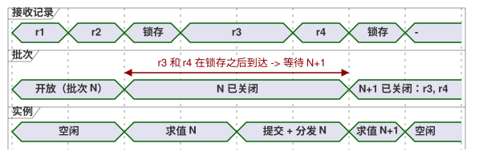
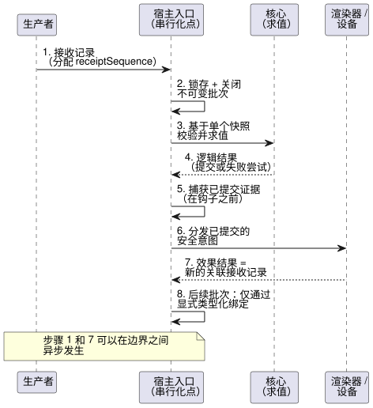

<!-- translation-source: docs/HOST-EVENT-ORDERING-CONTRACT.md -->
[英文原文](HOST-EVENT-ORDERING-CONTRACT.md)

# 宿主事件排序契约

[한국어](HOST-EVENT-ORDERING-CONTRACT.ko.md)

**状态：** 针对 [#115](https://github.com/callin2/ghostflow-language/issues/115) 的一份契约，外加一个可执行的一致性**模型**。

本文档定义宿主（host）如何对传入的事件（接收记录，receipt）排序，以及如何把它们分组到各次扫描中。下文的入口队列和边界规则目前尚未被任何宿主实现；今后每个宿主都必须采用这些规则。

本次变更**不**新增任何生产级事件引擎、源语法、descriptor 绑定、固件策略、传输模式（schema）或 ABI。它不依赖命令/报警 descriptor 的实现，也不依赖任何特定前端。

**本文内容**

- **权威来源与当前实现**：本契约所依据的内容，以及目前已经存在的内容。
- **运行内接收记录与批次边界**：接收记录如何编号并分组为批次。
- **必需顺序**：从接收到下一次判定的八个步骤。
- **失败、关联与安全**：求值或效果失败时会发生什么。
- **边界情形与证据**：宿主必须通过的测试向量。

下文使用的关键术语：

| 术语 | 含义 |
| --- | --- |
| 接收记录（Receipt） | 宿主已接受其所有权的一个事件 |
| 批次（Batch） | 由一次扫描求值的、不可变且连续的一组接收记录 |
| 锁存（Latch） | 在扫描边界上关闭一个批次的原子操作 |
| 效果（Effect） | 根据已提交结果分发的外部动作（例如一次渲染器写入） |

## 权威来源与当前实现

本契约只对宿主接收和扫描边界进行排序。它不会重新定义由其他文档负责的生命周期：

- [参考手册 2.8](reference/02-types-expressions-state.zh.md)
  定义了 tick 的不可变输入快照，以及逻辑状态与输出的原子提交。
- [参考手册 4.7](reference/04-sensors-constraints-control.zh.md)
  区分 requested、safe、applied 和 confirmed 证据。
- [参考手册 5.3](reference/05-settings-and-observation.zh.md)
  和[交互流设计](INTERACTION-STREAM-CONTRACT.zh.md)
  将已完成的快照与有序事件和命令结果区分开来。

目前已经存在的内容：

- `runtimes/wasm/framed-runtime.mjs` 会在同步分发之前捕获一个完整的类型化帧。
- `crates/ghostflow-core/src/scan.rs` 校验扫描标识和时间。失败的扫描不会推进成功扫描的标识或时间。
- `crates/ghostflow-core/src/lib.rs` 先计算候选状态和意图，然后才提交成功的逻辑结果。
- `runtimes/wasm/control-runtime.mjs` 区分准备/提交前回滚与提交后的适配器失败。

这些接口**并未**实现共享的外部接收队列、批次锁存或事件决胜规则（tie-breaker）。它们现有的测试是核心和适配器的证据，并不能证明这一新的入口契约已经部署。

[物理序列](LLM-TOOLCHAIN-ARCHITECTURE.zh.md)记录了：宿主在 Device 输出失败时会停机，但不会回滚逻辑提交。本契约没有检查任何 Device 固件修订版。本契约既不取代该策略，也不声称物理行为已经得到验证。

## 运行内接收记录与批次边界

**为接收记录编号。** 由宿主的一个串行化点为每条被接受的接收记录分配一个运行内的 `receiptSequence`。该序列是连续的，且绝不复用。宿主在接受接收记录所有权的那一刻、任何观察者运行之前分配它。

- 两条墙钟时间戳或单调时间戳相同的接收记录仍然是两条独立的接收记录，由序列决定先后。
- 生产者事件时间、生产者序列和来源纪元（source epoch）作为各自独立的证据保留。
- 携带较早生产者时间戳但较晚到达的接收记录，绝不会被移入已经关闭的批次。
- 除宿主接收顺序之外，独立生产者之间不存在任何隐含的全局因果顺序。

**关闭批次。** 在扫描边界上，宿主以原子方式锁存自上次锁存以来所接受的接收记录中最大的连续前缀。在适当情况下，该前缀可以为空。宿主记录：

- 一个独立的尝试/边界标识；
- 精确的来源/模块/绑定/运行标识；
- 接收记录范围；
- 扫描/时间候选值。

然后宿主关闭一个不可变批次。任何接收记录都不能横跨两个批次。在锁存之后到达的接收记录属于后续批次，即使它是在求值、逻辑提交、效果分发或观测钩子执行期间到达的。可重入回调使用同一个串行化点，它们不能修改当前批次，也不能为同一实例启动重叠的求值。

下面的时间线展示了两条在批次 N 求值和分发期间到达的接收记录；二者都要等待批次 N+1。

**顺序不等于含义。** 这里说的是接收顺序，而不是一个通用的归约器（reducer）。每个声明的输入/事件绑定各自定义其校验、重复处理、协议顺序和快照投影。

- 不要根据名称或 Bool 值推断“最后值获胜”、命令优先级、报警含义或物理 ACK。
- 来源的有序事件协议在其绑定范围内仍然具有权威性。
- 冲突或缺失的证据会被显式诊断。

**界限。** 存储和负载的界限是有限的，由宿主 profile 选定。发生溢出时，宿主会在接受接收记录*之前*拒绝准入。它绝不会丢弃已接受的接收记录或为其重新编号。接受之后发生的丢失需要显式的间隙/故障证据。

## 必需顺序

宿主必须按以下顺序处理每个批次。

| 顺序 | 边界 | 必需结果 |
| --- | --- | --- |
| 1 | 接受接收记录 | 串行化标识并保留原始证据；不得针对开放中的队列求值 |
| 2 | 锁存并关闭批次 | 冻结一个连续的接收记录前缀，以及完整的类型化帧、时钟和先前状态上下文 |
| 3 | 校验并求值 | 基于该单一快照，由核心计算下一状态、请求意图和经约束的安全意图 |
| 4 | 逻辑结果 | 成功时一起提交逻辑状态/结果；失败时记录失败的尝试，不产生已完成快照，也不产生新效果 |
| 5 | 捕获已提交证据 | 在调用钩子或物理分发之前，将完成/输出意图绑定到实际已提交的扫描 |
| 6 | 分发外部效果 | 按现有渲染器/profile 策略分发已提交的安全意图；仍可能出现部分物理应用 |
| 7 | 接受效果结果 | 为实际的成功/失败/不确定记录单独的、相关联的接收记录；只在未来某个允许的边界上准入它们 |
| 8 | 下一次允许的判定 | 显式的类型化绑定可以使用新的接收记录；不得追溯修改发起该效果的判定 |

下面的序列图展示了各参与者之间的这八个步骤。

关于该顺序的说明：

- 步骤 1 和 7 可以在串行化边界之间异步发生。
- 捕获已提交证据（步骤 5）发生在钩子之前。不过，网络导出不需要在物理分发之前完成。
- 导出错误不得撤销提交，也不得虚构一个未被观测到的效果。
- 批次成员关系和事件序列不同于已完成扫描的标识，也不同于交互流独立分配的触发实例（occurrence）序列。

## 失败、关联与安全

**求值或校验失败。** 先前已提交的逻辑状态被保留，失败的候选不发出任何新效果。

- 将失败的批次、其接收记录成员关系、尝试标识和原因作为失败证据保留。接收记录成员关系既不代表命令处理成功，也不是一次已完成的扫描。
- 宿主要么显式地终结失败的批次，要么按其重试策略重试同一个不可变批次。
- 无论哪种情况，宿主都不得静默重放非幂等请求，也不得向重试追加新到达的记录。后续接收记录继续排队。
- 当前核心可以重试某个扫描 ID/时间。仅凭这一能力并不授权重试请求。

**关联效果结果。** 效果结果标识其发起所在的已提交扫描、运行、精确的来源/模块/绑定，以及效果/尝试标识。

- 多个效果和多次重试需要各自不同的标识。重试不能伪造第二次原始提交。
- 渲染器的受理记录只证明所述的寄存器/写入已被受理，不证明继电器动作或物理确认。
- 失败或不确定的应用不会回滚发起时的逻辑状态，也不会用一个错误的历史值替换该状态的 safe/requested 意图。
- 保留部分应用以及每个结果的原因。缺失的反馈仍为未知。

**效果结果到达时队列已满。** 迟到的记录可能在效果结果被准入之前就填满队列。这种情况下，应保留发起时的提交，并单独保留结果/准入失败证据，不得虚构一个已接受的接收序列号。模型会在这一记录路径故障上停机。采用本契约的宿主必须定义故障关闭（fail-closed）策略，且不得静默丢失该结果。

**停机还是继续。**

- 如果宿主现有的失败策略是停机，则记录结果并停机。不会自动重启，也不会进行下一次扫描。
- 如果显式允许继续，那么在发起批次锁存之后被接受的效果结果只能影响*未来*的判定，并且只能通过声明的类型化绑定。它不会自动变成报警、命令完成或任意来源输入。

本排序契约不会把独立的急停或看门狗排在普通批次之后，也不会改变任何现有的带外安全路径。

## 边界情形与证据

`tests/host-event-ordering-contract.test.mjs` 是一个测试本地的参考模型，而不是宿主适配器。其中简单的请求归约器和效果失败输入绑定都是虚构的显式夹具（fixture），既不是通用的产品策略，也不是源语法。其接收记录和边界对象是模型记法，而不是已批准的记录格式。

| 向量 | 一致性义务 |
| --- | --- |
| 正常 | 接受/锁存/求值/提交/分发/结果的顺序；效果看到的是已提交状态和不可变的发起标识 |
| 时间相同与旧的生产者时间 | 接收时间相同时保留序列；较晚的来源时间戳不会改变成员关系的顺序 |
| 求值或分发期间到达 | 已关闭批次保持不变；新接收记录恰好进入下一个允许的批次 |
| 求值故障 | 先前状态完好，无已完成结果/效果；显式处置失败批次，成功扫描计数器不变 |
| 允许继续时的效果失败 | 发起批次保持已提交；结果作为后续入口记录到达，并与发起批次关联；下一次判定只使用显式夹具绑定 |
| 停机策略下的效果失败 | 保留结果，拒绝后续求值；不会自动继续 |
| 界限与可重入 | 溢出在分配序列号之前被拒绝；强制不可变捕获和单实例求值；提交后结果准入失败时保留发起/结果证据并使模型停机 |

这些聚焦的模型测试只确立了上述契约判定基准（oracle）。要采用本契约，每个宿主仍然必须：

1. 实现其锁存、有界存储、类型化投影、失败/重试策略和记录；并且
2. 通过其实际适配器演示相同的情形。

核心所有权、当前 ABI 和物理证据保持不变。
