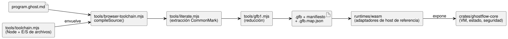

<!-- translation-source: docs/IMPLEMENTATION.md -->
[Original en inglés](IMPLEMENTATION.md)

# Implementación y fronteras de los artefactos

Este documento describe qué hace la implementación actual, qué artefactos
produce y dónde termina su responsabilidad.

Esta exportación mantiene sin cambios el compilador existente y el runtime
(entorno de ejecución) portable. Los documentos del lenguaje describen tanto la
sintaxis implementada como el diseño futuro. Lo que realmente se acepta lo
deciden el compilador y las pruebas del host descritas en
[VERIFICATION.md](VERIFICATION.es.md), no los documentos.

**Entrada por lotes de Station.** El adaptador WASM fijo de Station expone
`enterBatch(requests)` para el contrato existente de Rust `Station::enter_batch`
(Referencia §4.10).

- Los hosts despachan primero un Stop observado. Después envían en un solo lote
  todas las entradas de modo del mismo tick.
- Las entradas en conflicto se rechazan de forma atómica, incluso desde Stopped.
  Nunca se ponen en cola hasta que termine la limpieza.
- Las llamadas secuenciales a `enter()` siguen siendo solicitudes individuales.
  No pueden representar un lote en conflicto.

La exportación aditiva `gf_station_enter_batch` admite como máximo 256 registros
empaquetados de 32 bytes. Cada registro contiene cuatro campos u64 little-endian,
en este orden:

1. ID de solicitud;
2. revisión;
3. generación de parada;
4. modo (1 Auto, 2 Manual, 3 Configure).

El adaptador valida todos los registros antes de llamar al núcleo. Esto no
cambia GFB/GFS ni las exportaciones existentes; los llamadores que necesiten
lotes requieren esta nueva exportación. Las pruebas nativas y WASM usan la misma
fuente canónica verificada de Station y la configuración generada por la
vinculación (binding). Las salidas aplicadas y los ACK duraderos provienen de
fixtures del host; no hay verificación física.

## Ruta ejecutable

El diagrama muestra cómo un documento `.ghost.md` se convierte en un artefacto
ejecutable y qué componentes lo ejecutan.

**Puntos de entrada del compilador.**

- `tools/browser-toolchain.mjs` expone `compileSource(source, {filename,
  interactionSourceIdentity})`. Solo acepta documentos `.ghost.md` canónicos y
  se puede importar de forma segura desde un Worker del navegador.
- `tools/toolchain.mjs` envuelve ese mismo compilador neutral respecto del
  entorno para Node y se encarga de la E/S de artefactos en el sistema de
  archivos.
- La extracción CommonMark conserva el mapeo a las posiciones originales a
  través de `tools/literate.mjs`. El control extraído se reduce después a GFB1
  a través de `tools/gfb1.mjs`.
- La fuente plana (no Markdown) se rechaza en ambas fronteras públicas del
  compilador.

El conjunto de pruebas del lenguaje verifica que el grafo local de importaciones
de la entrada de navegador no dependa de módulos integrados de Node ni de
`Buffer`, y ejecuta la entrada con `Buffer` no disponible. No añade un ejecutor
de navegador ni afirma tener evidencia de Workers en Vite/Chromium. Esa
integración del consumidor pertenece a la frontera de Farm Studio Web.

**Composición fijada.** La composición fijada proporciona
`sourceClosure: [{filename, revision, text}]` y acepta definiciones de sensores
y de funciones puras sin cambios.

- Las funciones y sus llamadas tienen ámbito por instancia, por lo que se
  conservan las vinculaciones locales.
- Los paquetes de sensores raíz se distribuyen a las instancias antes del
  acondicionamiento. Cada instancia es titular de su propio estado original de
  filtro, frescura y recuperación.
- `manifest.sensors` enumera los puertos públicos. El campo opcional
  `manifest.sensorInstances` enumera descriptores privados con `sourceSensor`,
  `instance` y `port`. Los hosts aceptan paquetes solo para sensores públicos.
- Las conexiones de sensores requieren una coincidencia exacta de carga útil,
  opcionalidad e intervalo de muestreo declarado.
- La restauración de artefactos verifica este enrutamiento contra el cierre de
  fuentes completo.

Las ranuras de entrada generadas usan las interfaces existentes de GFB y
WASM/trama. Las pruebas comparan las tramas acondicionadas reales con la VM
nativa con tramas. No afirman la existencia de un host nativo de escenarios con
sensores en bruto. Véase
[#377](https://github.com/callin2/ghostflow-language/issues/377).

**Superficie del lenguaje admitida.** El control moderno admite entradas,
configs, salidas, estado, enumeraciones finitas, funciones puras,
comprobaciones de expresiones/estado siguiente, temporizadores de tiempo
transcurrido, DailySlots, sensores y señales, todo dentro del perfil acotado
existente. Las restricciones independientes usan entrada `.ghost.md` canónica a
través de `tools/ghostrules.mjs`. Su reductor interno `tools/constraints.mjs`
produce el formato separado de política generada. La sintaxis no admitida se
rechaza; esta exportación no añade funciones del lenguaje.

**Quién es titular de qué en tiempo de ejecución.**

| Componente | Responsabilidad |
| --- | --- |
| `crates/ghostflow-core` | Carga de módulos, ejecución de expresiones, transiciones de estado simultáneas, resolución de intención/seguridad, acondicionamiento de señales y arbitraje de estaciones |
| `runtimes/wasm` | Expone esos motores; contiene adaptadores de host de referencia para la validación del manifiesto, las entradas generadas, las programaciones y las devoluciones de llamada de persistencia |
| `runtimes/node/ledger.mjs` | Persistencia en archivos usada por las pruebas de estación del host |

Los consumidores de API y de firmware deben usar estas implementaciones a través
de sus contratos. No deben reimplementar las transiciones de la VM.

**Las salidas son intención, no estado del hardware.** Una declaración
`output name: Type;` es solo de tipo y debe tener exactamente una conexión
`name <- expression;`. La conexión produce la intención lógica *solicitada*
(requested) del tick. La resolución de seguridad puede producir una intención
*segura* (safe) diferente. La VM no asigna valores predeterminados de arranque y
no promete que una intención haya llegado al hardware. El comportamiento de
apagado (OFF) en el arranque y ante fallos, el momento de aplicación de las
salidas y el manejo de la desconexión del renderizador son política del
host/renderizador y requieren evidencia separada.

**Políticas Solar/Tide extendidas.** Las políticas naturales Solar/Tide
extendidas seleccionan GFB13 y `GhostFlow/control-v12`; los hechos Solar usan
GFSF6.

- Los perfiles heredados y los bytes de paquete no cambian.
- Los nombres de funciones WASM no cambian. Los runtimes anteriores fijados
  rechazan GFB13.
- El perfil GFB11 solo de configuración del paquete portable firmado no se
  amplía.
- La cobertura de regresión del compilador/runtime corresponde a
  `natural-fallback-compiler.test.mjs`, `natural-fallback-runtime.test.mjs` y
  las pruebas `solar_tape` del núcleo. Esta documentación no establece su
  resultado de ejecución ni el comportamiento físico del Device.

**Fronteras de calendario.** La porción adoptada de fronteras de calendario usa
GFB18 y `GhostFlow/control-v18`.

- `calendar_is` se reduce a una consulta Result tipada.
- Un Range Daily inmutable en UTC de días laborables/no laborables se reduce a
  una admisión filtrada por calendario.
- Ambos se ejecutan en el núcleo Rust compartido, a partir de instantáneas
  identificadas, mediante hechos GFSF5 sin cambios. Se requieren vinculaciones
  UTC explícitas coincidentes.
- Los rangos laborables que cruzan la medianoche se rechazan; divídalos en
  declaraciones separadas. Los rangos UTC ordinarios mantienen su
  comportamiento existente.
- Esta porción no implementa Range fuera de UTC, la titularidad de turnos ni las
  bases Window/Run diferidas.

La evidencia de aceptación nativa y WASM con tramas corresponde a
`tests/reference-calendar-boundary.test.mjs`, no a la documentación ni a un
modelo.

## Artefactos y versiones

| Elemento | Representación actual | Función |
|---|---|---|
| Programa con autoridad | `.ghost.md` | Fuente literaria (literate) con intención, código, comentarios y explicación |
| Ejecutable generado | `.gfb`, magic `GFB1` con un formato `u16` seleccionado según las funciones usadas (originalmente 1–9, 11 o 12; funciones posteriores añaden formatos como 13 y 18) | IR binaria consumida por la VM; véase [BYTECODE.md](BYTECODE.es.md) para la lista con autoridad |
| Manifiesto de control generado | `GhostFlow/control-v1`, `v2`, `v3`, `v4`, `v7`, `v8` o `v10` según las funciones usadas; funciones posteriores añaden versiones como `v12` y `v18` | Puertos tipados del host, requisitos de temporizadores/sensores/programaciones y hash del bytecode |
| Política de restricciones generada | `GhostFlow/constraints-v1` | Fuente de restricciones independiente reducida, vinculada por el host |
| Mapa de fuente generado | `.gfb.map.json` | Mapeo de nodos/líneas de diagnóstico; envoltorio que conserva la fuente, producido por compileSource según SOURCE-MAP.md |
| Identidad/evidencia de integración | `contracts/integration-v1`, verificador puro | Identidades de versión publicada, perfil, mapeo y ejecución entre proyectos |
| Verificación del host | `GhostFlow/language-verification-v1` | Comandos, resultados y hashes de fuente/artefactos de esta copia de trabajo |

**Las versiones son independientes.** La versión npm/del núcleo `0.1.0`, el
perfil del lenguaje fuente, la versión del bytecode, el formato del manifiesto y
la versión del firmware son independientes entre sí.

- El mapa de migración original era un objeto de nodos/líneas sin versión. El
  [contrato de mapa de fuente](SOURCE-MAP.es.md) aditivo conserva esos campos y
  añade un envoltorio versionado de la fuente original y hashes emparejados.
- El magic `GFB1` permanece igual. Su versión de formato y el manifiesto de
  control varían según las funciones de la fuente usadas.
- El verificador del contrato v1 del equipo de integración se incluye sin
  cambios.

**Responsabilidades de publicación.** El responsable de una versión publicada
debe mantener juntos la fuente, el bytecode, el manifiesto y el mapa, junto con:

- sus hashes;
- la revisión del compilador/núcleo;
- los bloqueos de dependencias;
- el ABI/perfil del runtime;
- los requisitos de funciones aplicables.

`compileSource` vincula el manifiesto al SHA-256 del bytecode. Un hash es una
comprobación de integridad, no una firma de autenticidad. El contrato de
integración proporciona campos adicionales de identidad y compatibilidad. Su
ejemplo es ficticio; no es un programa desplegable ni un resultado de
ejecución. El empaquetado de producción y el cableado de API/Device siguen
siendo trabajo del consumidor. Los registros de despliegue de la API y las
versiones publicadas del firmware se versionan por separado.

**Registros de instalación frente a semántica del programa.** Los registros de
instalación proporcionan nombres, capacidades, vinculaciones y hechos conocidos
del sitio. Las programaciones ejecutables, los enclavamientos y las
transiciones pertenecen a la fuente (incluida la fuente de restricciones
independiente) y a sus artefactos compilados. Un registro de vinculación no
puede anular silenciosamente la semántica del programa.

## Límites y responsabilidades del consumidor

- Actualmente el núcleo usa `std` de Rust y asignación dinámica de memoria. La
  fuente portable no establece `no_std`, memoria fija para toda la VM, cotas de
  tiempo en MCU ni un perfil de dispositivo.
- La paridad nativa CSV/WASM reproduce las mismas instantáneas de entrada de la
  VM generadas. No prueba que otro host genere datos idénticos de sensores,
  temporizadores o programaciones.
- La compatibilidad del lenguaje con sensores/señales existe en esta plataforma
  de host. Un firmware puede admitir un perfil más pequeño y debe rechazar
  explícitamente los requisitos no admitidos.
- El mapeo de drivers, la sincronización de relojes, la E/S física, el
  despliegue atómico en dispositivos, la recuperación, la calidad de la
  intención generada por LLM y la interacción con el agricultor pertenecen a los
  proyectos consumidores.
- Esta exportación no añade restauración general completa de puntos de control
  (checkpoints), compactación automática del ledger, mapeo de fuente por opcode
  ni firma/empaquetado de versiones de producción.
