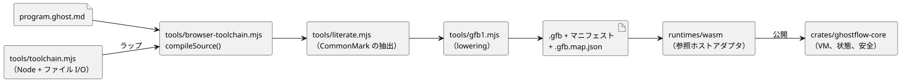

<!-- translation-source: docs/IMPLEMENTATION.md -->
[英語の原文](IMPLEMENTATION.md)

# 実装と成果物の境界

この文書では、現在の実装が何を行い、どの成果物を生成し、その責任がどこで終わるかを説明します。

このエクスポートは、既存のコンパイラとポータブルランタイムを変更しません。言語文書には、実装済みの構文と将来の設計の両方が書かれています。実際に何が受け入れられるかを決めるのは、文書ではなく、コンパイラと [VERIFICATION.md](VERIFICATION.ja.md) に記載されたホストテストです。

**Station のバッチ投入。**固定の Station WASM アダプタは、既存の Rust `Station::enter_batch` 契約（Reference §4.10）のために `enterBatch(requests)` を公開しています。

- ホストは、観測された Stop を最初にディスパッチします。その後、同じ tick のすべてのモード投入を 1 つのバッチで送信します。
- 競合する投入は、Stopped からのものも含めてアトミックに拒否されます。クリーンアップが完了するまでキューに入れておくことは決してありません。
- 逐次的な `enter()` 呼び出しは、引き続き単一のリクエストです。競合するバッチを表現することはできません。

追加された `gf_station_enter_batch` エクスポートは、パックされた 32 バイトのレコードを最大 256 個受け取ります。各レコードには、リトルエンディアンの u64 フィールドが次の順で 4 つ含まれます。

1. リクエスト ID
2. リビジョン
3. 停止世代（stop generation）
4. モード（1 Auto、2 Manual、3 Configure）

アダプタは、コアを呼び出す前にすべてのレコードを検証します。これにより GFB/GFS も既存のエクスポートも変わりません。バッチを必要とする呼び出し側には、この新しいエクスポートが必要です。ネイティブと WASM のテストは、検査済みの同じ正準 Station ソースと、バインディングから生成された設定を使います。適用された出力と永続的な ACK はホストのフィクスチャから得られます。物理的な検証はありません。

## 実行経路

図は、`.ghost.md` 文書がどのように実行可能な成果物になり、どのコンポーネントがそれを実行するかを示しています。

**コンパイラのエントリポイント。**

- `tools/browser-toolchain.mjs` は `compileSource(source, {filename,
  interactionSourceIdentity})` を公開します。正準の `.ghost.md` 文書のみを受け付け、ブラウザの Worker からインポートしても安全です。
- `tools/toolchain.mjs` は、環境に依存しない同じコンパイラを Node 向けにラップし、成果物のファイルシステム I/O を担います。
- CommonMark の抽出は、`tools/literate.mjs` を通じて元の位置への対応を保持します。抽出された control は、その後 `tools/gfb1.mjs` を通じて GFB1 に変換（lowering）されます。
- プレーンな（Markdown でない）ソースは、2 つの公開コンパイラ境界の両方で拒否されます。

言語のテストスイートは、ブラウザエントリのローカルなインポートグラフが Node の組み込みモジュールや `Buffer` に依存していないことを検証し、`Buffer` が使えない状態でエントリを実行します。ブラウザランナーを追加したり、Vite/Chromium Worker での証拠を主張したりはしません。そうした利用側の統合は、Farm Studio Web の境界に属します。

**ピン留めされた合成。**ピン留めされた合成は `sourceClosure: [{filename, revision, text}]` を与え、変更されていないセンサと純粋関数の定義を受け付けます。

- 関数とその呼び出しはインスタンスごとにスコープが分かれるため、ローカルなバインディングは保持されます。
- ルートのセンサパケットは、コンディショニングの前に各インスタンスへ分配されます。各インスタンスは、元のフィルタ、鮮度、復旧の状態を自分で持ちます。
- `manifest.sensors` は公開ポートを列挙します。任意の `manifest.sensorInstances` は、`sourceSensor`、`instance`、`port` を持つ非公開のディスクリプタを列挙します。ホストがパケットを受け付けるのは公開センサについてだけです。
- センサの接続には、ペイロード、オプション性、宣言されたサンプル間隔が完全に一致することが必要です。
- 成果物の復元では、このルーティングをソースクロージャ全体に照らして検証します。

生成された入力スロットは、既存の GFB および WASM／フレームのインターフェースを使います。テストは、実際にコンディショニングされたフレームを、ネイティブのフレーム化 VM と比較します。ネイティブの生センサのシナリオホストがあるとは主張しません。[#377](https://github.com/callin2/ghostflow-language/issues/377) を参照してください。

**サポートされる言語範囲。**モダンな control は、入力、設定（config）、出力、状態、有限の enum、純粋関数、式／次状態のチェック、経過時間タイマー、DailySlots、センサ、信号をサポートします。いずれも既存の上限付きプロファイルの範囲内です。スタンドアロンの制約は、`tools/ghostrules.mjs` を通じて正準の `.ghost.md` 入力を使います。その内部の `tools/constraints.mjs` による変換が、別個の生成ポリシー形式を生成します。サポートされない構文は拒否されます。このエクスポートは言語機能を追加しません。

**実行時に誰が何を担うか。**

| コンポーネント | 責任 |
| --- | --- |
| `crates/ghostflow-core` | モジュールのロード、式の実行、同時的な状態遷移、意図／安全の解決、信号のコンディショニング、Station の調停 |
| `runtimes/wasm` | それらのエンジンを公開する。マニフェスト検証、生成入力、スケジュール、永続化コールバックのための参照ホストアダプタを含む |
| `runtimes/node/ledger.mjs` | ホストの Station テストで使うファイル永続化 |

API とファームウェアの利用側は、これらの実装を契約を通じて使わなければなりません。VM の遷移を再実装してはなりません。

**出力はハードウェア状態ではなく意図です。**`output name: Type;` 宣言は型だけを宣言し、`name <- expression;` 接続をちょうど 1 つ持たなければなりません。この接続が、その tick の論理的な*要求*意図を生成します。安全の解決によって、異なる*安全*意図が生じることがあります。VM は起動時の既定値を割り当てず、意図がハードウェアに届いたことも約束しません。起動時やフェイルセーフでの OFF の振る舞い、出力適用のタイミング、レンダラー切断時の扱いは、ホスト／レンダラーのポリシーであり、別個の証拠が必要です。

**拡張された Solar/Tide ポリシー。**拡張された Solar/Tide の自然ポリシーは GFB13 と `GhostFlow/control-v12` を選択します。Solar のファクトは GFSF6 を使います。

- レガシーのプロファイルとパケットのバイト列は変わりません。
- WASM の関数名は変わりません。ピン留めされた古いランタイムは GFB13 を拒否します。
- 署名付きポータブルパッケージの config 専用 GFB11 プロファイルは拡張されません。
- コンパイラ／ランタイムの回帰テストは、`natural-fallback-compiler.test.mjs`、`natural-fallback-runtime.test.mjs`、コアの `solar_tape` テストが担います。この文書は、それらの実行結果や Device の物理的な振る舞いを立証するものではありません。

**カレンダー境界。**採用されたカレンダー境界のスライスは、GFB18 と `GhostFlow/control-v18` を使います。

- `calendar_is` は型付きの Result クエリに変換されます。
- 不変の UTC Daily の稼働日／休日 Range は、カレンダーでフィルタされた受け入れ（アドミッション）に変換されます。
- どちらも共有の Rust コアで、識別されたスナップショットから、変更されていない GFSF5 ファクトを通じて実行されます。一致する明示的な UTC バインディングが必要です。
- 深夜をまたぐ稼働範囲は拒否されます。別々の宣言に分割してください。通常の UTC 範囲は既存の振る舞いを保ちます。
- このスライスは、UTC 以外の Range、シフトの所有権、延期された Window/Run の基準を実装しません。

ネイティブとフレーム化 WASM の受け入れ証拠は、文書やモデルではなく `tests/reference-calendar-boundary.test.mjs` に属します。

## 成果物とバージョン

| 項目 | 現在の表現 | 役割 |
|---|---|---|
| 権威あるプログラム | `.ghost.md` | 意図、コード、コメント、説明を含む文芸的ソース |
| 生成された実行形式 | `.gfb`、`GFB1` マジックと機能に応じて選択される `u16` 形式（当初は 1〜9、11、12。後の機能で 13 や 18 などの形式が追加） | VM が消費するバイナリ IR。権威ある一覧は [BYTECODE.md](BYTECODE.ja.md) を参照 |
| 生成された control マニフェスト | 機能に応じて選択される `GhostFlow/control-v1`、`v2`、`v3`、`v4`、`v7`、`v8`、`v10`。後の機能で `v12` や `v18` などのバージョンが追加 | 型付きのホストポート、タイマー／センサ／スケジュールの要件、バイトコードのハッシュ |
| 生成された制約ポリシー | `GhostFlow/constraints-v1` | 変換されたスタンドアロンの制約ソース。ホストがバインドする |
| 生成されたソースマップ | `.gfb.map.json` | 診断ノード／行の対応。SOURCE-MAP.md に規定された、compileSource によるソース保持エンベロープ |
| 統合の同一性／証拠 | `contracts/integration-v1`、純粋なチェッカー | プロジェクト横断のリリース、プロファイル、マッピング、実行の同一性 |
| ホストの検証 | `GhostFlow/language-verification-v1` | このチェックアウトのコマンド、結果、ソース／成果物のハッシュ |

**バージョンは互いに独立しています。**npm/コアのバージョン `0.1.0`、ソース言語のプロファイル、バイトコードのバージョン、マニフェストの形式、ファームウェアのバージョンは、互いに独立しています。

- 元の移行マップは、バージョンのない nodes/lines オブジェクトでした。追加された[ソースマップ契約](SOURCE-MAP.ja.md)は、それらのフィールドを保持したうえで、バージョン付きの元ソースのエンベロープと対になるハッシュを追加します。
- `GFB1` マジックは同じままです。形式のバージョンと control マニフェストは、使われるソース機能によって変わります。
- 統合チームの v1 契約チェッカーは、変更なしで含まれています。

**リリースの責任。**リリース担当者は、ソース、バイトコード、マニフェスト、マップを、次のものと一緒に保持しなければなりません。

- それらのハッシュ
- コンパイラ／コアのリビジョン
- 依存関係のロック
- ランタイムの ABI／プロファイル
- 該当する機能要件

`compileSource` は、マニフェストをバイトコードの SHA-256 に結び付けます。ハッシュは完全性のチェックであり、真正性の署名ではありません。統合契約が、追加の同一性と互換性のフィールドを提供します。その例は架空のものであり、デプロイ可能なプログラムや実行結果ではありません。本番のパッケージングと API／Device の配線は、引き続き利用側の作業です。API のデプロイ記録とファームウェアのリリースは、別々にバージョン管理されます。

**設置記録とプログラムの意味。**設置記録は、名前、ケイパビリティ、バインディング、既知の現場の事実を提供します。実行可能なスケジュール、インターロック、遷移は、ソース（スタンドアロンの制約ソースを含む）とそのコンパイル済み成果物に属します。バインディング記録がプログラムの意味を黙って上書きすることはできません。

## 制限と利用側の責任

- コアは現在、Rust の `std` と動的メモリ割り当てを使っています。ポータブルなソースだからといって、`no_std`、VM 全体の固定メモリ、MCU のタイミング上限、デバイスプロファイルが立証されるわけではありません。
- ネイティブ CSV/WASM のパリティは、生成された同じ VM 入力スナップショットをリプレイします。別のホストが同一のセンサ、タイマー、スケジュールのデータを生成することを証明するものではありません。
- センサ／信号の言語サポートは、このホストプラットフォームに存在します。ファームウェアはより小さなプロファイルをサポートしてもかまいませんが、サポートしない要件は明示的に拒否しなければなりません。
- ドライバのマッピング、クロックの同期、物理 I/O、デバイスへのアトミックなデプロイ、復旧、LLM による意図の品質、農家とのやり取りは、利用側のプロジェクトに属します。
- このエクスポートは、完全で汎用的なチェックポイントの復元、台帳の自動コンパクション、オペコード単位のソースマッピング、本番リリースの署名／パッケージングを追加しません。
