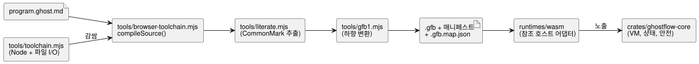

<!-- translation-source: docs/IMPLEMENTATION.md -->
[영문 원문](IMPLEMENTATION.md)

# 구현 및 아티팩트 경계

이 문서는 현재 구현이 무엇을 하는지, 어떤 아티팩트를 만드는지, 그리고 그 책임이 어디서
끝나는지 설명합니다.

이 내보내기는 기존 컴파일러와 이식 가능한 런타임을 변경하지 않습니다. 언어 문서에는
구현된 문법과 향후 설계가 함께 들어 있습니다. 실제로 무엇이 수용되는지는 문서가 아니라
컴파일러와 [VERIFICATION.md](VERIFICATION.ko.md)에 설명된 호스트 테스트가 결정합니다.

**Station batch 진입.** 고정된 Station WASM 어댑터는 기존 Rust `Station::enter_batch`
계약(Reference §4.10)을 위해 `enterBatch(requests)`를 노출합니다.

- 호스트는 관측한 Stop을 먼저 dispatch합니다. 그런 다음 같은 tick의 모든 mode 진입을
  하나의 batch로 제출합니다.
- 충돌하는 진입은 Stopped 상태에서 오더라도 원자적으로 거부됩니다. cleanup이 끝날
  때까지 queue에 쌓아 두지 않습니다.
- 순차적인 `enter()` 호출은 각각 단일 요청으로 남습니다. 이 호출로는 충돌하는 batch를
  표현할 수 없습니다.

추가된 `gf_station_enter_batch` export는 최대 256개의 32바이트 packed record를 받습니다.
각 record는 little-endian u64 필드 네 개를 다음 순서로 담습니다.

1. 요청 ID
2. revision
3. stop generation
4. mode (1 Auto, 2 Manual, 3 Configure)

어댑터는 core를 호출하기 전에 모든 record를 검증합니다. 이 변경은 GFB/GFS나 기존 export를
바꾸지 않습니다. batch가 필요한 호출자는 이 새 export를 사용해야 합니다. Native와 WASM
테스트는 같은 검증된 정본 Station 소스와 바인딩으로 생성한 설정을 사용합니다. Applied
출력과 durable ACK는 호스트 fixture에서 나오며, 물리 검증은 없습니다.

## 실행 경로

다이어그램은 `.ghost.md` 문서가 실행 가능한 아티팩트가 되는 과정과, 이를 실행하는
구성 요소를 보여 줍니다.

**컴파일러 진입점.**

- `tools/browser-toolchain.mjs`는 `compileSource(source, {filename,
  interactionSourceIdentity})`를 제공합니다. 정본 `.ghost.md` 문서만 받으며, 브라우저
  Worker에서 import해도 안전합니다.
- `tools/toolchain.mjs`는 같은 환경 중립 컴파일러를 Node용으로 감싸고, 아티팩트 파일
  시스템 I/O를 담당합니다.
- CommonMark 추출은 `tools/literate.mjs`를 통해 원래 위치와의 매핑을 보존합니다. 추출된
  control은 이어서 `tools/gfb1.mjs`를 거쳐 GFB1로 하향 변환(lowering)됩니다.
- 일반(Markdown이 아닌) 소스는 두 공개 컴파일러 경계 모두에서 거부됩니다.

언어 테스트 모음은 브라우저 진입점의 로컬 import 그래프가 Node 내장 모듈이나 `Buffer`에
의존하지 않는지 확인하고, `Buffer`를 사용할 수 없는 상태에서 진입점을 실행합니다. 브라우저
러너를 추가하거나 Vite/Chromium Worker 증거를 주장하지는 않습니다. 그러한 소비자 통합은
Farm Studio Web 경계에 속합니다.

**고정(pinned) 합성.** 고정 합성은 `sourceClosure: [{filename, revision, text}]`를
제공하며, 변경되지 않은 sensor 정의와 순수 함수 정의를 받습니다.

- 함수와 그 호출은 instance별로 범위가 나뉘므로 지역 바인딩이 보존됩니다.
- root sensor packet은 conditioning 전에 각 instance로 나누어 전달됩니다. 각 instance는
  원래의 filter, freshness, recovery 상태를 소유합니다.
- `manifest.sensors`는 공개 포트를 나열합니다. 선택적인 `manifest.sensorInstances`는
  `sourceSensor`, `instance`, `port`를 가진 비공개 descriptor를 나열합니다. 호스트는
  공개 sensor에 대한 packet만 받습니다.
- sensor 연결은 payload, 선택성(optionality), 선언된 sample 간격이 정확히 일치해야
  합니다.
- 아티팩트 복원은 전체 source closure를 기준으로 이 routing을 검증합니다.

생성된 입력 slot은 기존 GFB 및 WASM/frame 인터페이스를 사용합니다. 테스트는 실제로
conditioning된 frame을 native framed VM과 비교합니다. native 원시 sensor 시나리오 호스트를
주장하지는 않습니다. [#377](https://github.com/callin2/ghostflow-language/issues/377)을
참고하십시오.

**지원되는 언어 범위.** 최신 control은 기존의 제한된 프로필 안에서 입력, 설정, 출력,
상태, 유한 enum, 순수 함수, 식/다음 상태 검사, elapsed 타이머, DailySlots, 센서와 신호를
지원합니다. 독립 제약은 `tools/ghostrules.mjs`를 통해 정본 `.ghost.md` 입력을 사용합니다.
그 내부의 `tools/constraints.mjs` 하향 변환기는 별도의 생성 정책 형식을 만듭니다. 지원하지
않는 문법은 거부됩니다. 이 내보내기는 언어 기능을 추가하지 않습니다.

**런타임에서 누가 무엇을 담당하는가.**

| 구성 요소 | 책임 |
| --- | --- |
| `crates/ghostflow-core` | 모듈 로딩, 식 실행, 동시 상태 전이, 의도/안전 해결, 신호 conditioning, station 중재 |
| `runtimes/wasm` | 이 엔진들을 노출합니다. 매니페스트 검증, 생성 입력, 예약, 영속성 callback을 위한 참조 호스트 어댑터를 포함합니다 |
| `runtimes/node/ledger.mjs` | 호스트 station 테스트가 사용하는 파일 영속성 |

API와 펌웨어 소비자는 계약을 통해 이 구현을 사용해야 합니다. VM 전이를 다시 구현해서는
안 됩니다.

**출력은 하드웨어 상태가 아니라 의도입니다.** `output name: Type;` 선언은 타입만 지정하며,
정확히 하나의 `name <- expression;` 연결을 가져야 합니다. 이 연결은 해당 tick의 논리적
*요청* 의도를 만듭니다. 안전 해결은 이와 다른 *안전* 의도를 만들 수 있습니다. VM은 시작
기본값을 할당하지 않으며, 의도가 하드웨어에 도달했다고 약속하지 않습니다. 시작 시와 고장
시의 안전 OFF 동작, 출력 적용 시점, renderer 연결 해제 처리는 호스트/renderer 정책이며
별도의 증거가 필요합니다.

**확장 Solar/Tide 정책.** 확장 Solar/Tide 자연 정책은 GFB13과 `GhostFlow/control-v12`를
선택하며, Solar fact는 GFSF6을 사용합니다.

- 기존 프로필과 packet 바이트는 변하지 않습니다.
- WASM 함수 이름은 바뀌지 않습니다. 고정된 이전 런타임은 GFB13을 거부합니다.
- 서명된 portable-package의 config-only GFB11 프로필은 확장되지 않습니다.
- 컴파일러/런타임 회귀 검증은 `natural-fallback-compiler.test.mjs`,
  `natural-fallback-runtime.test.mjs`, core의 `solar_tape` 테스트가 담당합니다. 이 문서는
  그 실행 결과나 물리 Device 동작을 입증하지 않습니다.

**달력 경계.** 채택된 달력 경계 범위는 GFB18과 `GhostFlow/control-v18`을 사용합니다.

- `calendar_is`는 typed Result 질의로 하향 변환됩니다.
- 변경할 수 없는 UTC Daily 업무일/휴무일 Range는 달력으로 걸러지는 admission(수용)으로
  하향 변환됩니다.
- 둘 다 공유 Rust core에서, 식별된 snapshot으로부터, 변경되지 않은 GFSF5 fact를 통해
  실행됩니다. 일치하는 명시적 UTC 바인딩이 필요합니다.
- 자정을 넘는 업무 range는 거부됩니다. 별도의 선언으로 나누십시오. 일반 UTC range는
  기존 동작을 유지합니다.
- 이 범위는 UTC가 아닌 Range, 교대 귀속, 보류된 Window/Run basis를 구현하지 않습니다.

Native와 framed WASM의 acceptance 증거는 문서나 모델이 아니라
`tests/reference-calendar-boundary.test.mjs`에 속합니다.

## 아티팩트와 버전

| 항목 | 현재 표현 | 역할 |
|---|---|---|
| 정본 프로그램 | `.ghost.md` | 의도, 코드, 주석, 설명을 담은 문서형 소스 |
| 생성 실행 파일 | `.gfb`, `GFB1` 매직과 기능에 따라 선택되는 `u16` 형식(원래 1–9, 11 또는 12; 이후 기능이 13, 18 같은 형식을 추가) | VM이 사용하는 바이너리 IR. 정식 목록은 [BYTECODE.md](BYTECODE.ko.md)를 참고하십시오 |
| 생성 control 매니페스트 | 기능에 따라 선택되는 `GhostFlow/control-v1`, `v2`, `v3`, `v4`, `v7`, `v8` 또는 `v10`; 이후 기능이 `v12`, `v18` 같은 버전을 추가 | typed 호스트 포트, 타이머/센서/예약 요구 사항, 바이트코드 해시 |
| 생성 제약 정책 | `GhostFlow/constraints-v1` | 하향 변환된 독립 제약 소스. 호스트가 바인딩합니다 |
| 생성 소스 맵 | `.gfb.map.json` | 진단 노드/행 매핑. SOURCE-MAP.md에 명시된 compileSource의 소스 보존 envelope |
| 통합 identity/증거 | `contracts/integration-v1`, 순수 검사기 | 프로젝트 간 릴리스, 프로필, 매핑, 실행 identity |
| 호스트 검증 | `GhostFlow/language-verification-v1` | 이 체크아웃의 명령, 결과, 소스/아티팩트 해시 |

**버전은 서로 독립적입니다.** npm/core 버전 `0.1.0`, 소스 언어 프로필, 바이트코드 버전,
매니페스트 형식, 펌웨어 버전은 서로 독립적입니다.

- 원래의 마이그레이션 맵은 버전이 없는 nodes/lines 객체였습니다. 추가된
  [소스 맵 계약](SOURCE-MAP.ko.md)은 그 필드를 보존하고, 버전이 지정된 원본 소스
  envelope와 쌍을 이루는 해시를 추가합니다.
- `GFB1` 매직은 그대로입니다. 형식 버전과 control 매니페스트는 사용한 소스 기능에 따라
  달라집니다.
- 통합 팀의 v1 계약 검사기는 변경 없이 포함되어 있습니다.

**릴리스 책임.** 릴리스 담당자는 소스, 바이트코드, 매니페스트, 맵을 다음과 함께 묶어
보존해야 합니다.

- 각각의 해시
- 컴파일러/core revision
- 의존성 잠금
- 런타임 ABI/프로필
- 적용되는 기능 요구 사항

`compileSource`는 매니페스트를 바이트코드 SHA-256에 연결합니다. 해시는 무결성 검사이지
진위 서명이 아닙니다. 통합 계약은 추가적인 identity와 호환성 필드를 제공합니다. 그 예시는
가상이며, 배포 가능한 프로그램이나 실행 결과가 아닙니다. 프로덕션 패키징과 API/Device
연결은 소비자의 작업으로 남습니다. API 배포 기록과 펌웨어 릴리스는 별도로 버전 관리됩니다.

**설치 기록과 프로그램 의미의 구분.** 설치 기록은 이름, capability, 바인딩, 확인된 현장
정보를 제공합니다. 실행 가능한 예약, 인터록, 전이는 소스(독립 제약 소스 포함)와 그 컴파일
아티팩트에 속합니다. 바인딩 기록이 프로그램 의미를 조용히 덮어쓸 수는 없습니다.

## 한계와 소비자 책임

- core는 현재 Rust `std`와 동적 할당을 사용합니다. 이식 가능한 소스라고 해서 `no_std`,
  VM 전체의 고정 메모리, MCU 타이밍 상한, 장치 프로필이 성립하는 것은 아닙니다.
- Native CSV/WASM parity(동등성)는 같은 생성 VM 입력 snapshot을 재생합니다. 다른 호스트가
  동일한 센서, 타이머, 예약 데이터를 생성한다는 것을 증명하지는 않습니다.
- 이 호스트 플랫폼에는 센서/신호 언어 지원이 있습니다. 펌웨어는 더 작은 프로필만 지원할
  수 있으며, 지원하지 않는 요구 사항은 명시적으로 거부해야 합니다.
- 드라이버 매핑, 시계 동기화, 물리 I/O, 원자적 장치 배포, 복구, LLM 의도 품질, 농업인과의
  상호작용은 소비자 프로젝트의 책임입니다.
- 이 내보내기는 범용 전체 checkpoint 복원, 자동 ledger 압축, opcode별 소스 매핑,
  프로덕션 릴리스 서명/패키징을 추가하지 않습니다.
