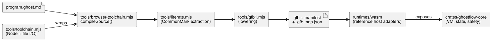

# Implementation and artifact boundaries

This document describes what the current implementation does, which artifacts
it produces, and where its responsibility ends.

This export keeps the existing compiler and portable runtime unchanged. The
language documents describe both implemented syntax and future design. What is
actually accepted is decided by the compiler and by the host tests described in
[VERIFICATION.md](VERIFICATION.md), not by the documents.

**Station batch entry.** The fixed Station WASM adapter exposes
`enterBatch(requests)` for the existing Rust `Station::enter_batch` contract
(Reference §4.10).

- Hosts dispatch an observed Stop first. They then submit every mode entry of
  the same tick in one batch.
- Conflicting entries are rejected atomically, including from Stopped. They are
  never queued until cleanup completes.
- Sequential `enter()` calls remain single requests. They cannot represent a
  conflicting batch.

The additive `gf_station_enter_batch` export takes at most 256 packed 32-byte
records. Each record contains four little-endian u64 fields, in this order:

1. request ID;
2. revision;
3. stop generation;
4. mode (1 Auto, 2 Manual, 3 Configure).

The adapter validates all records before it calls the core. This changes
neither GFB/GFS nor the existing exports; callers that need batches require
this new export. Native and WASM tests use the same checked canonical Station
source and binding-generated configuration. Applied outputs and durable ACKs
come from host fixtures; there is no physical verification.

## Executable path

The diagram shows how a `.ghost.md` document becomes an executable artifact and
which components run it.

**Compiler entry points.**

- `tools/browser-toolchain.mjs` exposes `compileSource(source, {filename,
  interactionSourceIdentity})`. It accepts canonical `.ghost.md` documents only
  and is safe to import from a browser Worker.
- `tools/toolchain.mjs` wraps that same environment-neutral compiler for Node
  and owns artifact filesystem I/O.
- CommonMark extraction preserves the mapping to original positions through
  `tools/literate.mjs`. The extracted control is then lowered through
  `tools/gfb1.mjs` to GFB1.
- Plain (non-Markdown) source is rejected at both public compiler boundaries.

The language test suite verifies that the browser entry's local import graph
has no dependency on Node builtins or `Buffer`, and it runs the entry with
`Buffer` unavailable. It does not add a browser runner or claim Vite/Chromium
Worker evidence. That consumer integration belongs to the Farm Studio Web
boundary.

**Pinned composition.** Pinned composition supplies
`sourceClosure: [{filename, revision, text}]` and accepts unchanged sensor and
pure-function definitions.

- Functions and their calls are scoped per instance, so local bindings are
  preserved.
- Root sensor packets fan out to instances before conditioning. Each instance
  owns its original filter, freshness and recovery state.
- `manifest.sensors` lists public ports. The optional `manifest.sensorInstances`
  lists private descriptors with `sourceSensor`, `instance` and `port`. Hosts
  accept packets only for public sensors.
- Sensor connections require an exact match of payload, optionality and
  declared sample interval.
- Artifact restoration verifies this routing against the full source closure.

The generated input slots use the existing GFB and WASM/frame interfaces. Tests
compare actual conditioned frames against the native framed VM. They do not
claim a native raw-sensor scenario host. See
[#377](https://github.com/callin2/ghostflow-language/issues/377).

**Supported language surface.** Modern control supports inputs, configs,
outputs, state, finite enums, pure functions, expression/next-state checks,
elapsed timers, DailySlots, sensors and signals, all within the existing bounded
profile. Standalone constraints use canonical `.ghost.md` input through
`tools/ghostrules.mjs`. Its internal `tools/constraints.mjs` lowerer produces
the separate generated policy format. Unsupported syntax is rejected; this
export adds no language features.

**Who owns what at runtime.**

| Component | Responsibility |
| --- | --- |
| `crates/ghostflow-core` | Module loading, expression execution, simultaneous state transitions, intent/safety resolution, signal conditioning and station arbitration |
| `runtimes/wasm` | Exposes those engines; contains reference host adapters for manifest validation, generated inputs, schedules and persistence callbacks |
| `runtimes/node/ledger.mjs` | File persistence used by host station tests |

API and firmware consumers must use these implementations through their
contracts. They must not reimplement VM transitions.

**Outputs are intent, not hardware state.** An `output name: Type;` declaration
is type-only and must have exactly one `name <- expression;` connection. The
connection produces the tick's logical *requested* intent. Safety resolution may
produce a different *safe* intent. The VM does not assign startup defaults and
does not promise that an intent reached hardware. Startup and failure-safe OFF
behavior, output application timing, and renderer disconnect handling are
host/renderer policy and require separate evidence.

**Extended Solar/Tide policies.** Extended Solar/Tide natural policies select
GFB13 and `GhostFlow/control-v12`; Solar facts use GFSF6.

- Legacy profiles and packet bytes remain unchanged.
- WASM function names do not change. Pinned older runtimes reject GFB13.
- The signed portable-package config-only GFB11 profile is not broadened.
- Compiler/runtime regression coverage belongs to
  `natural-fallback-compiler.test.mjs`, `natural-fallback-runtime.test.mjs` and
  the core `solar_tape` tests. This documentation does not establish their
  execution result or physical Device behavior.

**Calendar boundaries.** The adopted calendar-boundary slice uses GFB18 and
`GhostFlow/control-v18`.

- `calendar_is` lowers to a typed Result query.
- An immutable UTC Daily work/off-day Range lowers to calendar-filtered
  admission.
- Both execute in the shared Rust core, from identified snapshots, through
  unchanged GFSF5 facts. Matching explicit UTC bindings are required.
- Work ranges that cross midnight are rejected; split them into separate
  declarations. Ordinary UTC ranges keep their existing behavior.
- This slice does not implement non-UTC Range, shift ownership, or the deferred
  Window/Run bases.

Native and framed WASM acceptance evidence belongs to
`tests/reference-calendar-boundary.test.mjs`, not to documentation or a model.

## Artifacts and versions

| Item | Current representation | Role |
|---|---|---|
| Authoritative program | `.ghost.md` | Literate source with intent, code, comments and explanation |
| Generated executable | `.gfb`, `GFB1` magic with a feature-selected `u16` format (originally 1–9, 11 or 12; later features add formats such as 13 and 18) | Binary IR consumed by the VM; see [BYTECODE.md](BYTECODE.md) for the authoritative list |
| Generated control manifest | Feature-selected `GhostFlow/control-v1`, `v2`, `v3`, `v4`, `v7`, `v8` or `v10`; later features add versions such as `v12` and `v18` | Typed host ports, timer/sensor/schedule requirements and bytecode hash |
| Generated constraint policy | `GhostFlow/constraints-v1` | Lowered standalone constraint source, bound by the host |
| Generated source map | `.gfb.map.json` | Diagnostic nodes/line mapping; source-preserving envelope from compileSource as specified in SOURCE-MAP.md |
| Integration identity/evidence | `contracts/integration-v1`, pure checker | Cross-project release, profile, mapping and run identities |
| Host verification | `GhostFlow/language-verification-v1` | This checkout's commands, results and source/artifact hashes |

**Versions are independent.** The npm/core version `0.1.0`, the source-language
profile, the bytecode version, the manifest format and the firmware version are
independent of each other.

- The original migration map was an unversioned nodes/lines object. The additive
  [source-map contract](SOURCE-MAP.md) preserves those fields and adds a
  versioned original-source envelope and paired hashes.
- The `GFB1` magic stays the same. Its format version and the control manifest
  vary with the source features used.
- The integration team's v1 contract checker is included unchanged.

**Release responsibilities.** A release owner must keep source, bytecode,
manifest and map together, along with:

- their hashes;
- the compiler/core revision;
- dependency locks;
- the runtime ABI/profile;
- the applicable feature requirements.

`compileSource` binds the manifest to the bytecode SHA-256. A hash is an
integrity check, not an authenticity signature. The integration contract
supplies additional identity and compatibility fields. Its example is fictional;
it is not a deployable program or an execution result. Production packaging and
API/Device wiring remain consumer work. API deployment records and firmware
releases are versioned separately.

**Installation records versus program semantics.** Installation records provide
names, capabilities, bindings and known site facts. Executable schedules,
interlocks and transitions belong to the source (including standalone
constraint source) and its compiled artifacts. A binding record cannot silently
override program semantics.

## Limits and consumer responsibilities

- The core currently uses Rust `std` and dynamic allocation. Portable source does
  not establish `no_std`, fixed whole-VM memory, MCU timing bounds or a device
  profile.
- Native CSV/WASM parity replays the same generated VM input snapshots. It does
  not prove that another host generates identical sensor, timer or schedule data.
- Sensor/signal language support exists in this host platform. A firmware may
  support a smaller profile and must reject unsupported requirements explicitly.
- Driver mapping, clock synchronization, physical I/O, atomic device deployment,
  recovery, LLM intent quality and farmer interaction belong to consumer projects.
- This export does not add full general checkpoint restore, automatic ledger
  compaction, per-opcode source mapping, or production release signing/packaging.
