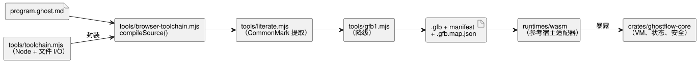

<!-- translation-source: docs/IMPLEMENTATION.md -->
[英文原文](IMPLEMENTATION.md)

# 实现与制品边界

本文档描述当前实现做了什么、产生哪些制品（artifact），以及它的职责止于何处。

本次导出保持现有编译器和可移植运行时不变。语言文档既描述已实现的语法，也描述未来的设计。实际接受什么，由编译器以及 [VERIFICATION.md](VERIFICATION.zh.md) 中描述的宿主测试决定，而不是由文档决定。

**Station 批量进入。** 固定的 Station WASM 适配器为现有的 Rust `Station::enter_batch` 契约（参考手册 §4.10）暴露了 `enterBatch(requests)`。

- 宿主先分发观测到的 Stop，然后在一个批次中提交同一 tick 的所有模式进入请求。
- 冲突的进入请求会被原子地拒绝，包括从 Stopped 状态发起的请求。它们绝不会排队等待清理完成。
- 依次调用 `enter()` 仍然是单个请求，无法表示一个冲突的批次。

新增的 `gf_station_enter_batch` 导出最多接受 256 条紧凑排列的 32 字节记录。每条记录包含四个小端序 u64 字段，顺序如下：

1. 请求 ID；
2. 修订版（revision）；
3. 停止代次（stop generation）；
4. 模式（1 Auto、2 Manual、3 Configure）。

适配器在调用核心之前校验所有记录。这既不改变 GFB/GFS，也不改变现有导出；需要批量操作的调用方必须使用这个新导出。原生测试和 WASM 测试使用同一份经检查的规范 Station 源，以及由绑定生成的配置。已应用的输出和持久 ACK 来自宿主夹具（fixture）；没有经过物理验证。

## 可执行路径

下图展示 `.ghost.md` 文档如何变成可执行制品，以及由哪些组件运行它。

**编译器入口点。**

- `tools/browser-toolchain.mjs` 暴露 `compileSource(source, {filename,
  interactionSourceIdentity})`。它只接受规范的 `.ghost.md` 文档，并且可以安全地从浏览器 Worker 中导入。
- `tools/toolchain.mjs` 为 Node 封装同一个与环境无关的编译器，并负责制品的文件系统 I/O。
- CommonMark 提取通过 `tools/literate.mjs` 保留到原始位置的映射。提取出的 control 随后经 `tools/gfb1.mjs` 降级为 GFB1。
- 普通（非 Markdown）源在两个公开编译器边界上都会被拒绝。

语言测试套件验证浏览器入口的本地导入图不依赖 Node 内置模块或 `Buffer`，并在 `Buffer` 不可用的情况下运行该入口。它没有添加浏览器运行器，也不声称具有 Vite/Chromium Worker 方面的证据。那部分使用方集成属于 Farm Studio Web 边界。

**固定组合（pinned composition）。** 固定组合提供 `sourceClosure: [{filename, revision, text}]`，并接受未经修改的传感器定义和纯函数定义。

- 函数及其调用按实例划分作用域，因此本地绑定得以保留。
- 根传感器数据包在调理（conditioning）之前扇出到各实例。每个实例拥有自己原有的滤波、新鲜度和恢复状态。
- `manifest.sensors` 列出公开端口。可选的 `manifest.sensorInstances` 列出带有 `sourceSensor`、`instance` 和 `port` 的私有描述符。宿主只接受公开传感器的数据包。
- 传感器连接要求负载类型、可选性和声明的采样间隔完全匹配。
- 制品恢复会针对完整的源闭包验证这一路由。

生成的输入槽使用现有的 GFB 和 WASM/帧接口。测试将实际调理后的帧与原生帧式 VM 进行比较，并不声称存在原生的原始传感器场景宿主。参见 [#377](https://github.com/callin2/ghostflow-language/issues/377)。

**支持的语言范围。** 现代 control 支持输入、config、输出、状态、有限枚举、纯函数、表达式/下一状态检查、elapsed 定时器、DailySlots、传感器和信号，且全部处于现有的有界 profile 之内。独立约束通过 `tools/ghostrules.mjs` 使用规范的 `.ghost.md` 输入。其内部的 `tools/constraints.mjs` 降级器生成单独的已生成策略格式。不支持的语法会被拒绝；本次导出不添加任何语言特性。

**运行时谁负责什么。**

| 组件 | 职责 |
| --- | --- |
| `crates/ghostflow-core` | 模块加载、表达式执行、同时状态转换、意图/安全解析、信号调理和 station 仲裁 |
| `runtimes/wasm` | 暴露上述引擎；包含用于 manifest 校验、生成输入、调度计划和持久化回调的参考宿主适配器 |
| `runtimes/node/ledger.mjs` | 宿主 station 测试使用的文件持久化 |

API 和固件使用方必须通过各自的契约使用这些实现，不得重新实现 VM 转换。

**输出是意图，而不是硬件状态。** `output name: Type;` 声明只声明类型，并且必须恰好有一个 `name <- expression;` 连接。该连接产生该 tick 的逻辑*请求*（requested）意图。安全解析可能产生不同的*安全*（safe）意图。VM 不分配启动默认值，也不保证意图已到达硬件。启动和故障安全 OFF 行为、输出应用时机以及渲染器断开处理都属于宿主/渲染器策略，需要单独的证据。

**扩展的 Solar/Tide 策略。** 扩展的 Solar/Tide 自然策略选择 GFB13 和 `GhostFlow/control-v12`；Solar 事实使用 GFSF6。

- 旧版 profile 和数据包字节保持不变。
- WASM 函数名不变。固定的旧版运行时会拒绝 GFB13。
- 已签名的可移植包仅 config 的 GFB11 profile 不会被放宽。
- 编译器/运行时回归覆盖属于 `natural-fallback-compiler.test.mjs`、`natural-fallback-runtime.test.mjs` 和核心 `solar_tape` 测试。本文档不确立它们的执行结果或物理 Device 行为。

**日历边界。** 已采纳的日历边界切片使用 GFB18 和 `GhostFlow/control-v18`。

- `calendar_is` 降级为类型化的 Result 查询。
- 不可变的 UTC Daily 工作日/休息日 Range 降级为经日历过滤的准入。
- 二者都在共享的 Rust 核心中、基于已标识的快照、通过未修改的 GFSF5 事实执行。需要匹配的显式 UTC 绑定。
- 跨越午夜的工作区间会被拒绝；请将其拆分为单独的声明。普通 UTC 区间保持其现有行为。
- 此切片不实现非 UTC 的 Range、班次所有权或延后的 Window/Run 基准。

原生和帧式 WASM 的验收证据属于 `tests/reference-calendar-boundary.test.mjs`，而不属于文档或模型。

## 制品与版本

| 项目 | 当前表示 | 作用 |
|---|---|---|
| 权威程序 | `.ghost.md` | 包含意图、代码、注释和解释的文学式源文件 |
| 生成的可执行文件 | `.gfb`，`GFB1` 魔数，带有按特性选择的 `u16` 格式（最初为 1–9、11 或 12；后续特性加入了 13 和 18 等格式） | 由 VM 使用的二进制 IR；权威列表见 [BYTECODE.md](BYTECODE.zh.md) |
| 生成的 control manifest | 按特性选择的 `GhostFlow/control-v1`、`v2`、`v3`、`v4`、`v7`、`v8` 或 `v10`；后续特性加入了 `v12` 和 `v18` 等版本 | 类型化的宿主端口、定时器/传感器/调度计划需求以及字节码哈希 |
| 生成的约束策略 | `GhostFlow/constraints-v1` | 降级后的独立约束源，由宿主绑定 |
| 生成的源映射 | `.gfb.map.json` | 诊断节点/行映射；以及按 SOURCE-MAP.md 规定、由 compileSource 产生的保留源文本的封装 |
| 集成标识/证据 | `contracts/integration-v1`，纯检查器 | 跨项目的发布、profile、映射和运行标识 |
| 宿主验证 | `GhostFlow/language-verification-v1` | 本检出（checkout）的命令、结果以及源/制品哈希 |

**各版本相互独立。** npm/核心版本 `0.1.0`、源语言 profile、字节码版本、manifest 格式和固件版本彼此独立。

- 最初的迁移映射是一个未带版本的 nodes/lines 对象。新增的[源映射契约](SOURCE-MAP.zh.md)保留了这些字段，并添加了带版本的原始源封装和成对的哈希。
- `GFB1` 魔数保持不变。其格式版本和 control manifest 随所使用的源特性而变化。
- 集成团队的 v1 契约检查器被原样包含在内。

**发布职责。** 发布负责人必须把源、字节码、manifest 和映射放在一起保存，同时保存：

- 它们的哈希；
- 编译器/核心修订版；
- 依赖锁定文件；
- 运行时 ABI/profile；
- 适用的特性需求。

`compileSource` 将 manifest 绑定到字节码的 SHA-256。哈希是完整性检查，而不是真实性签名。集成契约提供了额外的标识和兼容性字段。其示例是虚构的，既不是可部署的程序，也不是执行结果。生产打包和 API/Device 接线仍属于使用方的工作。API 部署记录和固件发布分别进行版本管理。

**安装记录与程序语义。** 安装记录提供名称、能力（capability）、绑定和已知的现场事实。可执行的调度计划、互锁和转换属于源（包括独立约束源）及其编译后的制品。绑定记录不能静默覆盖程序语义。

## 限制与使用方职责

- 核心目前使用 Rust `std` 和动态内存分配。可移植源并不意味着 `no_std`、固定的整个 VM 内存、MCU 时序界限或设备 profile。
- 原生 CSV/WASM 一致性测试重放相同的生成 VM 输入快照。它不能证明另一个宿主会生成相同的传感器、定时器或调度计划数据。
- 本宿主平台中具备传感器/信号语言支持。固件可以支持更小的 profile，并且必须显式拒绝不支持的需求。
- 驱动程序映射、时钟同步、物理 I/O、原子化设备部署、恢复、LLM 意图质量以及农户交互都属于使用方项目。
- 本次导出不添加完整的通用检查点恢复、自动账本压缩、逐操作码的源映射或生产发布签名/打包。
