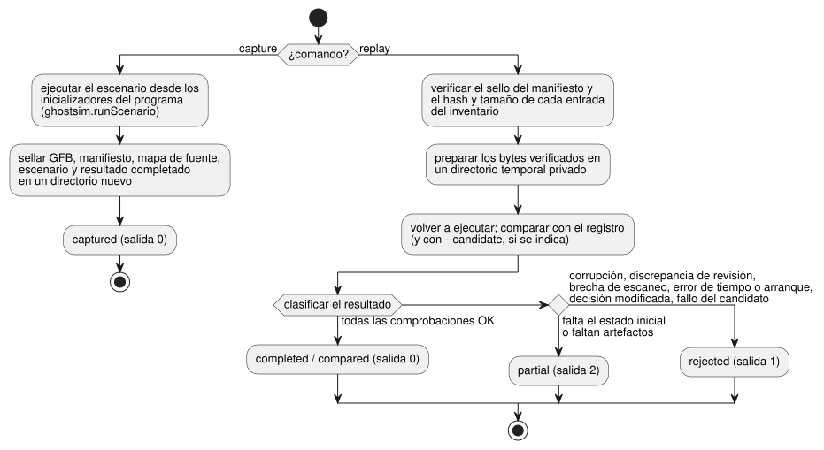

<!-- translation-source: docs/INCIDENT-REPLAY.md -->
[Original en inglés](INCIDENT-REPLAY.md)

# Captura y reproducción de incidentes

Fuente en inglés; [traducción al coreano](INCIDENT-REPLAY.ko.md).

La CLI de host de referencia `tools/ghostsim-incident.mjs` captura una ejecución
virtual en un paquete sellado y la reproduce más tarde. Da soporte a
[#133](https://github.com/callin2/ghostflow-language/issues/133).

La herramienta reutiliza piezas existentes en lugar de añadir otras nuevas:

- `ghostsim.runScenario`, con sus comprobaciones de artefactos y de mapa de
  fuente;
- el núcleo nativo o WASM existente.

No añade ninguna VM, ningún modelo de dispositivo físico ni ningún reductor de
eventos en bruto a ticks. El
[contrato de ordenación de eventos del host](HOST-EVENT-ORDERING-CONTRACT.es.md)
sigue siendo el titular de la ordenación del ingreso. Este adaptador solo
consume acciones explícitas del escenario y escaneos completados. No infiere
eventos faltantes ni el orden de llegada.

## Comandos y alcance

```sh
node tools/ghostsim-incident.mjs capture program.gfb scenario.toon new-bundle
node tools/ghostsim-incident.mjs replay new-bundle
node tools/ghostsim-incident.mjs replay new-bundle --candidate changed.gfb
```

El diagrama resume qué hace cada comando y cómo se clasifica una reproducción.



**`capture`** inicia una nueva ejecución virtual a partir de los
inicializadores del programa. Sella lo siguiente en un directorio nuevo de uso
exclusivo:

- los bytes GFB exactos;
- el manifiesto;
- el mapa de fuente;
- el escenario explícito;
- el resultado completado.

Los IDs virtuales de ejecución/arranque generados identifican esta captura. No
son una ejecución histórica reconstruida de un dispositivo. Los ajustes y las
vinculaciones (bindings) provienen únicamente de los valores predeterminados
del artefacto y de la activación explícita del escenario. No se admite lo
siguiente: restaurar un estado arbitrario a mitad de ejecución, revisiones de
ajustes desconocidas ni la reproducción a través de fronteras de arranque. Los
archivos originales nunca se sobrescriben.

**`replay`** verifica el sello del manifiesto y el hash y el tamaño de cada
entrada del inventario. Después copia los búferes de bytes verificados en un
directorio temporal privado. El simulador lee solo esas copias, de modo que
reemplazar el paquete proporcionado después de la verificación no puede cambiar
las entradas de la ejecución. Las copias temporales se eliminan tras su uso.

Límites y salvaguardas:

| Elemento | Límite |
| --- | --- |
| Cada archivo | 4 MiB |
| Inventario | 32 entradas |
| Registros completados | 256 escaneos |
| Escenario | Siguen aplicándose los límites de escenario existentes de ghostsim |
| Enlaces simbólicos | Ni los archivos de artefactos ni el directorio proporcionado pueden ser enlaces simbólicos |

Una publicación fallida puede dejar un destino nuevo incompleto. Nunca
sobrescribe un destino existente ni elimina las entradas del usuario.

**Revisión del runtime.** Cada captura registra una revisión del runtime
(entorno de ejecución) que incluye:

- el resumen (digest) del binario nativo/WASM realmente seleccionado;
- los resúmenes de todas las fuentes `.mjs` de herramientas de nivel superior y
  de las fuentes `.mjs` de los adaptadores WASM;
- el resumen del archivo de bloqueo de dependencias;
- la versión de Node.

La reproducción requiere igualdad exacta, por lo que incluso un cambio no
relacionado en una herramienta puede invalidar de forma conservadora una
captura antigua. La revisión seleccionada se comprueba tanto antes como después
de la ejecución. Para reproducir una cápsula antigua, restaure el host/runtime
exacto; nunca vuelva a etiquetar un binario nuevo con una identidad antigua.
Estos valores son revisiones de contenido, no números de compilación oficiales.

La integridad de la instalación de dependencias y la ejecución en un host de
confianza son requisitos previos. Los hashes son comprobaciones de
consistencia. No son una procedencia autenticada y no protegen frente a otro
proceso que se ejecute con la autoridad del mismo usuario.

## Resultados y significado de la evidencia

Cada comando imprime un objeto JSON `GhostFlow/incident-replay-result-v1`.

| Resultado | Código de salida | Causas típicas |
| --- | --- | --- |
| captured / completed / compared | 0 | Se superaron todas las comprobaciones |
| partial | 2 | Falta el estado inicial o faltan artefactos |
| rejected | 1 | Corrupción, discrepancia de revisión del runtime, brechas en la secuencia de escaneos, tiempo lógico que retrocede, discrepancia de arranque, decisiones registradas modificadas |

Reproducir repetidamente entradas sin cambios devuelve objetos de resultado
idénticos. Las condiciones de rechazo se informan explícitamente; ninguna
interpolación las repara.

**Comparación con un candidato.** `--candidate` inicia una instancia nueva con
el mismo escenario sellado. Informa las identidades de fuente y las diferencias
en las salidas virtuales seguras por ID de escaneo, tiempo lógico y canal,
incluido si un canal está presente.

- `matched` significa que se reprodujo el registro original.
- `candidate.equivalent` se refiere solo a las salidas seguras comparadas. No
  afirma la equivalencia del estado interno, de la temporización en el hardware
  ni de todo el comportamiento futuro.
- Si el candidato no logra ejecutarse, la comparación se rechaza.

**Paquetes históricos de FarmStudio.** Los envoltorios históricos
`FarmStudio/incident-bundle-v1` provenientes de System229 solo se aceptan para
comprobaciones acotadas de integridad del inventario y para informar
explícitamente de brechas. Siguen siendo parciales aunque `replay.available`
indique true, porque este formato no proporciona ninguna cápsula de escaneos
completados.

- La validación semántica del productor sigue correspondiendo a System. Un sello
  recalculado no autentica una afirmación histórica.
- Los registros privados de dispositivos no son fixtures del repositorio.
- Ningún respaldo (fallback) reconstruye la ejecución, los ajustes, el estado,
  el reloj ni las posiciones de escaneo que les faltan.

**Qué significan los resultados.** Todos los resultados describen **decisiones
virtuales** registradas. No son salidas físicas aplicadas o confirmadas,
contactos, comportamiento de la planta en lazo cerrado ni aceptación HIL. Una
regresión sintética de paridad nativa/WASM compara los motores existentes entre
sí; no es un oráculo físico independiente. No se invoca ningún servicio, red,
modelo ni hardware.

## Verificación e integración pendiente

`node --test tests/ghostsim-incident.test.mjs` cubre:

- la repetibilidad;
- las diferencias del candidato;
- la corrupción y las entradas faltantes;
- la deriva de revisión del runtime/de los auxiliares;
- la ejecución de instantáneas verificadas;
- las fronteras de estado inicial, escaneo, reloj y arranque;
- los envoltorios históricos parciales;
- los códigos de salida de la CLI;
- la paridad sintética nativa/WASM.

El conjunto de pruebas está registrado explícitamente en el verificador
completo. Conserva la evidencia histórica y la semántica del lenguaje, de GFB,
del ABI y de los resultados de escenarios.

Esta herramienta es el consumidor de captura/reproducción virtual con arranque
en frío. La reproducción completa de un incidente histórico todavía necesita que
el productor proporcione:

- un artefacto ejecutable exacto;
- las revisiones efectivas de ajustes y de vinculaciones;
- un estado de ejecución inicial suficiente;
- escaneos completados ordenados.

La captura del ingreso de eventos del host y la restauración de un estado
arbitrario siguen siendo capacidades separadas; esta herramienta no las marca
como implementadas.
