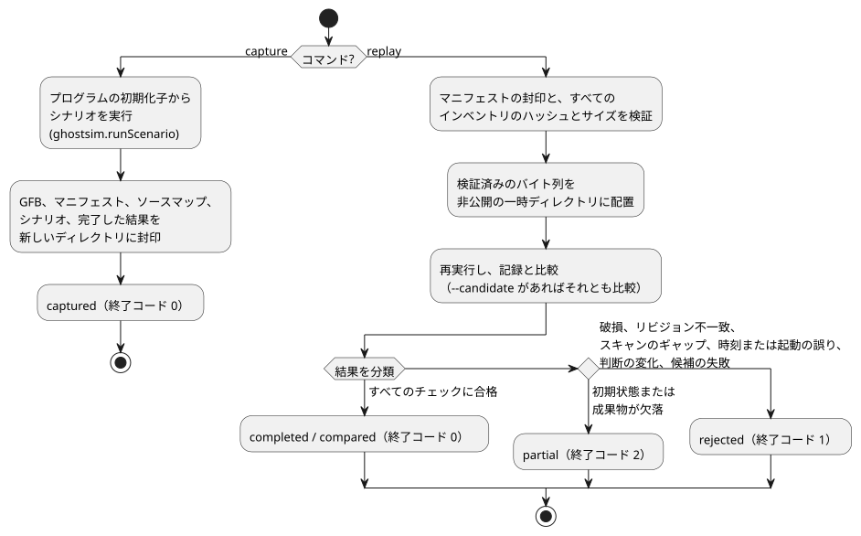

<!-- translation-source: docs/INCIDENT-REPLAY.md -->
[英語の原文](INCIDENT-REPLAY.md)

# インシデントのキャプチャとリプレイ

英語が原文です。[한국어 번역](INCIDENT-REPLAY.ko.md)。

参照ホスト CLI `tools/ghostsim-incident.mjs` は、仮想的な実行を封印済みバンドルにキャプチャし、後でリプレイします。これは [#133](https://github.com/callin2/ghostflow-language/issues/133) をサポートします。

このツールは、新しい部品を追加せずに既存の部品を再利用します。

- 成果物とソースマップのチェックを備えた `ghostsim.runScenario`
- 既存のネイティブまたは WASM のコア

VM、物理デバイスのモデル、生のイベントから tick へのリデューサは追加しません。イングレスの順序付けは、引き続き[ホストイベント順序契約](HOST-EVENT-ORDERING-CONTRACT.ja.md)が担います。このアダプタが消費するのは、明示的なシナリオのアクションと完了したスキャンだけです。欠落したイベントや到着順を推論することはありません。

## コマンドと範囲

```sh
node tools/ghostsim-incident.mjs capture program.gfb scenario.toon new-bundle
node tools/ghostsim-incident.mjs replay new-bundle
node tools/ghostsim-incident.mjs replay new-bundle --candidate changed.gfb
```

図は、各コマンドが何を行い、リプレイの結果がどのように分類されるかをまとめたものです。



**`capture`** は、プログラムの初期化子から新しい仮想的な実行を開始します。次のものを、排他的に作成した新しいディレクトリに封印します。

- 正確な GFB のバイト列
- マニフェスト
- ソースマップ
- 明示的なシナリオ
- 完了した結果

生成された仮想的な実行／起動の ID が、このキャプチャを識別します。それらは、デバイスの過去の実行を再構成したものではありません。設定とバインディングは、成果物の既定値と、明示的なシナリオのアクティベーションからのみ得られます。任意の実行途中の状態の復元、不明な設定リビジョン、起動境界をまたぐリプレイはサポートされていません。元のファイルが上書きされることは決してありません。

**`replay`** は、マニフェストの封印と、すべてのインベントリエントリのハッシュとサイズを検証します。その後、検証済みのバイトバッファを非公開の一時ディレクトリにコピーします。シミュレータはそれらのコピーだけを読むため、検証後に渡されたバンドルを差し替えても、実行の入力は変わりません。一時コピーは使用後に削除されます。

制限と安全策：

| 項目 | 制限 |
| --- | --- |
| 各ファイル | 4 MiB |
| インベントリ | 32 エントリ |
| 完了した記録 | 256 スキャン |
| シナリオ | ghostsim の既存のシナリオ上限が引き続き適用される |
| シンボリックリンク | 成果物のファイルと渡されたディレクトリは、シンボリックリンクであってはならない |

公開（publication）に失敗すると、不完全な新しい出力先が残ることがあります。既存の出力先を上書きしたり、ユーザーの入力を削除したりすることは決してありません。

**ランタイムリビジョン。**各キャプチャは、次のものを含むランタイムリビジョンを記録します。

- 実際に選択されたネイティブ／WASM バイナリのダイジェスト
- トップレベルのすべてのツール `.mjs` ソースと、WASM アダプタの `.mjs` ソースのダイジェスト
- 依存関係のロックのダイジェスト
- Node のバージョン

リプレイには完全な一致が必要なため、無関係なツールの変更でも、古いキャプチャが保守的に無効になることがあります。選択されたリビジョンは、実行の前後の両方でチェックされます。古いカプセルをリプレイするには、正確なホスト／ランタイムを復元してください。新しいバイナリに古い同一性のラベルを付け直してはなりません。これらの値はコンテンツのリビジョンであり、公式のビルド番号ではありません。

依存関係のインストールの完全性と、信頼できるホストでの実行が前提条件です。ハッシュは一貫性のチェックです。認証された来歴（provenance）ではなく、同じユーザーの権限で動く別のプロセスから保護するものでもありません。

## 結果と証拠の意味

各コマンドは、`GhostFlow/incident-replay-result-v1` の JSON オブジェクトを 1 つ出力します。

| 結果 | 終了ステータス | 典型的な原因 |
| --- | --- | --- |
| captured / completed / compared | 0 | すべてのチェックに合格 |
| partial | 2 | 初期状態または成果物の欠落 |
| rejected | 1 | 破損、ランタイムリビジョンの不一致、スキャンシーケンスのギャップ、論理時間の逆行、起動の不一致、記録された判断の変化 |

変更されていない入力を繰り返しリプレイすると、同一の結果オブジェクトが返されます。拒否された状況は明示的に報告され、補間によって修復されることはありません。

**候補との比較。**`--candidate` は、封印された同じシナリオで新しいインスタンスを開始します。ソースの同一性と、安全な仮想出力の差分を、スキャン ID、論理時間、チャネルごとに（チャネルが存在するかどうかも含めて）報告します。

- `matched` は、元の記録が再現されたことを意味します。
- `candidate.equivalent` は、比較された安全な出力についてのみ述べています。内部状態、ハードウェア上のタイミング、将来のすべての振る舞いが等価であるとは主張しません。
- 候補の実行に失敗した場合、比較は拒否されます。

**過去の FarmStudio バンドル。**System229 による過去の `FarmStudio/incident-bundle-v1` エンベロープは、上限付きのインベントリ完全性チェックと、明示的なギャップの報告のためにだけ受け付けられます。この形式は完了スキャンのカプセルを提供しないため、`replay.available` が true であっても partial のままです。

- プロデューサ側の意味的な検証は、引き続き System の責任です。再計算した封印が、過去の記述を認証するわけではありません。
- 非公開のデバイス記録は、リポジトリのフィクスチャではありません。
- 欠落した実行、設定、状態、クロック、スキャン位置を再構成するフォールバックはありません。

**結果の意味。**すべての結果は、記録された**仮想的な判断**を表します。適用された、あるいは確認された物理出力、接点、閉ループのプラントの振る舞い、HIL の受け入れではありません。合成のネイティブ／WASM パリティ回帰テストは、既存のエンジン同士を比較するものであり、独立した物理的なオラクルではありません。サービス、ネットワーク、モデル、ハードウェアは一切呼び出されません。

## 検証と残りの統合

`node --test tests/ghostsim-incident.test.mjs` は、次の項目をカバーします。

- 再現性
- 候補との差分
- 破損と欠落した入力
- ランタイム／ヘルパーのリビジョンのずれ
- 検証済みスナップショットの実行
- 初期状態、スキャン、クロック、起動の境界
- 過去の partial エンベロープ
- CLI の終了コード
- 合成のネイティブ／WASM パリティ

このスイートは、完全な検証器に明示的に登録されています。過去の証拠と、言語、GFB、ABI、シナリオ結果の意味を保持します。

このツールは、コールドスタートでの仮想的なキャプチャ／リプレイの利用側です。過去のインシデントを完全にリプレイするには、引き続きプロデューサが次のものを提供する必要があります。

- 正確な実行可能成果物
- 有効な設定とバインディングのリビジョン
- 十分な初期実行状態
- 順序付けられた完了スキャン

ホストイベントのイングレスのキャプチャと任意の状態の復元は、引き続き別のケイパビリティです。このツールはそれらを実装済みとはしません。
