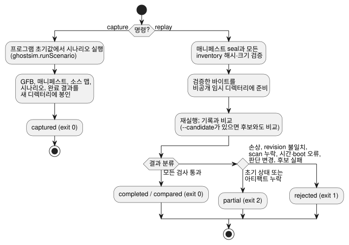

<!-- translation-source: docs/INCIDENT-REPLAY.md -->
[영문 원문](INCIDENT-REPLAY.md)

# incident(사고) 캡처와 재생

참조 호스트 CLI `tools/ghostsim-incident.mjs`는 가상 실행을 봉인된 bundle로 캡처하고,
나중에 이를 재생(replay)합니다. 이 도구는
[#133](https://github.com/callin2/ghostflow-language/issues/133)을 지원합니다.

이 도구는 새 구성 요소를 추가하지 않고 기존 구성 요소를 재사용합니다.

- 아티팩트 및 source-map 검사를 포함한 `ghostsim.runScenario`
- 기존 native 또는 WASM core

새 VM, 물리 장치 모델, 원시 event-to-tick reducer는 추가하지 않습니다. ingress 순서는
계속 [호스트 이벤트 순서 계약](HOST-EVENT-ORDERING-CONTRACT.ko.md)이 소유합니다. 이
어댑터는 명시적인 시나리오 action과 완료된 scan만 사용합니다. 누락된 이벤트나 도착 순서를
추론하지 않습니다.

## 명령과 범위

```sh
node tools/ghostsim-incident.mjs capture program.gfb scenario.toon new-bundle
node tools/ghostsim-incident.mjs replay new-bundle
node tools/ghostsim-incident.mjs replay new-bundle --candidate changed.gfb
```

다이어그램은 각 명령이 하는 일과 재생 결과를 분류하는 방식을 요약합니다.



**`capture`** 는 프로그램 초기값에서 새 가상 실행을 시작합니다. 그리고 다음 항목을 새로
독점 생성한 디렉터리에 봉인합니다.

- 정확한 GFB 바이트
- 매니페스트
- 소스 맵
- 명시적 시나리오
- 완료된 결과

생성된 가상 run/boot ID는 이 캡처를 식별합니다. 과거 장치 실행을 복원한 ID가 아닙니다.
설정과 바인딩은 아티팩트 기본값과 명시적 시나리오 activation에서만 가져옵니다. 다음은
지원하지 않습니다: 임의의 실행 중간 상태 복원, 알 수 없는 설정 revision, boot 경계를
넘는 재생. 원본 파일은 절대 덮어쓰지 않습니다.

**`replay`** 는 매니페스트 seal과 모든 inventory 항목의 해시와 크기를 검증합니다. 그런 다음
검증한 바이트 buffer를 비공개 임시 디렉터리에 복사합니다. 시뮬레이터는 그 사본만 읽으므로,
검증 이후에 전달된 bundle을 바꾸더라도 실행 입력은 바뀌지 않습니다. 임시 사본은 사용 후
제거됩니다.

한계와 보호 장치는 다음과 같습니다.

| 항목 | 한계 |
| --- | --- |
| 각 파일 | 4 MiB |
| Inventory | 32개 항목 |
| 완료 기록 | 256 scan |
| 시나리오 | ghostsim의 기존 시나리오 한계도 그대로 적용됩니다 |
| Symlink | 아티팩트 파일과 전달한 디렉터리는 symlink일 수 없습니다 |

게시가 실패하면 새 목적지에 불완전한 결과가 남을 수 있습니다. 그러나 기존 목적지를
덮어쓰거나 사용자 입력을 제거하는 일은 절대 없습니다.

**런타임 revision.** 각 캡처는 다음을 포함하는 런타임 revision을 기록합니다.

- 실제로 선택된 native/WASM 바이너리의 digest
- 최상위 도구 `.mjs` 소스와 WASM 어댑터 `.mjs` 소스 전체의 digest
- 의존성 잠금 digest
- Node 버전

재생에는 정확한 일치가 필요하므로, 관련 없는 도구 변경조차 보수적으로 오래된 캡처를
무효화할 수 있습니다. 선택된 revision은 실행 전과 후에 모두 검사합니다. 오래된 capsule을
재생하려면 정확한 호스트/런타임을 복원하십시오. 새 바이너리에 오래된 identity를 다시 붙여서는
절대 안 됩니다. 이 값들은 내용 revision이며 공식 빌드 번호가 아닙니다.

의존성 설치의 무결성과 신뢰할 수 있는 호스트 실행은 전제 조건입니다. 해시는 일관성
검사입니다. 인증된 provenance(출처)가 아니며, 같은 사용자 권한으로 실행되는 다른 프로세스로부터
보호해 주지도 않습니다.

## 결과와 증거의 의미

각 명령은 `GhostFlow/incident-replay-result-v1` JSON 객체 하나를 출력합니다.

| 결과 | 종료 상태 | 대표적인 원인 |
| --- | --- | --- |
| captured / completed / compared | 0 | 모든 검사 통과 |
| partial | 2 | 초기 상태 또는 아티팩트 누락 |
| rejected | 1 | 손상, 런타임 revision 불일치, scan 순서 누락, 논리 시간 역행, boot 불일치, 기록된 판단의 변경 |

변경되지 않은 입력을 반복해서 재생하면 동일한 결과 객체가 반환됩니다. 거부 조건은 명시적으로
보고되며, 보간으로 이를 복구하지 않습니다.

**후보 비교.** `--candidate`는 같은 봉인된 시나리오로 새 instance를 시작합니다. 소스
identity와, scan ID·논리 시간·channel별 안전 가상 출력의 차이를 보고하며, channel이
존재하는지 여부도 포함합니다.

- `matched`는 원래 기록이 재현되었다는 뜻입니다.
- `candidate.equivalent`는 비교한 안전 출력에만 해당합니다. 내부 상태, 하드웨어에서의
  타이밍, 모든 미래 동작이 동등하다고 주장하지 않습니다.
- 후보 실행이 실패하면 비교는 거부됩니다.

**과거 FarmStudio bundle.** System229의 과거 `FarmStudio/incident-bundle-v1` envelope는
제한된 inventory 무결성 검사와 명시적 gap 보고에만 받아들입니다. 이 형식은 완료 scan
capsule을 제공하지 않으므로, `replay.available`이 true라고 해도 partial로 남습니다.

- producer 의미 검증은 여전히 System의 책임입니다. seal을 다시 계산한다고 해서 과거의
  진술이 인증되지는 않습니다.
- 비공개 장치 기록은 저장소 fixture가 아닙니다.
- 누락된 run, 설정, 상태, 시계, scan 위치를 재구성하는 fallback은 없습니다.

**결과의 의미.** 모든 결과는 기록된 **가상 판단**을 설명합니다. 적용(applied)되었거나
확인(confirmed)된 물리 출력, 접점, closed-loop 공정 동작, HIL 수용이 아닙니다. 합성
native/WASM parity 회귀 테스트는 기존 엔진끼리 비교할 뿐이며, 독립적인 물리 oracle이
아닙니다. 서비스, 네트워크, 모델, 하드웨어는 호출하지 않습니다.

## 검증과 남은 통합

`node --test tests/ghostsim-incident.test.mjs`는 다음을 다룹니다.

- 반복성
- 후보 차이
- 손상과 입력 누락
- 런타임/helper revision 변화
- 검증된 snapshot 실행
- 초기 상태, scan, 시계, boot 경계
- 과거 partial envelope
- CLI 종료 코드
- 합성 native/WASM parity

이 테스트 모음은 전체 verifier에 명시적으로 등록되어 있습니다. 과거 증거와 언어, GFB, ABI,
시나리오 결과의 의미를 보존합니다.

이 도구는 cold-start 가상 캡처/재생 소비자입니다. 과거 incident를 완전히 재생하려면 여전히
producer가 다음을 제공해야 합니다.

- 정확한 실행 아티팩트
- 유효한 설정과 바인딩 revision
- 충분한 초기 실행 상태
- 순서가 있는 완료 scan

호스트 이벤트 ingress 캡처와 임의 상태 복원은 별도의 기능으로 남습니다. 이 도구는 그것들을
구현 완료로 표시하지 않습니다.
