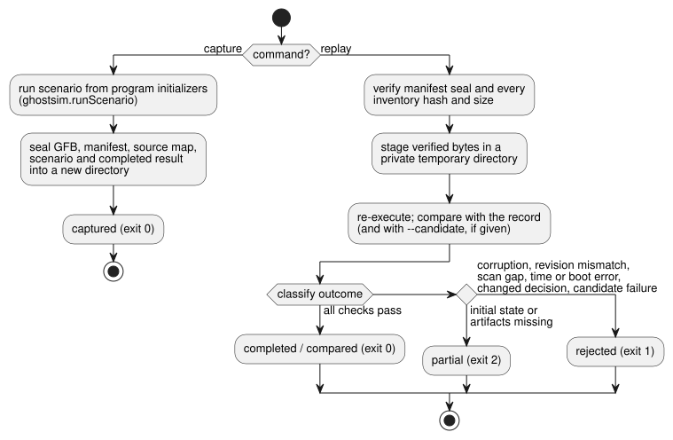

# Incident capture and replay

English source; [한국어 번역](INCIDENT-REPLAY.ko.md).

The reference host CLI `tools/ghostsim-incident.mjs` captures a virtual run into
a sealed bundle and replays it later. It supports
[#133](https://github.com/callin2/ghostflow-language/issues/133).

The tool reuses existing parts instead of adding new ones:

- `ghostsim.runScenario`, with its artifact and source-map checks;
- the existing native or WASM core.

It adds no VM, no physical device model, and no raw event-to-tick reducer. The
[host event ordering contract](HOST-EVENT-ORDERING-CONTRACT.md) remains the
owner of ingress ordering. This adapter consumes only explicit scenario actions
and completed scans. It does not infer missing events or arrival order.

## Commands and scope

```sh
node tools/ghostsim-incident.mjs capture program.gfb scenario.toon new-bundle
node tools/ghostsim-incident.mjs replay new-bundle
node tools/ghostsim-incident.mjs replay new-bundle --candidate changed.gfb
```

The diagram summarizes what each command does and how a replay is classified.



**`capture`** starts a new virtual run from the program initializers. It seals
the following into an exclusive new directory:

- the exact GFB bytes;
- the manifest;
- the source map;
- the explicit scenario;
- the completed result.

Generated virtual run/boot IDs identify this capture. They are not a
reconstructed historical device run. Settings and bindings come only from the
artifact defaults and the explicit scenario activation. The following are not
supported: restoring arbitrary mid-run state, unknown settings revisions, and
replay across boot boundaries. Original files are never overwritten.

**`replay`** verifies the manifest seal and the hash and size of every
inventory entry. It then copies the verified byte buffers into a private
temporary directory. The simulator reads only those copies, so replacing the
supplied bundle after verification cannot change the execution inputs. The
temporary copies are removed after use.

Limits and safeguards:

| Item | Limit |
| --- | --- |
| Each file | 4 MiB |
| Inventory | 32 entries |
| Completed records | 256 scans |
| Scenario | ghostsim's existing scenario bounds still apply |
| Symlinks | Artifact files and the supplied directory cannot be symlinks |

A failed publication may leave an incomplete new destination. It never
overwrites an existing destination and never removes user inputs.

**Runtime revision.** Each capture records a runtime revision that includes:

- the digest of the native/WASM binary actually selected;
- the digests of all top-level tool `.mjs` sources and WASM adapter `.mjs` sources;
- the dependency lock digest;
- the Node version.

Replay requires exact equality, so even an unrelated tool change can
conservatively invalidate an old capture. The selected revision is checked both
before and after execution. To replay an old capsule, restore the exact
host/runtime; never relabel a new binary with an old identity. These values are
content revisions, not official build numbers.

Dependency installation integrity and trusted host execution are
prerequisites. The hashes are consistency checks. They are not authenticated
provenance, and they do not protect against another process running with the
same user's authority.

## Results and evidence meaning

Each command prints one `GhostFlow/incident-replay-result-v1` JSON object.

| Outcome | Exit status | Typical causes |
| --- | --- | --- |
| captured / completed / compared | 0 | All checks passed |
| partial | 2 | Missing initial state or artifacts |
| rejected | 1 | Corruption, runtime revision mismatch, scan sequence gaps, backward logical time, boot mismatch, changed recorded decisions |

Replaying unchanged inputs repeatedly returns identical result objects. Rejected
conditions are reported explicitly; no interpolation repairs them.

**Candidate comparison.** `--candidate` starts a fresh instance with the same
sealed scenario. It reports source identities and differences in safe virtual
outputs by scan ID, logical time and channel, including whether a channel is
present.

- `matched` means the original record was reproduced.
- `candidate.equivalent` refers only to the compared safe outputs. It does not
  claim equivalence of internal state, timing on hardware, or all future
  behavior.
- If the candidate fails to execute, the comparison is rejected.

**Historical FarmStudio bundles.** Historical `FarmStudio/incident-bundle-v1`
envelopes from System229 are accepted only for bounded inventory integrity
checks and explicit gap reporting. They remain partial even if
`replay.available` says true, because this format supplies no completed-scan
capsule.

- Producer semantic validation remains with System. A recomputed seal does not
  authenticate a historical statement.
- Private device records are not repository fixtures.
- No fallback reconstructs their missing run, settings, state, clock or scan
  positions.

**What results mean.** All results describe recorded **virtual decisions**. They
are not applied or confirmed physical outputs, contacts, closed-loop plant
behavior, or HIL acceptance. A synthetic native/WASM parity regression compares
the existing engines with each other; it is not an independent physical oracle.
No service, network, model or hardware is invoked.

## Verification and remaining integration

`node --test tests/ghostsim-incident.test.mjs` covers:

- repeatability;
- candidate differences;
- corruption and missing inputs;
- runtime/helper revision drift;
- verified snapshot execution;
- initial-state, scan, clock and boot boundaries;
- historical partial envelopes;
- CLI exit codes;
- synthetic native/WASM parity.

The suite is explicitly registered in the full verifier. It preserves historical
evidence and the semantics of the language, GFB, ABI and scenario results.

This tool is the cold-start virtual capture/replay consumer. Complete replay of
a historical incident still needs the producer to supply:

- an exact executable artifact;
- effective settings and binding revisions;
- sufficient initial execution state;
- ordered completed scans.

Host event ingress capture and arbitrary state restore remain separate
capabilities; this tool does not mark them as implemented.
