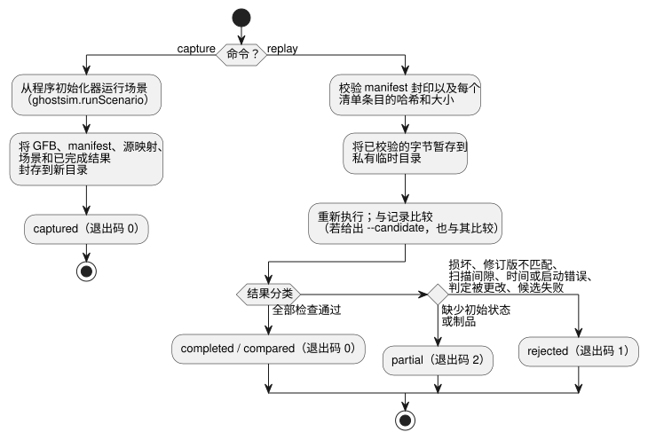

<!-- translation-source: docs/INCIDENT-REPLAY.md -->
[英文原文](INCIDENT-REPLAY.md)

# 事故捕获与重放

英文为源文本；[한국어 번역](INCIDENT-REPLAY.ko.md)。

参考宿主 CLI `tools/ghostsim-incident.mjs` 把一次虚拟运行捕获为一个封存的包（bundle），并可在之后重放它。它支持 [#133](https://github.com/callin2/ghostflow-language/issues/133)。

该工具复用现有部件，而不是新增部件：

- `ghostsim.runScenario`，及其制品和源映射检查；
- 现有的原生或 WASM 核心。

它不添加 VM、不添加物理设备模型，也不添加从原始事件到 tick 的归约器。[宿主事件排序契约](HOST-EVENT-ORDERING-CONTRACT.zh.md)仍然负责入口排序。本适配器只使用显式的场景动作和已完成的扫描。它不会推断缺失的事件或到达顺序。

## 命令与范围

```sh
node tools/ghostsim-incident.mjs capture program.gfb scenario.toon new-bundle
node tools/ghostsim-incident.mjs replay new-bundle
node tools/ghostsim-incident.mjs replay new-bundle --candidate changed.gfb
```

下图概括了每条命令的作用，以及重放结果如何分类。



**`capture`** 从程序初始化器开始一次新的虚拟运行。它将以下内容封存到一个独占的新目录中：

- 精确的 GFB 字节；
- manifest；
- 源映射；
- 显式场景；
- 已完成的结果。

生成的虚拟运行/启动 ID 标识此次捕获。它们并不是重建出来的历史设备运行。设置和绑定只来自制品默认值和显式的场景激活。以下内容不受支持：恢复任意的运行中途状态、未知的设置修订版，以及跨启动边界的重放。原始文件绝不会被覆盖。

**`replay`** 校验 manifest 封印以及每个清单条目的哈希和大小。然后它把已校验的字节缓冲区复制到一个私有临时目录中。模拟器只读取这些副本，因此在校验之后替换所提供的包，无法改变执行输入。临时副本在使用后会被删除。

限制与保护措施：

| 项目 | 限制 |
| --- | --- |
| 每个文件 | 4 MiB |
| 清单 | 32 个条目 |
| 已完成记录 | 256 次扫描 |
| 场景 | ghostsim 现有的场景界限仍然适用 |
| 符号链接 | 制品文件和所提供的目录不能是符号链接 |

发布失败时可能会留下一个不完整的新目标目录。它绝不会覆盖已存在的目标，也绝不会删除用户输入。

**运行时修订版。** 每次捕获都会记录一个运行时修订版，其中包括：

- 实际选用的原生/WASM 二进制文件的摘要；
- 所有顶层工具 `.mjs` 源文件和 WASM 适配器 `.mjs` 源文件的摘要；
- 依赖锁定文件的摘要；
- Node 版本。

重放要求完全相等，因此即使是一个无关的工具变更，也可能保守地使旧的捕获失效。所选修订版在执行前后都会被检查。若要重放旧的捕获胶囊（capsule），请恢复完全相同的宿主/运行时；绝不要给新的二进制文件贴上旧的标识。这些值是内容修订版，而不是官方构建编号。

依赖安装的完整性和可信的宿主执行是前提条件。这些哈希是一致性检查。它们不是经过认证的来源（provenance），也不能防范以同一用户权限运行的其他进程。

## 结果及其证据含义

每条命令输出一个 `GhostFlow/incident-replay-result-v1` JSON 对象。

| 结果 | 退出状态 | 典型原因 |
| --- | --- | --- |
| captured / completed / compared | 0 | 所有检查均通过 |
| partial | 2 | 缺少初始状态或制品 |
| rejected | 1 | 损坏、运行时修订版不匹配、扫描序列间隙、逻辑时间倒退、启动不匹配、已记录的判定被更改 |

对未改变的输入反复重放，会返回完全相同的结果对象。被拒绝的情况会被显式报告；不会通过插值来修复它们。

**候选比较。** `--candidate` 使用同一个封存场景启动一个全新实例。它报告源标识，以及按扫描 ID、逻辑时间和通道列出的安全虚拟输出差异，包括某个通道是否存在。

- `matched` 表示原始记录被复现。
- `candidate.equivalent` 只针对所比较的安全输出。它并不声称内部状态、硬件上的时序或所有未来行为等价。
- 如果候选执行失败，比较会被拒绝。

**历史 FarmStudio 包。** 来自 System229 的历史 `FarmStudio/incident-bundle-v1` 封装只被接受用于有界的清单完整性检查和显式的间隙报告。即使 `replay.available` 为 true，它们仍然是 partial，因为该格式不提供已完成扫描的胶囊。

- 生产者的语义校验仍由 System 负责。重新计算出的封印并不能认证历史陈述。
- 私有设备记录不是仓库夹具。
- 没有任何回退（fallback）机制会重建它们缺失的运行、设置、状态、时钟或扫描位置。

**结果的含义。** 所有结果描述的都是已记录的**虚拟判定**。它们不是已应用或已确认的物理输出、触点、闭环设备行为或 HIL 验收。合成的原生/WASM 一致性回归测试是在现有引擎之间相互比较，并不是独立的物理判定基准（oracle）。不会调用任何服务、网络、模型或硬件。

## 验证与剩余集成

`node --test tests/ghostsim-incident.test.mjs` 覆盖：

- 可重复性；
- 候选差异；
- 损坏和缺失输入；
- 运行时/辅助工具修订版漂移；
- 已校验快照的执行；
- 初始状态、扫描、时钟和启动边界；
- 历史 partial 封装；
- CLI 退出码；
- 合成的原生/WASM 一致性。

该测试套件已在完整验证器中显式注册。它保留历史证据，以及语言、GFB、ABI 和场景结果的语义。

本工具是冷启动的虚拟捕获/重放使用方。要完整重放一次历史事故，仍需要生产者提供：

- 精确的可执行制品；
- 生效的设置和绑定修订版；
- 足够的初始执行状态；
- 有序的已完成扫描。

宿主事件入口捕获和任意状态恢复仍是独立的能力；本工具不会把它们标记为已实现。
