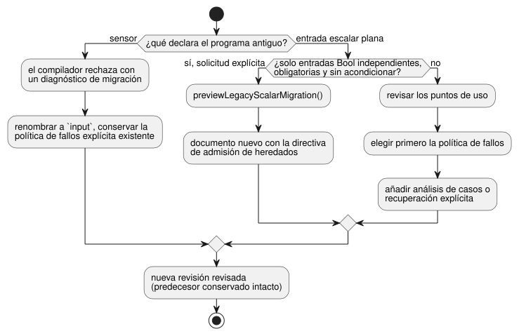

<!-- translation-source: docs/INPUT-MIGRATION.md -->
[Original en inglés](INPUT-MIGRATION.md)

# Entrada externa canónica y migración explícita de revisiones

Este documento explica la forma canónica de declarar entradas externas, cómo
migran a ella los programas existentes y qué deben proporcionar los hosts de
adquisición.

**En este documento**

- La declaración `input` y su semántica de fallos (a continuación).
- **Fuente e historial**: cómo los programas antiguos con `sensor` y con entradas planas se convierten en nuevas revisiones.
- **Admisión explícita de Bool heredados**: una ruta opcional que mantiene en funcionamiento, sin cambios, los programas Bool antiguos.
- **Adquisición y compatibilidad en el cable**: qué envían los productores y qué permanece igual en el cable.
- **Titularidad y puertas de adopción**: quién adopta cada parte del contrato.

**La declaración `input`.** La declaración externa previa a 1.0 es
`input name: T;`. Leerla produce `Result<T, SensorFault>`, lo que conserva el
anterior contrato de calidad de los sensores. Dicho de otro modo, cada lectura
puede ser un valor sano o un fallo.

- Las cargas útiles admitidas son Bool, Int, Number, Percent, Duration, Date,
  TimeOfDay, DateTime y las magnitudes físicas.
- A modo de comparación: `let` calcula una vinculación, `state` recuerda un
  valor entre ticks y `output` declara la intención solicitada.

```ghost
control ExplicitQuality {
  input request: Bool;
  output enabled: Bool;
  enabled <- request |> recover(true);
}
```

Este ejemplo elige deliberadamente true ante un fallo. Ilustra una política
escrita por el autor; **no** es una política de instalación recomendada.

- Un false sano sigue siendo false.
- Ante un fallo no se sustituye automáticamente ni false/cero ni una política de
  todo apagado.
- El análisis de casos y las transformaciones de Result conservan la procedencia
  NotReady, Disconnected, Stale e Invalid, incluso cuando el autor recupera
  explícitamente un valor.

El diagrama muestra de dónde proviene el Result de una entrada.


**Otras características de las entradas.** Los nombres agrupados,
`input observation?: Bool;`, las unidades, la cadencia, los rangos válidos, los
filtros de mediana/media móvil/EMA, los límites de obsolescencia y los
recuentos de recuperación usan todos los contratos de sensores existentes.

- La *ausencia* opcional (una entrada que no está instalada) selecciona la
  estrategia de adaptación escrita por el autor. Un fallo en una entrada
  instalada no significa ausencia.
- En las coincidencias de capacidades, `sensor<Bool>` nombra la categoría de
  capacidad de calidad. No es un alias de una declaración.

## Fuente e historial

El diagrama resume las rutas de migración descritas en esta sección y en la
siguiente.



**Declaraciones `sensor` antiguas.** La antigua declaración `sensor` se rechaza
con un diagnóstico de migración. Ningún producto ni respaldo del compilador en
bruto la acepta. Para migrar, cambie la grafía de la declaración y conserve la
política de fallos explícita existente; el resultado es una nueva revisión que
debe revisarse. Los bytes de la fuente, el resumen (digest) de la fuente, la
revisión y la identidad de aprobación deben identificar ese nuevo documento.
Conserve intacto su predecesor.

**Entradas planas antiguas.** Un programa antiguo con entradas planas necesita
una revisión de sus puntos de uso, no solo un cambio de nombre. Por ejemplo,
`request && !stop` no puede consumir entradas Result.

1. Establezca primero una política de fallos.
2. Después introduzca un análisis de casos exhaustivo o una transformación de
   recuperación explícita.

No infiera esa política a partir de tramas de reproducción sanas, etiquetas o
un modo de destino. Un error del compilador no edita la fuente almacenada ni
crea una revisión de reemplazo.

**Cambio del destino de adquisición.** Cambiar entre adquisición por
navegador, USB o física selecciona adaptadores y vinculaciones de instalación
para el mismo documento aprobado. No reescribe la fuente ni sustituye un
programa predefinido. Mantenga juntas la revisión de la fuente y la identidad
del artefacto. La API es titular de las revisiones persistidas y de la
aprobación de nuevos candidatos.

**Dominios de cargas útiles escalares.** Todas las cargas útiles escalares
admitidas usan muestras de calidad tipadas.

| Tipo | Dominio |
| --- | --- |
| Int | i32 con signo |
| Duration | Entero seguro no negativo, en milisegundos |
| Date, TimeOfDay, DateTime | Sus dominios de enteros exactos existentes |

- Las observaciones numéricas fraccionarias o fuera de rango pasan a Invalid
  antes del acondicionamiento. Los tipos de registro del host mal formados
  siguen rechazándose.
- No se infiere ninguna conversión a Number, ningún redondeo ni ninguna
  confianza en el reloj.
- Los tipos exactos usan el filtro de identidad predeterminado sin cambios. Los
  filtros numéricos explícitos y la histéresis siguen limitados a Number,
  Percent y las magnitudes físicas.
- Los puntos de uso escalares planos antiguos siguen requiriendo una política
  de Result explícita escrita por el autor.

## Admisión explícita de Bool heredados

Esta sección describe una ruta opcional que permite que un programa antiguo
solo con Bool mantenga su comportamiento actual sin reescribir sus puntos de
uso.

**Vista previa de la migración.** `previewLegacyScalarMigration(source,{filename})`
devuelve un documento nuevo determinista, un recibo y un contrato vinculado.

- El documento nuevo contiene el documento original como prefijo exacto. Los
  puntos de uso ejecutables no cambian.
- Solo se admiten entradas Bool independientes, obligatorias y sin
  acondicionamiento. Se rechazan las importaciones, las funciones/macros, el
  ciclo de vida, las entradas opcionales o acondicionadas y los demás tipos.
- Las fuentes que ya están al día (tipadas o convertidas) no migran de forma
  predeterminada.
- El éxito de la compilación por sí solo no prueba la conservación: los puertos
  Bool heredados no usados seguían siendo obligatorios en cada trama. Una
  solicitud explícita de origen conocido puede pasar
  `sourceInputContract:'required-current-bool-snapshot'` para conservar esos
  puertos. La prueba de reducción en bruto sigue rechazando el uso de Result
  tipados.
- El host conserva la revisión antigua y, de forma explícita, previsualiza y
  acepta la nueva. No se llama a ningún almacenamiento ni modelo.

**La directiva de admisión.** Una directiva de nivel superior
`<!-- ghostflow:legacy-scalar-admission-v1 ` lleva JSON canónico con
exactamente las claves `format,contractVersion,policy,originalSourceSha256,inputs`.

| Clave | Valor |
| --- | --- |
| format | `GhostFlow/legacy-scalar-admission-v1` |
| contractVersion | 1 |
| policy | `required-current-bool-snapshot` |
| inputs | Entradas `{name,type:'Bool'}` ordenadas |

Se rechazan las directivas desconocidas, mal formadas, duplicadas o que no
coinciden con las declaraciones. Conserve la directiva en las ediciones
posteriores. La entrada ordinaria sin marcar mantiene la semántica de Result.
La directiva selecciona la reducción en bruto actual; nunca selecciona un
compilador retirado ni un valor predeterminado ante fallos.

**Manifiesto, estado y recibo.**

- `manifest.legacyAdmission` añade `sourceSha256` y `sha256`. Este último es el
  hash del JSON canónico de todos los demás campos.
- Se añade al final un estado Bool false no usado llamado
  `__gf_legacy_admission_v1_<sha256>`, de modo que se conservan los índices de
  estado existentes. El prefijo está reservado para el compilador. No se
  introduce ningún nuevo formato GFB ni ABI de WASM.
- El recibo tiene exactamente las claves
  `format,contractVersion,originalSourceSha256,convertedSourceSha256,contractSha256,previewSha256`.
  Su formato es `GhostFlow/legacy-scalar-migration-receipt-v1`; `previewSha256`
  es el hash del JSON canónico de los otros cinco campos.
- Los resúmenes no dependen del nombre de archivo. El documento devuelto es la
  fuente candidata exacta.

**Inspección y validación.**

- `inspectLegacyAdmissionSource(source,{bound:true})` devuelve el contrato
  completo. La inspección predeterminada devuelve los términos incrustados, o
  null.
- `validateLegacyAdmission({bytes,manifest,sourceDocument})`, que tiene en
  cuenta la fuente, y la reproducción de paquetes firmados vinculan entre sí la
  fuente, el marcador, los metadatos y el resumen del bytecode.
- Los destinos físicos no admitidos llaman a
  `assertLegacyAdmissionTarget(source,{supported:false})` antes de seleccionar
  un compilador congelado que podría ignorar los metadatos Markdown.

**Comprobación previa de tramas.** La función pura
`preflightLegacyAdmission(contract,frame)` trabaja sobre una copia de la trama.

- Cada puerto requiere exactamente un Bool en `inputs`, o un paquete exacto en
  `samples` con `{epoch,id,timestampMs,quality,value}`.
- Un paquete requiere calidad Good (u ordinal 1), una carga útil Bool,
  metadatos de enteros seguros no negativos y una marca de tiempo no posterior a
  `nowMs`.
- Los paquetes Good se normalizan a las entradas en bruto originales; las demás
  muestras permanecen.
- Las instantáneas faltantes, ambiguas, mal formadas y no Good se rechazan antes
  de que cambien los acondicionadores, los relojes o la VM, en ambas rutas de
  entrada de `ControlRuntime`.
- Las identidades Good válidas repetidas siguen siendo válidas. No se inventa
  ninguna política de frescura de adquisición, de duplicados ni de
  recuperación.
- Los demás hosts deben hacer cumplir este contrato o rechazarlo.

**Elección de la entrada del runtime.** En el host de control de referencia,
`selectControlRuntimeEntry(manifest)` selecciona `legacy` para los perfiles
existentes Solar sin contexto o de objetivo nativo, y `framed` en los demás
casos. Seleccione antes de la instanciación; nunca reintente después de un
error. Solar heredado usa el adaptador actual sin tramas y sus hechos solares
existentes. No afirma tener evidencia nativa de escaneos con tramas.

**Errores y comprobaciones de artefactos.** Los códigos de error esperados son
`legacy_admission_invalid`, `legacy_admission_unsupported`,
`legacy_admission_frame_rejected` y `legacy_migration_not_required`. Usan el
estado 422 y el diagnóstico `GF_SEMANTIC`. No se añade telemetría por trama.

- Se rechazan los artefactos que solo tienen el marcador o solo los metadatos.
- El GFB en bruto histórico sigue admitiéndose. Si se eliminan tanto el
  marcador como los metadatos y se recalcula el resumen, el resultado es
  indistinguible de un GFB en bruto histórico, salvo que se disponga de una
  fuente o de firmas de confianza.
- La validación que tiene en cuenta la fuente rechaza una directiva conservada
  que carezca de su contrato de artefacto.
- Las rutas del producto requieren el cierre de reproducción de la
  fuente/firma. La carga directa de bajo nivel en la VM no tiene ninguna
  garantía universal.

**`validate()` con tramas.** El `validate()` con tramas comprueba la estrategia
de capacidades del bytecode ya cargado. No activa programaciones, ventanas
temporales, vinculaciones de recursos ni entradas del ciclo de vida de
reinicio. Puede repetirse durante la configuración, pero no permite un escaneo.
La activación posterior sigue requiriendo las vinculaciones originales
específicas del perfil y la inicialización del ciclo de vida. La misma
distinción se aplica a los paquetes de contexto firmados, usen o no la admisión
de heredados.

## Adquisición y compatibilidad en el cable

**Qué permanece igual en el cable.** La palabra clave de la fuente no cambia el
nombre de la categoría de calidad a nivel de cable. Se conservan:

- `manifest.sensors`;
- las ranuras `__gf_sensor_*`;
- las categorías existentes de origen/traza de Result;
- los registros de capacidades;
- las versiones GFB seleccionadas y el ABI de WASM.

`manifest.inputs` ya no contiene declaraciones externas planas escritas por el
autor. Las ranuras internas de la VM siguen transportando valores escalares,
calidad y códigos de fallo mediante la reducción existente.

**El paquete de muestra.** El Host de referencia acepta una observación del
productor como `samples[name] = {epoch, id, timestampMs, quality, value}`.

- La calidad es explícita.
- Los valores Bool siguen siendo booleanos. Las cargas útiles numéricas y de
  magnitudes usan su unidad canónica.
- La marca de tiempo no debe superar el tiempo del escaneo.
- Un productor de software puede usar su propia época de sesión, su secuencia
  de observaciones y su marca de tiempo monotónica de observación. El paquete no
  requiere un ID de placa física.
- El productor proporciona observaciones reales. No inventa un número de
  secuencia nuevo para cada escaneo que solo avanza el reloj.

**Reglas de continuidad.**

- Una identidad de muestra repetida contribuye solo una vez a los filtros y a la
  recuperación.
- Un cambio de época de la fuente rompe la continuidad y restablece el
  historial de acondicionamiento.
- Un productor nuevo sigue las reglas existentes de disponibilidad en el
  arranque; el acondicionamiento de identidad puede aceptar su primera muestra
  Good.
- Los recuentos de recuperación se aplican después de un fallo observado dentro
  de la misma época del productor.
- Estas reglas de adquisición no seleccionan una política de reinicio del
  control.
- Sin muestras nuevas, la frescura se mide desde la última marca de tiempo
  válida real.
- Un `ok(false)` literal en una expresión pura no crea ninguna de estas
  evidencias de adquisición.

Los adaptadores de driver, USB y software deben establecer por separado sus
garantías de sesión, vinculación, desconexión y entrega. La forma del paquete
por sí sola no prueba la procedencia ni la adquisición física.

**Qué puede y qué no puede indicarle una lectura Bool.** Una observación
booleana de un pulsador no diagnostica un cable roto, un contacto atascado ni un
botón desconectado.

- `NotReady` describe la disponibilidad de adquisición/acondicionamiento, por
  ejemplo cuando todavía no se ha aceptado ninguna observación.
- Un false leído correctamente es un false sano.
- Los demás fallos de calidad requieren evidencia del productor o del contrato
  de frescura/validez configurado.

La palabra clave de la fuente no añade diagnósticos físicos. No impone ningún
requisito universal de reinicio ni de botón START.

## Titularidad y puertas de adopción

| Titular | Contrato que debe adoptar |
| --- | --- |
| Lenguaje | Sintaxis canónica, Result tipado, reducción, formatos actuales en el cable y conformidad del Host de referencia |
| Simulador/navegador | La misma fuente/artefacto; paquetes de calidad, continuidad del productor e interfaz de usuario genérica existente para sensores |
| Autoría | Los nuevos candidatos usan input y manejo explícito de fallos; conservar la intención solicitada y el historial original |
| API | Fijaciones inmutables del compilador/autoría, revisiones almacenadas y aprobación explícita de candidatos; sin reescritura al cambiar de destino |
| Device/SDK | Fijación inmutable del compilador/núcleo, comprobaciones de paquete/admisión, muestras tipadas existentes y barreras de sesión |
| Driver | Adquisición en la fuente y metadatos; la implementación genérica de Driver9 sigue teniendo un titular separado |

Integration-v1 valida actualmente las vinculaciones `manifest.inputs/outputs`.
Ese validador no establece la continuidad de adquisición de
`manifest.sensors`. No reutilice una vinculación aprobada de un endpoint de
software plano como prueba de adquisición con calidad.

Las siguientes son puertas separadas, cada una con su propia evidencia
necesaria: la conformidad del titular, las pruebas del consumidor instalado, la
ejecución en navegador, la entrega por USB y la evidencia física de
salidas/contactos. Las fijaciones de los consumidores deben nombrar un
candidato del titular inmutable y revisado. El cambio de palabra clave no
implica una versión publicada del Device, un despliegue aprobado, una migración
de fuentes en vivo ni la aceptación del hardware físico.

Véanse la [Referencia 4](reference/04-sensors-constraints-control.es.md) y
[#531](https://github.com/callin2/ghostflow-language/issues/531).
