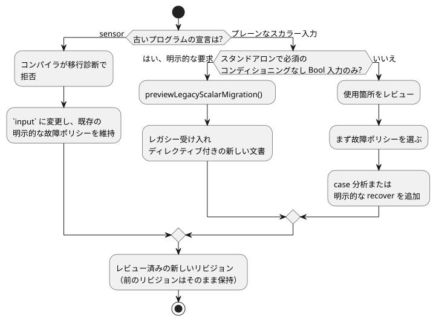

<!-- translation-source: docs/INPUT-MIGRATION.md -->
[英語の原文](INPUT-MIGRATION.md)

# 正準の外部入力と明示的なリビジョン移行

この文書では、外部入力を宣言する正準の方法、既存のプログラムをそこへ移行する方法、取得（acquisition）ホストが提供しなければならないものを説明します。

**この文書の内容**

- `input` 宣言とその故障（fault）の意味（以下）。
- **ソースと履歴**：古い `sensor` やプレーンな入力のプログラムが、どのように新しいリビジョンになるか。
- **明示的なレガシー Bool の受け入れ**：古い Bool プログラムを変更せずに動かし続けるための、オプトインの経路。
- **取得とワイヤ互換性**：プロデューサが何を送り、ワイヤ上で何が変わらないか。
- **所有権と採用のゲート**：契約のどの部分を誰が採用するか。

**`input` 宣言。**1.0 より前の外部宣言は `input name: T;` です。これを読むと `Result<T, SensorFault>` が得られ、以前のセンサの品質契約が保たれます。つまり、どの読み取りも、健全な値か故障のどちらかになりえます。

- サポートされるペイロードは、Bool、Int、Number、Percent、Duration、Date、TimeOfDay、DateTime、物理量です。
- 比較のために：`let` はバインディングを計算し、`state` は tick の間で値を記憶し、`output` は要求意図を宣言します。

```ghost
control ExplicitQuality {
  input request: Bool;
  output enabled: Bool;
  enabled <- request |> recover(true);
}
```

この例は、故障時に意図的に true を選んでいます。これは記述されたポリシーの例であり、推奨される設置ポリシーでは**ありません**。

- 健全な false は false のままです。
- 故障時に false／ゼロや全オフのポリシーが自動的に代入されることはありません。
- case 分析と Result の変換は、作者が明示的に値を復旧した場合でも、NotReady、Disconnected、Stale、Invalid の来歴を保持します。

図は、入力の Result がどこから来るかを示しています。


**その他の入力機能。**グループ化された名前、`input observation?: Bool;`、単位、周期、有効範囲、中央値／移動平均／EMA のフィルタ、古さ（stale）の上限、復旧カウントは、すべて既存のセンサの契約を使います。

- オプションの*欠落*（設置されていない入力）は、記述された適応戦略を選択します。設置された入力の故障は、欠落を意味しません。
- ケイパビリティの照合では、`sensor<Bool>` は品質ケイパビリティのカテゴリを指します。宣言の別名ではありません。

## ソースと履歴

図は、この節と次の節で説明する移行経路をまとめたものです。



**古い `sensor` 宣言。**古い `sensor` 宣言は、移行診断とともに拒否されます。製品側にも生のコンパイラ側にも、これを受け付けるフォールバックはありません。移行するには、宣言の綴りを変更し、既存の明示的な故障ポリシーを維持します。その結果はレビューが必要な新しいリビジョンです。ソースのバイト列、ソースのダイジェスト、リビジョン、承認の同一性は、その新しい文書を識別しなければなりません。前のリビジョンはそのまま保持してください。

**古いプレーンな入力。**古いプレーン入力のプログラムには、単なる名前の変更ではなく、使用箇所のレビューが必要です。たとえば、`request && !stop` は Result の入力を消費できません。

1. まず故障ポリシーを確立します。
2. 次に、網羅的な case 分析か、明示的な復旧の変換を導入します。

そのポリシーを、健全なリプレイフレーム、ラベル、ターゲットモードから推論してはなりません。コンパイラエラーが保存されたソースを編集したり、置き換えのリビジョンを作成したりすることはありません。

**取得ターゲットの変更。**ブラウザ、USB、物理的な取得の間で切り替えると、同じ承認済み文書に対するアダプタと設置バインディングが選択されます。ソースを書き換えたり、既製のプログラムで置き換えたりはしません。ソースのリビジョンと成果物の同一性を一緒に保ってください。永続化されたリビジョンと新しい候補の承認は API が担います。

**スカラーペイロードの値域。**サポートされるすべてのスカラーペイロードは、型付きの品質サンプルを使います。

| 型 | 値域 |
| --- | --- |
| Int | 符号付き i32 |
| Duration | 非負の安全な整数（ミリ秒） |
| Date, TimeOfDay, DateTime | それぞれの既存の厳密な整数の値域 |

- 小数や範囲外の数値の観測は、コンディショニングの前に Invalid になります。不正な形式のホストレコード型は、引き続き拒否されます。
- Number への変換、丸め、クロックの信頼は推論されません。
- 厳密な型は、変更されていない既定の恒等フィルタを使います。明示的な数値フィルタとヒステリシスは、引き続き Number、Percent、物理量に限られます。
- 古いプレーンなスカラーの使用箇所には、引き続き明示的に記述された Result のポリシーが必要です。

## 明示的なレガシー Bool の受け入れ

この節では、古い Bool 専用プログラムが使用箇所を書き換えずに現在の振る舞いを保てるようにする、オプトインの経路を説明します。

**移行のプレビュー。**`previewLegacyScalarMigration(source,{filename})` は、決定的な新しい文書、レシート、バインドされた契約を返します。

- 新しい文書は、元の文書を正確な先頭部分として含みます。実行可能な使用箇所は変わりません。
- サポートされるのは、スタンドアロンで、必須で、コンディショニングされていない Bool 入力だけです。インポート、関数／マクロ、ライフサイクル、オプションまたはコンディショニングされた入力、その他の型は拒否されます。
- すでに現行の（型付きまたは変換済みの）ソースは、既定では移行されません。
- コンパイルが成功しただけでは保存の証明にはなりません。未使用のレガシー Bool ポートも、すべてのフレームで必須だったからです。発信元が既知の明示的なリクエストは、それらのポートを保持するために `sourceInputContract:'required-current-bool-snapshot'` を渡すことができます。生の変換の証明は、引き続き型付きの Result の使用を拒否します。
- ホストは古いリビジョンを保持し、新しいリビジョンを明示的にプレビューして受け入れます。ストレージやモデルは呼び出されません。

**受け入れディレクティブ。**トップレベルの `<!-- ghostflow:legacy-scalar-admission-v1 ` ディレクティブは、ちょうど `format,contractVersion,policy,originalSourceSha256,inputs` のキーを持つ正準の JSON を運びます。

| キー | 値 |
| --- | --- |
| format | `GhostFlow/legacy-scalar-admission-v1` |
| contractVersion | 1 |
| policy | `required-current-bool-snapshot` |
| inputs | 順序付きの `{name,type:'Bool'}` エントリ |

不明、不正な形式、重複、宣言と一致しないディレクティブは拒否されます。以後の編集でもディレクティブを残してください。印のない通常の入力は Result の意味を保ちます。このディレクティブは現在の生の変換を選択します。引退したコンパイラや故障時の既定値を選択することは決してありません。

**マニフェスト、状態、レシート。**

- `manifest.legacyAdmission` は `sourceSha256` と `sha256` を追加します。後者は、他のすべてのフィールドの正準 JSON をハッシュしたものです。
- `__gf_legacy_admission_v1_<sha256>` という名前の、未使用で false の Bool 状態が末尾に追加されるため、既存の状態インデックスは保たれます。この接頭辞はコンパイラ用に予約されています。新しい GFB 形式や WASM ABI は導入されません。
- レシートは、ちょうど
  `format,contractVersion,originalSourceSha256,convertedSourceSha256,contractSha256,previewSha256` のキーを持ちます。
  その形式は `GhostFlow/legacy-scalar-migration-receipt-v1` で、`previewSha256` は他の 5 つのフィールドの正準 JSON をハッシュしたものです。
- ダイジェストはファイル名に依存しません。返された文書が、正確な候補ソースです。

**検査と検証。**

- `inspectLegacyAdmissionSource(source,{bound:true})` は完全な契約を返します。既定の検査は、埋め込まれた条項か null を返します。
- ソースを考慮した `validateLegacyAdmission({bytes,manifest,sourceDocument})` と、署名付きパッケージのリプレイは、ソース、マーカー、メタデータ、バイトコードのダイジェストを互いに結び付けます。
- サポートされない物理ターゲットは、Markdown のメタデータを無視しうる凍結済みコンパイラを選択する前に、`assertLegacyAdmissionTarget(source,{supported:false})` を呼び出します。

**フレームの事前チェック。**純粋な `preflightLegacyAdmission(contract,frame)` は、フレームのコピーに対して動作します。

- 各ポートには、`inputs` にちょうど 1 つの Bool があるか、`samples` に `{epoch,id,timestampMs,quality,value}` を持つ正確なパケットがあることが必要です。
- パケットには、Good の品質（または序数 1）、Bool のペイロード、非負の安全な整数のメタデータ、`nowMs` より後でないタイムスタンプが必要です。
- Good のパケットは元の生の入力に正規化され、他のサンプルはそのまま残ります。
- 欠落した、曖昧な、不正な形式の、Good でないスナップショットは、`ControlRuntime` の両方のエントリ経路で、コンディショナ、クロック、VM が変化する前に拒否されます。
- 有効な Good の同一性が繰り返されても有効なままです。取得の鮮度、重複、復旧のポリシーがでっち上げられることはありません。
- 他のホストは、この契約を強制するか、拒否しなければなりません。

**ランタイムエントリの選択。**参照の control ホストでは、`selectControlRuntimeEntry(manifest)` が、既存のコンテキストを持たない Solar またはネイティブの objective のプロファイルには `legacy` を、それ以外には `framed` を選択します。インスタンス化の前に選択し、エラーの後にリトライしてはなりません。レガシーの Solar は、現在のフレーム化されていないアダプタと既存の solar ファクトを使います。ネイティブのフレーム化スキャンの証拠があるとは主張しません。

**エラーと成果物のチェック。**想定されるエラーコードは、`legacy_admission_invalid`、`legacy_admission_unsupported`、`legacy_admission_frame_rejected`、`legacy_migration_not_required` です。これらはステータス 422 と診断 `GF_SEMANTIC` を使います。フレームごとのテレメトリは追加されません。

- マーカーだけ、またはメタデータだけを持つ成果物は拒否されます。
- 過去の生の GFB は引き続きサポートされます。マーカーとメタデータの両方を削除してダイジェストを再計算すると、信頼できるソース／署名がない限り、その結果は過去の生の GFB と区別できません。
- ソースを考慮した検証は、成果物側の契約を欠いたまま残されたディレクティブを拒否します。
- 製品の経路には、ソースのリプレイ／署名による閉包が必要です。低レベルで VM を直接ロードする場合には、汎用的な保証はありません。

**フレーム化された `validate()`。**フレーム化された `validate()` は、すでにロードされたバイトコードのケイパビリティ戦略をチェックします。スケジュール、時間的なウィンドウ、リソースバインディング、再起動ライフサイクルの入力はアクティベートしません。設定中に繰り返し呼び出してもかまいませんが、スキャンを許可するものではありません。その後のアクティベーションには、引き続き元のプロファイル固有のバインディングとライフサイクルの初期化が必要です。同じ区別は、レガシーの受け入れを使うかどうかにかかわらず、署名付きのコンテキストパッケージにも当てはまります。

## 取得とワイヤ互換性

**ワイヤ上で変わらないもの。**ソースのキーワードは、ワイヤレベルの品質カテゴリの名前を変えません。次のものはそのまま維持します。

- `manifest.sensors`
- `__gf_sensor_*` スロット
- 既存の Result の発生元／トレースのカテゴリ
- ケイパビリティの記録
- 選択された GFB のバージョンと WASM ABI

`manifest.inputs` には、記述されたプレーンな外部宣言はもう含まれません。内部の VM スロットは、既存の変換を通じて、引き続きスカラー値、品質、故障コードを運びます。

**サンプルパケット。**参照 Host は、プロデューサの観測を `samples[name] = {epoch, id, timestampMs, quality, value}` として受け付けます。

- 品質は明示的です。
- Bool の値は boolean のままです。数値と物理量のペイロードは正準の単位を使います。
- タイムスタンプはスキャン時刻を超えてはなりません。
- ソフトウェアのプロデューサは、独自のセッションエポック、観測シーケンス、単調な観測タイムスタンプを使ってかまいません。パケットに物理ボードの ID は必要ありません。
- プロデューサは実際の観測を提供します。クロックだけのスキャンのたびに新しいシーケンス番号をでっち上げることはありません。

**連続性の規則。**

- 繰り返されたサンプルの同一性は、フィルタと復旧に 1 回だけ寄与します。
- ソースのエポックが変わると連続性が途切れ、コンディショニングの履歴がリセットされます。
- 新しいプロデューサは、既存の起動時の準備規則に従います。恒等コンディショニングは、最初の Good のサンプルを受け入れることができます。
- 復旧カウントは、同じプロデューサのエポック内で故障が観測された後に適用されます。
- これらの取得規則は、制御の再起動ポリシーを選択するものではありません。
- 新しいサンプルがない場合、鮮度は、実際に最後に有効だったタイムスタンプから測られます。
- 純粋な式の中のリテラル `ok(false)` は、こうした取得の証拠を何も生み出しません。

ドライバ、USB、ソフトウェアのアダプタは、それぞれのセッション、バインディング、切断、配送の保証を別途確立しなければなりません。パケットの形だけでは、来歴や物理的な取得は証明されません。

**Bool の読み取りからわかること、わからないこと。**Bool の押しボタンの観測では、断線、接点の固着、ボタンの切断を診断できません。

- `NotReady` は取得／コンディショニングの準備状態を表します。たとえば、まだ観測が 1 つも受け入れられていない場合です。
- 正常に読み取られた false は、健全な false です。
- その他の品質の故障には、プロデューサからの証拠、または設定された鮮度／有効性の契約による証拠が必要です。

ソースのキーワードは、物理的な診断を追加しません。汎用的な再起動や START ボタンの要件を課すこともありません。

## 所有権と採用のゲート

| 所有者 | 採用すべき契約 |
| --- | --- |
| 言語 | 正準の構文、型付きの Result、変換、現在のワイヤ形式、参照 Host の適合性 |
| シミュレータ／ブラウザ | 同じソース／成果物。品質パケット、プロデューサの連続性、既存の汎用センサ UI |
| オーサリング | 新しい候補は input と明示的な故障処理を使う。要求意図と元の履歴を保持する |
| API | 不変のコンパイラ／オーサリングのピン、保存されたリビジョン、明示的な候補の承認。ターゲット切り替えによる書き換えはしない |
| Device/SDK | 不変のコンパイラ／コアのピン、パッケージ／受け入れのチェック、既存の型付きサンプルとセッションフェンス |
| ドライバ | ソースの取得とメタデータ。汎用の Driver9 の実装は引き続き別に所有される |

Integration-v1 は現在、`manifest.inputs/outputs` のバインディングを検証します。このバリデータは、`manifest.sensors` の取得の連続性を立証しません。合格したプレーンなソフトウェアエンドポイントのバインディングを、品質取得の証明として流用してはなりません。

次のものはそれぞれ別のゲートであり、それぞれ独自の証拠が必要です：所有者の適合性、設置された利用側のテスト、ブラウザでの実行、USB での配送、物理的な出力／接点の証拠。利用側のピンは、不変でレビュー済みの所有者候補を指さなければなりません。キーワードの変更は、Device のリリース、承認済みのデプロイ、稼働中のソースの移行、物理ハードウェアの受け入れを意味するものではありません。

[Reference 4](reference/04-sensors-constraints-control.ja.md) と [#531](https://github.com/callin2/ghostflow-language/issues/531) を参照してください。
