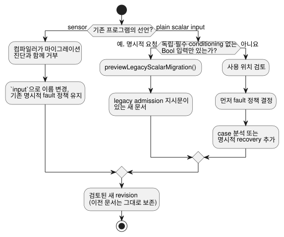

<!-- translation-source: docs/INPUT-MIGRATION.md -->
[영문 원문](INPUT-MIGRATION.md)

# 외부 입력의 정본 선언과 명시적 revision 마이그레이션

이 문서는 외부 입력을 선언하는 정본 방식, 기존 프로그램을 그 방식으로 마이그레이션하는
방법, 그리고 수집(acquisition) 호스트가 제공해야 하는 것을 설명합니다.

**이 문서의 내용**

- `input` 선언과 그 fault 의미(아래).
- **소스와 이력**: 기존 `sensor` 프로그램과 plain input 프로그램이 새 revision이 되는 방법.
- **기존 Bool 입력의 명시적 admission**: 기존 Bool 프로그램을 그대로 실행하도록 하는 opt-in 경로.
- **수집과 wire 호환성**: producer가 보내는 것과 wire에서 그대로 유지되는 것.
- **소유권과 채택 gate**: 계약의 어느 부분을 누가 채택하는지.

**`input` 선언.** 1.0 이전의 외부 선언은 `input name: T;`입니다. 이 값을 읽으면
`Result<T, SensorFault>`가 나오며, 이는 기존 sensor 품질 계약을 그대로 이어받습니다.
즉 모든 읽기는 정상 값이거나 fault일 수 있습니다.

- 지원하는 payload는 Bool, Int, Number, Percent, Duration, Date, TimeOfDay, DateTime,
  그리고 물리량입니다.
- 비교하자면, `let`은 바인딩을 계산하고, `state`는 tick 사이에 값을 기억하며, `output`은
  요청 의도를 선언합니다.

```ghost
control ExplicitQuality {
  input request: Bool;
  output enabled: Bool;
  enabled <- request |> recover(true);
}
```

이 예제는 fault일 때 의도적으로 true를 선택합니다. 작성자가 정한 정책을 보여 주는 예일 뿐,
설치에 권장하는 정책이 **아닙니다**.

- 정상적인 false는 false로 남습니다.
- fault일 때 false/0이나 all-off 정책이 자동으로 대입되지 않습니다.
- 작성자가 값을 명시적으로 복구하더라도, case 분석과 Result 변환은 NotReady,
  Disconnected, Stale, Invalid provenance(출처)를 보존합니다.

다이어그램은 입력의 Result가 어디에서 오는지 보여 줍니다.


**그 밖의 입력 기능.** 이름을 묶은 선언, `input observation?: Bool;`, 단위, cadence, 유효
범위, 중앙값/이동평균/EMA 필터, stale 한계, recovery 횟수는 모두 기존 sensor 계약을
사용합니다.

- 선택적 입력의 *부재*(설치되지 않은 입력)는 작성자가 정한 adaptation 전략을 선택합니다.
  설치된 입력의 fault는 부재를 뜻하지 않습니다.
- capability match에서 `sensor<Bool>`은 품질 capability 분류의 이름입니다. 선언의
  별칭이 아닙니다.

## 소스와 이력

다이어그램은 이 절과 다음 절에서 설명하는 마이그레이션 경로를 요약합니다.



**기존 `sensor` 선언.** 기존 `sensor` 선언은 마이그레이션 진단과 함께 거부됩니다. 제품
경로나 원시 컴파일러 fallback 중 어느 것도 이를 받아들이지 않습니다. 마이그레이션하려면 선언
표기를 바꾸고 기존의 명시적 fault 정책은 유지하십시오. 그 결과는 검토를 거쳐야 하는 새
revision입니다. 소스 바이트, 소스 digest, revision, 승인 identity는 그 새 문서를 가리켜야
합니다. 이전 문서는 그대로 보존하십시오.

**기존 plain input.** 기존 plain input 프로그램은 이름만 바꾸는 것이 아니라 사용 위치를
검토해야 합니다. 예를 들어 `request && !stop`은 Result 입력을 사용할 수 없습니다.

1. 먼저 fault 정책을 정합니다.
2. 그런 다음 빠짐없는 case 분석이나 명시적 recovery 변환을 도입합니다.

정상적인 replay frame, 라벨, 대상 모드로부터 그 정책을 추론하지 마십시오. 컴파일러 오류는
저장된 소스를 수정하지도, 대체 revision을 만들지도 않습니다.

**수집 대상 변경.** 브라우저, USB, 물리 수집 사이의 전환은 같은 승인 문서에 대한 어댑터와
설치 바인딩을 선택합니다. 소스를 다시 쓰거나 미리 만들어 둔 프로그램으로 대체하지 않습니다.
소스 revision과 아티팩트 identity를 함께 유지하십시오. 저장된 revision과 새 후보의 승인은
API가 소유합니다.

**Scalar payload 도메인.** 지원하는 모든 scalar payload는 typed 품질 샘플을 사용합니다.

| 타입 | 도메인 |
| --- | --- |
| Int | 부호 있는 i32 |
| Duration | 음수가 아닌 안전한 정수, 밀리초 단위 |
| Date, TimeOfDay, DateTime | 각자의 기존 정확한 정수 도메인 |

- 소수이거나 범위를 벗어난 숫자 관측값은 conditioning 전에 Invalid가 됩니다. 형식이
  잘못된 호스트 record 타입은 여전히 거부됩니다.
- Number로의 변환, 반올림, 시계 신뢰는 추론하지 않습니다.
- 정확한 타입은 변경되지 않은 기본 identity 필터를 사용합니다. 명시적 숫자 필터와
  히스테리시스는 여전히 Number, Percent, 물리량으로 한정됩니다.
- 기존 plain scalar 사용 위치에는 여전히 작성자가 명시한 Result 정책이 필요합니다.

## 기존 Bool 입력의 명시적 admission

이 절은 Bool만 사용하는 기존 프로그램이 사용 위치를 다시 쓰지 않고도 현재 동작을 유지하도록
하는 opt-in 경로를 설명합니다.

**마이그레이션 미리 보기.** `previewLegacyScalarMigration(source,{filename})`는 결정적인 새
문서, receipt, 바인딩된 계약을 반환합니다.

- 새 문서는 원래 문서를 정확한 prefix로 포함합니다. 실행 가능한 사용 위치는 바뀌지 않습니다.
- 독립적이고, 필수이며, conditioning되지 않은 Bool 입력만 지원합니다. import, 함수/매크로,
  lifecycle, 선택적이거나 conditioning된 입력, 다른 타입은 거부됩니다.
- 이미 최신(typed 또는 변환 완료)인 소스는 기본적으로 마이그레이션되지 않습니다.
- 컴파일 성공만으로는 동작 보존이 증명되지 않습니다. 사용되지 않는 기존 Bool 포트도 모든
  frame에서 필수였기 때문입니다. 출처가 확인된 명시적 요청은
  `sourceInputContract:'required-current-bool-snapshot'`을 전달하여 그 포트를 보존할 수
  있습니다. 원시 하향 변환 증명은 여전히 typed Result 사용을 거부합니다.
- 호스트는 이전 revision을 보존하고, 새 revision을 명시적으로 미리 본 뒤 수락합니다.
  저장소나 모델은 호출하지 않습니다.

**Admission 지시문.** 최상위 `<!-- ghostflow:legacy-scalar-admission-v1 ` 지시문은 정확히
`format,contractVersion,policy,originalSourceSha256,inputs` 키만 가진 정본 JSON을 담습니다.

| 키 | 값 |
| --- | --- |
| format | `GhostFlow/legacy-scalar-admission-v1` |
| contractVersion | 1 |
| policy | `required-current-bool-snapshot` |
| inputs | 순서가 있는 `{name,type:'Bool'}` 항목 |

알 수 없거나, 형식이 잘못되었거나, 중복되었거나, 선언과 일치하지 않는 지시문은 거부됩니다.
이후 편집에서도 지시문을 유지하십시오. 표시가 없는 일반 input은 Result 의미를 유지합니다.
이 지시문은 현재의 원시 하향 변환을 선택할 뿐, 폐기된 컴파일러나 fault 기본값을 선택하지는
않습니다.

**매니페스트, 상태, receipt.**

- `manifest.legacyAdmission`은 `sourceSha256`과 `sha256`을 추가합니다. 후자는 나머지 모든
  필드의 정본 JSON 해시입니다.
- `__gf_legacy_admission_v1_<sha256>`이라는 이름의, 사용되지 않는 false Bool 상태가 끝에
  추가되므로 기존 상태 인덱스가 보존됩니다. 이 prefix는 컴파일러 전용으로 예약되어 있습니다.
  새로운 GFB 형식이나 WASM ABI는 도입되지 않습니다.
- receipt는 정확히
  `format,contractVersion,originalSourceSha256,convertedSourceSha256,contractSha256,previewSha256`
  키를 가집니다. 형식은 `GhostFlow/legacy-scalar-migration-receipt-v1`이며,
  `previewSha256`은 나머지 다섯 필드의 정본 JSON 해시입니다.
- digest는 파일 이름에 의존하지 않습니다. 반환된 문서가 그대로 정확한 후보 소스입니다.

**검사와 검증.**

- `inspectLegacyAdmissionSource(source,{bound:true})`는 전체 계약을 반환합니다. 기본 검사는
  내장된 조건 또는 null을 반환합니다.
- 소스를 고려하는 `validateLegacyAdmission({bytes,manifest,sourceDocument})`와 서명된
  package replay는 소스, marker, 메타데이터, 바이트코드 digest를 함께 묶습니다.
- 지원하지 않는 물리 대상은 Markdown 메타데이터를 무시할 수 있는 동결된 컴파일러를 선택하기
  전에 `assertLegacyAdmissionTarget(source,{supported:false})`를 호출합니다.

**Frame 사전 검사.** 순수 함수 `preflightLegacyAdmission(contract,frame)`은 frame의 사본에서
동작합니다.

- 모든 포트는 `inputs`에 정확히 하나의 Bool이 있거나, `samples`에
  `{epoch,id,timestampMs,quality,value}`를 가진 정확한 packet이 있어야 합니다.
- packet은 Good 품질(또는 ordinal 1), Bool payload, 음수가 아닌 안전한 정수 메타데이터,
  그리고 `nowMs`보다 늦지 않은 timestamp를 요구합니다.
- Good packet은 원래의 원시 입력으로 정규화되고, 다른 샘플은 그대로 남습니다.
- 누락되었거나, 모호하거나, 형식이 잘못되었거나, Good이 아닌 snapshot은 두 `ControlRuntime`
  진입 경로 모두에서 conditioner, 시계, VM이 변경되기 전에 거부됩니다.
- 반복된 유효한 Good identity는 여전히 유효합니다. 수집 freshness, 중복, recovery 정책을
  새로 만들어 내지 않습니다.
- 다른 호스트는 이 계약을 강제하거나 거부해야 합니다.

**런타임 진입점 선택.** 참조 control 호스트에서 `selectControlRuntimeEntry(manifest)`는
기존의 non-context Solar 또는 native-objective 프로필에는 `legacy`를, 그 밖에는 `framed`를
선택합니다. instance 생성 전에 선택하십시오. 오류 후에 재시도해서는 절대 안 됩니다. 기존
Solar는 현재의 unframed 어댑터와 기존 solar fact를 사용합니다. native framed-scan 증거를
주장하지 않습니다.

**오류와 아티팩트 검사.** 예상되는 오류 코드는 `legacy_admission_invalid`,
`legacy_admission_unsupported`, `legacy_admission_frame_rejected`,
`legacy_migration_not_required`입니다. 이 오류들은 status 422와 진단 `GF_SEMANTIC`을
사용합니다. frame별 telemetry는 추가되지 않습니다.

- marker만 있거나 메타데이터만 있는 아티팩트는 거부됩니다.
- 과거의 원시 GFB는 계속 지원됩니다. marker와 메타데이터를 모두 제거하고 digest를 다시
  계산하면, 신뢰할 수 있는 소스/서명이 없는 한 그 결과는 과거의 원시 GFB와 구별할 수
  없습니다.
- 소스를 고려하는 검증은 아티팩트 계약 없이 지시문만 남은 경우를 거부합니다.
- 제품 경로는 source replay/서명 closure를 요구합니다. 직접적인 저수준 VM 로딩에는 보편적인
  보장이 없습니다.

**Framed `validate()`.** Framed `validate()`는 이미 로드된 바이트코드의 capability 전략을
검사합니다. 예약, 시간 window, resource 바인딩, 재시작 lifecycle 입력을 활성화하지는
않습니다. 설정 중에 반복할 수 있지만, scan을 허용하지는 않습니다. 이후의 activation에는
여전히 원래의 프로필별 바인딩과 lifecycle 초기화가 필요합니다. 같은 구분이 legacy
admission 사용 여부와 관계없이 서명된 context package에도 적용됩니다.

## 수집과 wire 호환성

**Wire에서 그대로 유지되는 것.** 소스 키워드가 wire 수준의 품질 분류 이름을 바꾸지는
않습니다. 다음을 유지하십시오.

- `manifest.sensors`
- `__gf_sensor_*` slot
- 기존 Result origin/trace 분류
- capability record
- 선택된 GFB 버전과 WASM ABI

`manifest.inputs`에는 더 이상 작성자가 쓴 plain 외부 선언이 들어 있지 않습니다. 내부 VM
slot은 여전히 기존 하향 변환을 통해 scalar 값, 품질, fault 코드를 운반합니다.

**샘플 packet.** 참조 Host는 producer 관측을
`samples[name] = {epoch, id, timestampMs, quality, value}` 형태로 받습니다.

- 품질은 명시적입니다.
- Bool 값은 boolean으로 남습니다. 숫자와 물리량 payload는 정본 단위를 사용합니다.
- timestamp는 scan 시간을 넘어서는 안 됩니다.
- 소프트웨어 producer는 자체 session epoch, 관측 sequence, 단조 관측 timestamp를 사용할 수
  있습니다. packet에 물리 보드 ID가 필요하지는 않습니다.
- producer는 실제 관측을 제공합니다. 시계만 진행되는 scan마다 새 sequence 번호를 만들어
  내지 않습니다.

**연속성 규칙.**

- 반복된 샘플 identity는 필터와 recovery에 한 번만 기여합니다.
- source epoch가 바뀌면 연속성이 끊기고 conditioning 이력이 초기화됩니다.
- 새 producer는 기존 시작 준비 규칙을 따릅니다. identity conditioning은 첫 Good 샘플을
  받아들일 수 있습니다.
- recovery 횟수는 같은 producer epoch 안에서 관측된 fault 이후에 적용됩니다.
- 이 수집 규칙이 control의 재시작 정책을 선택하지는 않습니다.
- 새 샘플이 없으면 freshness는 실제 마지막 유효 timestamp부터 측정합니다.
- 순수 식 안의 리터럴 `ok(false)`는 이러한 수집 증거를 전혀 만들지 않습니다.

드라이버, USB, 소프트웨어 어댑터는 각자의 session, 바인딩, 연결 끊김, 전달 보장을 별도로
확립해야 합니다. packet 형태만으로는 provenance나 물리 수집이 증명되지 않습니다.

**Bool 읽기로 알 수 있는 것과 알 수 없는 것.** Boolean 푸시 버튼 관측만으로는 단선, 고착된
접점, 연결이 끊긴 버튼을 진단할 수 없습니다.

- `NotReady`는 수집/conditioning의 준비 상태를 나타냅니다. 예를 들어 아직 받아들인 관측이
  없는 경우입니다.
- 정상적으로 읽은 false는 정상적인 false입니다.
- 그 밖의 품질 fault에는 producer의 증거나 설정된 freshness/유효성 계약의 증거가 필요합니다.

소스 키워드는 물리 진단을 추가하지 않습니다. 보편적인 재시작 요구나 START 버튼 요구를 강제하지도
않습니다.

## 소유권과 채택 gate

| 소유자 | 채택할 계약 |
| --- | --- |
| Language | 정본 문법, typed Result, 하향 변환, 현재 wire 형식, 참조 Host conformance |
| Simulator/browser | 같은 소스/아티팩트, 품질 packet, producer 연속성, 기존의 범용 sensor UI |
| Authoring | 새 후보는 input과 명시적 fault 처리를 사용. 요청 의도와 원래 이력 보존 |
| API | 변경할 수 없는 컴파일러/authoring 고정, 저장된 revision, 명시적 후보 승인. 대상 전환 시 재작성 없음 |
| Device/SDK | 변경할 수 없는 컴파일러/core 고정, package/admission 검사, 기존 typed 샘플과 session fence |
| Driver | 소스 수집과 메타데이터. 범용 Driver9 구현은 별도 소유 |

Integration-v1은 현재 `manifest.inputs/outputs` 바인딩을 검증합니다. 그 검증기는
`manifest.sensors`의 수집 연속성을 확립하지 않습니다. plain 소프트웨어 endpoint 바인딩이
통과했다는 사실을 품질 수집의 증거로 재사용하지 마십시오.

다음은 각각 고유한 증거가 필요한 별개의 gate입니다: 소유자 conformance, 설치된 소비자
테스트, 브라우저 실행, USB 전달, 물리 출력/접점 증거. 소비자 고정은 변경할 수 없고 검토를
거친 소유자 후보를 지정해야 합니다. 키워드 변경은 Device 릴리스, 승인된 배포, 운영 중인 소스의
마이그레이션, 물리 하드웨어 수용을 의미하지 않습니다.

[Reference 4](reference/04-sensors-constraints-control.md)와
[#531](https://github.com/callin2/ghostflow-language/issues/531)을 참고하십시오.
