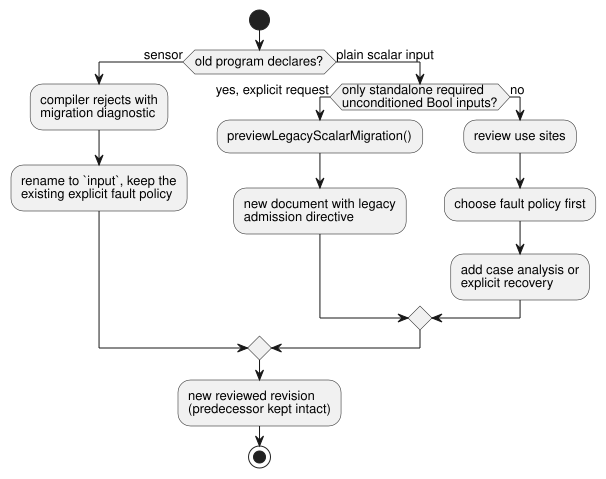

# Canonical external input and explicit revision migration

This document explains the canonical way to declare external inputs, how
existing programs migrate to it, and what acquisition hosts must provide.

**In this document**

- The `input` declaration and its fault semantics (below).
- **Source and history**: how old `sensor` and plain-input programs become new revisions.
- **Explicit legacy Bool admission**: an opt-in path that keeps old Bool programs running unchanged.
- **Acquisition and wire compatibility**: what producers send and what stays the same on the wire.
- **Ownership and adoption gates**: who adopts which part of the contract.

**The `input` declaration.** The pre-1.0 external declaration is
`input name: T;`. Reading it yields `Result<T, SensorFault>`, which preserves
the former sensor quality contract. In other words, every read can be either a
healthy value or a fault.

- Supported payloads are Bool, Int, Number, Percent, Duration, Date, TimeOfDay,
  DateTime and physical quantities.
- For comparison: `let` computes a binding, `state` remembers a value between
  ticks, and `output` declares requested intent.

```ghost
control ExplicitQuality {
  input request: Bool;
  output enabled: Bool;
  enabled <- request |> recover(true);
}
```

This example deliberately chooses true on fault. It illustrates an authored
policy; it is **not** a recommended installation policy.

- A healthy false remains false.
- Neither false/zero nor an all-off policy is substituted automatically on fault.
- Case analysis and Result transforms keep the NotReady, Disconnected, Stale and
  Invalid provenance, even when the author explicitly recovers a value.

The diagram shows where an input's Result comes from.


**Other input features.** Grouped names, `input observation?: Bool;`, units,
cadence, valid ranges, median/moving-average/EMA filters, stale limits and
recovery counts all use the existing sensor contracts.

- Optional *absence* (an input that is not installed) selects the authored
  adaptation strategy. A fault on an installed input does not mean absence.
- In capability matches, `sensor<Bool>` names the quality capability category.
  It is not an alias for a declaration.

## Source and history

The diagram summarizes the migration paths described in this section and the
next one.



**Old `sensor` declarations.** The old `sensor` declaration is rejected with a
migration diagnostic. No product or raw compiler fallback accepts it. To
migrate, change the declaration spelling and keep the existing explicit fault
policy; the result is a new revision that must be reviewed. Source bytes, source
digest, revision and approval identity must identify that new document. Keep
its predecessor intact.

**Old plain inputs.** An old plain-input program needs a review of its use
sites, not just a rename. For example, `request && !stop` cannot consume Result
inputs.

1. Establish a fault policy first.
2. Then introduce exhaustive case analysis or an explicit recovery transform.

Do not infer that policy from healthy replay frames, labels or a target mode. A
compiler error neither edits the stored source nor creates a replacement
revision.

**Changing the acquisition target.** Switching between browser, USB or physical
acquisition selects adapters and installation bindings for the same approved
document. It does not rewrite the source or substitute a canned program. Keep
source revision and artifact identity together. The API owns persisted
revisions and the approval of new candidates.

**Scalar payload domains.** All supported scalar payloads use typed quality
samples.

| Type | Domain |
| --- | --- |
| Int | Signed i32 |
| Duration | Nonnegative safe integer, in milliseconds |
| Date, TimeOfDay, DateTime | Their existing exact integer domains |

- Fractional or out-of-range numeric observations become Invalid before
  conditioning. Malformed host record types are still rejected.
- No conversion to Number, rounding or clock trust is inferred.
- Exact types use the unchanged default identity filter. Explicit numeric
  filters and hysteresis remain limited to Number, Percent and physical
  quantities.
- Old plain scalar use sites still require an explicit authored Result policy.

## Explicit legacy Bool admission

This section describes an opt-in path that lets an old Bool-only program keep
its current behavior without rewriting its use sites.

**Previewing the migration.** `previewLegacyScalarMigration(source,{filename})`
returns a deterministic new document, a receipt and a bound contract.

- The new document contains the original document as an exact prefix. Executable
  use sites are unchanged.
- Only standalone, required, unconditioned Bool inputs are supported. Imports,
  functions/macros, lifecycle, optional or conditioned inputs, and other types
  are rejected.
- Sources that are already current (typed or converted) do not migrate by
  default.
- Compilation success alone does not prove preservation: unused legacy Bool
  ports were still required in every frame. An explicit known-origin request can
  pass `sourceInputContract:'required-current-bool-snapshot'` to preserve those
  ports. The raw lowering proof still rejects typed Result use.
- The host preserves the old revision and explicitly previews and accepts the
  new one. No storage or model is called.

**The admission directive.** A top-level
`<!-- ghostflow:legacy-scalar-admission-v1 ` directive carries canonical JSON
with exactly the keys `format,contractVersion,policy,originalSourceSha256,inputs`.

| Key | Value |
| --- | --- |
| format | `GhostFlow/legacy-scalar-admission-v1` |
| contractVersion | 1 |
| policy | `required-current-bool-snapshot` |
| inputs | Ordered `{name,type:'Bool'}` entries |

Unknown, malformed, duplicate or declaration-mismatched directives are
rejected. Keep the directive in later edits. Ordinary unmarked input keeps
Result semantics. The directive selects the current raw lowering; it never
selects a retired compiler or a fault default.

**Manifest, state and receipt.**

- `manifest.legacyAdmission` adds `sourceSha256` and `sha256`. The latter hashes
  the canonical JSON of all other fields.
- An unused false Bool state named `__gf_legacy_admission_v1_<sha256>` is
  appended, so existing state indices are preserved. The prefix is reserved for
  the compiler. No new GFB format or WASM ABI is introduced.
- The receipt has exactly the keys
  `format,contractVersion,originalSourceSha256,convertedSourceSha256,contractSha256,previewSha256`.
  Its format is `GhostFlow/legacy-scalar-migration-receipt-v1`; `previewSha256`
  hashes the canonical JSON of the other five fields.
- Digests do not depend on the filename. The returned document is the exact
  candidate source.

**Inspection and validation.**

- `inspectLegacyAdmissionSource(source,{bound:true})` returns the full contract.
  Default inspection returns the embedded terms, or null.
- Source-aware `validateLegacyAdmission({bytes,manifest,sourceDocument})` and
  signed package replay bind together the source, the marker, the metadata and
  the bytecode digest.
- Unsupported physical targets call
  `assertLegacyAdmissionTarget(source,{supported:false})` before selecting a
  frozen compiler that could ignore Markdown metadata.

**Frame preflight.** The pure `preflightLegacyAdmission(contract,frame)` works
on a copy of the frame.

- Every port requires either exactly one Bool in `inputs`, or an exact packet in
  `samples` with `{epoch,id,timestampMs,quality,value}`.
- A packet requires Good quality (or ordinal 1), a Bool payload, nonnegative
  safe-integer metadata, and a timestamp no later than `nowMs`.
- Good packets are normalized to the original raw inputs; other samples remain.
- Missing, ambiguous, malformed and non-Good snapshots are rejected before
  conditioners, clocks or the VM change, in both `ControlRuntime` entry paths.
- Repeated valid Good identities remain valid. No acquisition freshness,
  duplicate or recovery policy is invented.
- Other hosts must enforce this contract or reject it.

**Choosing the runtime entry.** In the reference control host,
`selectControlRuntimeEntry(manifest)` selects `legacy` for existing non-context
Solar or native-objective profiles, and `framed` otherwise. Select before
instantiation; never retry after an error. Legacy Solar uses the current
unframed adapter and its existing solar facts. It does not claim native
framed-scan evidence.

**Errors and artifact checks.** The expected error codes are
`legacy_admission_invalid`, `legacy_admission_unsupported`,
`legacy_admission_frame_rejected`, and `legacy_migration_not_required`. They use
status 422 and diagnostic `GF_SEMANTIC`. No per-frame telemetry is added.

- Artifacts with only the marker, or only the metadata, are rejected.
- Historical raw GFB remains supported. If both marker and metadata are removed
  and the digest is recomputed, the result is indistinguishable from historical
  raw GFB unless trusted source/signatures are available.
- Source-aware validation rejects a retained directive that lacks its artifact
  contract.
- Product paths require source replay/signature closure. Direct low-level VM
  loading has no universal guarantee.

**Framed `validate()`.** Framed `validate()` checks the already-loaded
bytecode's capability strategy. It does not activate schedules, temporal
windows, resource bindings or restart lifecycle inputs. It may be repeated while
configuring, but it does not permit a scan. Later activation still requires the
original profile-specific bindings and lifecycle initialization. The same
distinction applies to signed context packages, whether or not they use legacy
admission.

## Acquisition and wire compatibility

**What stays the same on the wire.** The source keyword does not rename the
wire-level quality category. Keep:

- `manifest.sensors`;
- the `__gf_sensor_*` slots;
- the existing Result origin/trace categories;
- capability records;
- the selected GFB versions and the WASM ABI.

`manifest.inputs` no longer contains authored plain external declarations.
Internal VM slots still carry scalar values, quality and fault codes through
the existing lowering.

**The sample packet.** The reference Host accepts a producer observation as
`samples[name] = {epoch, id, timestampMs, quality, value}`.

- Quality is explicit.
- Bool values remain booleans. Numeric and quantity payloads use their
  canonical unit.
- The timestamp must not exceed the scan time.
- A software producer may use its own session epoch, observation sequence and
  monotonic observation timestamp. The packet does not require a physical board ID.
- The producer supplies actual observations. It does not invent a fresh
  sequence number for every clock-only scan.

**Continuity rules.**

- A repeated sample identity contributes only once to filters and recovery.
- A change of source epoch breaks continuity and resets the conditioning history.
- A new producer follows the existing startup readiness rules; identity
  conditioning can accept its first Good sample.
- Recovery counts apply after an observed fault within the same producer epoch.
- These acquisition rules do not select a control restart policy.
- Without new samples, freshness is measured from the actual last valid timestamp.
- A literal `ok(false)` in a pure expression creates none of this acquisition
  evidence.

Driver, USB and software adapters must separately establish their session,
binding, disconnect and delivery guarantees. A packet shape alone does not prove
provenance or physical acquisition.

**What a Bool reading can and cannot tell you.** A Boolean push-button
observation does not diagnose a broken wire, a stuck contact or a disconnected
button.

- `NotReady` describes acquisition/conditioning readiness, for example when no
  observation has been accepted yet.
- A false that was read successfully is a healthy false.
- Other quality faults require evidence from the producer or from the
  configured freshness/validity contract.

The source keyword adds no physical diagnostics. It imposes no universal
restart or START-button requirement.

## Ownership and adoption gates

| Owner | Contract to adopt |
| --- | --- |
| Language | Canonical syntax, typed Result, lowering, current wire formats and reference Host conformance |
| Simulator/browser | Same source/artifact; quality packets, producer continuity and existing generic sensor UI |
| Authoring | New candidates use input and explicit fault handling; preserve requested intent and original history |
| API | Immutable compiler/authoring pins, stored revisions and explicit candidate approval; no target-switch rewrite |
| Device/SDK | Immutable compiler/core pin, package/admission checks, existing typed samples and session fences |
| Driver | Source acquisition and metadata; generic Driver9 implementation remains separately owned |

Integration-v1 currently validates `manifest.inputs/outputs` bindings. That
validator does not establish `manifest.sensors` acquisition continuity. Do not
reuse a passing plain software endpoint binding as proof of quality acquisition.

The following are separate gates, each needing its own evidence: owner
conformance, installed-consumer tests, browser execution, USB delivery, and
physical output/contact evidence. Consumer pins must name an immutable, reviewed
owner candidate. The keyword change does not imply a Device release, an
approved deployment, a live source migration or physical hardware acceptance.

See [Reference 4](reference/04-sensors-constraints-control.en.md) and
[#531](https://github.com/callin2/ghostflow-language/issues/531).
