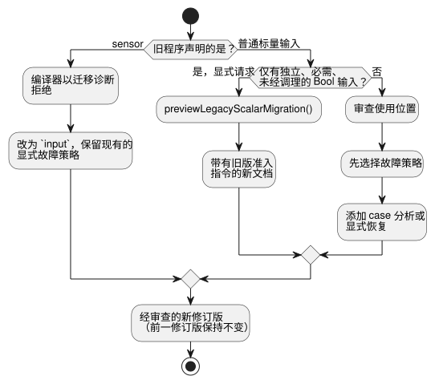

<!-- translation-source: docs/INPUT-MIGRATION.md -->
[英文原文](INPUT-MIGRATION.md)

# 规范外部输入与显式修订版迁移

本文档说明声明外部输入的规范方式、现有程序如何迁移到这种方式，以及采集宿主必须提供什么。

**本文内容**

- `input` 声明及其故障语义（见下文）。
- **源与历史**：旧的 `sensor` 程序和普通输入程序如何成为新的修订版。
- **显式的旧版 Bool 准入**：一条需主动选择启用的路径，让旧的 Bool 程序无需修改即可继续运行。
- **采集与线路兼容性**：生产者发送什么，以及线路上哪些内容保持不变。
- **所有权与采纳关卡**：谁采纳契约的哪一部分。

**`input` 声明。** 1.0 之前的外部声明是 `input name: T;`。读取它得到 `Result<T, SensorFault>`，这保留了以前的传感器质量契约。换句话说，每次读取的结果既可能是一个健康值，也可能是一个故障。

- 支持的负载类型有 Bool、Int、Number、Percent、Duration、Date、TimeOfDay、DateTime 以及物理量。
- 作为对比：`let` 计算一个绑定，`state` 在 tick 之间记住一个值，`output` 声明请求意图。

```ghost
control ExplicitQuality {
  input request: Bool;
  output enabled: Bool;
  enabled <- request |> recover(true);
}
```

这个示例刻意选择在故障时取 true。它演示的是作者编写的策略；它**不是**推荐的安装策略。

- 健康的 false 仍然是 false。
- 发生故障时，既不会自动代入 false/零，也不会自动代入全部关闭的策略。
- 即使作者显式恢复了一个值，case 分析和 Result 变换仍会保留 NotReady、Disconnected、Stale 和 Invalid 的来源信息。

下图展示输入的 Result 从何而来。


**其他输入特性。** 分组名称、`input observation?: Bool;`、单位、采样节奏、有效范围、中值/移动平均/EMA 滤波、陈旧（stale）上限和恢复计数，全部使用现有的传感器契约。

- 可选输入的*缺失*（即未安装的输入）会选择作者编写的自适应策略。已安装输入上的故障并不意味着缺失。
- 在能力（capability）匹配中，`sensor<Bool>` 指的是质量能力类别，而不是某个声明的别名。

## 源与历史

下图概括了本节和下一节所描述的迁移路径。



**旧的 `sensor` 声明。** 旧的 `sensor` 声明会被拒绝，并给出迁移诊断。没有任何产品或原始编译器回退（fallback）会接受它。迁移方法是修改声明的写法并保留现有的显式故障策略；其结果是一个必须经过审查的新修订版。源字节、源摘要、修订版和批准标识都必须标识这份新文档。保持其前一版本完好不变。

**旧的普通输入。** 旧的普通输入程序需要审查其使用位置，而不仅仅是重命名。例如，`request && !stop` 无法使用 Result 输入。

1. 先确立故障策略。
2. 然后引入穷尽的 case 分析或显式的恢复变换。

不要根据健康的重放帧、标签或目标模式来推断该策略。编译器错误既不会编辑已存储的源，也不会创建替代的修订版。

**更改采集目标。** 在浏览器、USB 或物理采集之间切换，是为同一份已批准文档选择适配器和安装绑定。它不会重写源，也不会代入一个预制程序。请将源修订版和制品标识放在一起。已持久化的修订版和新候选的批准由 API 负责。

**标量负载的值域。** 所有支持的标量负载都使用类型化的质量样本。

| 类型 | 值域 |
| --- | --- |
| Int | 有符号 i32 |
| Duration | 非负安全整数，单位为毫秒 |
| Date、TimeOfDay、DateTime | 各自现有的精确整数值域 |

- 带小数或超出范围的数值观测会在调理之前变为 Invalid。格式错误的宿主记录类型仍会被拒绝。
- 不会推断转换为 Number、取整或对时钟的信任。
- 精确类型使用未改变的默认恒等滤波器。显式的数值滤波器和迟滞仍仅限于 Number、Percent 和物理量。
- 旧的普通标量使用位置仍需要作者显式编写的 Result 策略。

## 显式的旧版 Bool 准入

本节描述一条需主动选择启用的路径，它让仅使用 Bool 的旧程序无需重写使用位置即可保持当前行为。

**预览迁移。** `previewLegacyScalarMigration(source,{filename})` 返回一份确定性的新文档、一份回执（receipt）和一份已绑定的契约。

- 新文档以原文档作为精确前缀。可执行的使用位置保持不变。
- 只支持独立、必需、未经调理的 Bool 输入。导入、函数/宏、生命周期、可选或经调理的输入以及其他类型都会被拒绝。
- 已经是最新形式（类型化或已转换）的源默认不会迁移。
- 仅凭编译成功并不能证明行为得到保留：未使用的旧版 Bool 端口此前在每一帧中仍是必需的。显式的已知来源请求可以传入 `sourceInputContract:'required-current-bool-snapshot'` 来保留这些端口。原始降级证明仍会拒绝类型化 Result 的使用。
- 宿主保留旧修订版，并显式预览和接受新修订版。不会调用任何存储或模型。

**准入指令。** 顶层的 `<!-- ghostflow:legacy-scalar-admission-v1 ` 指令携带规范 JSON，其键恰好为 `format,contractVersion,policy,originalSourceSha256,inputs`。

| 键 | 值 |
| --- | --- |
| format | `GhostFlow/legacy-scalar-admission-v1` |
| contractVersion | 1 |
| policy | `required-current-bool-snapshot` |
| inputs | 有序的 `{name,type:'Bool'}` 条目 |

未知、格式错误、重复或与声明不匹配的指令会被拒绝。在后续编辑中请保留该指令。未加标记的普通输入保持 Result 语义。该指令选择当前的原始降级；它绝不会选择已退役的编译器或故障默认值。

**Manifest、状态与回执。**

- `manifest.legacyAdmission` 添加 `sourceSha256` 和 `sha256`。后者是对所有其他字段的规范 JSON 计算的哈希。
- 会追加一个名为 `__gf_legacy_admission_v1_<sha256>` 的未使用 false Bool 状态，因此现有状态索引得以保留。该前缀保留给编译器使用。不会引入新的 GFB 格式或 WASM ABI。
- 回执的键恰好为 `format,contractVersion,originalSourceSha256,convertedSourceSha256,contractSha256,previewSha256`。其格式为 `GhostFlow/legacy-scalar-migration-receipt-v1`；`previewSha256` 是对其他五个字段的规范 JSON 计算的哈希。
- 摘要不依赖于文件名。返回的文档就是精确的候选源。

**检查与校验。**

- `inspectLegacyAdmissionSource(source,{bound:true})` 返回完整契约。默认检查返回嵌入的条款，或 null。
- 感知源的 `validateLegacyAdmission({bytes,manifest,sourceDocument})` 和已签名包的重放会把源、标记、元数据和字节码摘要绑定在一起。
- 不受支持的物理目标会在选择可能忽略 Markdown 元数据的冻结编译器之前调用 `assertLegacyAdmissionTarget(source,{supported:false})`。

**帧预检。** 纯函数 `preflightLegacyAdmission(contract,frame)` 在帧的副本上工作。

- 每个端口要求 `inputs` 中恰好有一个 Bool，或者 `samples` 中有一个带 `{epoch,id,timestampMs,quality,value}` 的精确数据包。
- 数据包要求 Good 质量（或序数 1）、Bool 负载、非负安全整数元数据，以及不晚于 `nowMs` 的时间戳。
- Good 数据包会被规范化为原始的原始输入；其他样本保持不变。
- 在 `ControlRuntime` 的两条入口路径中，缺失、有歧义、格式错误和非 Good 的快照都会在调理器、时钟或 VM 发生变化之前被拒绝。
- 重复出现的有效 Good 标识仍然有效。不会凭空发明采集新鲜度、重复或恢复策略。
- 其他宿主必须执行此契约，或拒绝它。

**选择运行时入口。** 在参考 control 宿主中，`selectControlRuntimeEntry(manifest)` 对现有的非上下文 Solar 或原生目标（objective）profile 选择 `legacy`，其他情况选择 `framed`。请在实例化之前选择；出错后绝不重试。旧版 Solar 使用当前的非帧式适配器及其现有的太阳事实。它不声称具有原生帧式扫描的证据。

**错误与制品检查。** 预期的错误码为 `legacy_admission_invalid`、`legacy_admission_unsupported`、`legacy_admission_frame_rejected` 和 `legacy_migration_not_required`。它们使用状态码 422 和诊断 `GF_SEMANTIC`。不会添加逐帧遥测。

- 只有标记或只有元数据的制品会被拒绝。
- 历史原始 GFB 仍受支持。如果同时移除标记和元数据并重新计算摘要，那么除非有可信的源/签名可用，否则结果与历史原始 GFB 无法区分。
- 感知源的校验会拒绝保留了指令却缺少相应制品契约的情况。
- 产品路径要求源重放/签名闭合。直接的底层 VM 加载没有普遍性保证。

**帧式 `validate()`。** 帧式 `validate()` 检查已加载字节码的能力策略。它不会激活调度计划、时间窗口、资源绑定或重启生命周期输入。它可以在配置期间重复调用，但并不允许执行扫描。之后的激活仍然需要原有的、特定于 profile 的绑定和生命周期初始化。同样的区别也适用于已签名的上下文包，无论它们是否使用旧版准入。

## 采集与线路兼容性

**线路上保持不变的内容。** 源关键字不会重命名线路层面的质量类别。保留：

- `manifest.sensors`；
- `__gf_sensor_*` 槽位；
- 现有的 Result 来源/追踪类别；
- 能力记录；
- 所选的 GFB 版本和 WASM ABI。

`manifest.inputs` 不再包含作者编写的普通外部声明。内部 VM 槽位仍通过现有的降级携带标量值、质量和故障码。

**样本数据包。** 参考 Host 以 `samples[name] = {epoch, id, timestampMs, quality, value}` 的形式接受生产者观测。

- 质量是显式的。
- Bool 值仍为布尔值。数值和物理量负载使用其规范单位。
- 时间戳不得超过扫描时间。
- 软件生产者可以使用自己的会话纪元、观测序列和单调观测时间戳。数据包不要求物理板卡 ID。
- 生产者提供实际观测。它不会为每次仅由时钟驱动的扫描发明一个新的序列号。

**连续性规则。**

- 重复的样本标识只会对滤波和恢复贡献一次。
- 来源纪元的变化会打断连续性，并重置调理历史。
- 新的生产者遵循现有的启动就绪规则；恒等调理可以接受其第一个 Good 样本。
- 恢复计数在同一生产者纪元内观测到故障之后才适用。
- 这些采集规则不会选择 control 的重启策略。
- 没有新样本时，新鲜度从实际最后一个有效时间戳开始计算。
- 纯表达式中的字面量 `ok(false)` 不会产生上述任何采集证据。

驱动程序、USB 和软件适配器必须各自确立其会话、绑定、断开和交付保证。仅凭数据包的形状无法证明来源或物理采集。

**Bool 读数能告诉你什么、不能告诉你什么。** 布尔按钮观测无法诊断断线、触点粘连或按钮断开。

- `NotReady` 描述采集/调理的就绪状态，例如尚未接受任何观测时。
- 成功读取到的 false 是健康的 false。
- 其他质量故障需要来自生产者或来自所配置的新鲜度/有效性契约的证据。

源关键字不会添加任何物理诊断。它不强加任何通用的重启或 START 按钮要求。

## 所有权与采纳关卡

| 负责方 | 需采纳的契约 |
| --- | --- |
| 语言 | 规范语法、类型化 Result、降级、当前线路格式以及参考 Host 一致性 |
| 模拟器/浏览器 | 相同的源/制品；质量数据包、生产者连续性以及现有的通用传感器 UI |
| 编写 | 新候选使用 input 和显式故障处理；保留请求意图和原始历史 |
| API | 不可变的编译器/编写固定版本、已存储的修订版以及显式的候选批准；不因切换目标而重写 |
| 设备/SDK | 不可变的编译器/核心固定版本、包/准入检查、现有的类型化样本以及会话栅栏 |
| 驱动程序 | 来源采集和元数据；通用 Driver9 实现仍由他方单独负责 |

Integration-v1 目前校验 `manifest.inputs/outputs` 绑定。该校验器并不确立 `manifest.sensors` 的采集连续性。不要把一个通过校验的普通软件端点绑定当作质量采集的证明。

以下是各自独立的关卡，每一项都需要自己的证据：负责方一致性、已安装使用方测试、浏览器执行、USB 交付，以及物理输出/触点证据。使用方的固定版本必须指明一个不可变、经过审查的负责方候选。关键字的变化并不意味着 Device 发布、已批准的部署、在线源迁移或物理硬件验收。

参见[参考手册第 4 章](reference/04-sensors-constraints-control.zh.md)和 [#531](https://github.com/callin2/ghostflow-language/issues/531)。
