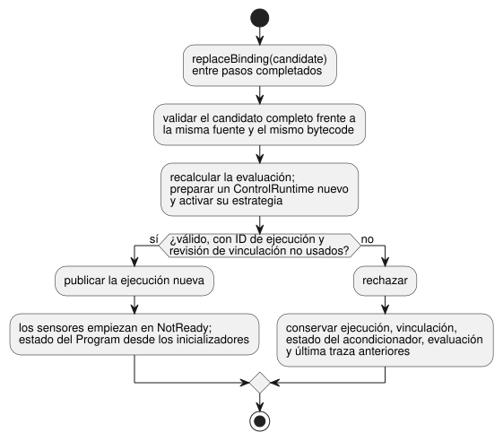

<!-- translation-source: docs/INSTALLED-SENSOR-BINDING.md -->
[Original en inglés](INSTALLED-SENSOR-BINDING.md)

# Host de referencia para la vinculación de sensores instalados

`InstalledControlHost` es un host de referencia que ejecuta un Program compilado
en una instalación concreta. Primero *admite* un Program compilado fijo frente a
una declaración de instalación fijada (comprueba que encajen entre sí) y luego
lo ejecuta mediante el `ControlRuntime.instantiateFramed` existente.

Es el contrato de host para
[REF-06-009, reemplazo de sensores](https://github.com/callin2/ghostflow-language/issues/297)
y [REF-04-039, reemplazo del perfil de estrategia](https://github.com/callin2/ghostflow-language/issues/243).
No realiza descubrimiento de dispositivos, instalación de drivers, sondeo ni
verificación física.

**En este documento**

- **Contrato de perfil fijado**: qué declaran el perfil de placa y la instalación, y qué se comprueba.
- **Ejecución y reemplazo**: cómo hacer avanzar el host y cómo reemplazar una vinculación de sensor.
- **Activación de estrategias**: cómo las capacidades de los sensores seleccionan una estrategia del Program.
- **Ejecución compuesta instalada**: el perfil para programas compuestos con instancias y ajustes.

## Contrato de perfil fijado

**Evaluación.** Las instantáneas, los pasos aceptados y los reemplazos de
vinculación (binding) exitosos incluyen todos la misma `assessment` propia
procedente de la
[admisión de instalación solo con metadatos](../contracts/integration-v1/README.es.md).

- Su identidad fija la fuente, el bytecode, el manifiesto, la versión
  publicada, el perfil y el mapeo admitidos.
- `assessment.physical.status` sigue siendo `unknown`, incluso cuando una
  salida Bool coincide con la dirección, el tipo, la polaridad y el `safeLevel`
  declarados. Estas declaraciones no aportan ninguna observación independiente
  eléctrica, de seguridad ante fallos (fail-safe), de carga ni de cableado.
- Una idoneidad física desconocida no bloquea una ejecución válida del host.
- El reemplazo recalcula la evaluación antes de la publicación. Los candidatos
  rechazados o manipulados conservan la evaluación y la traza vigentes.
- Las evaluaciones devueltas están desacopladas del estado del host.

**Perfiles de placa.** La forma existente `GhostFlow/board-profile-v1` no
cambia. El nuevo `GhostFlow/board-profile-v2` usa la misma identidad de placa y
el mismo mapa de endpoints.

| Endpoint v2 | Campos |
| --- | --- |
| Salida Bool | `direction`, `type`, `driver`, `address`, `activeLevel`, `safeLevel` |
| Entrada Number o Bool | `direction`, `type`, `driver`, `address`, `sensor` (en lugar de los campos de polaridad de salida) |

**El contrato `sensor`.** `sensor` contiene:

- `format: "GhostFlow/sensor-observation-v1"`;
- `canonicalUnit`;
- un entero seguro positivo `maxInterSampleGapMs`;
- solo para una entrada Number: `minValue` y `maxValue` finitos y ordenados.

El contrato de observación significa que el titular de la adquisición
proporciona muestras reales. Cada muestra tiene una época de la fuente, un ID de
muestra, una marca de tiempo de captura, una carga útil y una calidad entre
`Good`, `NotReady`, `Disconnected`, `Stale` o `Invalid`. Un fallo es un fallo,
aunque el valor de relleno que transporta sea cero.

El perfil y la instalación se fijan mediante las referencias SHA-256 existentes
de la versión publicada. Son capacidades declaradas, no mediciones autenticadas
de un sensor físico ni de un binario de driver.

**Comprobaciones de integración.** Para un sensor vinculado,
`validateIntegration` comprueba:

- la dirección y el tipo;
- la unidad canónica;
- que el rango de medición del Number cubra el rango `valid` explícito del
  Program;
- el contrato de observación;
- `maxInterSampleGapMs < staleMs`. La igualdad falla, porque una lectura pasa a
  estar obsoleta exactamente en el límite.

El intervalo `sample` de la fuente sigue siendo metadatos descriptivos. Esta
comprobación no lo convierte en un comando de sondeo ni en un segundo plazo
estricto. Este perfil de host acotado rechaza una vinculación de sensor v2 sin
un `stale_after` explícito y un sensor Number sin un rango `valid` explícito. La
validación v1 existente mantiene su forma y su comportamiento anteriores.

## Ejecución y reemplazo

```js
import { InstalledControlHost } from './runtimes/wasm/installed-control-host.mjs';

const host = await InstalledControlHost.instantiate(wasmBytes, compiled, {
  runId: 'run-1', release, boardProfile, installation,
});
const result = host.step({ bindingRevision: installation.revision, nowMs: 1000,
  samples: { reading: { bindingRevision: installation.revision,
    endpointId: installation.bindings.reading,
    sample: { epoch: 1, id: 1, timestampMs: 1000, quality: 'Good', value: 42 },
  } },
});
```

**Avance por pasos.** Inicie el host con
`InstalledControlHost.instantiate(wasmBytes, compiled, { runId, release, boardProfile, installation })`.
Cada `step` pasa el `bindingRevision` actual, `nowMs` y `samples`.

- El llamador adjunta la revisión de la vinculación y el ID del endpoint cuando
  captura una muestra. Por tanto, cada muestra lleva `bindingRevision`,
  `endpointId` y `{ epoch, id, timestampMs, quality, value }`.
- El host rechaza los paquetes de una revisión anterior o de otro endpoint antes
  de pasar su muestra a `ControlRuntime`. Estas etiquetas del llamador no son
  una autenticación del hardware.
- Un escaneo sin muestra nueva pasa un objeto `samples` vacío, de modo que el
  acondicionador existente decide la frescura.
- La salida del runtime sigue siendo intención de control requested/safe. No es
  una prueba de salida física.

**Reemplazo de una vinculación.** `replaceBinding({ runId, release, boardProfile, installation })`
valida un candidato completo frente a la **misma fuente y el mismo bytecode**,
prepara un `ControlRuntime` nuevo y lo publica entre pasos completados.



- Un candidato no válido deja utilizables la ejecución anterior, la
  vinculación, el estado del acondicionador y la última traza.
- Un candidato exitoso necesita una revisión de vinculación y un ID de ejecución
  no usados. Inicia una ejecución (run) nueva con el estado de los sensores en
  `NotReady`.
- La nueva fuente de adquisición debe emitir su propia época de fuente y sus
  propios IDs de muestra.
- La nueva frontera de ejecución impide que se reutilice el estado antiguo de
  filtros/frescura. No promete continuidad ininterrumpida del estado ni de las
  salidas.
- El host conserva como máximo 128 revisiones de ejecución y de vinculación.
  Después de eso rechaza más reemplazos en lugar de olvidar IDs y permitir su
  reutilización.
- Una revisión de perfil usada anteriormente no puede adquirir un contenido
  diferente.

Esta operación solo cambia las vinculaciones de sensores. Rechaza los cambios en
el ID o el modelo de la placa, el cableado de salidas, el ID de instalación, los
metadatos de compilador/runtime/protocolo o el resumen (digest) del firmware.
Migrar a otra placa física requiere un flujo de trabajo de instalación
separado. `step` devuelve el resultado aceptado con su identidad de ejecución,
fuente, bytecode, perfil y vinculación adjunta. Las instantáneas y los
resultados están desacoplados de los objetos propiedad del llamador.

## Activación de estrategias

El perfil de Program acotado también acepta los metadatos `adaptPolicy` y
`strategies` generados por el compilador. Antes de la admisión, el host vuelve a
compilar la fuente canónica y compara el manifiesto y el bytecode completos,
incluidas las coincidencias de estrategias, las prioridades y la identidad de la
política. Los metadatos editados por el llamador no superan esta comparación.

**Cómo se selecciona una estrategia.**

1. La validación de integración confirma cada vinculación de sensor requerida y
   cada tipo de endpoint.
2. Luego el host proporciona a `ControlRuntime` una capacidad explícita para
   cada sensor vinculado.
3. El runtime de Rust existente selecciona la estrategia durante la activación.

La presencia de una capacidad proviene de la instalación validada, con
independencia de la calidad de las muestras. `NotReady`, `Stale` y los demás
fallos de sensor siguen siendo observaciones Result bajo la estrategia
seleccionada. Nunca eliminan una capacidad ni seleccionan `match always`
automáticamente.

**Reemplazo y estrategias.** Un reemplazo valida el candidato completo y activa
su estrategia antes de la publicación. Por ejemplo, suponga que `WithReading`
coincide con un sensor Number requerido y que la lectura actual es Stale. Un
candidato que vincula ese sensor a un endpoint Bool falla con `type_mismatch`.

- El perfil, la ejecución, la vinculación, el estado y la última traza antiguos
  siguen disponibles.
- Los pasos siguientes siguen ejecutando `WithReading` y su rama de fallo
  explícita.
- Un candidato compatible publica una ejecución nueva. Su sensor empieza en
  `NotReady` y el estado de su Program empieza desde el inicializador de la
  fuente.

**Perfil de Program independiente.** El perfil independiente requiere:

- bytes `control-v1` o `control-v4` verificados con la fuente;
- al menos un sensor Number/Bool no opcional;
- salidas Bool;
- ninguna programación, temporizador, señal, config, importación ni entrada
  escalar.

Las vinculaciones de sensores opcionales y las capacidades arbitrarias
proporcionadas por el llamador quedan fuera de este perfil de host. Las salidas
Bool validadas siguen disponibles como capacidades de actuador para la
coincidencia de estrategias. Los demás perfiles fallan antes de la publicación.
La aplicación de vinculaciones en el Device, las garantías reales del driver y
el comportamiento de la carga física requieren evidencia separada.

## Ejecución compuesta instalada

**Qué acepta el perfil compuesto.** El perfil compuesto acepta `control-v10`
con:

- un cierre de fuentes canónico fijado;
- un Interaction Schema;
- estados, configs y temporizadores privados por instancia;
- sensores Number/Bool requeridos;
- salidas Bool.

Pase `context`, los `grants` de actores y, opcionalmente, `historyCapacity` en
la activación. El host es titular privado de un único `TemporarySettingsHost`
con tramas, que es titular del único controlador. Los ajustes, las
observaciones y las explicaciones provienen todos de ese mismo escaneo real.

**Estructura raíz permitida.** La raíz solo puede contener declaraciones de
puertos, instancias y conexiones directas de dos tipos: de entrada raíz a
entrada de instancia, o de salida de instancia a salida raíz.

- Se rechazan las instancias anidadas, las rutas de instancia a instancia, los
  cálculos en la raíz, las programaciones y las señales.
- Las rutas provienen del AST canónico reproducido por el compilador, de
  `sourceClosure` y de `sourceMap`. Deben concordar con el mapeo de entradas
  tipado de `sensorInstances`.
- Cada sensor de la raíz y de las instancias se comprueba frente a su endpoint
  admitido real, incluidos la unidad, el rango de medición y el límite de brecha
  entre muestras/obsolescencia.
- Los nombres de runtime generados no definen rutas.

**Avance por pasos.** Llame a `step(frame, settingsEvent)` con los paquetes
adquiridos y un campo adicional `contextFacts`.

- El contrato existente de eventos de ajustes temporales usa la identidad actual
  de `snapshot().execution`.
- Las comprobaciones de endpoint, revisión de vinculación y forma de la
  adquisición se realizan antes de entrar en el titular de los ajustes.
- Las observaciones `Invalid` o `Disconnected` válidas llegan al acondicionador
  como fallos. La época, el ID de muestra y la marca de tiempo siguen las reglas
  de identidad de muestras del runtime compartido.

**Resultados y explicaciones de salidas.** Un resultado aceptado incluye la
`execution` real del titular de los ajustes y una `provenance` que vincula su
ejecución, su escaneo, el tiempo lógico, la revisión de ajustes consolidada,
los resúmenes de admisión y las rutas de instancia.

`explainOutput('output.east_on', result)` solo acepta el resultado completado
actual del titular. Une la prueba y la observación reales, y devuelve el
descriptor, los ajustes efectivos de la instancia, las rutas de entrada y el
endpoint de salida.

- Se rechazan los resultados antiguos y las rutas, ajustes o revisiones
  intercambiados.
- Una unión `ready` significa que la asociación es válida. `proof.status` indica
  por separado si la explicación de la expresión está disponible.
- Las pruebas Bool basadas en estado están disponibles. Las expresiones de los
  rieles generados de config/temporizador siguen sin estar disponibles.
- Estos recibos no autentican un driver físico. No prueban transiciones de
  estado, salidas de seguridad, salidas aplicadas ni efectos físicos.

**Finalización actual frente a histórica.** `snapshot().latest` conserva la
última finalización aceptada como historial. Por separado,
`currentFrameCompletion` identifica el escaneo completado actual del runtime
real.

- El despacho borra esa identidad antes de la ejecución y publica una identidad
  nueva solo después de la finalización.
- Por tanto, un despacho fallido deja no disponibles las explicaciones de
  salida actuales. Esto incluye un fallo de retorno de ajustes informado como
  `accepted: false`.
- Los rechazos en la comprobación previa de adquisición, ajustes y contexto
  nunca despachan, de modo que conservan la identidad actual.
- Las pruebas históricas no cambian. Después de un fallo de despacho no pueden
  presentarse como actuales a través de `explainOutput`.

**Reemplazo.** El reemplazo prepara el nuevo titular completo antes de la
publicación.

- Los candidatos rechazados conservan los ajustes, las superposiciones, el
  historial, el estado, los temporizadores, los acondicionadores, la última
  finalización y la evaluación.
- El éxito inicia estado, ajustes y acondicionadores nuevos en una ejecución
  nueva y borra las finalizaciones anteriores.

**Cobertura y límites.**

- Junto con las comprobaciones nativas/WASM de config/temporizadores, esta ruta
  acotada completa el caso especificado de REF-06-002 de aislamiento del estado
  este/ajustes.
- Las rutas anidadas y la migración independiente de vinculaciones en caliente
  quedan fuera de este perfil.
- REF-06-016 comprueba la explicación de salida de cada instancia frente a su
  nodo de fuente exacto, su tramo, su revisión, sus ajustes y su ruta de
  endpoint instalado.
- La cadena de restricciones de requested a safe más amplia de la sección 6.7
  sigue incompleta.

`tests/installed-composition.test.mjs` ejercita la ejecución WASM real, el
aislamiento este/oeste en el mismo instante, la procedencia unida, la
manipulación, los fallos y el reemplazo.
