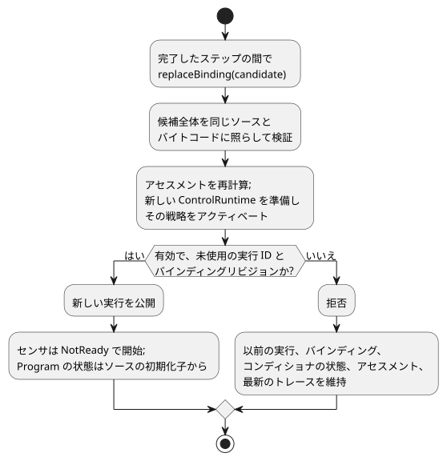

<!-- translation-source: docs/INSTALLED-SENSOR-BINDING.md -->
[英語の原文](INSTALLED-SENSOR-BINDING.md)

# 設置済みセンサバインディングの参照ホスト

`InstalledControlHost` は、コンパイル済みの Program を特定の設備上で実行する参照ホストです。まず、固定されたコンパイル済み Program を、ピン留めされた設置宣言に照らして*受け入れ*（両者が適合するかをチェック）し、その後、既存の `ControlRuntime.instantiateFramed` を通じて実行します。

これは、[REF-06-009 センサの交換](https://github.com/callin2/ghostflow-language/issues/297)と [REF-04-039 戦略プロファイルの交換](https://github.com/callin2/ghostflow-language/issues/243)のためのホスト契約です。デバイスの検出、Driver のインストール、ポーリング、物理的な検証は行いません。

**この文書の内容**

- **ピン留めされたプロファイル契約**：ボードプロファイルと設置が何を宣言し、何がチェックされるか。
- **実行と交換**：ホストをステップ実行する方法と、センサバインディングを交換する方法。
- **戦略のアクティベーション**：センサのケイパビリティがどのように Program の戦略を選択するか。
- **設置済みの合成実行**：インスタンスと設定を持つ合成プログラムのためのプロファイル。

## ピン留めされたプロファイル契約

**アセスメント。**スナップショット、受け入れられたステップ、成功したバインディングの交換には、すべて、[メタデータのみによる設置の受け入れ](../contracts/integration-v1/README.md)から得られる、同じ所有された `assessment` が含まれます。

- その同一性は、受け入れられたソース、バイトコード、マニフェスト、リリース、プロファイル、マッピングをピン留めします。
- `assessment.physical.status` は、Bool 出力が宣言された方向、型、極性、`safeLevel` と一致する場合でも `unknown` のままです。これらの宣言は、電気、フェイルセーフ、負荷、配線についての独立した観測を何も提供しません。
- 物理的な適合性が不明であっても、有効なホストの実行は妨げられません。
- 交換では、公開の前にアセスメントを再計算します。拒否された候補や改ざんされた候補では、稼働中のアセスメントとトレースが維持されます。
- 返されたアセスメントは、ホストの状態から切り離されています。

**ボードプロファイル。**既存の `GhostFlow/board-profile-v1` の形は変わりません。新しい `GhostFlow/board-profile-v2` は、同じボードの同一性とエンドポイントのマップを使います。

| v2 のエンドポイント | フィールド |
| --- | --- |
| Bool 出力 | `direction`、`type`、`driver`、`address`、`activeLevel`、`safeLevel` |
| Number または Bool 入力 | `direction`、`type`、`driver`、`address`、`sensor`（出力の極性フィールドの代わり） |

**`sensor` 契約。**`sensor` には次のものが含まれます。

- `format: "GhostFlow/sensor-observation-v1"`
- `canonicalUnit`
- 正の安全な整数である `maxInterSampleGapMs`
- Number 入力の場合のみ：有限で順序付けられた `minValue` と `maxValue`

この観測契約は、取得の所有者が実際のサンプルを提供することを意味します。各サンプルは、ソースのエポック、サンプル ID、キャプチャのタイムスタンプ、ペイロード、そして `Good`、`NotReady`、`Disconnected`、`Stale`、`Invalid` のいずれか 1 つの品質を持ちます。故障は、運ばれるプレースホルダの値がゼロであっても故障です。

プロファイルと設置は、既存のリリースの SHA-256 参照によってピン留めされます。これらは宣言されたケイパビリティであり、物理的なセンサや Driver のバイナリを認証付きで測定したものではありません。

**統合チェック。**バインドされたセンサについて、`validateIntegration` は次のことをチェックします。

- 方向と型
- 正準の単位
- Number の測定範囲が、Program の明示的な `valid` 範囲を包含していること
- 観測契約
- `maxInterSampleGapMs < staleMs`。等しい場合は失敗します。読み取り値はちょうど上限の時点で古く（stale）なるためです。

ソースの `sample` 間隔は、引き続き記述的なメタデータです。このチェックによって、それがポーリングのコマンドや 2 つ目の厳格な期限になることはありません。この上限付きのホストプロファイルは、明示的な `stale_after` のない v2 センサバインディングと、明示的な `valid` 範囲のない Number センサを拒否します。既存の v1 の検証は、以前の形と振る舞いを保ちます。

## 実行と交換

```js
import { InstalledControlHost } from './runtimes/wasm/installed-control-host.mjs';

const host = await InstalledControlHost.instantiate(wasmBytes, compiled, {
  runId: 'run-1', release, boardProfile, installation,
});
const result = host.step({ bindingRevision: installation.revision, nowMs: 1000,
  samples: { reading: { bindingRevision: installation.revision,
    endpointId: installation.bindings.reading,
    sample: { epoch: 1, id: 1, timestampMs: 1000, quality: 'Good', value: 42 },
  } },
});
```

**ステップ実行。**`InstalledControlHost.instantiate(wasmBytes, compiled, { runId, release, boardProfile, installation })` でホストを開始します。各 `step` には、現在の `bindingRevision`、`nowMs`、`samples` を渡します。

- 呼び出し側は、サンプルをキャプチャするときにバインディングリビジョンとエンドポイント ID を付けます。そのため、各サンプルは `bindingRevision`、`endpointId`、`{ epoch, id, timestampMs, quality, value }` を運びます。
- ホストは、古いリビジョンや別のエンドポイントからのパケットを、そのサンプルを `ControlRuntime` に渡す前に拒否します。これらの呼び出し側のラベルは、ハードウェアの認証ではありません。
- 新しいサンプルのないスキャンでは空の `samples` オブジェクトを渡し、既存のコンディショナが鮮度を判断します。
- ランタイムの出力は、引き続き要求／安全の制御意図です。物理的な出力の証明ではありません。

**バインディングの交換。**`replaceBinding({ runId, release, boardProfile, installation })` は、完全な候補を**同じソースとバイトコード**に照らして検証し、新しい `ControlRuntime` を準備して、完了したステップの間でそれを公開します。



- 無効な候補では、以前の実行、バインディング、コンディショナの状態、最新のトレースが引き続き使えます。
- 成功する候補には、未使用のバインディングリビジョンと実行 ID が必要です。センサの状態が `NotReady` の新しい実行を開始します。
- 新しい取得ソースは、独自のソースエポックとサンプル ID を発行しなければなりません。
- 新しい実行の境界により、古いフィルタ／鮮度の状態が再利用されることはありません。状態や出力が途切れずに続くことは約束しません。
- ホストが保持する実行とバインディングのリビジョンは最大 128 個です。それを超えると、ID を忘れて再利用を許す代わりに、以後の交換を拒否します。
- 一度使われたプロファイルのリビジョンが、異なる内容を持つことはできません。

この操作が変更するのはセンサバインディングだけです。ボードの ID やモデル、出力の配線、設置 ID、コンパイラ／ランタイム／プロトコルのメタデータ、ファームウェアのダイジェストの変更は拒否します。別の物理ボードへの移行には、別の設置ワークフローが必要です。`step` は、実行、ソース、バイトコード、プロファイル、バインディングの同一性を付けた、受け入れられた結果を返します。スナップショットと結果は、呼び出し側が所有するオブジェクトから切り離されています。

## 戦略のアクティベーション

上限付きの Program プロファイルは、コンパイラが生成した `adaptPolicy` と `strategies` のメタデータも受け付けます。受け入れの前に、ホストは正準のソースを再コンパイルし、戦略の照合、優先度、ポリシーの同一性を含めて、マニフェストとバイトコードの全体を比較します。呼び出し側が編集したメタデータは、この比較で失敗します。

**戦略の選択方法。**

1. 統合検証が、必要なすべてのセンサバインディングとエンドポイントの型を確認します。
2. その後、ホストは、バインドされた各センサについて明示的なケイパビリティを `ControlRuntime` に提供します。
3. 既存の Rust ランタイムが、アクティベーション時に戦略を選択します。

ケイパビリティの有無は、サンプルの品質とは独立に、検証済みの設置から得られます。`NotReady`、`Stale`、その他のセンサの故障は、選択された戦略の下で Result の観測のままです。それらがケイパビリティを取り除いたり、`match always` を自動的に選択したりすることは決してありません。

**交換と戦略。**交換では、公開の前に完全な候補を検証し、その戦略をアクティベートします。たとえば、`WithReading` が必須の Number センサに一致し、現在の読み取り値が Stale だとします。そのセンサを Bool エンドポイントにバインドする候補は `type_mismatch` で失敗します。

- 古いプロファイル、実行、バインディング、状態、最新のトレースは引き続き利用できます。
- 以後のステップは、引き続き `WithReading` とその明示的な故障分岐を実行します。
- 互換性のある候補は、新しい実行を公開します。そのセンサは `NotReady` で始まり、Program の状態はソースの初期化子から始まります。

**スタンドアロンの Program プロファイル。**スタンドアロンのプロファイルには次のものが必要です。

- ソースで検証された `control-v1` または `control-v4` のバイト列
- オプションでない Number/Bool センサが少なくとも 1 つ
- Bool 出力
- スケジュール、タイマー、信号、設定（config）、インポート、スカラー入力がないこと

オプションのセンサバインディングと、呼び出し側が任意に与えるケイパビリティは、引き続きこのホストプロファイルの範囲外です。検証済みの Bool 出力は、戦略の照合のためのアクチュエータのケイパビリティとして引き続き利用できます。その他のプロファイルは公開の前に失敗します。デバイスバインディングの適用、Driver の実際の保証、物理的な負荷の振る舞いには、別個の証拠が必要です。

## 設置済みの合成実行

**合成プロファイルが受け付けるもの。**合成プロファイルは、次のものを持つ `control-v10` を受け付けます。

- 正準のピン留めされたソースクロージャ
- Interaction Schema
- インスタンス非公開の状態、設定（config）、タイマー
- 必須の Number/Bool センサ
- Bool 出力

アクティベーション時に、`context`、アクターの `grants`、任意で `historyCapacity` を渡します。ホストは、フレーム化された `TemporarySettingsHost` を 1 つ非公開で所有し、それが唯一のコントローラを所有します。設定、観測、説明は、すべて同じ実際のスキャンから得られます。

**許可されるルート構造。**ルートに含められるのは、ポート宣言、インスタンス、そして 2 種類の直接接続（ルート入力からインスタンス入力へ、またはインスタンス出力からルート出力へ）だけです。

- ネストしたインスタンス、インスタンス間のルート、ルートでの計算、スケジュール、信号は拒否されます。
- ルートは、コンパイラがリプレイした正準の AST、`sourceClosure`、`sourceMap` から得られます。それらは型付きの `sensorInstances` の入力マッピングと一致しなければなりません。
- ルートとインスタンスのすべてのセンサは、単位、測定範囲、サンプル間隔／stale の上限を含めて、実際に受け入れられたエンドポイントに照らしてチェックされます。
- 生成されたランタイム名がルートを定義することはありません。

**ステップ実行。**取得したパケットと追加の `contextFacts` フィールドを付けて `step(frame, settingsEvent)` を呼び出します。

- 既存の一時設定イベントの契約は、`snapshot().execution` から得られる現在の同一性を使います。
- エンドポイント、バインディングリビジョン、取得の形のチェックは、設定の所有者に入る前に行われます。
- 有効な `Invalid` や `Disconnected` の観測は、故障としてコンディショナに届きます。エポック、サンプル ID、タイムスタンプは、共有ランタイムのサンプル同一性の規則に従います。

**結果と出力の説明。**受け入れられた結果には、実際の設定所有者の `execution` と、その実行、スキャン、論理時間、確定した設定リビジョン、受け入れのダイジェスト、インスタンスのルートを結び付ける `provenance` が含まれます。

`explainOutput('output.east_on', result)` は、所有者の現在の完了した結果だけを受け付けます。実際の証明と観測を結合し、ディスクリプタ、インスタンスの有効な設定、入力ルート、出力エンドポイントを返します。

- 古い結果や、入れ替えられたルート、設定、リビジョンは拒否されます。
- `ready` の結合は、関連付けが有効であることを意味します。式の説明が利用できるかどうかは、`proof.status` が別に示します。
- 状態に基づく Bool の証明は利用できます。config／タイマーの生成されたレールの式は、引き続き利用できません。
- これらのレシートは、物理的な Driver を認証しません。状態遷移、安全出力、適用された出力、物理的な効果を証明するものではありません。

**現在の完了と過去の完了。**`snapshot().latest` は、最後に受け入れられた完了を履歴として保持します。それとは別に、`currentFrameCompletion` が実際のランタイムの現在の完了スキャンを識別します。

- ディスパッチは、実行の前にその同一性をクリアし、完了した後にのみ新しい同一性を公開します。
- したがって、ディスパッチが失敗すると、現在の出力の説明は利用できなくなります。これには、`accepted: false` として報告される設定の復帰の失敗も含まれます。
- 取得、設定、コンテキストの事前チェックによる拒否はディスパッチを行わないため、現在の同一性を維持します。
- 過去の証明は変わりません。ディスパッチの失敗後は、それらを `explainOutput` を通じて現在のものとして提示することはできません。

**交換。**交換では、公開の前に新しい所有者を完全に準備します。

- 拒否された候補では、設定、オーバーレイ、履歴、状態、タイマー、コンディショナ、最新の完了、アセスメントが保持されます。
- 成功すると、新しい実行で状態、設定、コンディショナを新たに開始し、以前の完了をクリアします。

**カバー範囲と制限。**

- ネイティブ／WASM の config／タイマーのチェックと合わせて、この上限付きの経路は、規定された REF-06-002 の east の状態／設定の分離ケースを完了します。
- ネストしたルートと、独立したホットなバインディングの移行は、このプロファイルの範囲外です。
- REF-06-016 は、各インスタンスの出力の説明を、その正確なソースノード、スパン、リビジョン、設定、設置されたエンドポイントのルートに照らしてチェックします。
- より広い 6.7 節の、要求から安全への制約チェーンは、引き続き未完成です。

`tests/installed-composition.test.mjs` は、実際の WASM 実行、同時刻の east/west の分離、結合された来歴、改ざん、故障、交換を検証します。
