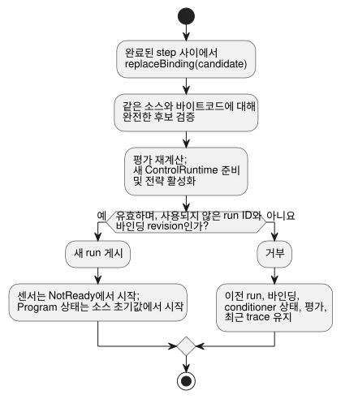

<!-- translation-source: docs/INSTALLED-SENSOR-BINDING.md -->
[영문 원문](INSTALLED-SENSOR-BINDING.md)

# 설치 센서 바인딩 참조 호스트

`InstalledControlHost`는 컴파일된 Program을 특정 설치 환경에서 실행하는 참조 호스트입니다.
먼저 고정된 컴파일 Program을 고정(pinned)된 설치 선언에 대해 *admission(수용)* 하고(둘이 서로
맞는지 검사하고), 그런 다음 기존 `ControlRuntime.instantiateFramed`로 실행합니다.

이 호스트는 [REF-06-009 센서 교체](https://github.com/callin2/ghostflow-language/issues/297)와
[REF-04-039 전략 프로필 교체](https://github.com/callin2/ghostflow-language/issues/243)를
위한 호스트 계약입니다. 장치 발견, 드라이버 설치, 폴링, 물리 검증은 수행하지 않습니다.

**이 문서의 내용**

- **고정된 프로필 계약**: 보드 프로필과 설치가 선언하는 것, 그리고 검사하는 것.
- **실행과 교체**: 호스트를 step으로 진행하는 방법과 센서 바인딩을 교체하는 방법.
- **전략 활성화**: 센서 capability가 Program 전략을 선택하는 방식.
- **설치된 합성 실행**: instance와 설정을 가진 합성 프로그램을 위한 프로필.

## 고정된 프로필 계약

**평가(assessment).** snapshot, 수락된 step, 성공한 바인딩 교체는 모두
[메타데이터만으로 판단하는 설치 admission](../contracts/integration-v1/README.ko.md)의
동일한 소유 `assessment`를 포함합니다.

- 그 identity는 수용된 소스, 바이트코드, 매니페스트, 릴리스, 프로필, 매핑을 고정합니다.
- Bool 출력이 선언된 방향, 타입, 극성, `safeLevel`과 일치하더라도
  `assessment.physical.status`는 `unknown`으로 남습니다. 이 선언들은 독립적인 전기, 페일세이프,
  부하, 배선 관측을 제공하지 않습니다.
- 물리적 적합성을 알 수 없다고 해서 유효한 호스트 실행이 막히지는 않습니다.
- 교체는 게시 전에 평가를 다시 계산합니다. 거부되었거나 변조된 후보는 현재 평가와 trace를
  그대로 유지합니다.
- 반환된 평가는 호스트 상태와 분리되어 있습니다.

**보드 프로필.** 기존 `GhostFlow/board-profile-v1` 형태는 변하지 않습니다. 새
`GhostFlow/board-profile-v2`는 같은 보드 identity와 endpoint 맵을 사용합니다.

| v2 endpoint | 필드 |
| --- | --- |
| Bool 출력 | `direction`, `type`, `driver`, `address`, `activeLevel`, `safeLevel` |
| Number 또는 Bool 입력 | `direction`, `type`, `driver`, `address`, `sensor` (출력 극성 필드 대신) |

**`sensor` 계약.** `sensor`는 다음을 포함합니다.

- `format: "GhostFlow/sensor-observation-v1"`
- `canonicalUnit`
- 양의 안전한 정수 `maxInterSampleGapMs`
- Number 입력에 한해: 유한하고 순서가 맞는 `minValue`와 `maxValue`

관측 계약은 수집 주체가 실제 샘플을 제공한다는 뜻입니다. 각 샘플은 source epoch, sample ID,
캡처 timestamp, payload, 그리고 `Good`, `NotReady`, `Disconnected`, `Stale`, `Invalid` 중
하나의 품질을 가집니다. fault는 함께 실린 자리 채움 값이 0이더라도 fault입니다.

프로필과 설치는 기존 릴리스 SHA-256 참조로 고정됩니다. 이들은 선언된 capability이며, 물리
센서나 드라이버 바이너리를 인증된 방식으로 측정한 결과가 아닙니다.

**통합 검사.** 바인딩된 센서에 대해 `validateIntegration`은 다음을 검사합니다.

- 방향과 타입
- 정본 단위
- Number 측정 범위가 Program의 명시적 `valid` 범위를 포함하는지
- 관측 계약
- `maxInterSampleGapMs < staleMs`. 같은 값은 실패합니다. 읽은 값은 정확히 그 한계에서
  stale(오래된 값)이 되기 때문입니다.

소스의 `sample` 간격은 설명용 메타데이터로 남습니다. 이 검사는 그것을 폴링 명령이나 두 번째
강제 기한으로 바꾸지 않습니다. 이 제한된 호스트 프로필은 명시적 `stale_after`가 없는 v2 센서
바인딩과, 명시적 `valid` 범위가 없는 Number 센서를 거부합니다. 기존 v1 검증은 이전의 형태와
동작을 유지합니다.

## 실행과 교체

```js
import { InstalledControlHost } from './runtimes/wasm/installed-control-host.mjs';

const host = await InstalledControlHost.instantiate(wasmBytes, compiled, {
  runId: 'run-1', release, boardProfile, installation,
});
const result = host.step({ bindingRevision: installation.revision, nowMs: 1000,
  samples: { reading: { bindingRevision: installation.revision,
    endpointId: installation.bindings.reading,
    sample: { epoch: 1, id: 1, timestampMs: 1000, quality: 'Good', value: 42 },
  } },
});
```

**Step 진행.** 호스트는
`InstalledControlHost.instantiate(wasmBytes, compiled, { runId, release, boardProfile, installation })`로
시작합니다. 각 `step`에는 현재 `bindingRevision`, `nowMs`, `samples`를 전달합니다.

- 호출자는 샘플을 캡처할 때 바인딩 revision과 endpoint ID를 붙입니다. 따라서 각 샘플은
  `bindingRevision`, `endpointId`, `{ epoch, id, timestampMs, quality, value }`를 담습니다.
- 호스트는 이전 revision이나 다른 endpoint에서 온 packet을, 그 샘플을 `ControlRuntime`에
  전달하기 전에 거부합니다. 이러한 호출자 라벨은 하드웨어 인증이 아닙니다.
- 새 샘플이 없는 scan은 빈 `samples` 객체를 전달하므로, freshness는 기존 conditioner가
  판정합니다.
- 런타임 출력은 여전히 요청/안전 제어 의도입니다. 물리 출력의 증거가 아닙니다.

**바인딩 교체.** `replaceBinding({ runId, release, boardProfile, installation })`은 완전한
후보를 **같은 소스와 바이트코드**에 대해 검증하고, 새 `ControlRuntime`을 준비한 뒤, 완료된
step 사이에서 게시합니다.



- 유효하지 않은 후보는 이전 run, 바인딩, conditioner 상태, 최근 trace를 계속 사용할 수 있게
  둡니다.
- 성공하는 후보에는 사용된 적 없는 바인딩 revision과 run ID가 필요합니다. 성공하면 센서 상태가
  `NotReady`인 새 run이 시작됩니다.
- 새 수집 source는 자체 source epoch와 sample ID를 발행해야 합니다.
- 새 run 경계는 이전 필터/freshness 상태가 재사용되는 것을 막습니다. 상태나 출력이 끊김 없이
  이어진다고 약속하지는 않습니다.
- 호스트는 run과 바인딩 revision을 최대 128개까지 보관합니다. 그 이후에는 ID를 잊고 재사용을
  허용하는 대신, 추가 교체를 거부합니다.
- 이전에 사용된 프로필 revision은 다른 내용을 가질 수 없습니다.

이 작업은 센서 바인딩만 바꿉니다. 보드 ID나 모델, 출력 배선, 설치 ID,
컴파일러/런타임/protocol 메타데이터, 펌웨어 digest의 변경은 거부합니다. 다른 물리 보드로
옮기려면 별도의 설치 절차가 필요합니다. `step`은 run, 소스, 바이트코드, 프로필, 바인딩
identity가 붙은 수락된 결과를 반환합니다. snapshot과 결과는 호출자가 소유한 객체와 분리되어
있습니다.

## 전략 활성화

이 제한된 Program 프로필은 컴파일러가 생성한 `adaptPolicy`와 `strategies` 메타데이터도
받습니다. admission 전에 호스트는 정본 소스를 재컴파일하고, 전략 match, 우선순위, 정책
identity를 포함한 전체 매니페스트와 바이트코드를 비교합니다. 호출자가 편집한 메타데이터는 이
비교에서 실패합니다.

**전략이 선택되는 방식.**

1. 통합 검증이 모든 필수 센서 바인딩과 endpoint 타입을 확인합니다.
2. 그런 다음 호스트는 바인딩된 각 센서에 대해 명시적 capability를 `ControlRuntime`에
   전달합니다.
3. 기존 Rust 런타임이 activation 중에 전략을 선택합니다.

capability의 존재 여부는 샘플 품질과 독립적으로, 검증된 설치에서 결정됩니다. `NotReady`,
`Stale`을 비롯한 센서 fault는 선택된 전략 아래에서 Result 관측으로 남습니다. fault가
capability를 제거하거나 `match always`를 자동으로 선택하는 일은 절대 없습니다.

**교체와 전략.** 교체는 게시 전에 완전한 후보를 검증하고 그 전략을 활성화합니다. 예를 들어
`WithReading`이 필수 Number 센서에 match하고, 현재 읽은 값이 Stale이라고 가정해 봅시다. 그
센서를 Bool endpoint에 바인딩하는 후보는 `type_mismatch`로 실패합니다.

- 이전 프로필, run, 바인딩, 상태, 최근 trace는 계속 사용할 수 있습니다.
- 이후의 step은 여전히 `WithReading`과 그 명시적 fault 분기를 실행합니다.
- 호환되는 후보는 새 run을 게시합니다. 그 센서는 `NotReady`에서 시작하고, Program 상태는 소스
  초기값에서 시작합니다.

**독립형 Program 프로필.** 독립형 프로필에는 다음이 필요합니다.

- 소스로 검증된 `control-v1` 또는 `control-v4` 바이트
- 선택적이지 않은 Number/Bool 센서 하나 이상
- Bool 출력
- 예약, 타이머, 신호, config, import, scalar 입력이 없을 것

선택적 센서 바인딩과 호출자가 임의로 제공한 capability는 이 호스트 프로필의 범위 밖입니다.
검증된 Bool 출력은 전략 match를 위한 액추에이터 capability로 계속 사용할 수 있습니다. 다른
프로필은 게시 전에 실패합니다. Device 바인딩 적용, 실제 드라이버 보장, 물리 부하 동작에는
별도의 증거가 필요합니다.

## 설치된 합성 실행

**합성 프로필이 받는 것.** 합성 프로필은 다음을 가진 `control-v10`을 받습니다.

- 정본으로 고정된 source closure
- Interaction Schema
- instance별 비공개 state, config, timer
- 필수 Number/Bool 센서
- Bool 출력

activation 시에 `context`, 행위자 `grants`, 그리고 선택적으로 `historyCapacity`를
전달합니다. 호스트는 framed `TemporarySettingsHost` 하나를 비공개로 소유하며, 이것이 유일한
controller를 소유합니다. 설정, 관측, 설명은 모두 같은 실제 scan에서 나옵니다.

**허용되는 root 구조.** root에는 포트 선언, instance, 그리고 두 종류의 직접 연결(root 입력에서
instance 입력으로, 또는 instance 출력에서 root 출력으로)만 들어갈 수 있습니다.

- 중첩 instance, instance 간 경로, root 계산, 예약, 신호는 거부됩니다.
- 경로는 컴파일러가 재생한 정본 AST, `sourceClosure`, `sourceMap`에서 나옵니다. 경로는
  typed `sensorInstances` 입력 매핑과 일치해야 합니다.
- 모든 root 센서와 instance 센서는 실제로 수용된 endpoint에 대해 검사되며, 여기에는 단위,
  측정 범위, sample gap/stale 한계가 포함됩니다.
- 생성된 런타임 이름은 경로를 정의하지 않습니다.

**Step 진행.** 수집한 packet과 추가 `contextFacts` 필드를 넣어 `step(frame, settingsEvent)`를
호출합니다.

- 기존 임시 설정 event 계약은 `snapshot().execution`의 현재 identity를 사용합니다.
- endpoint, 바인딩 revision, 수집 형태 검사는 설정 소유자에 진입하기 전에 일어납니다.
- 유효한 `Invalid` 또는 `Disconnected` 관측은 fault로 conditioner에 도달합니다. epoch,
  sample ID, timestamp는 공유 런타임의 샘플 identity 규칙을 따릅니다.

**결과와 출력 설명.** 수락된 결과에는 실제 설정 소유자의 `execution`과, 그 run, scan, 논리
시간, 확정된 설정 revision, admission digest, instance 경로를 묶는 `provenance`가 포함됩니다.

`explainOutput('output.east_on', result)`는 소유자의 현재 완료 결과만 받습니다. 실제 proof와
관측을 결합하여 descriptor, 해당 instance의 유효 설정, 입력 경로, 출력 endpoint를 반환합니다.

- 오래된 결과, 그리고 바뀐 경로, 설정, revision은 거부됩니다.
- `ready` join은 연결 관계가 유효하다는 뜻입니다. 식 설명을 사용할 수 있는지는
  `proof.status`가 별도로 알려 줍니다.
- 상태 기반 Bool proof는 사용할 수 있습니다. config/timer 생성 rail 식은 여전히 사용할 수
  없습니다.
- 이 receipt는 물리 드라이버를 인증하지 않습니다. 상태 전이, 안전 출력, 적용된 출력, 물리
  효과를 증명하지도 않습니다.

**현재 완료와 과거 완료.** `snapshot().latest`는 마지막으로 수락된 완료를 이력으로
보존합니다. 이와 별도로 `currentFrameCompletion`은 실제 런타임의 현재 완료 scan을
식별합니다.

- dispatch는 실행 전에 그 identity를 지우고, 완료한 뒤에만 새 identity를 게시합니다.
- 따라서 dispatch가 실패하면 현재 출력 설명을 사용할 수 없게 됩니다. 여기에는
  `accepted: false`로 보고되는 설정 복귀 실패도 포함됩니다.
- 수집, 설정, context 사전 검사에서 거부된 경우는 dispatch를 하지 않으므로 현재 identity를
  유지합니다.
- 과거 proof는 변하지 않습니다. dispatch 실패 후에는 `explainOutput`을 통해 과거 proof를 현재
  것으로 제시할 수 없습니다.

**교체.** 교체는 게시 전에 새 소유자를 완전히 준비합니다.

- 거부된 후보는 설정, overlay, 이력, 상태, 타이머, conditioner, 최근 완료, 평가를
  보존합니다.
- 성공하면 소유자의 검증된 설정 checkpoint에서 일반 Result 값, fault, revision,
  history를 복원합니다. Run overlay는 새 run의 첫 판단 전에 반환하고 Until overlay는
  기존 만료 시각과 유효성 규칙을 유지합니다. 제어 상태, 타이머, conditioner는 새로
  시작하며 이전 완료를 지웁니다.
- 교체 중 합성 `step`을 거부하므로 checkpoint 캡처와 게시 사이에 승인된 설정이
  사라지지 않습니다. 복원 실패 시 이전 소유자를 보존합니다. parameter를 가진 합성은
  이 프로필의 범위 밖입니다.

**범위와 한계.**

- native/WASM config/timer 검사와 함께, 이 제한된 경로는 지정된 REF-06-002 east 상태/설정
  격리 사례를 완성합니다.
- 중첩 경로와 독립적인 무중단 바인딩 마이그레이션은 이 프로필의 범위 밖입니다.
- REF-06-016은 각 instance의 출력 설명을 정확한 소스 노드, span, revision, 설정, 설치된
  endpoint 경로와 대조합니다.
- 더 넓은 6.7절의 requested에서 safe까지 이어지는 제약 체인은 아직 완료되지 않았습니다.

`tests/installed-composition.test.mjs`는 실제 WASM 실행, 같은 시각의 east/west 격리, 결합된
provenance, 변조, fault, 교체를 시험합니다.
