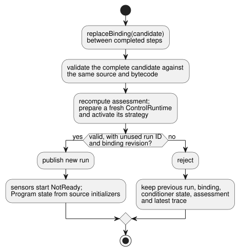

# Installed sensor binding reference host

`InstalledControlHost` is a reference host that runs a compiled Program on a
specific installation. It first *admits* a fixed compiled Program against a
pinned installation declaration (it checks that they fit together), then runs it
through the existing `ControlRuntime.instantiateFramed`.

It is the host contract for
[REF-06-009 sensor replacement](https://github.com/callin2/ghostflow-language/issues/297)
and [REF-04-039 strategy profile replacement](https://github.com/callin2/ghostflow-language/issues/243).
It performs no device discovery, Driver installation, polling, or physical
verification.

**In this document**

- **Pinned profile contract**: what the board profile and installation declare, and what is checked.
- **Running and replacement**: how to step the host and how to replace a sensor binding.
- **Strategy activation**: how sensor capabilities select a Program strategy.
- **Installed composed execution**: the profile for composed programs with instances and settings.

## Pinned profile contract

**Assessment.** Snapshots, accepted steps, and successful binding replacements
all include the same owned `assessment` from
[metadata-only installation admission](../contracts/integration-v1/README.md).

- Its identity pins the admitted source, bytecode, manifest, release, profile,
  and mapping.
- `assessment.physical.status` remains `unknown`, even when a Bool output
  matches the declared direction, type, polarity, and `safeLevel`. These
  declarations supply no independent electrical, fail-safe, load, or wiring
  observation.
- Unknown physical suitability does not block valid host execution.
- Replacement recomputes the assessment before publication. Rejected or
  tampered candidates keep the live assessment and trace.
- Returned assessments are detached from host state.

**Board profiles.** The existing `GhostFlow/board-profile-v1` shape remains
unchanged. The new `GhostFlow/board-profile-v2` uses the same board identity and
endpoint map.

| v2 endpoint | Fields |
| --- | --- |
| Bool output | `direction`, `type`, `driver`, `address`, `activeLevel`, `safeLevel` |
| Number or Bool input | `direction`, `type`, `driver`, `address`, `sensor` (instead of the output polarity fields) |

**The `sensor` contract.** `sensor` contains:

- `format: "GhostFlow/sensor-observation-v1"`;
- `canonicalUnit`;
- a positive safe integer `maxInterSampleGapMs`;
- for a Number input only: finite, ordered `minValue` and `maxValue`.

The observation contract means that the acquisition owner supplies actual
samples. Each sample has a source epoch, a sample ID, a capture timestamp, a
payload, and one quality out of `Good`, `NotReady`, `Disconnected`, `Stale`, or
`Invalid`. A fault is a fault, even when its carried placeholder value is zero.

The profile and the installation are pinned by the existing release SHA-256
references. They are declared capabilities, not authenticated measurements of a
physical sensor or a Driver binary.

**Integration checks.** For a bound sensor, `validateIntegration` checks:

- direction and type;
- canonical unit;
- that the Number measurement range covers the Program's explicit `valid` range;
- the observation contract;
- `maxInterSampleGapMs < staleMs`. Equality fails, because a reading becomes
  stale exactly at the limit.

The source `sample` interval remains descriptive metadata. This check does not
turn it into a polling command or a second hard deadline. This bounded host
profile rejects a v2 sensor binding without an explicit `stale_after`, and a
Number sensor without an explicit `valid` range. Existing v1 validation keeps
its previous shape and behavior.

## Running and replacement

```js
import { InstalledControlHost } from './runtimes/wasm/installed-control-host.mjs';

const host = await InstalledControlHost.instantiate(wasmBytes, compiled, {
  runId: 'run-1', release, boardProfile, installation,
});
const result = host.step({ bindingRevision: installation.revision, nowMs: 1000,
  samples: { reading: { bindingRevision: installation.revision,
    endpointId: installation.bindings.reading,
    sample: { epoch: 1, id: 1, timestampMs: 1000, quality: 'Good', value: 42 },
  } },
});
```

**Stepping.** Start the host with
`InstalledControlHost.instantiate(wasmBytes, compiled, { runId, release, boardProfile, installation })`.
Each `step` passes the current `bindingRevision`, `nowMs` and `samples`.

- The caller attaches the binding revision and endpoint ID when it captures a
  sample. Each sample therefore carries `bindingRevision`, `endpointId` and
  `{ epoch, id, timestampMs, quality, value }`.
- The host rejects packets from an older revision or from another endpoint
  before it passes their sample to `ControlRuntime`. These caller labels are not
  hardware authentication.
- A scan without a new sample passes an empty `samples` object, so the existing
  conditioner decides freshness.
- Runtime output remains requested/safe control intent. It is not proof of
  physical output.

**Replacing a binding.** `replaceBinding({ runId, release, boardProfile, installation })`
validates a complete candidate against the **same source and bytecode**,
prepares a fresh `ControlRuntime`, and publishes it between completed steps.



- An invalid candidate leaves the previous run, binding, conditioner state, and
  latest trace usable.
- A successful candidate needs an unused binding revision and run ID. It starts
  a fresh run with `NotReady` sensor state.
- The new acquisition source must issue its own source epoch and sample IDs.
- The new run boundary prevents old filter/freshness state from being reused.
  It does not promise uninterrupted state or output continuity.
- The host retains at most 128 run and binding revisions. After that it rejects
  further replacements instead of forgetting IDs and allowing reuse.
- A previously used profile revision cannot acquire different content.

This operation changes sensor bindings only. It rejects changes to the board ID
or model, output wiring, installation ID, compiler/runtime/protocol metadata,
or firmware digest. Migrating to another physical board requires a separate
installation workflow. `step` returns the accepted outcome with its run, source,
bytecode, profile, and binding identity attached. Snapshots and results are
detached from caller-owned objects.

## Strategy activation

The bounded Program profile also accepts compiler-generated `adaptPolicy` and
`strategies` metadata. Before admission, the host recompiles the canonical
source and compares the complete manifest and bytecode, including strategy
matches, priorities and policy identity. Metadata edited by the caller fails
this comparison.

**How a strategy is selected.**

1. Integration validation confirms every required sensor binding and endpoint type.
2. The host then supplies an explicit capability for each bound sensor to
   `ControlRuntime`.
3. The existing Rust runtime selects the strategy during activation.

Capability presence comes from the validated installation, independently of
sample quality. `NotReady`, `Stale` and other sensor faults remain Result
observations under the selected strategy. They never remove a capability or
select `match always` automatically.

**Replacement and strategies.** A replacement validates the complete candidate
and activates its strategy before publication. For example, suppose
`WithReading` matches a required Number sensor and the current reading is
Stale. A candidate that binds that sensor to a Bool endpoint fails with
`type_mismatch`.

- The old profile, run, binding, state and latest trace remain available.
- Subsequent steps still execute `WithReading` and its explicit fault branch.
- A compatible candidate publishes a fresh run. Its sensor starts `NotReady`,
  and its Program state starts from the source initializer.

**Standalone Program profile.** The standalone profile requires:

- source-verified `control-v1` or `control-v4` bytes;
- at least one nonoptional Number/Bool sensor;
- Bool outputs;
- no schedules, timers, signals, configs, imports, or scalar inputs.

Optional sensor bindings and arbitrary caller-supplied capabilities remain
outside this host profile. Validated Bool outputs remain available as actuator
capabilities for strategy matching. Other profiles fail before publication.
Device binding application, actual Driver guarantees, and physical load
behavior require separate evidence.

## Installed composed execution

**What the composed profile accepts.** The composed profile accepts
`control-v10` with:

- a canonical pinned source closure;
- an Interaction Schema;
- private instance states, configs and timers;
- required Number/Bool sensors;
- Bool outputs.

Pass `context`, actor `grants` and, optionally, `historyCapacity` at
activation. The host privately owns one framed `TemporarySettingsHost`, which
owns the only controller. Settings, observations and explanations all come from
that same actual scan.

**Allowed root structure.** The root may contain only port declarations,
instances, and direct connections of two kinds: root input to instance input,
or instance output to root output.

- Nested instances, instance-to-instance routes, root computations, schedules
  and signals are rejected.
- Routes come from the compiler-replayed canonical AST, `sourceClosure` and
  `sourceMap`. They must agree with the typed `sensorInstances` input mapping.
- Every root and instance sensor is checked against its actual admitted
  endpoint, including unit, measurement range and the sample-gap/stale limit.
- Generated runtime names do not define routes.

**Stepping.** Call `step(frame, settingsEvent)` with acquired packets and an
extra `contextFacts` field.

- The existing temporary-settings event contract uses the current identity from
  `snapshot().execution`.
- Endpoint, binding revision and acquisition shape checks happen before the
  settings owner is entered.
- Valid `Invalid` or `Disconnected` observations reach the conditioner as
  faults. Epoch, sample ID and timestamp follow the shared runtime's sample
  identity rules.

**Results and output explanations.** An accepted result includes the actual
settings-owner `execution`, and a `provenance` that binds its run, scan,
logical time, committed settings revision, admission digests and instance
routes.

`explainOutput('output.east_on', result)` accepts only the owner's current
completed result. It joins the actual proof and observation, and returns the
descriptor, the instance's effective settings, the input routes and the output
endpoint.

- Old results, and swapped routes, settings or revisions, are rejected.
- A `ready` join means the association is valid. `proof.status` says separately
  whether the expression explanation is available.
- State-based Bool proofs are available. Config/timer generated-rail
  expressions remain unavailable.
- These receipts do not authenticate a physical Driver. They do not prove state
  transitions, safety outputs, applied outputs or physical effects.

**Current versus historical completion.** `snapshot().latest` keeps the last
accepted completion as history. Separately, `currentFrameCompletion` identifies
the actual runtime's current completed scan.

- Dispatch clears that identity before execution and publishes a new identity
  only after completion.
- A failed dispatch therefore makes current output explanations unavailable.
  This includes a settings-return failure reported as `accepted: false`.
- Acquisition, settings and context preflight rejections never dispatch, so
  they keep the current identity.
- Historical proofs are unchanged. After a dispatch failure they cannot be
  presented as current through `explainOutput`.

**Replacement.** Replacement prepares the complete new owner before
publication.

- Rejected candidates preserve settings, overlays, history, state, timers,
  conditioners, latest completion and assessment.
- Success restores the owner's validated settings checkpoint, including ordinary
  Result values, faults, revision and history. Run overlays return before the first
  new-run decision; Until overlays retain their deadlines and validity rules.
  Control state, timers and conditioners start fresh, and previous completions clear.
- Composed `step` calls are rejected during replacement so accepted settings cannot
  be lost between checkpoint capture and publication. Restore failure preserves the
  previous owner. Parameter-bearing composition remains outside this profile.

**Coverage and limits.**

- Together with the native/WASM config/timer checks, this bounded path
  completes the specified REF-06-002 east-state/settings isolation case.
- Nested routes and independent hot binding migration are outside this profile.
- REF-06-016 checks each instance's output explanation against its exact source
  node, span, revision, settings and installed endpoint route.
- The broader section 6.7 requested-to-safe constraint chain remains incomplete.

`tests/installed-composition.test.mjs` exercises actual WASM execution,
same-time east/west isolation, joined provenance, tampering, faults and
replacement.
