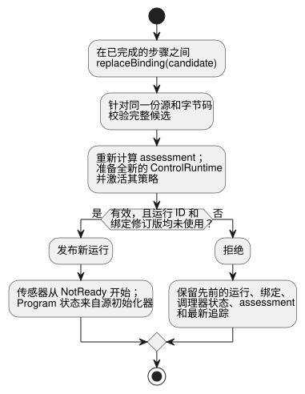

<!-- translation-source: docs/INSTALLED-SENSOR-BINDING.md -->
[英文原文](INSTALLED-SENSOR-BINDING.md)

# 已安装传感器绑定参考宿主

`InstalledControlHost` 是一个在特定安装上运行已编译 Program 的参考宿主。它首先针对一份固定的安装声明*准入*一个固定的已编译 Program（检查二者是否相互匹配），然后通过现有的 `ControlRuntime.instantiateFramed` 运行它。

它是 [REF-06-009 传感器替换](https://github.com/callin2/ghostflow-language/issues/297)和 [REF-04-039 策略 profile 替换](https://github.com/callin2/ghostflow-language/issues/243)的宿主契约。它不执行设备发现、Driver 安装、轮询或物理验证。

**本文内容**

- **固定 profile 契约**：板卡 profile 和安装声明了什么，以及检查什么。
- **运行与替换**：如何让宿主执行步骤，以及如何替换传感器绑定。
- **策略激活**：传感器能力如何选择 Program 策略。
- **已安装的组合执行**：适用于带有实例和设置的组合程序的 profile。

## 固定 profile 契约

**评估（assessment）。** 快照、被接受的步骤以及成功的绑定替换，都包含同一个自有的 `assessment`，它来自[仅元数据的安装准入](../contracts/integration-v1/README.zh.md)。

- 其标识固定了被准入的源、字节码、manifest、发布、profile 和映射。
- 即使 Bool 输出与声明的方向、类型、极性和 `safeLevel` 相匹配，`assessment.physical.status` 仍然是 `unknown`。这些声明不提供任何独立的电气、故障安全、负载或接线观测。
- 物理适用性未知并不会阻止有效的宿主执行。
- 替换会在发布之前重新计算评估。被拒绝或被篡改的候选会保留当前在用的评估和追踪。
- 返回的评估与宿主状态相互分离。

**板卡 profile。** 现有的 `GhostFlow/board-profile-v1` 结构保持不变。新的 `GhostFlow/board-profile-v2` 使用相同的板卡标识和端点映射。

| v2 端点 | 字段 |
| --- | --- |
| Bool 输出 | `direction`、`type`、`driver`、`address`、`activeLevel`、`safeLevel` |
| Number 或 Bool 输入 | `direction`、`type`、`driver`、`address`、`sensor`（替代输出的极性字段） |

**`sensor` 契约。** `sensor` 包含：

- `format: "GhostFlow/sensor-observation-v1"`；
- `canonicalUnit`；
- 一个正的安全整数 `maxInterSampleGapMs`；
- 仅对 Number 输入：有限且有序的 `minValue` 和 `maxValue`。

观测契约意味着采集负责方提供实际样本。每个样本都有来源纪元、样本 ID、捕获时间戳、负载，以及 `Good`、`NotReady`、`Disconnected`、`Stale` 或 `Invalid` 之一的质量。故障就是故障，即使它携带的占位值为零。

profile 和安装由现有的发布 SHA-256 引用固定。它们是声明的能力，而不是对物理传感器或 Driver 二进制文件的经认证的测量。

**集成检查。** 对于已绑定的传感器，`validateIntegration` 检查：

- 方向和类型；
- 规范单位；
- Number 测量范围是否覆盖 Program 显式的 `valid` 范围；
- 观测契约；
- `maxInterSampleGapMs < staleMs`。相等时检查失败，因为读数恰好在该上限处变为陈旧。

源中的 `sample` 间隔仍是描述性元数据。此检查不会把它变成轮询命令或第二个硬截止时间。这个有界宿主 profile 会拒绝没有显式 `stale_after` 的 v2 传感器绑定，以及没有显式 `valid` 范围的 Number 传感器。现有的 v1 校验保持其原有结构和行为。

## 运行与替换

```js
import { InstalledControlHost } from './runtimes/wasm/installed-control-host.mjs';

const host = await InstalledControlHost.instantiate(wasmBytes, compiled, {
  runId: 'run-1', release, boardProfile, installation,
});
const result = host.step({ bindingRevision: installation.revision, nowMs: 1000,
  samples: { reading: { bindingRevision: installation.revision,
    endpointId: installation.bindings.reading,
    sample: { epoch: 1, id: 1, timestampMs: 1000, quality: 'Good', value: 42 },
  } },
});
```

**执行步骤。** 用 `InstalledControlHost.instantiate(wasmBytes, compiled, { runId, release, boardProfile, installation })` 启动宿主。每次 `step` 传入当前的 `bindingRevision`、`nowMs` 和 `samples`。

- 调用方在捕获样本时附加绑定修订版和端点 ID。因此每个样本都携带 `bindingRevision`、`endpointId` 和 `{ epoch, id, timestampMs, quality, value }`。
- 宿主在把样本传给 `ControlRuntime` 之前，会拒绝来自较旧修订版或其他端点的数据包。这些调用方标签并不是硬件认证。
- 没有新样本的扫描传入一个空的 `samples` 对象，由现有的调理器判定新鲜度。
- 运行时输出仍是 requested/safe 控制意图，并不能证明物理输出。

**替换绑定。** `replaceBinding({ runId, release, boardProfile, installation })` 针对**同一份源和字节码**校验完整的候选，准备一个全新的 `ControlRuntime`，并在已完成的步骤之间发布它。



- 无效的候选会让先前的运行、绑定、调理器状态和最新追踪保持可用。
- 成功的候选需要一个未使用过的绑定修订版和运行 ID。它会以 `NotReady` 传感器状态开始一次全新运行。
- 新的采集来源必须发出自己的来源纪元和样本 ID。
- 新的运行边界防止旧的滤波/新鲜度状态被复用。它不保证状态或输出的连续不中断。
- 宿主最多保留 128 个运行修订版和绑定修订版。超过之后，它会拒绝进一步的替换，而不是遗忘 ID 并允许复用。
- 已经使用过的 profile 修订版不能获得不同的内容。

此操作只改变传感器绑定。它拒绝对板卡 ID 或型号、输出接线、安装 ID、编译器/运行时/协议元数据或固件摘要的更改。迁移到另一块物理板卡需要单独的安装工作流。`step` 返回被接受的结果，并附带其运行、源、字节码、profile 和绑定标识。快照和结果与调用方拥有的对象相互分离。

## 策略激活

有界 Program profile 也接受编译器生成的 `adaptPolicy` 和 `strategies` 元数据。在准入之前，宿主会重新编译规范源，并比较完整的 manifest 和字节码，包括策略匹配、优先级和策略标识。被调用方编辑过的元数据无法通过此比较。

**策略如何被选择。**

1. 集成校验确认每个必需的传感器绑定和端点类型。
2. 然后宿主为每个已绑定的传感器向 `ControlRuntime` 提供一个显式能力。
3. 现有的 Rust 运行时在激活期间选择策略。

能力是否存在取决于已校验的安装，与样本质量无关。`NotReady`、`Stale` 和其他传感器故障在所选策略下仍然是 Result 观测。它们绝不会移除能力，也不会自动选择 `match always`。

**替换与策略。** 替换会在发布之前校验完整候选并激活其策略。例如，假设 `WithReading` 匹配一个必需的 Number 传感器，而当前读数为 Stale。一个把该传感器绑定到 Bool 端点的候选会以 `type_mismatch` 失败。

- 旧的 profile、运行、绑定、状态和最新追踪仍然可用。
- 后续步骤仍执行 `WithReading` 及其显式故障分支。
- 兼容的候选会发布一次全新运行。其传感器从 `NotReady` 开始，其 Program 状态从源初始化器开始。

**独立 Program profile。** 独立 profile 要求：

- 经源验证的 `control-v1` 或 `control-v4` 字节；
- 至少一个非可选的 Number/Bool 传感器；
- Bool 输出；
- 没有调度计划、定时器、信号、config、导入或标量输入。

可选传感器绑定和调用方任意提供的能力不在此宿主 profile 范围内。已校验的 Bool 输出仍可作为执行器能力用于策略匹配。其他 profile 会在发布之前失败。设备绑定的应用、实际的 Driver 保证以及物理负载行为需要单独的证据。

## 已安装的组合执行

**组合 profile 接受什么。** 组合 profile 接受 `control-v10`，并要求：

- 规范的固定源闭包；
- Interaction Schema；
- 私有的实例状态、config 和定时器；
- 必需的 Number/Bool 传感器；
- Bool 输出。

在激活时传入 `context`、参与者 `grants`，以及可选的 `historyCapacity`。宿主私有地拥有一个帧式 `TemporarySettingsHost`，后者拥有唯一的控制器。设置、观测和解释全部来自同一次实际扫描。

**允许的根结构。** 根只能包含端口声明、实例，以及两种直接连接：根输入到实例输入，或实例输出到根输出。

- 嵌套实例、实例到实例的路由、根级计算、调度计划和信号都会被拒绝。
- 路由来自编译器重放的规范 AST、`sourceClosure` 和 `sourceMap`。它们必须与类型化的 `sensorInstances` 输入映射一致。
- 每个根传感器和实例传感器都会对照其实际准入的端点进行检查，包括单位、测量范围以及样本间隔/陈旧上限。
- 生成的运行时名称不定义路由。

**执行步骤。** 使用采集到的数据包和一个额外的 `contextFacts` 字段调用 `step(frame, settingsEvent)`。

- 现有的临时设置事件契约使用来自 `snapshot().execution` 的当前标识。
- 端点、绑定修订版和采集结构的检查发生在进入设置负责方之前。
- 有效的 `Invalid` 或 `Disconnected` 观测会作为故障到达调理器。纪元、样本 ID 和时间戳遵循共享运行时的样本标识规则。

**结果与输出解释。** 被接受的结果包括实际的设置负责方 `execution`，以及一个 `provenance`，后者绑定其运行、扫描、逻辑时间、已提交的设置修订版、准入摘要和实例路由。

`explainOutput('output.east_on', result)` 只接受负责方当前的已完成结果。它把实际的证明和观测联结起来，并返回描述符、实例的生效设置、输入路由和输出端点。

- 旧的结果，以及被调换的路由、设置或修订版，都会被拒绝。
- `ready` 联结表示该关联有效。`proof.status` 单独说明表达式解释是否可用。
- 基于状态的 Bool 证明可用。config/定时器生成的轨道表达式仍不可用。
- 这些回执不能认证物理 Driver。它们不能证明状态转换、安全输出、已应用的输出或物理效果。

**当前完成与历史完成。** `snapshot().latest` 将最后一次被接受的完成作为历史保留。另外，`currentFrameCompletion` 标识实际运行时当前已完成的扫描。

- 分发会在执行之前清除该标识，并且只在完成之后发布新标识。
- 因此，分发失败会使当前的输出解释不可用。这包括以 `accepted: false` 报告的设置返回失败。
- 采集、设置和上下文的预检拒绝从不进行分发，因此它们保留当前标识。
- 历史证明保持不变。分发失败之后，它们不能通过 `explainOutput` 被呈现为当前结果。

**替换。** 替换会在发布之前准备好完整的新负责方。

- 被拒绝的候选会保留设置、覆盖层、历史、状态、定时器、调理器、最新完成和评估。
- 成功时恢复负责方已验证的设置检查点，包括普通 Result 值、故障、修订版和历史。
  Run 叠加在新运行首次决策前返回；Until 叠加保留原有截止时间和有效性规则。
  控制状态、计时器和调理器重新开始，并清除先前的完成记录。
- 替换期间拒绝组合 `step`，避免检查点捕获与发布之间丢失已接受的设置。
  恢复失败时保留先前的负责方。带 parameter 的组合仍不在此配置范围内。

**覆盖范围与限制。**

- 与原生/WASM 的 config/定时器检查一起，这条有界路径完成了规定的 REF-06-002 east 状态/设置隔离用例。
- 嵌套路由和独立的热绑定迁移不在此 profile 范围内。
- REF-06-016 将每个实例的输出解释与其精确的源节点、跨度、修订版、设置和已安装端点路由进行对照检查。
- 更广泛的第 6.7 节从 requested 到 safe 的约束链仍未完成。

`tests/installed-composition.test.mjs` 演练了实际的 WASM 执行、同一时刻的 east/west 隔离、联结的来源（provenance）、篡改、故障和替换。
