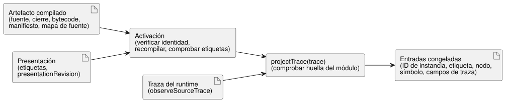

<!-- translation-source: docs/INSTANCE-TRACE-PROJECTION.md -->
[Original en inglés](INSTANCE-TRACE-PROJECTION.md)

# Adaptador de referencia para la proyección de trazas por instancia

El adaptador `tools/instance-trace-projection.mjs` es un pequeño titular de
referencia de producción para la visualización de instancias y la proyección de
trazas de REF-06-003. Convierte las observaciones de un programa compilado en
entradas que una interfaz de usuario puede mostrar por instancia, con etiquetas
legibles para las personas.

El adaptador tiene un alcance limitado:

- No cambia la gramática de la fuente de GhostFlow.
- No evalúa expresiones; la ejecución permanece en el núcleo compartido.
- Valida un artefacto ya compilado y después proyecta solo las observaciones que
  el runtime compilado emitió a través de `observeSourceTrace()`.

Cada registro proyectado conserva los `sourceDocumentSha256` y `bytecodeSha256` activados, de modo que las observaciones persistidas o unidas de forma independiente mantienen su revisión de compilación exacta.

El diagrama muestra las dos etapas: la activación comprueba el artefacto y las
etiquetas una sola vez; después `projectTrace` une cada traza del runtime.

**Activación.** La activación (`activateInstanceTraceProjection(artifact,
presentation)`) verifica la identidad completa vinculada a la fuente antes de
aceptar cualquier metadato de visualización:

- el texto y el SHA-256 del `sourceDocument` raíz canónico;
- el texto, la revisión inmutable y el SHA-256 de cada documento importado del cierre de fuentes;
- el SHA-256 del bytecode frente al manifiesto de control y los metadatos de traza;
- la recompilación de la fuente raíz exacta y del cierre importado, con bytecode, manifiesto, cierre de fuentes, mapa de fuente y metadatos de traza que coincidan con el artefacto proporcionado;
- etiquetas explícitas exactamente para los IDs de instancia compilados.

**Las etiquetas son presentación, no identidad.** Las etiquetas de
visualización y la revisión de presentación son metadatos del adaptador.

- No son revisiones de la fuente.
- No cambian el nombre de las instancias.
- No afectan a las claves semánticas de la traza.

Un llamador puede mover archivos, cambiar el orden de las declaraciones o
cambiar las etiquetas de presentación manteniendo los mismos IDs de instancia
escritos por el autor. La proyección sigue indexada por la identidad de
instancia emitida y por los símbolos escritos por el autor derivados de la
fuente y de los metadatos del mapa de fuente. Si cambian los IDs de instancia
escritos por el autor, la identidad de traza antigua no se convierte en alias
de la nueva.

**Proyección.** `projectTrace(trace)` rechaza primero una traza cuya huella de
módulo no coincide con el artefacto activado. Después une las observaciones
reales de la traza de la fuente y devuelve entradas con:

- el ID de instancia compilado;
- la etiqueta de visualización;
- el nodo de la fuente;
- el símbolo escrito por el autor;
- los campos de traza observados.

Las declaraciones originales analizadas por el compilador se unen a través del
`definitionNodeId` de cada mapa de fuente. Como resultado, varias declaraciones
en una misma línea, o una declaración repartida en varias líneas, conservan cada
una su propio símbolo. Los nombres privados de ranuras de la VM y el orden
numérico de los nodos no son claves semánticas públicas. La clave más el tipo
de observación identifica las vistas de estado y de estado siguiente, mientras
que los IDs y las ubicaciones de los nodos conservan la procedencia exacta del
artefacto.

**Titularidad y seguridad de las entradas.**

- La activación toma sus propias copias de las entradas de compilación y de
  presentación antes de que comience la verificación asíncrona.
- La proyección devuelve copias congeladas en profundidad. No congela ni
  modifica la traza del runtime del llamador.
- El único punto de entrada de la proyección acepta una traza de fuente real
  con la huella de módulo activada. No se expone ninguna entrada de
  observaciones sin comprobar, ninguna devolución de llamada de verificación
  personalizada ni ninguna opción de titularidad solo para pruebas.
- `presentationRevision` es obligatorio y no puede proporcionarse como revisión
  de la fuente.
- Las etiquetas deben ser texto acotado, no vacío y bien formado, sin caracteres
  de control. Estos límites pertenecen a este adaptador de referencia, no a la
  política del lenguaje fuente.
