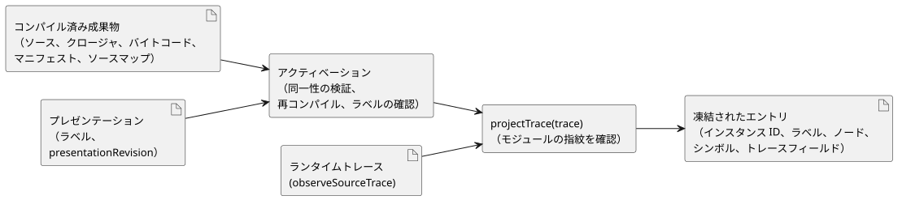

<!-- translation-source: docs/INSTANCE-TRACE-PROJECTION.md -->
[英語の原文](INSTANCE-TRACE-PROJECTION.md)

# インスタンストレース射影の参照アダプタ

`tools/instance-trace-projection.mjs` アダプタは、REF-06-003 のインスタンス表示とトレース射影を担う、小さな本番用の参照実装です。コンパイル済みプログラムの観測を、ユーザーインターフェースがインスタンスごとに人間が読めるラベル付きで表示できるエントリに変換します。

このアダプタの範囲は限定されています。

- GhostFlow のソース文法を変更しません。
- 式を評価しません。実行は共有コアにとどまります。
- すでにコンパイルされた成果物を検証し、そのうえで、コンパイル済みランタイムが `observeSourceTrace()` を通じて出力した観測だけを射影します。

射影された各レコードは、アクティベートされた `sourceDocumentSha256` と `bytecodeSha256` を保持します。そのため、永続化された観測や独立に結合された観測も、正確なコンパイルリビジョンを保ちます。

図は 2 つの段階を示しています。アクティベーションは成果物とラベルを一度だけ確認し、その後 `projectTrace` が各ランタイムトレースを結合します。

**アクティベーション。**アクティベーション（`activateInstanceTraceProjection(artifact,
presentation)`）は、表示用のメタデータを受け入れる前に、ソースに結び付いた同一性の全体を検証します。

- 正準のルート `sourceDocument` のテキストと SHA-256
- インポートされたソースクロージャの各文書のテキスト、不変のリビジョン、SHA-256
- control マニフェストとトレースメタデータに対するバイトコードの SHA-256
- 正確なルートソースとインポートされたクロージャの再コンパイル。バイトコード、マニフェスト、ソースクロージャ、ソースマップ、トレースメタデータが、渡された成果物と一致すること
- コンパイルされたインスタンス ID とちょうど一致する、明示的なラベル

**ラベルは表示用であり、同一性ではありません。**表示ラベルとプレゼンテーションのリビジョンは、アダプタのメタデータです。

- ソースのリビジョンではありません。
- インスタンスの名前を変更しません。
- 意味的なトレースキーに影響しません。

呼び出し側は、記述されたインスタンス ID を同じに保ったまま、ファイルを移動したり、宣言の順序を変えたり、表示ラベルを変えたりできます。射影は、出力されたインスタンスの同一性と、ソースおよびソースマップのメタデータから導かれる記述上のシンボルをキーとし続けます。記述されたインスタンス ID が変わった場合、古いトレースの同一性が新しいものの別名になることはありません。

**射影。**`projectTrace(trace)` は、まず、モジュールの指紋がアクティベートされた成果物と一致しないトレースを拒否します。次に、実際のソーストレースの観測を結合し、次のものを含むエントリを返します。

- コンパイルされたインスタンス ID
- 表示ラベル
- ソースノード
- 記述上のシンボル
- 観測されたトレースフィールド

コンパイラが元々パースした宣言は、各ソースマップの `definitionNodeId` を通じて結合されます。その結果、1 行にある複数の宣言や、複数行にまたがる 1 つの宣言も、それぞれ独自のシンボルを保ちます。VM の非公開スロット名や数値のノード順序は、公開の意味的キーではありません。キーと観測の種類の組み合わせが状態ビューと次状態ビューを識別し、ノード ID と位置が成果物の正確な来歴を保持します。

**入力の所有権と安全性。**

- アクティベーションは、非同期の検証が始まる前に、コンパイルとプレゼンテーションの入力の独自のコピーを取ります。
- 射影は、深く凍結（deep freeze）されたコピーを返します。呼び出し側のランタイムトレースを凍結したり変更したりはしません。
- 唯一の射影エントリポイントは、アクティベートされたモジュール指紋を持つ実際のソーストレースだけを受け付けます。未検査の観測入力、カスタムの検証コールバック、テスト専用の所有権オプションは公開されていません。
- `presentationRevision` は必須であり、ソースのリビジョンとして渡すことはできません。
- ラベルは、上限があり、空でなく、制御文字を含まない整形式のテキストでなければなりません。これらの上限はこの参照アダプタのものであり、ソース言語のポリシーではありません。
