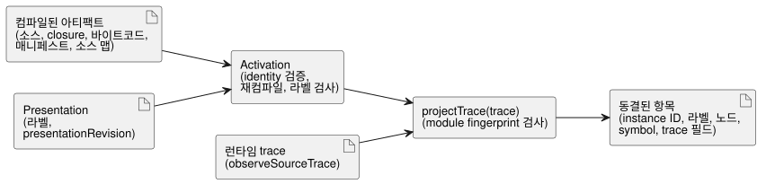

<!-- translation-source: docs/INSTANCE-TRACE-PROJECTION.md -->
[영문 원문](INSTANCE-TRACE-PROJECTION.md)

# Instance trace projection 참조 어댑터

`tools/instance-trace-projection.mjs` 어댑터는 REF-06-003 instance 표시와 trace projection을
위한 작은 프로덕션 참조 소유자입니다. 이 어댑터는 컴파일된 프로그램의 관측을, 사용자
인터페이스가 instance별로 사람이 읽을 수 있는 라벨과 함께 보여 줄 수 있는 항목으로
변환합니다.

이 어댑터의 범위는 좁습니다.

- GhostFlow 소스 문법을 바꾸지 않습니다.
- 식을 평가하지 않습니다. 실행은 공유 core에 남습니다.
- 이미 컴파일된 아티팩트를 검증한 뒤, 컴파일된 런타임이 `observeSourceTrace()`로 내보낸
  관측만 projection합니다.

projection된 각 record는 activation된 `sourceDocumentSha256`과 `bytecodeSha256`을 보존하므로, 저장되거나 독립적으로 결합된 관측도 정확한 컴파일 revision을 유지합니다.

다이어그램은 두 단계를 보여 줍니다. activation은 아티팩트와 라벨을 한 번 검사하고, 그 뒤
`projectTrace`가 각 런타임 trace를 결합합니다.

**Activation.** activation(`activateInstanceTraceProjection(artifact,
presentation)`)은 표시 메타데이터를 받기 전에 소스에 결합된 identity 전체를 검증합니다.

- 정본 root `sourceDocument` 텍스트와 SHA-256
- import된 모든 source-closure 문서의 텍스트, 변경할 수 없는 revision, SHA-256
- control 매니페스트 및 trace 메타데이터와 대조한 바이트코드 SHA-256
- 정확한 root 소스와 import된 closure의 재컴파일, 그리고 바이트코드, 매니페스트, source closure, 소스 맵, trace 메타데이터가 제공된 아티팩트와 일치하는지
- 컴파일된 instance ID와 정확히 일치하는 명시적 라벨

**라벨은 identity가 아니라 표시 정보입니다.** 표시 라벨과 presentation revision은 어댑터
메타데이터입니다.

- 소스 revision이 아닙니다.
- instance의 이름을 바꾸지 않습니다.
- 의미적 trace key에 영향을 주지 않습니다.

호출자는 작성된 instance ID를 그대로 유지하는 한, 파일을 옮기거나 선언 순서를 바꾸거나
presentation 라벨을 바꿀 수 있습니다. projection은 계속 내보내진 instance identity와, 소스 및
source-map 메타데이터에서 얻은 작성된 symbol을 key로 사용합니다. 작성된 instance ID가 바뀌면,
이전 trace identity를 새 identity의 별칭으로 취급하지 않습니다.

**Projection.** `projectTrace(trace)`는 먼저 module fingerprint가 activation된 아티팩트와
일치하지 않는 trace를 거부합니다. 그런 다음 실제 source trace 관측을 결합하여 다음을 담은
항목을 반환합니다.

- 컴파일된 instance ID
- 표시 라벨
- 소스 노드
- 작성된 symbol
- 관측된 trace 필드

컴파일러가 원래 파싱한 선언은 각 source-map `definitionNodeId`를 통해 결합됩니다. 그 결과 한
줄에 있는 여러 선언이나 여러 줄에 걸친 하나의 선언도 각자 자신의 symbol을 유지합니다. 비공개
VM slot 이름과 숫자 노드 순서는 공개 의미 key가 아닙니다. key와 관측 종류(observation kind)가
상태 보기와 다음 상태 보기를 식별하고, 노드 ID와 위치는 정확한 아티팩트 provenance(출처)를
보존합니다.

**입력의 소유권과 안전성.**

- activation은 비동기 검증이 시작되기 전에 컴파일 입력과 presentation 입력의 자체 사본을
  만듭니다.
- projection은 깊게 동결된 사본을 반환합니다. 호출자의 런타임 trace를 동결하거나 변경하지
  않습니다.
- 유일한 projection 진입점은 activation된 module fingerprint를 가진 실제 source trace만
  받습니다. 검사되지 않은 관측 입력, 사용자 정의 검증 callback, 테스트 전용 소유권 option은
  노출되지 않습니다.
- `presentationRevision`은 필수이며, 소스 revision으로 대신 제공할 수 없습니다.
- 라벨은 길이가 제한되고, 비어 있지 않으며, 제어 문자가 없는 올바른 형식의 텍스트여야 합니다.
  이 한계는 이 참조 어댑터의 것이며, 소스 언어 정책이 아닙니다.
