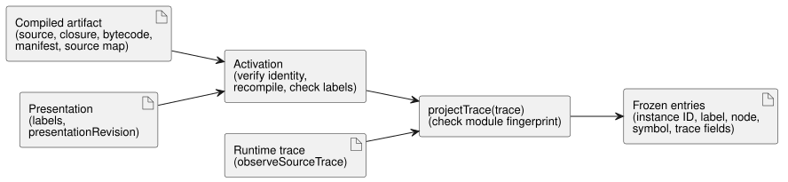

# Instance trace projection reference adapter

The `tools/instance-trace-projection.mjs` adapter is a small production
reference owner for REF-06-003 instance display and trace projection. It turns
the observations of a compiled program into entries that a user interface can
show per instance, with human-readable labels.

The adapter has a narrow scope:

- It does not change the GhostFlow source grammar.
- It does not evaluate expressions; execution stays in the shared core.
- It validates an already compiled artifact, then projects only observations
  that the compiled runtime emitted through `observeSourceTrace()`.

Each projected record preserves the activated `sourceDocumentSha256` and `bytecodeSha256`, so persisted or independently joined observations retain their exact compilation revision.

The diagram shows the two stages: activation checks the artifact and labels
once; `projectTrace` then joins each runtime trace.

**Activation.** Activation (`activateInstanceTraceProjection(artifact,
presentation)`) verifies the complete source-bound identity before it accepts
any display metadata:

- the canonical root `sourceDocument` text and SHA-256;
- every imported source-closure document text, immutable revision and SHA-256;
- bytecode SHA-256 against the control manifest and trace metadata;
- recompilation of the exact root source and imported closure, with bytecode, manifest, source closure, source map and trace metadata matching the supplied artifact;
- explicit labels for exactly the compiled instance IDs.

**Labels are presentation, not identity.** Display labels and the presentation
revision are adapter metadata.

- They are not source revisions.
- They do not rename instances.
- They do not affect semantic trace keys.

A caller may move files, change declaration order or change presentation labels
while keeping the same authored instance IDs. The projection stays keyed by the
emitted instance identity and by authored symbols derived from source and
source-map metadata. If the authored instance IDs change, the old trace identity
is not aliased to the new one.

**Projection.** `projectTrace(trace)` first rejects a trace whose module
fingerprint does not match the activated artifact. It then joins the actual
source trace observations and returns entries with:

- the compiled instance ID;
- the display label;
- the source node;
- the authored symbol;
- the observed trace fields.

The compiler's original parsed declarations are joined through each source-map
`definitionNodeId`. As a result, several declarations on one line, or one
declaration spread across lines, each keep their own symbol. Private VM slot
names and numeric node order are not public semantic keys. The key plus the
observation kind identifies the state and next-state views, while node IDs and
locations retain the exact artifact provenance.

**Ownership and safety of inputs.**

- Activation takes its own copies of the compilation and presentation inputs
  before asynchronous verification starts.
- Projection returns deeply frozen copies. It does not freeze or mutate the
  caller's runtime trace.
- The only projection entry point accepts an actual source trace with the
  activated module fingerprint. No unchecked observation input, custom
  verification callback or test-only ownership option is exposed.
- `presentationRevision` is required and cannot be supplied as a source revision.
- Labels must be bounded, nonempty, well-formed text without control
  characters. These bounds belong to this reference adapter, not to
  source-language policy.
