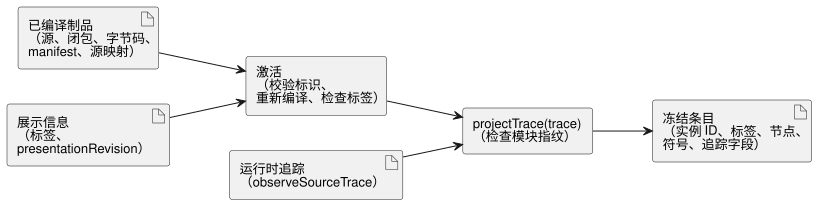

<!-- translation-source: docs/INSTANCE-TRACE-PROJECTION.md -->
[英文原文](INSTANCE-TRACE-PROJECTION.md)

# 实例追踪投影参考适配器

`tools/instance-trace-projection.mjs` 适配器是 REF-06-003 实例显示与追踪投影的一个小型生产级参考负责方。它把已编译程序的观测转换为用户界面可以按实例显示、并带有人类可读标签的条目。

该适配器的范围很窄：

- 它不改变 GhostFlow 源语法。
- 它不对表达式求值；执行仍在共享核心中进行。
- 它校验一个已编译的制品，然后只投影已编译运行时通过 `observeSourceTrace()` 发出的观测。

每条投影记录都保留激活时的 `sourceDocumentSha256` 和 `bytecodeSha256`，因此被持久化或被独立联结的观测都保留其精确的编译修订版。

下图展示两个阶段：激活时一次性检查制品和标签；随后 `projectTrace` 联结每一条运行时追踪。

**激活。** 激活（`activateInstanceTraceProjection(artifact,
presentation)`）在接受任何显示元数据之前，会校验完整的源绑定标识：

- 规范的根 `sourceDocument` 文本及其 SHA-256；
- 每个导入的源闭包文档的文本、不可变修订版和 SHA-256；
- 字节码 SHA-256 与 control manifest 及追踪元数据的对照；
- 对精确的根源和导入闭包重新编译，并要求字节码、manifest、源闭包、源映射和追踪元数据与所提供的制品一致；
- 恰好覆盖已编译实例 ID 的显式标签。

**标签是展示信息，而不是标识。** 显示标签和展示修订版是适配器元数据。

- 它们不是源修订版。
- 它们不会重命名实例。
- 它们不影响语义追踪键。

调用方可以移动文件、改变声明顺序或更改展示标签，同时保持作者编写的实例 ID 不变。投影仍以发出的实例标识，以及从源和源映射元数据推导出的作者编写符号作为键。如果作者编写的实例 ID 发生变化，旧的追踪标识不会被别名到新的标识上。

**投影。** `projectTrace(trace)` 首先拒绝模块指纹与已激活制品不匹配的追踪。然后它联结实际的源追踪观测，并返回包含以下内容的条目：

- 已编译的实例 ID；
- 显示标签；
- 源节点；
- 作者编写的符号；
- 观测到的追踪字段。

编译器最初解析出的声明通过每个源映射的 `definitionNodeId` 进行联结。因此，同一行上的多个声明，或跨越多行的一个声明，都各自保留自己的符号。私有 VM 槽位名和数值节点顺序不是公开的语义键。键加上观测种类标识状态视图和下一状态视图，而节点 ID 和位置保留精确的制品来源（provenance）。

**输入的所有权与安全。**

- 激活会在异步校验开始之前，为编译输入和展示输入各自制作副本。
- 投影返回深度冻结的副本。它不会冻结或修改调用方的运行时追踪。
- 唯一的投影入口点只接受带有已激活模块指纹的实际源追踪。不暴露未经检查的观测输入、自定义校验回调或仅供测试的所有权选项。
- `presentationRevision` 是必需的，并且不能作为源修订版提供。
- 标签必须是有界、非空、格式良好且不含控制字符的文本。这些界限属于本参考适配器，而不是源语言策略。
