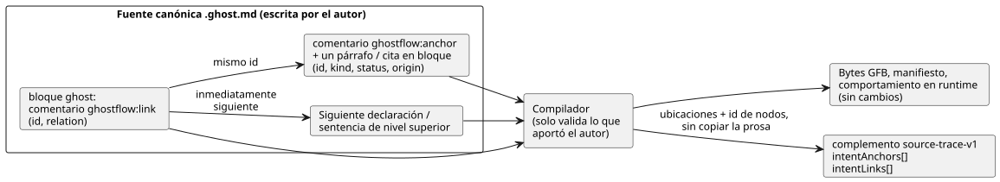
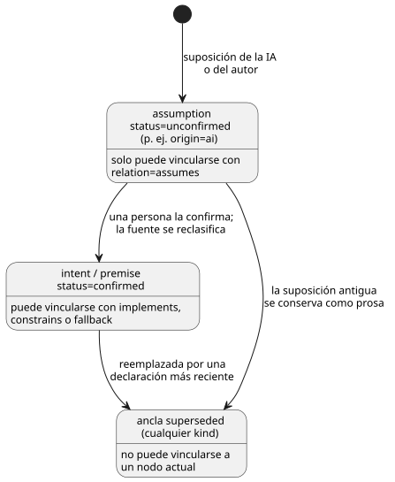

<!-- translation-source: docs/INTENT-ANCHOR-MAP.md -->
[Original en inglés](INTENT-ANCHOR-MAP.md)

# Mapa de anclas de intención para fuentes literate

Estado: contrato principal de implementación de LS-1c, 2026-09-15. Seguimiento:
issue del lenguaje #60 / issue de integración #17 / TASK-112 local.

Este contrato añade una **capa de procedencia de la fuente** pequeña y aditiva: una forma de
registrar *por qué* existe un fragmento de código GhostFlow. Su alcance es deliberadamente limitado:

- No añade ninguna construcción ejecutable de GhostFlow.
- No cambia los bytes de GFB1 ni el manifiesto estricto del control.
- Los metadatos nunca afectan a la salida en tiempo de ejecución.
- El documento `.ghost.md` escrito por el autor sigue siendo la única fuente canónica del producto.
  Un mapa generado nunca es una segunda fuente editable.

En este documento:

- [Por qué existe](#por-qué-existe): el vacío que cubre esta capa.
- [Forma mínima de autoría](#forma-mínima-de-autoría): cómo escribir anclas y vínculos.
- [Metadatos derivados](#metadatos-derivados): qué registra el compilador y cómo se verifica.
- [Procedencia de la intención importada](#procedencia-de-la-intención-importada): anclas y vínculos a través de importaciones fijadas.
- [Extracción y compatibilidad](#extracción-y-compatibilidad): qué cuenta como directiva y qué no cambia.
- [Diagnósticos y vectores de aceptación](#diagnósticos-y-vectores-de-aceptación): advertencias y errores.
- [Derivaciones de restricciones del compilador](#derivaciones-de-restricciones-del-compilador-31-aceptación-acotada): procedencia de las sentencias `require` reducidas.
- [No objetivos deliberados](#no-objetivos-deliberados).

## Por qué existe

GhostFlow ya conserva las ubicaciones exactas del documento literate y de los nodos del compilador.
Eso responde a «¿dónde se calcula esta salida?». No responde a «¿qué intención o premisa
declarada llevó a este cálculo?».

LS-1c añade un vínculo explícito entre ambas cosas. El compilador solo valida lo que
aportó el autor. No infiere la intención, no descubre conocimiento tácito ni
aprueba un supuesto de la IA.

## Forma mínima de autoría

Se escriben dos cosas: un **ancla** en la prosa Markdown y un **vínculo** dentro
de un bloque `ghost` ejecutable. El vínculo apunta al ancla por su `id` y se asocia
a la sentencia que le sigue.



El diagrama muestra a la izquierda las piezas que escribe el autor y a la derecha lo que produce
el compilador. Solo el complemento source-trace recibe datos nuevos.

**Anclas.** Un **ancla** es un comentario HTML de Markdown independiente y de nivel superior, seguido
inmediatamente por un párrafo o una cita en bloque de nivel superior:

```markdown
<!-- ghostflow:anchor id=GF-INT-PUMP-001 kind=intent status=confirmed origin=user -->
> 급수 요청 스위치를 켜면 펌프를 켜 주세요.
```

(La cita en coreano dice: «Cuando se active el interruptor de solicitud de riego, encienda la bomba».)

- El comentario es un metadato que no se renderiza.
- El bloque que le sigue es el **texto original anclado** (el cuerpo del ancla).
- Se permite una línea en blanco entre el comentario y el bloque, porque CommonMark
  trata ambos como bloques de nivel superior separados.
- Un encabezado, una lista, un bloque anidado, un bloque de código, otra ancla o el final del
  documento **no** es un cuerpo de ancla.

Un bloque por ancla mantiene sin ambigüedad los rangos de la fuente y las unidades de revisión. Para una
explicación más larga, use varias anclas o prosa ordinaria sin anclar.

En v1, los campos y su orden son exactos:

| Campo | Valores permitidos | Notas |
|---|---|---|
| `id` | `[A-Za-z][A-Za-z0-9._:-]{0,127}` | Único dentro de un documento. Manténgalo estable a lo largo de las revisiones de redacción mientras se mantenga la misma intención. |
| `kind` | `intent`, `premise`, `assumption` | |
| `status` | `confirmed`, `unconfirmed`, `superseded` | |
| `origin` | `user`, `operator`, `engineer`, `ai`, `imported` | |

Un `assumption` (supuesto) puede ser `unconfirmed` o `superseded`, pero **nunca** `confirmed`.
Cuando una persona lo confirma, la fuente canónica lo reclasifica como `intent` o
`premise`. El supuesto antiguo puede quedar como prosa `superseded` sin un vínculo
ejecutable vigente. Un ancla `superseded` no puede vincularse a un nodo actual.

Estas comprobaciones impiden que una suposición de la IA se convierta silenciosamente en intención confirmada. No
definen un flujo de aprobación del producto.



El diagrama resume a qué anclas puede hacer referencia cada relación. Un `intent`
o un `premise` también puede ser `unconfirmed`; en ese caso acepta las mismas relaciones que uno
confirmado.

**Vínculos.** Un **vínculo** es un comentario exacto que ocupa una línea completa dentro de un bloque `ghost` ejecutable:

```ghost
// ghostflow:link id=GF-INT-PUMP-001 relation=implements
pump <- request;
```

Los campos y su orden son exactos. `relation` es uno de los siguientes:

| `relation` | Significado |
|---|---|
| `implements` | Este nodo implementa el comportamiento declarado. |
| `constrains` | Este nodo restringe el comportamiento para una intención o premisa. |
| `fallback` | Este nodo implementa una política explícita de tiempo/datos degradados. |
| `assumes` | Este nodo candidato depende actualmente de un supuesto sin confirmar. |

**Destino del vínculo.** Una o más líneas de vínculo consecutivas pueden tener como destino la misma
sentencia. El destino es la declaración o sentencia rastreable de nivel superior que sigue
inmediatamente. Cualquiera de los siguientes elementos entre el vínculo y su destino
deja el vínculo **huérfano**, lo cual es un error: una línea en blanco, un comentario
ordinario, una expresión anidada, un encabezado de control o el final del bloque.

Los tipos de destino admitidos en v1 son las declaraciones y sentencias de nivel superior
del parser: `input`, `output`, `state`, `config`, `let`, `enum`, `function`,
`sensor`, `signal`, `schedule`, `timer`, `require`, `mutex`, `next` y
`connection`.

**Las comprobaciones de relación/clasificación** son intencionadamente estrechas:

- `assumes` debe hacer referencia a un `assumption` con `status=unconfirmed`.
- Las demás relaciones no pueden hacer referencia a un `assumption`.
- Ninguna relación puede hacer referencia a un ancla `superseded`.

Si un candidato sin confirmar puede simularse, revisarse, aprobarse o
desplegarse es una política del host/producto. El artefacto del lenguaje conserva el hecho;
no permite ni deniega silenciosamente una publicación.

## Metadatos derivados

Para una fuente literate que contiene anclas o vínculos, el complemento existente
`GhostFlow/source-trace-v1` recibe dos arrays opcionales. Las fuentes sin
esta función conservan la forma y el comportamiento existentes.

`intentAnchors[]` contiene:

- `id`, `kind`, `status` y `origin`, exactamente como se escribieron;
- `directiveSource`: la ubicación original en Markdown de la directiva del ancla;
- `source`: el rango original en Markdown del párrafo o la cita en bloque siguiente.

`intentLinks[]` contiene:

- `anchorId` y `relation`, exactamente como se escribieron;
- `nodeId` y `nodeKind` del AST autoritativo del compilador;
- `directiveSource`: la ubicación original en Markdown del comentario de vínculo;
- `source`: la ubicación autoritativa del nodo de destino;
- `extractedDirectiveSource` y `extractedSource`, solo en la compilación literate.
  Conservan el sistema de coordenadas del bloque de código, como la traza existente.

Los arrays nunca copian ni normalizan la prosa anclada. Para obtener el texto exacto, un
consumidor recorta el `sourceDocument.text` ya verificado en el rango registrado.
Así se evita crear una segunda copia del texto que alguien tendría que mantener.

**Verificación.** El complemento sigue incluyendo `sourceDocumentSha256` y `bytecodeSha256`.
La recuperación estricta valida:

- ambas identidades de revisión;
- la forma de cada ancla y cada vínculo, y la unicidad de los ID;
- la compatibilidad entre relación y clasificación;
- el ID, el tipo y la ubicación del nodo de destino;
- que las ubicaciones de la directiva y de la fuente estén dentro del documento seleccionado.

Rechaza:

- campos o valores de enumeración desconocidos;
- anclas duplicadas o vínculos idénticos duplicados;
- anclas ausentes y vínculos huérfanos;
- un nodo/ubicación de los metadatos que no concuerda con el mapa de fuente suministrado;
- revisiones mezcladas y ubicaciones fuera de rango.

Ningún verificador reconstruye ni adivina un vínculo ausente.

**Consistencia no es autenticidad.** Esta API de recuperación local demuestra **consistencia interna, no autenticidad**. Un
atacante que pueda reemplazar el mapa de fuente completo puede reemplazar a la vez un nodo y sus
metadatos correspondientes. La autenticidad requiere una de estas opciones:

- el verificador de paquetes portables existente, cuya carga firmada cubre el
  digest del mapa de fuente; o
- una reproducción determinista y de confianza del compilador a partir del documento fuente verificado.

LS-1c no debe afirmar que un mapa independiente sin firmar detecta un reemplazo
coordinado.

## Procedencia de la intención importada

La composición fijada conserva la intención escrita por el autor para cada definición instanciada.
Los `intentAnchors` e `intentLinks` raíz siguen limitados al documento raíz.
Cuando una instancia importada tiene anclas o vínculos, el compilador añade
`traceMetadata.compositionIntent`. Este contenedor tiene los siguientes campos:

- `format` es `GhostFlow/composition-intent-v1`.
- `sourceClosureSha256` es el SHA-256 de `canonicalJson(sourceClosure)`.
- `instances` contiene grupos en orden de recorrido determinista. Cada grupo tiene
  la ruta `instance` escrita por el autor, como `east` u `outer.inside`, y una
  `definition` con el `filename`, la `revision` y el `sha256` exacto del documento fijados.
- Los `anchors` de cada grupo conservan los campos originales del ancla. Sus `links`
  conservan los campos originales del vínculo, más el `nodeId` compuesto y el
  `definitionNodeId` original.

**Los ID de ancla son locales a su documento.** La raíz, dos definiciones e
instancias repetidas pueden usar el mismo ID. El grupo aporta el espacio de nombres.
El compilador no reescribe los ID ni infiere la identidad de la instancia a partir de
nombres de variables generados. Un supuesto de IA importado sigue siendo `origin=ai`,
`kind=assumption` y `status=unconfirmed`. Importarlo no lo confirma
ni cambia su origen.

**Validación y vinculación.**

- El compilador valida los vínculos contra el AST original de cada definición antes
  de asociarlos a los nodos compuestos.
- Las ubicaciones originales en Markdown y las ubicaciones del código extraído se mantienen separadas.
- Los vínculos en las declaraciones `input` y `output` se conservan incluso cuando la composición
  elimina la declaración ejecutable.
- Un documento importado no utilizado permanece en el cierre verificado, pero no aporta ningún
  grupo de instancia.
- Cuando se requiere la identidad de revisión raíz, la aporta quien llama; la composición
  nunca la inventa.

**Restauración y verificación de paquetes.** La restauración de artefactos y la verificación
de paquetes portables firmados recompilan el cierre exacto y comparan toda la
procedencia. Rechazan grupos, identidades de definición, digest del cierre,
ID de nodos, ubicaciones, clasificaciones o relaciones ausentes o modificados. El
validador de trazas independiente rechaza un contenedor de composición. Una edición solo de prosa en
una definición cambia la procedencia y las fijaciones, mientras que los tokens ejecutables sin cambios conservan
el mismo bytecode.

**Límites.** El `intentEvidence` raíz solo puede hacer referencia a anclas raíz y a nodos raíz
vinculados. No puede reclamar un nodo importado mediante un ID de ancla igual. El esquema
Interaction actual no puede representar grupos de intención importados y rechaza
explícitamente una solicitud de proyección que los contenga. La compilación y la
ejecución ordinarias siguen aceptando esos grupos. Los cruces con el perfil público y con las explicaciones del host
son trabajo aparte en
[#290](https://github.com/callin2/ghostflow-language/issues/290) y
[#302](https://github.com/callin2/ghostflow-language/issues/302).

## Extracción y compatibilidad

- **CommonMark decide qué es un bloque Markdown de nivel superior.** El texto con apariencia de directiva
  en bloques de código, código en línea, bloques HTML multilínea o envolventes, bloques
  anidados o front matter no es un ancla Markdown.
- **Solo se ejecutan los bloques `ghost` de nivel superior**, exactamente igual que antes. Para el analizador
  léxico de GhostFlow, los comentarios de vínculo siguen siendo comentarios `//` ordinarios y no producen ningún opcode.
- **El `.ghost` plano es solo evidencia histórica** y el compilador del producto
  lo rechaza. No puede aportar un espacio de nombres de anclas ni un respaldo ejecutable.
- **Sin directivas, sin cambios.** Los documentos sin directivas de ancla/vínculo producen
  el mismo código, los mismos bytes GFB, ID de nodos, diagnósticos, manifiesto y comportamiento en tiempo de ejecución
  que antes.
- **Ediciones de prosa y comentarios.** Los cambios solo de prosa/comentarios alteran
  `sourceDocument.sha256`. Cuando la estructura de tokens ejecutables no cambia, los bytes GFB
  y los ID de nodos del compilador siguen siendo los mismos. Las ubicaciones en el documento original pueden
  desplazarse; están ligadas a una revisión.

## Diagnósticos y vectores de aceptación

<a id="default-behavior-coverage-warnings"></a>
### Advertencias de cobertura del comportamiento predeterminadas (#553)

El compilador, la CLI y la creación de paquetes informan por defecto **advertencias de cobertura**
de los vínculos de intención. Hay dos códigos de advertencia.

**`GF_INTENT_LINK_MISSING`** se aplica a cada sentencia de nivel superior sin vínculo de tipo `connection`, `next`, `require`, `mutex`, `let`,
`function`, `signal`, `schedule` o `timer`.

- Un vínculo cubre solo su propia sentencia de destino. Vincular una declaración no
  cubre el comportamiento posterior.
- Las declaraciones independientes `input`, `output`, `state`, `config`, `parameter` y `enum`
  no se cuentan.
- La cobertura es estructural y local a cada sentencia. La advertencia no infiere
  comportamiento transitivo, no demuestra una aserción ni decide si una intención es correcta
  o está confirmada.
- Los vínculos activos explícitos satisfacen esta comprobación incluso cuando describen un
  supuesto sin confirmar. Ese estado sigue sin confirmar.

**`GF_INTENT_LINK_COVERAGE_UNSUPPORTED`** informa de los propietarios de comportamiento para los que el
contrato actual no tiene destino de vínculo: `adapt`, `objective`, `account`,
`account-constraints`, `local-constraints`, `shared-constraints`,
`adapt-setting` y `degraded` de nivel superior, además de las sentencias anidadas `connection`, `connect`, `next`,
`require` y `mutex`.

- Estas advertencias se emiten incluso cuando otras sentencias tienen vínculos.
- Sus sugerencias indican que no se inserte un vínculo huérfano. Explican que el ejemplo
  copiable muestra la sintaxis independiente, no una reparación inmediata. Admitir estos
  destinos requiere un cambio de contrato aparte.
- Los descriptores independientes no ejecutables de políticas de recursos están exentos.

**Contenido y límites de las advertencias.**

- Cada advertencia incluye el rango original de la fuente, un ejemplo copiable de ancla/vínculo
  y una sugerencia accionable. El ejemplo etiqueta su política como un supuesto de IA
  sin confirmar e incluye `recover(false)` como ejemplo explícito de política ante fallos.
- Se devuelven como máximo 20 registros de advertencia. Cuando se encuentran más de 20, la
  colección marca `limit: 20` y `truncated: true`. Exactamente 20 no implica
  truncamiento.
- Para una definición importada, la cobertura se informa una vez por sentencia de la fuente
  cuando se instancia esa definición. Las importaciones no utilizadas no producen estas
  advertencias.
- Un vínculo importado cubre solo su propia sentencia de la definición. La sugerencia dirige
  a los autores a ese documento original; un vínculo raíz no puede cubrir una sentencia
  importada.

**Alcance.** Estas advertencias cubren el comportamiento de nivel superior vinculable admitido y los propietarios
de comportamiento conocidos sin soporte de vínculos. No afirman completitud
semántica. Los diagnósticos existentes de formato incorrecto, vínculo huérfano, ancla ausente y
esquema de interacción mantienen su comportamiento actual. Las advertencias no añaden ninguna
construcción ejecutable, bytes GFB ni comportamiento en tiempo de ejecución.

**Vectores de aceptación.** Los diagnósticos identifican el nombre de archivo, la línea y la columna originales. Los
vectores de aceptación cubren:

1. vínculos válidos de intención confirmada a salida, de premisa a restricción, de respaldo a programación horaria,
   y de supuesto sin confirmar a nodo candidato;
2. campos con formato incorrecto/desconocidos, ID duplicados, bloques de cuerpo ausentes o no válidos;
3. referencias a anclas desconocidas, `superseded` o incompatibles con la clasificación;
4. directivas huérfanas, destinos anidados y vínculos idénticos duplicados;
5. discrepancia de revisión persistida de fuente/bytecode, inconsistencia entre metadatos y nodos,
   manipulación de rangos de la fuente y reemplazo del mapa de fuente en un paquete firmado;
6. cambios de revisión solo de prosa/comentarios con bytes GFB e ID de nodos idénticos;
7. comportamiento sin cambios de las fuentes literate y planas existentes, del mapa de fuente, de los paquetes, del modo nativo y de
   WASM.

La aceptación es solo evidencia del compilador/mapa de fuente. No es evidencia de navegación en el
frontend, integración en firmware, salida GPIO, movimiento de relés ni de una carga física.

## Derivaciones de restricciones del compilador (#31, aceptación acotada)

El compilador añade `traceMetadata.derivations` opcional para cada `require`
escrito por el autor. Estos registros describen cómo se reduce actualmente la restricción
(cómo se traduce a restricciones compiladas). No cambian la fuente, el manifiesto,
el bytecode ni el comportamiento en tiempo de ejecución. Un `mutex` escrito por el autor no tiene registro de derivación.

Cada registro contiene:

| Campo | Valor |
|---|---|
| `id` | `require:<nodeId>`, que identifica el require escrito por el autor en esta revisión. |
| `nodeId`, `originNodeIds` ordenados | El require y cada nodo de expresión original, incluidos los operadores y las referencias a salidas eliminados o aplanados por la reducción. Estos ID se unen con el mapa de fuente y los vínculos de intención sin cambios. El texto de la fuente y la clasificación del ancla siguen siendo autoritativos; un supuesto sigue sin confirmar. |
| `target` | El `index`, el `kind` y los `names` ordenados de la restricción compilada. |
| `rule` | `require-implication-to-requires-v1`, `require-disjunction-to-requires-any-v1` o `require-negated-conjunction-to-mutex-v1`. |
| `scope`, `relation`, `status`, `semanticVerification` | `scope`: `same-module-bool-output-constraint`; `relation`: `lowered-as`; `status`: `compiler-derived`; `semanticVerification`: `not-proven`. |

**Vinculación y reproducción.** El SHA-256 del documento y el SHA-256 del bytecode existentes ligan
estos registros a revisiones exactas de la fuente y de lo compilado. La recuperación del mapa de fuente y la
validación de paquetes portables vuelven a derivar y comparan los registros completos mediante la
reproducción canónica del compilador. Se rechazan los registros ausentes, sobrantes o alterados, y las afirmaciones
de prueba/estado no admitidas. La reproducción solo establece la consistencia del compilador.
Nunca establece equivalencia semántica, evaluación en tiempo de ejecución, satisfacción
inferida, bloqueo de salidas ni evidencia física.

**Por qué importa `not-proven`.** `require !(a && b && c)` se reduce actualmente a
`mutex(a,b,c)`. El «no todos» booleano ordinario y el «como máximo uno» difieren cuando exactamente
dos salidas son verdaderas. Por eso este registro debe seguir siendo `not-proven`, incluso después de
una reproducción correcta. El caso de dos salidas y la disyunción aplanada ejercitan la
conservación de la procedencia; este cambio no decide ni modifica el comportamiento del
lenguaje con tres salidas.

**Qué sigue abierto.** La aceptación de anclas existente de #31 y la procedencia de la
reducción actual están cubiertas. Su aceptación adicional de comprobaciones eliminadas/garantía de reemplazo
y de prueba de nodos fusionados sigue abierta en #42. Una fase futura debe
aportar evidencia semántica validada de forma independiente antes de afirmar una relación de
reemplazo verificada. Estos metadatos no son un motor de CSE, un solucionador SMT ni un marco
de pruebas.

## No objetivos deliberados

- Interpretación del lenguaje natural, descubrimiento de premisas tácitas, UI de confirmación,
  autorización y aprobación de despliegues.
- Causalidad de la ruta de ejecución por expresión, o la afirmación de que cada lectura estática
  causó una salida.
- Optimización SMT/BDD o generación de pruebas. La issue #42 podrá más adelante asociar
  registros de origen/prueba producidos por el compilador a las mismas identidades estables de ancla y de nodo,
  pero no debe reescribir la intención escrita por el autor ni marcar como demostrada una relación
  no verificada.
- Un lenguaje de anotaciones general, extensiones arbitrarias de clave/valor o un nuevo formato de fuente.
