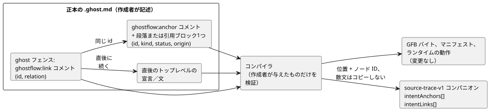
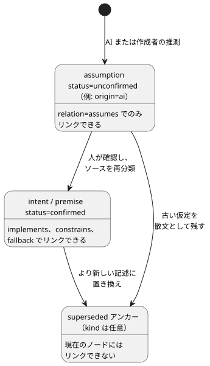

<!-- translation-source: docs/INTENT-ANCHOR-MAP.md -->
[英語の原文](INTENT-ANCHOR-MAP.md)

# 文芸的ソースの意図アンカーマップ

ステータス：LS-1cの主要な実装契約、2026-09-15。追跡：
言語issue #60／統合issue #17／ローカルTASK-112。

この契約は、小さな追加的な**ソース来歴レイヤー**を導入します。これは、GhostFlowのコードが*なぜ*存在するのかを記録するための仕組みです。範囲は意図的に限定されています。

- 実行可能なGhostFlow構文は追加しません。
- GFB1のバイトや厳格な制御マニフェストは変更しません。
- メタデータがランタイムの出力に影響することは決してありません。
- 作成者が記述した`.ghost.md`文書が、引き続き唯一の正本となる製品ソースです。
  生成されたマップが、編集可能な第2のソースになることは決してありません。

この文書の内容：

- [この仕組みが存在する理由](#この仕組みが存在する理由) — このレイヤーが埋めるギャップ。
- [最小限の記述形式](#最小限の記述形式) — アンカーとリンクの書き方。
- [派生メタデータ](#派生メタデータ) — コンパイラが記録する内容と、その検証方法。
- [インポートされた意図の来歴](#インポートされた意図の来歴) — ピン留めされたインポートをまたぐアンカーとリンク。
- [抽出と互換性](#抽出と互換性) — 何がディレクティブとして扱われ、何が変わらないか。
- [診断と受け入れベクトル](#診断と受け入れベクトル) — 警告とエラー。
- [コンパイラによる制約の導出](#コンパイラによる制約の導出31範囲を限定した受け入れ) — 低レベル化された`require`文の来歴。
- [意図的な非目標](#意図的な非目標)。

## この仕組みが存在する理由

GhostFlowはすでに、文芸的文書とコンパイラノードの正確な位置を保持しています。
これは「この出力はどこで計算されるのか」には答えます。しかし「どの記述された意図や前提がこの計算につながったのか」には答えません。

LS-1cは、この2つの間に明示的なリンクを追加します。コンパイラは、作成者が与えたものだけを検証します。意図を推論したり、暗黙知を発見したり、AIの仮定を承認したりはしません。

## 最小限の記述形式

記述するものは2つです。Markdownの散文中の**アンカー**と、実行可能な`ghost`フェンス内の**リンク**です。リンクは`id`によってアンカーを指し、その直後に続く文に付与されます。



この図は、左側に作成者が記述する要素を、右側にコンパイラが生成するものを示しています。新しいデータが加わるのは、ソーストレースのコンパニオンだけです。

**アンカー。** **アンカー**とは、単独のトップレベルのMarkdown HTMLコメントの直後に、トップレベルの段落または引用ブロックが1つ続いたものです。

```markdown
<!-- ghostflow:anchor id=GF-INT-PUMP-001 kind=intent status=confirmed origin=user -->
> 급수 요청 스위치를 켜면 펌프를 켜 주세요.
```

（例の韓国語の文は「給水要求スイッチを入れたらポンプをオンにしてください」という意味です。）

- コメントは表示されないメタデータです。
- その後に続くブロックが**アンカー付きの原文**（アンカー本文）です。
- コメントとブロックの間に空行を入れてもかまいません。CommonMarkでは両者が別々のトップレベルブロックとして扱われるためです。
- 見出し、リスト、入れ子のブロック、コードフェンス、別のアンカー、文書の終わりは、アンカー本文に**なりません**。

アンカー1つにつきブロック1つとすることで、ソース範囲とレビュー単位が曖昧になりません。より長い説明には、複数のアンカーか、アンカーのない通常の散文を使ってください。

v1では、フィールドとその順序は厳密に決まっています。

| フィールド | 許可される値 | 備考 |
|---|---|---|
| `id` | `[A-Za-z][A-Za-z0-9._:-]{0,127}` | 1つの文書内で一意です。同じ意図が続く限り、文言を改訂しても安定した値を保ってください。 |
| `kind` | `intent`、`premise`、`assumption` | |
| `status` | `confirmed`、`unconfirmed`、`superseded` | |
| `origin` | `user`、`operator`、`engineer`、`ai`、`imported` | |

`assumption`は`unconfirmed`または`superseded`にできますが、`confirmed`には**決して**なりません。
人がそれを確認したら、正本ソースではそれを`intent`または`premise`に再分類します。古い仮定は、現在の実行可能リンクを持たない`superseded`の散文として残してもかまいません。`superseded`アンカーは現在のノードにリンクできません。

これらのチェックは、AIの推測が知らないうちに確認済みの意図になることを防ぎます。製品の承認ワークフローを定義するものではありません。



この図は、各リレーションがどのアンカーを参照できるかをまとめたものです。`intent`や`premise`も`unconfirmed`であることがあり、その場合も確認済みのものと同じリレーションを受け付けます。

**リンク。** **リンク**とは、実行可能な`ghost`フェンス内にある、行全体が厳密に一致するコメントです。

```ghost
// ghostflow:link id=GF-INT-PUMP-001 relation=implements
pump <- request;
```

フィールドとその順序は厳密に決まっています。`relation`は次のいずれかです。

| `relation` | 意味 |
|---|---|
| `implements` | このノードは、記述された振る舞いを実装します。 |
| `constrains` | このノードは、意図または前提のために振る舞いを制限します。 |
| `fallback` | このノードは、明示的な縮退時の時間／データポリシーを実装します。 |
| `assumes` | この候補ノードは、現時点で未確認の仮定に依存しています。 |

**リンクの対象。** 連続する1行以上のリンク行が、同じ文を対象にしてもかまいません。対象は、直後に続くトレース可能なトップレベルの宣言または文です。リンクと対象の間に次のいずれかがあると、そのリンクは**孤立**し、エラーになります：空行、通常のコメント、入れ子の式、制御ヘッダー、フェンスの終わり。

v1でサポートされる対象の種類は、パーサーのトップレベルの宣言と文です：`input`、`output`、`state`、`config`、`let`、`enum`、`function`、`sensor`、`signal`、`schedule`、`timer`、`require`、`mutex`、`next`、`connection`。

**リレーション／分類のチェック**は、意図的に狭い範囲に限られています。

- `assumes`は、`status=unconfirmed`の`assumption`を参照しなければなりません。
- その他のリレーションは`assumption`を参照できません。
- どのリレーションも`superseded`アンカーを参照できません。

未確認の候補をシミュレーション、レビュー、承認、デプロイしてよいかどうかは、ホスト／製品のポリシーです。言語の成果物はその事実を保持するだけで、リリースを暗黙に許可したり拒否したりはしません。

## 派生メタデータ

アンカーやリンクを含む文芸的ソースでは、既存の`GhostFlow/source-trace-v1`コンパニオンに2つの任意の配列が加わります。この機能を使わないソースは、既存の形と動作を保ちます。

`intentAnchors[]`には次が含まれます。

- 記述されたとおりの`id`、`kind`、`status`、`origin`
- `directiveSource`：アンカーディレクティブの元のMarkdown上の位置
- `source`：続く段落または引用ブロックの元のMarkdown上の範囲

`intentLinks[]`には次が含まれます。

- 記述されたとおりの`anchorId`と`relation`
- 正式なコンパイラASTに由来する`nodeId`と`nodeKind`
- `directiveSource`：リンクコメントの元のMarkdown上の位置
- `source`：正式な対象ノードの位置
- `extractedDirectiveSource`と`extractedSource`（文芸的コンパイルの場合のみ）。
  これらは既存のトレースと同様に、コードフェンスの座標系を保ちます。

これらの配列は、アンカー付きの散文をコピーしたり正規化したりは決してしません。正確なテキストを得るには、利用側がすでに検証済みの`sourceDocument.text`を、記録された範囲で切り出します。
これにより、誰かが保守しなければならない2つ目のテキストのコピーを作らずに済みます。

**検証。** コンパニオンは引き続き`sourceDocumentSha256`と`bytecodeSha256`を持ちます。
厳格な復元では次を検証します。

- 両方のリビジョン同一性
- すべてのアンカーとリンクの形、およびIDの一意性
- リレーションと分類の互換性
- 対象ノードのID、種類、位置
- ディレクティブとソースの位置が、選択された文書の内部にあること

次のものは拒否されます。

- 未知のフィールドや列挙値
- 重複したアンカー、または同一内容のリンクの重複
- 存在しないアンカーと孤立リンク
- 与えられたソースマップと食い違うメタデータのノード／位置
- 混在したリビジョンと範囲外の位置

欠けたリンクを再構築したり推測したりする検証器はありません。

**整合性は真正性ではありません。** このローカル復元APIが証明するのは**内部整合性であって、真正性ではありません**。ソースマップ全体を置き換えられる攻撃者は、ノードとそれに対応するメタデータの両方を置き換えられます。真正性には次のいずれかが必要です。

- 既存のポータブルパッケージ検証器。その署名付きペイロードはソースマップのダイジェストを含みます。
- 検証済みのソース文書からの、信頼できる決定的なコンパイラリプレイ。

LS-1cは、署名のない単独のマップが組織的な置き換えを検出できると主張してはなりません。

## インポートされた意図の来歴

ピン留めされた合成では、インスタンス化された各定義について、作成者が記述した意図が保持されます。
ルートの`intentAnchors`と`intentLinks`は、ルート文書の範囲にとどまります。
インポートされたインスタンスにアンカーやリンクがある場合、コンパイラは`traceMetadata.compositionIntent`を追加します。このコンテナのフィールドは次のとおりです。

- `format`は`GhostFlow/composition-intent-v1`です。
- `sourceClosureSha256`は`canonicalJson(sourceClosure)`のSHA-256です。
- `instances`は、決定的な走査順のグループを含みます。各グループは、`east`や`outer.inside`のような記述された`instance`パスと、ピン留めされた`filename`、`revision`、文書の厳密な`sha256`を持つ`definition`を持ちます。
- 各グループの`anchors`は、元のアンカーのフィールドを保持します。`links`は元のリンクのフィールドに加えて、合成後の`nodeId`と元の`definitionNodeId`を保持します。

**アンカーIDはその文書内でローカルです。** ルート、2つの定義、繰り返されるインスタンスのすべてが同じIDを使ってもかまいません。名前空間はグループが提供します。
コンパイラはIDを書き換えず、生成された変数名からインスタンスの同一性を推論することもありません。インポートされたAIの仮定は`origin=ai`、`kind=assumption`、`status=unconfirmed`のままです。インポートしても、それが確認されることも、その由来が変わることもありません。

**検証とバインディング。**

- コンパイラは、合成後のノードにバインドする前に、各定義の元のASTに対してリンクを検証します。
- 元のMarkdown上の位置と、抽出されたコード上の位置は別々に保たれます。
- `input`と`output`宣言に付いたリンクは、合成によって実行可能な宣言が取り除かれても残ります。
- 使われないインポート文書は、検証済みのクロージャには残りますが、インスタンスグループには寄与しません。
- ルートのリビジョン同一性が必要な場合は、呼び出し側がそれを与えます。合成がそれを作り出すことは決してありません。

**復元とパッケージの検証。** 成果物の復元と、署名付きポータブルパッケージの検証では、厳密なクロージャを再コンパイルし、すべての来歴を比較します。欠落または変更されたグループ、定義の同一性、クロージャのダイジェスト、ノードID、位置、分類、リレーションは拒否されます。単独のトレース検証器は、合成コンテナを拒否します。定義の散文だけを編集すると来歴とピンは変わりますが、実行可能なトークンが変わらなければバイトコードは同じままです。

**制限。** ルートの`intentEvidence`が参照できるのは、ルートのアンカーとルートのリンク付きノードだけです。同じアンカーIDを使って、インポートされたノードを主張することはできません。現在のInteractionスキーマはインポートされた意図グループを表現できず、それを含む投影要求を明示的に拒否します。通常のコンパイルと実行では、これらのグループは引き続き受け付けられます。公開プロファイルやホストの説明との結合は、[#290](https://github.com/callin2/ghostflow-language/issues/290)と[#302](https://github.com/callin2/ghostflow-language/issues/302)で別途扱われる作業です。

## 抽出と互換性

- **トップレベルのMarkdownブロックが何であるかはCommonMarkが決めます。** フェンス付きコード、インラインコード、複数行または囲み型のHTMLブロック、入れ子のブロック、フロントマターの中にあるディレクティブ風のテキストは、Markdownアンカーではありません。
- **実行されるのはトップレベルの`ghost`フェンスだけです。** これは以前と同じです。GhostFlowの字句解析器にとって、リンクコメントは通常の`//`コメントのままであり、オペコードを生成しません。
- **素の`.ghost`は過去の証拠としてのみ扱われ、** 製品コンパイラはこれを拒否します。アンカーの名前空間も、実行可能なフォールバックも提供できません。
- **ディレクティブがなければ変化はありません。** アンカー／リンクのディレクティブを持たない文書は、以前と同じコード、GFBバイト、ノードID、診断、マニフェスト、ランタイムの動作を生成します。
- **散文とコメントの編集。** 散文／コメントだけの変更は`sourceDocument.sha256`を変えます。実行可能なトークン構造が変わらなければ、GFBバイトとコンパイラのノードIDは同じままです。元の文書上の位置は移動することがあり、位置はリビジョンに結び付けられています。

## 診断と受け入れベクトル

<a id="default-behavior-coverage-warnings"></a>
### 既定で出る振る舞いカバレッジ警告（#553）

コンパイラ、CLI、パッケージ作成は、既定で意図リンクの**カバレッジ警告**を報告します。警告コードは2つあります。

**`GF_INTENT_LINK_MISSING`**は、リンクのないトップレベルの`connection`、`next`、`require`、`mutex`、`let`、`function`、`signal`、`schedule`、`timer`文それぞれに適用されます。

- リンクがカバーするのは、その対象の文だけです。宣言にリンクしても、後続の振る舞いはカバーされません。
- 単独の`input`、`output`、`state`、`config`、`parameter`、`enum`宣言は数えられません。
- カバレッジは構造的で、文単位です。この警告は推移的な振る舞いを推論せず、表明を証明せず、意図が正しいか確認済みかも判断しません。
- 明示的で有効なリンクは、未確認の仮定を記述している場合でもこのチェックを満たします。その状態は未確認のままです。

**`GF_INTENT_LINK_COVERAGE_UNSUPPORTED`**は、現在の契約にリンク対象が存在しない振る舞いの所有者を報告します：トップレベルの`adapt`、`objective`、`account`、`account-constraints`、`local-constraints`、`shared-constraints`、`adapt-setting`、`degraded`、および入れ子の`connection`、`connect`、`next`、`require`、`mutex`文です。

- これらの警告は、他の文にリンクがある場合でも出力されます。
- そのヒントは、孤立リンクを挿入しないように伝えます。コピー可能な例は単独の構文を示すものであって、すぐに使える修正ではないことを説明します。これらの対象をサポートするには、別途契約の変更が必要です。
- 実行されない単独のリソースポリシーディスクリプタは対象外です。

**警告の内容と制限。**

- 各警告は、元のソース範囲、コピー可能なアンカー／リンクの例、実行可能なヒントを持ちます。例では、そのポリシーを未確認のAIの仮定として示し、明示的な故障ポリシーの例として`recover(false)`を含めています。
- 返される警告レコードは最大20件です。20件を超えて見つかった場合、コレクションには`limit: 20`と`truncated: true`が付きます。ちょうど20件の場合は、切り捨てを意味しません。
- インポートされた定義については、その定義がインスタンス化されたときに、ソースの文ごとに1回だけカバレッジが報告されます。使われないインポートはこれらの警告を生成しません。
- インポートされたリンクがカバーするのは、自身の定義の文だけです。ヒントは作成者を元の文書へ案内します。ルートのリンクでインポートされた文をカバーすることはできません。

**範囲。** これらの警告がカバーするのは、サポートされるリンク可能なトップレベルの振る舞いと、リンクがサポートされていない既知の振る舞いの所有者です。意味的な完全性は主張しません。既存の不正形式、孤立、アンカー欠落、インタラクションスキーマの診断は、既存の動作を保ちます。これらの警告は、実行可能な構文、GFBバイト、ランタイムの動作を何も追加しません。

**受け入れベクトル。** 診断は、元のファイル名、行、列を示します。受け入れベクトルは次をカバーします。

1. 有効なリンク：確認済みの意図から出力へ、前提から制約へ、フォールバックからスケジュールへ、未確認の仮定から候補ノードへ
2. 不正形式／未知のフィールド、重複ID、欠落または無効な本文ブロック
3. 未知、superseded、または分類と互換性のないアンカー参照
4. 孤立したディレクティブ、入れ子の対象、同一内容のリンクの重複
5. 永続化されたソース／バイトコードのリビジョン不一致、メタデータとノードの不整合、ソース範囲の改ざん、署名付きパッケージのソースマップ置き換え
6. GFBバイトとノードIDが同一のままの、散文／コメントだけのリビジョン変更
7. 既存の文芸的ソース、素のソース、ソースマップ、パッケージ、ネイティブ、WASMの動作が変わらないこと

受け入れは、コンパイラ／ソースマップの証拠にすぎません。フロントエンドのナビゲーション、ファームウェアとの統合、GPIO出力、リレーの動作、物理的な負荷の証拠ではありません。

## コンパイラによる制約の導出（#31、範囲を限定した受け入れ）

コンパイラは、作成者が記述したすべての`require`について、任意の`traceMetadata.derivations`を追加します。これらのレコードは、その制約が現在どのように低レベル化（コンパイル済みの制約に変換）されるかを記述します。ソース、マニフェスト、バイトコード、ランタイムの動作は変えません。作成者が記述した`mutex`には導出レコードがありません。

各レコードには次が含まれます。

| フィールド | 値 |
|---|---|
| `id` | `require:<nodeId>`。このリビジョンで作成者が記述したrequireを識別します。 |
| `nodeId`、ソート済みの`originNodeIds` | requireと、元のすべての式ノード。低レベル化によって取り除かれたり平坦化されたりした演算子や出力参照も含みます。これらのIDは、変更されないソースマップと意図リンクに結合されます。ソーステキストとアンカーの分類が引き続き正式であり、仮定は未確認のままです。 |
| `target` | コンパイル済み制約の`index`、`kind`、順序付きの`names`。 |
| `rule` | `require-implication-to-requires-v1`、`require-disjunction-to-requires-any-v1`、または`require-negated-conjunction-to-mutex-v1`。 |
| `scope`、`relation`、`status`、`semanticVerification` | `scope`：`same-module-bool-output-constraint`、`relation`：`lowered-as`、`status`：`compiler-derived`、`semanticVerification`：`not-proven`。 |

**バインディングとリプレイ。** 既存の文書SHA-256とバイトコードSHA-256が、これらのレコードを厳密なソースとコンパイル済みのリビジョンに結び付けます。ソースマップの復元とポータブルパッケージの検証では、正準的なコンパイラリプレイによって完全なレコードを再導出し、比較します。欠落、余分、または変更されたレコードや、サポートされていない証明／状態の主張は拒否されます。リプレイが確立するのはコンパイラの整合性だけです。意味的な等価性、ランタイムでの評価、推論による充足、出力のブロック、物理的な証拠を確立することは決してありません。

**`not-proven`が重要な理由。** `require !(a && b && c)`は現在`mutex(a,b,c)`に低レベル化されます。通常のブール論理の「すべてではない」と「多くとも1つ」は、ちょうど2つの出力が真のときに異なります。したがってこのレコードは、リプレイが成功した後も`not-proven`のままでなければなりません。2出力のケースと平坦化された選言は、来歴の保持を検証するものです。この変更は、3出力の場合の言語の動作を決めたり変えたりはしません。

**未解決の事項。** #31の既存のアンカーに関する受け入れと、現在の低レベル化の来歴はカバーされています。追加の、除去されたチェック／置き換え保証、およびマージされたノードの証明に関する受け入れは、#42で引き続き未解決です。将来の対応で検証済みの置き換え関係を主張するには、独立に検証された意味的な証拠を提供しなければなりません。このメタデータは、CSEエンジン、SMTソルバー、証明フレームワークではありません。

## 意図的な非目標

- 自然言語の解釈、暗黙の前提の発見、確認UI、認可、デプロイの承認。
- 式単位の実行経路の因果関係、またはすべての静的な読み取りが出力を引き起こしたという主張。
- SMT/BDDによる最適化や証明の生成。issue #42では将来、コンパイラが生成した由来／証明レコードを同じ安定したアンカーとノードの同一性に付与するかもしれません。しかし、作成者が記述した意図を書き換えたり、検証されていない関係を証明済みとしたりしてはなりません。
- 汎用の注釈言語、任意のキー／値の拡張、または新しいソース形式。
