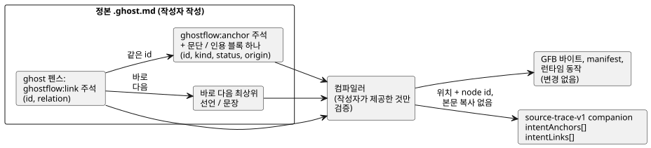
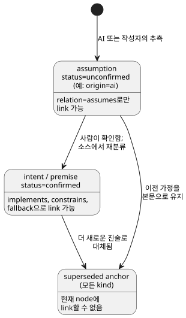

<!-- translation-source: docs/INTENT-ANCHOR-MAP.md -->
[영문 원문](INTENT-ANCHOR-MAP.md)

# Literate 의도 앵커 맵

상태: LS-1c의 주요 구현 계약, 2026-09-15. 추적:
language 이슈 #60 / integration 이슈 #17 / local TASK-112.

이 계약은 작고 추가적인 **소스 provenance(출처) 계층**을 더합니다. 즉 GhostFlow 코드가
*왜* 존재하는지를 기록하는 방법입니다. 이 계층은 의도적으로 범위가 제한됩니다.

- 실행 가능한 GhostFlow 구문을 추가하지 않습니다.
- GFB1 바이트나 strict control manifest를 바꾸지 않습니다.
- 메타데이터는 런타임 출력에 절대 영향을 주지 않습니다.
- 작성된 `.ghost.md` 문서가 유일한 정본 제품 소스로 남습니다.
  생성된 맵은 결코 편집 가능한 두 번째 소스가 아닙니다.

이 문서의 내용:

- [존재 이유](#존재-이유) — 이 계층이 메우는 공백.
- [최소 작성 형식](#최소-작성-형식) — anchor와 link를 작성하는 방법.
- [파생 메타데이터](#파생-메타데이터) — 컴파일러가 기록하는 내용과 검증 방식.
- [가져온 의도의 provenance](#가져온-의도의-provenance) — 고정된 import에 걸친 anchor와 link.
- [추출과 호환성](#추출과-호환성) — 무엇이 directive로 인정되는지, 무엇이 그대로 유지되는지.
- [진단과 acceptance vector](#진단과-acceptance-vector) — 경고와 오류.
- [컴파일러 제약 도출](#컴파일러-제약-도출-31-한정된-acceptance) — lowering된 `require` 문의 provenance.
- [의도적인 비목표](#의도적인-비목표).

## 존재 이유

GhostFlow는 이미 literate 문서와 컴파일러 node의 정확한 위치를 보존합니다.
이 정보는 “이 출력은 어디서 계산되는가?”에 답합니다. 그러나 “어떤 명시된
의도나 전제가 이 계산으로 이어졌는가?”에는 답하지 못합니다.

LS-1c는 둘 사이에 명시적인 연결을 추가합니다. 컴파일러는 작성자가 제공한 것만
검증합니다. 의도를 추론하거나, 암묵지(tacit knowledge)를 발견하거나, AI 가정을
승인하지 않습니다.

## 최소 작성 형식

작성할 것은 두 가지입니다. Markdown 본문의 **anchor**와, 실행 가능한 `ghost` fence
안의 **link**입니다. link는 `id`로 anchor를 가리키고, 바로 뒤에 오는 문장에 붙습니다.



그림의 왼쪽은 작성하는 요소, 오른쪽은 컴파일러가 만드는 결과입니다. 새 데이터가
추가되는 곳은 source-trace companion뿐입니다.

**Anchor.** **anchor**는 독립된 최상위 Markdown HTML 주석이며, 바로 뒤에 최상위
문단 또는 인용 블록(block quote) 하나가 옵니다.

```markdown
<!-- ghostflow:anchor id=GF-INT-PUMP-001 kind=intent status=confirmed origin=user -->
> 급수 요청 스위치를 켜면 펌프를 켜 주세요.
```

- 주석은 렌더링되지 않는 메타데이터입니다.
- 주석 뒤의 블록이 **anchor가 붙은 원문**(anchor body)입니다.
- CommonMark는 주석과 블록을 각각 별개의 최상위 블록으로 다루므로, 둘 사이의
  빈 줄은 허용됩니다.
- 제목, 목록, 중첩 블록, 코드 펜스, 다른 anchor, 문서 끝은 anchor body가
  **아닙니다**.

anchor마다 블록 하나만 두어야 소스 범위와 검토 단위가 모호하지 않습니다. 설명이 길면
anchor를 여러 개 쓰거나 anchor 없는 일반 본문을 사용합니다.

v1에서 필드와 그 순서는 정확히 다음과 같습니다.

| 필드 | 허용 값 | 비고 |
|---|---|---|
| `id` | `[A-Za-z][A-Za-z0-9._:-]{0,127}` | 한 문서 안에서 고유합니다. 같은 의도가 유지되는 한 문구 revision(판본)이 바뀌어도 안정적으로 유지합니다. |
| `kind` | `intent`, `premise`, `assumption` | |
| `status` | `confirmed`, `unconfirmed`, `superseded` | |
| `origin` | `user`, `operator`, `engineer`, `ai`, `imported` | |

`assumption`은 `unconfirmed` 또는 `superseded`일 수 있지만 **절대** `confirmed`일 수
없습니다. 사람이 확인하면 정본 소스에서 이를 `intent` 또는 `premise`로 재분류합니다.
이전 assumption은 현재 실행 link 없이 `superseded` 본문으로 남을 수 있습니다.
`superseded` anchor는 현재 node에 link할 수 없습니다.

이 검사는 AI의 추측이 조용히 확인된 의도가 되는 것을 막습니다. 제품 승인
workflow를 정의하지는 않습니다.



그림은 각 relation이 어떤 anchor를 참조할 수 있는지 요약합니다. `intent`나
`premise`도 `unconfirmed`일 수 있으며, 이때도 확인된 것과 같은 relation을 받습니다.

**Link.** **link**는 실행 가능한 `ghost` fence 안에서 한 줄 전체를 차지하는 정확한 주석입니다.

```ghost
// ghostflow:link id=GF-INT-PUMP-001 relation=implements
pump <- request;
```

필드와 그 순서는 정확해야 합니다. `relation`은 다음 중 하나입니다.

| `relation` | 의미 |
|---|---|
| `implements` | 이 node가 명시된 동작을 구현합니다. |
| `constrains` | 이 node가 의도나 전제를 위해 동작을 제한합니다. |
| `fallback` | 이 node가 명시적인 degraded 시간/데이터 정책을 구현합니다. |
| `assumes` | 이 후보 node가 현재 미확인 assumption에 의존합니다. |

**Link 대상.** 연속된 link 줄 하나 이상이 같은 문장을 대상으로 할 수 있습니다.
대상은 바로 다음에 오는 추적 가능한 최상위 선언 또는 문장입니다. link와 대상 사이에
다음 중 하나가 있으면 그 link는 **orphan**(고아)이 되며 오류입니다: 빈 줄, 일반 주석,
중첩 식, control 헤더, fence 끝.

v1에서 지원하는 대상 종류는 parser의 최상위 선언과 문장입니다: `input`, `output`,
`state`, `config`, `let`, `enum`, `function`, `sensor`, `signal`, `schedule`, `timer`,
`require`, `mutex`, `next`, `connection`.

**Relation/분류 검사**는 의도적으로 좁습니다.

- `assumes`는 `status=unconfirmed`인 `assumption`을 참조해야 합니다.
- 다른 relation은 `assumption`을 참조할 수 없습니다.
- 어떤 relation도 `superseded` anchor를 참조할 수 없습니다.

미확인 후보를 시뮬레이션, 검토, 승인, 배포할 수 있는지는 host/제품 정책입니다.
언어 산출물은 그 사실을 보존할 뿐, release를 조용히 허용하거나 거부하지 않습니다.

## 파생 메타데이터

anchor나 link를 포함한 literate 소스에서는 기존 `GhostFlow/source-trace-v1`
companion에 선택적 배열 두 개가 추가됩니다. 이 기능을 쓰지 않는 소스는 기존 형태와
동작을 유지합니다.

`intentAnchors[]`에는 다음이 들어갑니다.

- 작성된 그대로의 `id`, `kind`, `status`, `origin`.
- `directiveSource`: anchor directive의 원본 Markdown 위치.
- `source`: 뒤따르는 문단 또는 인용 블록의 원본 Markdown 범위.

`intentLinks[]`에는 다음이 들어갑니다.

- 작성된 그대로의 `anchorId`, `relation`.
- 권위 있는 컴파일러 AST의 `nodeId`, `nodeKind`.
- `directiveSource`: link 주석의 원본 Markdown 위치.
- `source`: 권위 있는 대상 node 위치.
- `extractedDirectiveSource`, `extractedSource`: literate 컴파일에만 있습니다.
  기존 trace와 마찬가지로 코드 펜스 좌표계를 유지합니다.

배열은 anchor가 붙은 본문을 복사하거나 정규화하지 않습니다. 정확한 텍스트가 필요하면
소비자는 이미 검증된 `sourceDocument.text`를 기록된 범위로 잘라냅니다. 이렇게 하면
누군가 별도로 관리해야 하는 두 번째 텍스트 복사본이 생기지 않습니다.

**검증.** companion은 계속 `sourceDocumentSha256`과 `bytecodeSha256`을 담습니다.
strict recovery는 다음을 검증합니다.

- 두 revision identity.
- 모든 anchor와 link의 형태, 그리고 ID의 고유성.
- relation/분류 호환성.
- 대상 node의 ID, 종류, 위치.
- directive 위치와 source 위치가 선택된 문서 안에 있는지.

다음은 거부합니다.

- 알 수 없는 필드나 enum 값.
- 중복 anchor, 또는 동일한 link의 중복.
- 누락된 anchor와 orphan link.
- 제공된 source map과 일치하지 않는 메타데이터 node/위치.
- 서로 섞인 revision과 범위를 벗어난 위치.

어떤 verifier도 누락된 link를 재구성하거나 추측하지 않습니다.

**일관성은 진위가 아닙니다.** 이 로컬 recovery API는 **내부 일관성을 증명할 뿐, 진위(authenticity)를 증명하지 않습니다**.
source map 전체를 교체할 수 있는 공격자는 node와 그에 맞는 메타데이터를 함께 바꿀 수 있습니다.
진위를 확인하려면 다음 중 하나가 필요합니다.

- 서명된 payload가 source-map digest를 포함하는 기존 portable package verifier.
- 검증된 소스 문서로부터 수행하는 신뢰할 수 있는 결정적 컴파일러 replay.

LS-1c는 서명되지 않은 독립 맵이 공모된 교체를 탐지한다고 주장해서는 안 됩니다.

## 가져온 의도의 provenance

고정된(pinned) composition은 인스턴스화된 각 definition의 작성 의도를 보존합니다.
root의 `intentAnchors`와 `intentLinks`는 root 문서 범위에 머뭅니다. import된
인스턴스에 anchor나 link가 있으면 컴파일러는 `traceMetadata.compositionIntent`를
추가합니다. 이 컨테이너의 필드는 다음과 같습니다.

- `format`은 `GhostFlow/composition-intent-v1`입니다.
- `sourceClosureSha256`은 `canonicalJson(sourceClosure)`의 SHA-256입니다.
- `instances`는 결정적인 순회 순서의 그룹을 담습니다. 각 그룹에는 `east`나
  `outer.inside`처럼 작성된 `instance` 경로와, 고정된 `filename`, `revision`,
  정확한 문서 `sha256`을 담은 `definition`이 있습니다.
- 각 그룹의 `anchors`는 원본 anchor 필드를 보존합니다. `links`는 원본 link 필드를
  보존하고, 조합된 `nodeId`와 원본 `definitionNodeId`를 더합니다.

**Anchor ID는 자기 문서에 국한됩니다.** root, 서로 다른 두 definition, 반복된
인스턴스가 모두 같은 ID를 써도 됩니다. namespace는 그룹이 제공합니다. 컴파일러는
ID를 다시 쓰지 않고, 생성된 변수 이름에서 인스턴스 identity를 추론하지도 않습니다.
import된 AI assumption은 `origin=ai`, `kind=assumption`, `status=unconfirmed`를
유지합니다. import한다고 해서 그것이 확인되거나 origin이 바뀌지 않습니다.

**검증과 결속.**

- 컴파일러는 link를 조합된 node에 결속하기 전에 각 definition의 원본 AST로 검증합니다.
- 원본 Markdown 위치와 추출된 코드 위치는 구분해서 유지합니다.
- composition이 실행 선언을 제거하더라도 `input`과 `output` 선언의 link는 남습니다.
- 사용하지 않는 import 문서는 검증된 closure에 남지만 인스턴스 그룹을 만들지 않습니다.
- root revision identity가 필요한 곳에서는 호출자가 이를 제공합니다. composition이
  만들어내지 않습니다.

**복원과 package 검증.** 산출물 복원과 서명된 portable-package 검증은 정확한 closure를
다시 컴파일해 모든 provenance를 비교합니다. 누락되거나 변경된 그룹, definition
identity, closure digest, node ID, 위치, 분류, relation을 거부합니다. 독립 trace
validator는 composition 컨테이너를 거부합니다. definition의 본문만 편집해도
provenance와 pin은 바뀌지만, 실행 token이 바뀌지 않았다면 bytecode는 같습니다.

**한계.** root의 `intentEvidence`는 root anchor와 root에서 link된 node만 참조할 수
있습니다. 같은 anchor ID를 이용해 import된 node를 주장할 수 없습니다. 현재 Interaction
schema는 import된 의도 그룹을 표현할 수 없으며, 이를 포함한 projection 요청을
명시적으로 거부합니다. 일반 컴파일과 실행은 여전히 이 그룹을 허용합니다. 공개 profile과
host 설명 연결은
[#290](https://github.com/callin2/ghostflow-language/issues/290)과
[#302](https://github.com/callin2/ghostflow-language/issues/302)의 별도 작업입니다.

## 추출과 호환성

- **최상위 Markdown 블록이 무엇인지는 CommonMark가 결정합니다.** fenced code, inline
  code, 여러 줄이거나 감싸는 HTML 블록, 중첩 블록, front matter 안의 directive처럼
  보이는 텍스트는 Markdown anchor가 아닙니다.
- **최상위 `ghost` fence만 실행됩니다.** 이전과 정확히 같습니다. GhostFlow lexer에게
  link 주석은 일반 `//` 주석일 뿐이며 opcode를 만들지 않습니다.
- **Plain `.ghost`는 역사적 증거일 뿐이며** 제품 컴파일러는 이를 거부합니다. anchor
  namespace나 실행 fallback을 제공할 수 없습니다.
- **Directive가 없으면 변화도 없습니다.** anchor/link directive가 없는 문서는 이전과
  같은 코드, GFB 바이트, node ID, 진단, manifest, 런타임 동작을 만듭니다.
- **본문과 주석 편집.** 본문/주석만 바꿔도 `sourceDocument.sha256`은 바뀝니다. 실행
  token 구조가 같으면 GFB 바이트와 컴파일러 node ID는 그대로입니다. 원본 문서 위치는
  이동할 수 있으며, 위치는 revision에 결속됩니다.

## 진단과 acceptance vector

<a id="default-behavior-coverage-warnings"></a>
### 기본 동작 커버리지 경고 (#553)

컴파일러, CLI, package 생성은 기본적으로 intent-link **커버리지 경고**를 보고합니다.
경고 코드는 두 가지입니다.

**`GF_INTENT_LINK_MISSING`**은 link가 없는 최상위 `connection`, `next`, `require`, `mutex`, `let`,
`function`, `signal`, `schedule`, `timer` 문마다 적용됩니다.

- link는 자기 대상 문장만 커버합니다. 선언에 link를 달아도 뒤따르는 동작까지
  커버하지 않습니다.
- 단독 `input`, `output`, `state`, `config`, `parameter`, `enum` 선언은 집계하지
  않습니다.
- 커버리지는 구조적이며 문장 단위입니다. 이 경고는 전이적 동작을 추론하거나,
  assertion을 증명하거나, 의도가 옳은지 또는 확인되었는지를 판정하지 않습니다.
- 명시된 활성 link는 미확인 assumption을 설명하더라도 이 검사를 충족합니다. 그
  상태는 계속 미확인으로 남습니다.

**`GF_INTENT_LINK_COVERAGE_UNSUPPORTED`**는 현재 계약에 link 대상이 없는 동작 소유자를
보고합니다: 최상위 `adapt`, `objective`, `account`, `account-constraints`,
`local-constraints`, `shared-constraints`, `adapt-setting`, `degraded`와, 중첩된
`connection`, `connect`, `next`, `require`, `mutex` 문입니다.

- 이 경고는 다른 문장에 link가 있어도 발생합니다.
- 안내문(hint)은 orphan link를 넣지 말라고 알려 줍니다. 복사 가능한 예시는 독립 구문을
  보여 줄 뿐 즉시 적용할 수정이 아니라고 설명합니다. 이 대상을 지원하려면 별도의
  계약 변경이 필요합니다.
- 실행되지 않는 독립 resource-policy descriptor는 제외됩니다.

**경고 내용과 한도.**

- 각 경고에는 원본 소스 범위, 복사 가능한 anchor/link 예시, 실행 가능한 안내문이
  들어갑니다. 예시는 그 정책을 미확인 AI assumption으로 표시하고, 명시적인 예시
  fault 정책으로 `recover(false)`를 포함합니다.
- 경고 레코드는 최대 20개까지 반환합니다. 20개를 초과하면 컬렉션에 `limit: 20`과
  `truncated: true`를 표시합니다. 정확히 20개라면 잘림을 뜻하지 않습니다.
- import된 definition의 커버리지는 그 definition이 인스턴스화될 때 소스 문장마다
  한 번씩 보고됩니다. 사용하지 않는 import는 이 경고를 만들지 않습니다.
- import된 link는 자기 definition의 문장만 커버합니다. 안내문은 작성자를 그 원본
  문서로 안내합니다. root link로 import된 문장을 커버할 수 없습니다.

**범위.** 이 경고는 지원되는 link 가능 최상위 동작과, link 지원이 없는 알려진 동작
소유자를 다룹니다. 의미상의 완전성을 주장하지는 않습니다. 기존 malformed, orphan,
missing-anchor, interaction-schema 진단은 기존 동작을 유지합니다. 이 경고는 실행 구문,
GFB 바이트, 런타임 동작을 추가하지 않습니다.

**Acceptance vector.** 진단은 원본 파일 이름, 줄, 열을 식별합니다. acceptance
vector는 다음을 다룹니다.

1. 유효한 link: 확인된 intent → output, premise → 제약, fallback → schedule,
   미확인 assumption → 후보 node.
2. 잘못되었거나 알 수 없는 필드, 중복 ID, 누락되었거나 유효하지 않은 body 블록.
3. 알 수 없거나, superseded이거나, 분류가 호환되지 않는 anchor 참조.
4. orphan directive, 중첩 대상, 동일한 link의 중복.
5. 저장된 source/bytecode revision 불일치, 메타데이터/node 불일치, 소스 범위 변조,
   서명된 package의 source-map 교체.
6. GFB 바이트와 node ID가 동일한, 본문/주석만의 revision 변경.
7. 기존 literate, plain-source, source-map, package, native, WASM 동작의 불변.

Acceptance는 컴파일러/source-map 증거일 뿐입니다. frontend 탐색, 펌웨어 통합, GPIO 출력,
릴레이 동작, 물리 부하에 대한 증거가 아닙니다.

## 컴파일러 제약 도출 (#31, 한정된 acceptance)

컴파일러는 작성된 모든 `require`에 대해 선택적 `traceMetadata.derivations`를
추가합니다. 이 레코드는 제약이 현재 어떻게 lowering되는지(컴파일된 제약으로
변환되는지) 설명합니다. 소스, manifest, bytecode, 런타임 동작은 바꾸지 않습니다.
작성된 `mutex`에는 도출 레코드가 없습니다.

각 레코드에는 다음이 들어갑니다.

| 필드 | 값 |
|---|---|
| `id` | `require:<nodeId>`. 이 revision에서 작성된 require를 식별합니다. |
| `nodeId`, 정렬된 `originNodeIds` | require와 모든 원본 식 node. lowering 과정에서 제거되거나 평탄화된 연산자와 출력 참조도 포함합니다. 이 ID로 변경되지 않은 source map과 intent link에 join합니다. 소스 텍스트와 anchor 분류가 권위를 유지하며, assumption은 미확인으로 남습니다. |
| `target` | 컴파일된 제약의 `index`, `kind`, 순서 있는 `names`. |
| `rule` | `require-implication-to-requires-v1`, `require-disjunction-to-requires-any-v1`, `require-negated-conjunction-to-mutex-v1`. |
| `scope`, `relation`, `status`, `semanticVerification` | `scope`: `same-module-bool-output-constraint`; `relation`: `lowered-as`; `status`: `compiler-derived`; `semanticVerification`: `not-proven`. |

**결속과 replay.** 기존 문서 SHA-256과 bytecode SHA-256이 이 레코드를 정확한 소스
revision과 컴파일된 revision에 결속합니다. source-map recovery와 portable-package
검증은 정본 컴파일러 replay로 전체 레코드를 다시 도출해 비교합니다. 누락되거나,
추가되거나, 변경된 레코드와 지원되지 않는 proof/status 주장은 거부됩니다. replay는
컴파일러 일관성만 확립합니다. 의미상 동등성, 런타임 평가, 추론된 충족, 출력 차단,
물리적 증거는 결코 확립하지 않습니다.

**`not-proven`이 중요한 이유.** `require !(a && b && c)`는 현재 `mutex(a,b,c)`로
lowering됩니다. 일반 Boolean의 “모두는 아님(not all)”과 “최대 하나(at most one)”는
정확히 두 출력이 true일 때 서로 다릅니다. 따라서 replay가 성공한 뒤에도 이 레코드는
`not-proven`으로 남아야 합니다. 두 출력 사례와 평탄화된 disjunction은 provenance
보존을 검사합니다. 이 변경은 세 출력에 대한 언어 동작을 결정하거나 바꾸지 않습니다.

**남은 과제.** #31의 기존 anchor acceptance와 현재 lowering provenance는 다뤄졌습니다.
추가적인 eliminated-check/replacement-guarantee 및 merged-node proof acceptance는
#42에서 열린 과제로 남아 있습니다. 향후 작업은 검증된 대체 관계를 주장하기 전에
독립적으로 검증된 의미 증거를 제공해야 합니다. 이 메타데이터는 CSE 엔진, SMT solver,
증명 프레임워크가 아닙니다.

## 의도적인 비목표

- 자연어 해석, 암묵적 전제 발견, 확인 UI, 권한 부여, 배포 승인.
- 식 단위 실행 경로 인과관계, 또는 모든 정적 읽기가 출력의 원인이었다는 주장.
- SMT/BDD 최적화나 증명 생성. 이슈 #42는 나중에 같은 안정적인 anchor와 node
  identity에 컴파일러가 만든 origin/proof 레코드를 붙일 수 있지만, 작성된 의도를 다시
  쓰거나 검증되지 않은 relation을 증명된 것으로 표시해서는 안 됩니다.
- 범용 annotation 언어, 임의의 key/value 확장, 새로운 소스 형식.
