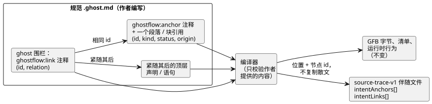
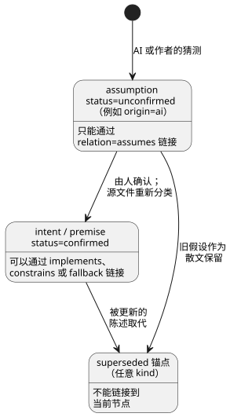

<!-- translation-source: docs/INTENT-ANCHOR-MAP.md -->
[英文原文](INTENT-ANCHOR-MAP.md)

# 文学式意图锚点映射

状态：LS-1c 的主要实现契约，2026-09-15。跟踪：
语言 issue #60 / 集成 issue #17 / 本地 TASK-112。

本契约新增一个小型、纯增量的**源来源层**（source-provenance layer）：一种记录
一段 GhostFlow 代码*为什么*存在的方式。它的范围是刻意受限的：

- 它不新增任何可执行的 GhostFlow 构造。
- 它不改变 GFB1 字节，也不改变严格的控制清单（manifest）。
- 元数据绝不影响运行时输出。
- 作者编写的 `.ghost.md` 文档仍然是唯一的规范产品源。
  生成的映射绝不是可编辑的第二个源。

本文内容：

- [为什么需要它](#为什么需要它)——这一层填补的空白。
- [最小编写形式](#最小编写形式)——如何编写锚点和链接。
- [派生元数据](#派生元数据)——编译器记录什么，以及如何校验。
- [导入的意图来源](#导入的意图来源)——跨固定版本导入的锚点和链接。
- [提取与兼容性](#提取与兼容性)——什么算作指令；什么保持不变。
- [诊断与验收向量](#诊断与验收向量)——警告和错误。
- [编译器约束派生](#编译器约束派生31有界验收)——降级后的 `require` 语句的来源。
- [刻意排除的目标](#刻意排除的目标)。

## 为什么需要它

GhostFlow 已经保留了精确的文学式文档位置和编译器节点位置。
这回答了“这个输出是在哪里计算的？”，但没有回答“是哪一条陈述的
意图或前提导致了这个计算？”

LS-1c 在两者之间加入一条显式链接。编译器只校验作者提供的内容。
它不推断意图，不发掘隐性知识，也不批准 AI 的假设。

## 最小编写形式

你需要写两样东西：Markdown 散文中的一个**锚点**（anchor），以及可执行 `ghost`
围栏内的一个**链接**（link）。链接通过 `id` 指向锚点，并附着到紧随其后的语句上。



图中左侧是作者编写的部分，右侧是编译器产出的内容。只有 source-trace 伴随文件
获得新数据。

**锚点。** **锚点**是一个独立的顶层 Markdown HTML 注释，其后紧跟一个顶层段落
或块引用：

```markdown
<!-- ghostflow:anchor id=GF-INT-PUMP-001 kind=intent status=confirmed origin=user -->
> 급수 요청 스위치를 켜면 펌프를 켜 주세요.
```

- 该注释是不渲染的元数据。
- 注释之后的块是**被锚定的原文**（锚点正文）。
- 注释与块之间允许有一个空行，因为 CommonMark 把二者视为两个独立的顶层块。
- 标题、列表、嵌套块、代码围栏、另一个锚点或文档结尾**都不是**锚点正文。

每个锚点只对应一个块，可以让源范围和审查单元保持无歧义。若需更长的说明，
请使用多个锚点或普通的无锚点散文。

在 v1 中，字段及其顺序是精确固定的：

| 字段 | 允许的值 | 说明 |
|---|---|---|
| `id` | `[A-Za-z][A-Za-z0-9._:-]{0,127}` | 在一个文档内唯一。只要表达的仍是同一意图，即使措辞修改也应保持稳定。 |
| `kind` | `intent`、`premise`、`assumption` | |
| `status` | `confirmed`、`unconfirmed`、`superseded` | |
| `origin` | `user`、`operator`、`engineer`、`ai`、`imported` | |

`assumption` 可以是 `unconfirmed` 或 `superseded`，但**绝不**可以是 `confirmed`。
一旦有人确认了它，规范源就会把它重新分类为 `intent` 或 `premise`。旧的假设可以
作为 `superseded` 散文保留，但不带当前的可执行链接。`superseded` 锚点不能链接到
当前节点。

这些检查可以防止 AI 的猜测悄无声息地变成已确认的意图。它们并不定义产品审批流程。



该图总结了每种 relation 可以引用哪些锚点。`intent` 或 `premise` 也可以是
`unconfirmed`；此时它接受的 relation 与已确认的锚点相同。

**链接。** **链接**是可执行 `ghost` 围栏内一个精确的整行注释：

```ghost
// ghostflow:link id=GF-INT-PUMP-001 relation=implements
pump <- request;
```

字段及其顺序是精确固定的。`relation` 取以下之一：

| `relation` | 含义 |
|---|---|
| `implements` | 该节点实现所陈述的行为。 |
| `constrains` | 该节点为某个意图或前提限制行为。 |
| `fallback` | 该节点实现一个显式的降级时间/数据策略。 |
| `assumes` | 该候选节点当前依赖一个未确认的假设。 |

**链接目标。** 一行或多行连续的链接可以指向同一条语句。目标是紧随其后的、
可追踪的顶层声明或语句。链接与其目标之间若出现以下任何一项，链接就会成为
**孤立链接**（orphaned），这是一个错误：空行、普通注释、嵌套表达式、控制头，
或围栏结尾。

v1 支持的目标种类是解析器的顶层声明和语句：`input`、`output`、`state`、
`config`、`let`、`enum`、`function`、`sensor`、`signal`、`schedule`、`timer`、
`require`、`mutex`、`next` 和 `connection`。

**relation/分类检查**被刻意设计得很窄：

- `assumes` 必须引用 `status=unconfirmed` 的 `assumption`。
- 其他 relation 不能引用 `assumption`。
- 任何 relation 都不能引用 `superseded` 锚点。

未确认的候选是否可以被仿真、审查、批准或部署，属于宿主/产品策略。语言产物
保留这一事实；它不会悄无声息地允许或拒绝一次发布。

## 派生元数据

对于包含锚点或链接的文学式源文件，现有的 `GhostFlow/source-trace-v1` 伴随文件
会新增两个可选数组。不使用此功能的源文件保持现有的结构和行为。

`intentAnchors[]` 包含：

- `id`、`kind`、`status` 和 `origin`，与作者所写完全一致；
- `directiveSource`：锚点指令在原始 Markdown 中的位置；
- `source`：其后段落或块引用在原始 Markdown 中的范围。

`intentLinks[]` 包含：

- `anchorId` 和 `relation`，与作者所写完全一致；
- 来自权威编译器 AST 的 `nodeId` 和 `nodeKind`；
- `directiveSource`：链接注释在原始 Markdown 中的位置；
- `source`：权威目标节点的位置；
- `extractedDirectiveSource` 和 `extractedSource`，仅用于文学式编译。
  它们与现有追踪一样，沿用代码围栏的坐标系。

这些数组绝不复制或规范化被锚定的散文。要获得确切文本，使用方应在已校验的
`sourceDocument.text` 上按记录的范围截取。这避免了产生一份需要有人维护的
第二份文本副本。

**校验。** 伴随文件仍然携带 `sourceDocumentSha256` 和 `bytecodeSha256`。
严格恢复会校验：

- 两个修订版身份标识；
- 每个锚点和链接的结构，以及 ID 的唯一性；
- relation/分类的兼容性；
- 目标节点的 ID、种类和位置；
- 指令位置和源位置都位于所选文档之内。

它会拒绝：

- 未知的字段或枚举值；
- 重复的锚点，或重复的相同链接；
- 缺失的锚点和孤立链接；
- 与所提供的源映射不一致的元数据节点/位置；
- 混合的修订版和越界的位置。

任何校验器都不会重建或猜测缺失的链接。

**一致性不等于真实性。** 这个本地恢复 API 证明的是**内部一致性，而不是真实性**。
能够替换整个源映射的攻击者，可以同时替换一个节点及其匹配的元数据。真实性需要
以下之一：

- 现有的可移植包校验器，其签名载荷覆盖了源映射摘要；或
- 从已校验的源文档进行可信的确定性编译器重放。

LS-1c 不得声称未签名的独立映射能够检测协同替换。

## 导入的意图来源

固定版本的组合会为每个实例化的定义保留作者编写的意图。
根的 `intentAnchors` 和 `intentLinks` 仍只限于根文档。
当被导入的实例带有锚点或链接时，编译器会添加
`traceMetadata.compositionIntent`。该容器包含以下字段：

- `format` 为 `GhostFlow/composition-intent-v1`。
- `sourceClosureSha256` 是 `canonicalJson(sourceClosure)` 的 SHA-256。
- `instances` 按确定性的遍历顺序包含若干组。每组包含作者编写的 `instance`
  路径（例如 `east` 或 `outer.inside`），以及一个 `definition`，其中有固定的
  `filename`、`revision` 和精确的文档 `sha256`。
- 每组的 `anchors` 保留原始锚点字段。其 `links` 保留原始链接字段，并附加组合后的
  `nodeId` 和原始的 `definitionNodeId`。

**锚点 ID 仅在其所在文档内有效。** 根文档、两个定义以及重复的实例都可以使用
同一个 ID。组提供命名空间。编译器不会改写 ID，也不会从生成的变量名推断实例
身份。被导入的 AI 假设保持 `origin=ai`、`kind=assumption` 和
`status=unconfirmed`。导入既不会确认它，也不会改变它的来源。

**校验与绑定。**

- 编译器先根据每个定义的原始 AST 校验链接，再把它们绑定到组合后的节点。
- 原始 Markdown 位置与提取代码的位置保持分离。
- 即使组合移除了可执行声明，`input` 和 `output` 声明上的链接也会保留。
- 未使用的导入文档仍留在已校验的闭包中，但不贡献任何实例组。
- 在需要根修订版身份的地方，由调用方提供；组合过程绝不自行编造。

**恢复与包校验。** 产物恢复和已签名的可移植包校验会重新编译精确的闭包，并比较
全部来源信息。它们会拒绝缺失或被修改的组、定义身份、闭包摘要、节点 ID、位置、
分类或 relation。独立的追踪校验器会拒绝组合容器。只修改定义的散文会改变来源信息
和固定值，而未改变的可执行 token 会保持相同的字节码。

**限制。** 根的 `intentEvidence` 只能引用根锚点和根中被链接的节点。它不能通过
相同的锚点 ID 声称拥有被导入的节点。当前的 Interaction 模式无法表示导入的意图组，
并会明确拒绝包含它们的投影请求。普通的编译和执行仍然接受这些组。公开 profile
与宿主解释的关联属于单独的工作，见
[#290](https://github.com/callin2/ghostflow-language/issues/290) 和
[#302](https://github.com/callin2/ghostflow-language/issues/302)。

## 提取与兼容性

- **由 CommonMark 决定什么是顶层 Markdown 块。** 位于代码围栏、行内代码、
  多行或包裹式 HTML 块、嵌套块或 front matter 中的类似指令的文本，都不是
  Markdown 锚点。
- **只有顶层 `ghost` 围栏会被执行**，与之前完全相同。对 GhostFlow 词法分析器
  而言，链接注释仍是普通的 `//` 注释，不产生任何操作码。
- **纯 `.ghost` 只是历史证据**，产品编译器会拒绝它。它不能提供锚点命名空间，
  也不能提供可执行的回退。
- **没有指令，就没有变化。** 不含锚点/链接指令的文档，产生与之前相同的代码、
  GFB 字节、节点 ID、诊断、清单和运行时行为。
- **散文与注释的修改。** 只修改散文/注释会改变 `sourceDocument.sha256`。
  当可执行 token 结构不变时，GFB 字节和编译器节点 ID 保持不变。原始文档位置
  可能移动；它们绑定到某个修订版。

## 诊断与验收向量

<a id="default-behavior-coverage-warnings"></a>
### 默认的行为覆盖警告（#553）

编译器、CLI 和包创建默认会报告意图链接的**覆盖警告**。共有两个警告代码。

**`GF_INTENT_LINK_MISSING`** 适用于每个未链接的顶层 `connection`、`next`、
`require`、`mutex`、`let`、`function`、`signal`、`schedule` 或 `timer` 语句。

- 一个链接只覆盖它自己的目标语句。链接一个声明并不会覆盖后续的行为。
- 独立的 `input`、`output`、`state`、`config`、`parameter` 和 `enum` 声明不计入。
- 覆盖是结构性的、仅限于语句本身。该警告不推断传递性的行为，不证明断言，
  也不判断某个意图是否正确或已确认。
- 显式的有效链接即使描述的是未确认的假设，也满足此检查。其状态仍然是未确认。

**`GF_INTENT_LINK_COVERAGE_UNSUPPORTED`** 报告当前契约中没有链接目标的行为
所有者：顶层的 `adapt`、`objective`、`account`、`account-constraints`、
`local-constraints`、`shared-constraints`、`adapt-setting` 和 `degraded`，
以及嵌套的 `connection`、`connect`、`next`、`require` 和 `mutex` 语句。

- 即使其他语句带有链接，也会发出这些警告。
- 它们的提示说明不要插入孤立链接，并解释可复制的示例只展示独立的语法，
  而不是即时的修复方法。支持这些目标需要单独的契约变更。
- 不可执行的独立资源策略描述符不受此限。

**警告内容与限制。**

- 每条警告都带有原始源范围、一个可复制的锚点/链接示例，以及一条可操作的提示。
  该示例把它的策略标注为未确认的 AI 假设，并包含 `recover(false)` 作为显式的
  故障策略示例。
- 最多返回 20 条警告记录。发现超过 20 条时，集合会标记 `limit: 20` 和
  `truncated: true`。恰好 20 条并不意味着被截断。
- 对于被导入的定义，当该定义被实例化时，每条源语句只报告一次覆盖情况。
  未使用的导入不会产生这些警告。
- 被导入的链接只覆盖其所在定义中的语句。提示会引导作者到原始文档；根链接
  不能覆盖被导入的语句。

**范围。** 这些警告覆盖受支持的可链接顶层行为，以及已知但不支持链接的行为所有者。
它们并不声称语义上的完整性。现有的格式错误、孤立、缺失锚点和 interaction-schema
诊断保持原有行为。这些警告不新增任何可执行构造、GFB 字节或运行时行为。

**验收向量。** 诊断会标明原始文件名、行号和列号。验收向量涵盖：

1. 有效的链接：已确认意图到输出、前提到约束、fallback 到调度计划，以及未确认
   假设到候选节点；
2. 格式错误/未知的字段、重复的 ID、缺失或无效的正文块；
3. 未知的、superseded 的或与分类不兼容的锚点引用；
4. 孤立指令、嵌套目标和重复的相同链接；
5. 持久化的源/字节码修订版不匹配、元数据/节点不一致、源范围篡改，以及已签名包的
   源映射替换；
6. 只修改散文/注释的修订版变更，且 GFB 字节和节点 ID 相同；
7. 现有的文学式源、纯源、源映射、包、原生和 WASM 行为保持不变。

验收只是编译器/源映射层面的证据。它不是前端导航、固件集成、GPIO 输出、继电器
动作或物理负载的证据。

## 编译器约束派生（#31，有界验收）

编译器会为每个作者编写的 `require` 添加可选的 `traceMetadata.derivations`。
这些记录描述该约束当前是如何被降级（翻译为编译后约束）的。它们不改变源、
清单、字节码或运行时行为。作者编写的 `mutex` 没有派生记录。

每条记录包含：

| 字段 | 值 |
|---|---|
| `id` | `require:<nodeId>`，标识本修订版中作者编写的 require。 |
| `nodeId`、已排序的 `originNodeIds` | 该 require 以及每个原始表达式节点，包括被降级过程移除或展平的运算符和输出引用。这些 ID 与未改变的源映射和意图链接相关联。源文本和锚点分类仍是权威依据；假设仍保持未确认。 |
| `target` | 编译后约束的 `index`、`kind` 和有序的 `names`。 |
| `rule` | `require-implication-to-requires-v1`、`require-disjunction-to-requires-any-v1` 或 `require-negated-conjunction-to-mutex-v1`。 |
| `scope`、`relation`、`status`、`semanticVerification` | `scope`：`same-module-bool-output-constraint`；`relation`：`lowered-as`；`status`：`compiler-derived`；`semanticVerification`：`not-proven`。 |

**绑定与重放。** 现有的文档 SHA-256 和字节码 SHA-256 把这些记录绑定到精确的源
修订版和编译修订版。源映射恢复和可移植包校验会通过规范的编译器重放重新派生并
比较完整的记录。缺失、多余或被修改的记录，以及不受支持的证明/状态声明，都会被
拒绝。重放只确立编译器一致性。它绝不确立语义等价、运行时求值、推断出的满足、
输出阻止或物理证据。

**为什么 `not-proven` 很重要。** `require !(a && b && c)` 当前被降级为
`mutex(a,b,c)`。当恰好有两个输出为 true 时，普通布尔意义上的“并非全部”与
“至多一个”是不同的。因此，即使重放成功，这条记录也必须保持 `not-proven`。
双输出情形和被展平的析取用于检验来源信息的保留；本次变更并不决定或改变
三输出情形下的语言行为。

**仍未解决的部分。** #31 现有的锚点验收和当前的降级来源信息已被覆盖。其额外的
“被消除检查/替换保证”以及合并节点证明的验收，仍在 #42 下保持未解决。未来的
工作必须先提供经过独立校验的语义证据，才能声称存在已验证的替换关系。这些元数据
不是 CSE 引擎、SMT 求解器或证明框架。

## 刻意排除的目标

- 自然语言解释、隐性前提发现、确认 UI、授权和部署审批。
- 逐表达式的执行路径因果关系，或声称每一次静态读取都导致了某个输出。
- SMT/BDD 优化或证明生成。Issue #42 以后可能会把编译器产生的来源/证明记录附加到
  同样稳定的锚点和节点身份上，但它不得改写作者编写的意图，也不得把未经验证的
  relation 标记为已证明。
- 通用的注解语言、任意的键/值扩展，或新的源格式。
