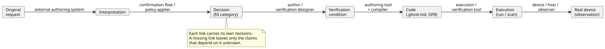
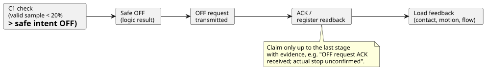

# Responsibility and Evidence Contract for Intent Consistency

Status: shared design contract for [#565](https://github.com/callin2/ghostflow-language/issues/565).
The five follow-up features in [#559](https://github.com/callin2/ghostflow-language/issues/559) apply this contract to their inputs, results, and completion criteria.

- The obligations here are **design criteria for follow-up work**. They do not mean that new APIs, storage schemas, or approval UIs have been implemented.
- This document does not change existing language syntax, execution semantics, or deployment policy.

The shared evidence record already has an implemented authoring API, validator, CLI, and persistence/recovery. They follow the [intent evidence implementation contract](INTENT-EVIDENCE.md). They check structure, revisions, and explicit links. They do **not** perform the four judgments described below.

In this document:

1. **What is judged and who has authority** — four separate judgments.
2. **Responsibilities by layer** — who owns what, from authoring agent to device.
3. **Decision states** — four categories of decision, and how they map onto existing anchor metadata.
4. **Minimum evidence and revision links** — the chain from original request to real device.
5. **Pump example** — confirmation and verification linked separately.
6. **Common review cases** — misjudgments to prevent.
7. **Design criteria for the five follow-up issues.**
8. **Existing evidence and completion boundary.**

## 1. What Is Judged and Who Has Authority

Two questions are easy to confuse:

- Does an interpretation fit the requester's intent?
- Does the code comply with the explicit conditions?

They are separate judgments. If the same LLM writes both code and tests from a mistaken interpretation, the code and tests can agree with each other and still diverge from the original intent.
Evidence links make these judgments traceable. A link by itself does not prove that an interpretation is appropriate.

The table below lists four judgments. For each one it shows who decides, what inputs are needed, what evidence to keep, and what may be claimed.

| Judgment | Decision authority and actor | Required inputs | Evidence to retain | Permitted claim and limit |
|---|---|---|---|---|
| Does the interpretation match the requester's intent? | The user, or a domain owner delegated authority for that scope, decides. An external LLM or authoring tool may propose interpretations, questions, and alternatives. | Original request and context, interpretation revision, items requiring a decision, applicable approval policy | Exactly which interpretation was confirmed, by whom and under what authority, including confirmation scope, time, and basis | May state that the specified interpretation and scope were confirmed. Silence, successful compilation, plausible wording, or agreement from another model do not substitute for confirmation. |
| Do the explicit requirements conflict with one another? | Tools check conflicts among conditions they can represent. An LLM may suggest ambiguities and possible conflicts. The relevant decision authority sets or changes precedence between policies. | Revision-pinned conditions, assumptions, priorities, and scope, plus the checker's supported scope | Conflicting conditions, counterexample/check result, and areas not checked | A conflict or no-conflict result for the supported form, model, and scope only. It does not automatically establish consistency of all natural language, absence of omissions, or which policy to waive. |
| Does the code satisfy the explicit conditions? | The compiler, verifier, and simulator each check within their own capabilities. The meaning of the conditions and the expected values are established externally. | Code/artifact, basis for conditions and expected values, initial state, inputs, clock, settings, and execution contract | Diagnostics, execution/counterexample, supported and observed scope, and exact revisions | Distinguish type checking, passing a specific scenario, and a bounded formal proof. Compilation success does not prove compliance with arbitrary requirements, and passing tests do not establish equivalence for all inputs. |
| Does the real device satisfy the conditions? | The device/observation system collects facts. The designated acceptance owner, or an approved acceptance policy, decides whether they are satisfied. | Deployed revision, device, installed binding, test procedure, observation points, quality and timing criteria, and acceptance conditions | Commands, responses, readbacks, physical feedback and their sources, results, omissions, and discrepancies | Claims apply only to the observed device, conditions, time, and physical quantity. Simulation, successful transmission, ACK, or a register value does not prove the complete behavior of the load. |

Separating authority from checking capability does **not** mean that a person must inspect every value by hand each time.

- An approved policy may automate judgments within its stated scope.
- The tool must then receive the policy, authority, scope, revision, and basis for applying it.
- An LLM or checker must not create a decision outside that authority and treat it as approved.

## 2. Responsibilities by Layer

| Layer | Owns | Must provide |
|---|---|---|
| External authoring agent / API / requirements-confirmation flow | Natural-language interpretation, discovery of undecided candidates, questions, confirmation records, approval-policy application, and revision retention | Identifiers and sources for the original, interpretation, and conditions; decision state; authority basis and scope |
| Canonical GhostFlow `.ghost.md` | Explanations, intent, assumptions, and executable code explicitly written by the author | Existing anchors/links and the canonical revision. Executable rules stay in this source and its derived artifacts. |
| Language, compiler, and verification tools | Checks of explicit structure, types, and relations; source tracing; verification of supported conditions | Actual checked scope, diagnostics, binding between code, conditions, and execution results, and reasons for unsupported/unknown results |
| Runtime and explanation tools | Execution under defined semantics and projection of actual evaluation traces | Exact run/scan and requested/safe results, distinguishing evaluated, unevaluated, and error cases |
| Device / host / driver / renderer | Installation/deployment, device communication, input quality, and actual output application/observation | Device/installation revisions, time and quality, evidence of application/feedback, and failures/omissions |
| Consumer UI / external agent | Presenting evidence and helping with questions and judgments | Explanations that preserve evidence level and unresolved scope |

Four boundaries follow from this table:

- Do not assume that a natural-language interpretation agent exists inside the GhostFlow language, toolchain, or runtime.
- Decision records from an external authoring system are not a second DSL that replaces the executable program.
- Derived maps, IR, and visualizations are generated from the canonical source. They do not create separately editable control semantics.
- Language tools can verify supported explicit links. They cannot authenticate the truth of an external record, or a user's authority, from field shape alone.

## 3. Decision States and Their Relationship to Existing Metadata

The four categories below describe what an external decision record means. They do **not** define new enum values for existing anchors.
Source, confirmation state, and scope are separate pieces of information. Human authorship alone does not make something confirmed, and deriving a result from a policy does not by itself confer authority.

| Category | Required evidence | Link to existing anchors | Promotion that is not allowed |
|---|---|---|---|
| Confirmed decision | Decision authority, the confirmed interpretation/condition revision and scope, and the confirmation record | `status=confirmed` on an `intent` or `premise` for which confirmation exists; `origin` preserves the actual source | Do not extend confirmation of one item into approval of the whole document. |
| Decision derived from an approved policy | Policy identifier, revision, authority, and effective scope; applied inputs and derivation basis; the decision scope delegated by that policy | Link to a suitable `intent/premise`, and keep the policy and derivation basis in the external record. Treat it as a confirmed decision only when the policy covers that decision. | Do not call an arbitrary convention or default an approved policy, and do not turn it into a direct user statement. |
| LLM assumption | Proposing actor, rationale, affected conditions/code, and unconfirmed state | `kind=assumption status=unconfirmed origin=ai`; candidate code uses `relation=assumes` | Do not promote it automatically to `confirmed`. After confirmation, reclassify it as `intent/premise` and keep the confirmation evidence. |
| Undecided item | The question/choice, the decision authority (or the fact that it is unspecified), and affected claims/work | Preserve it in the external record and the canonical explanation. An already authored unconfirmed assumption may be linked using the existing form. | Do not infer an undecided item automatically from behavior that is absent from code, and do not invent a nonexistent `status=undecided` syntax. |

How this maps onto the existing [anchor contract](INTENT-ANCHOR-MAP.md):

- `kind` is `intent/premise/assumption`, `status` is `confirmed/unconfirmed/superseded`, and `origin` is `user/operator/engineer/ai/imported`.
- `implements/constrains/fallback/assumes` are authored relationships. An `implements` comment does not prove that the implementation is correct.
- An `assumption` cannot be `confirmed`, and a `superseded` anchor cannot link to a current node.
- The text `origin=user` and `status=confirmed` does not replace evidence that a user actually confirmed something.

Undecided items do not justify blanket blocking:

- Do not add a rule that blocks all authoring, simulation, or deployment merely because something is undecided.
- Instead, identify the claims and work that depend on that item. Whether that work is allowed, deferred, or blocked follows the explicit product/installation policy for that work.
- Existing language errors for declarations that omit required policy inputs remain unchanged.

## 4. Minimum Evidence and Revision Links to Carry Forward

The following are **logical** information requirements. They do not fix field names, transport format, storage, or an approval API.
Follow-up features should reuse existing identity and source trace, and define a versioned schema that fits the actual consumer boundary.

The diagram shows the six links in order and the main producer of each. The table lists the minimum information each link carries.

| Link | Minimum information | Main producer |
|---|---|---|
| Original → interpretation | Original identifier, immutable revision/reference, and relevant scope; interpretation identifier, revision, and content; additional assumptions and omitted scope | External authoring system |
| Interpretation → decision | §3 category, source, confirmation/policy basis and authority scope, decision time, undecided items | Requirements-confirmation flow / policy applier |
| Decision → verification condition | Condition identifier and revision; observed variable, unit, and time basis; preconditions/expected values; the decision it was derived from; basis for independently reviewed expected values | Author / verification designer |
| Condition → code | Canonical document revision/digest, anchor-to-code node/span link, condition-to-target relation, bytecode/compiler and checker revisions | Authoring tool and compiler |
| Code → execution | Revisions of artifact, settings, initial state, input tape, and runtime/target contract; run/scan/logical time; checks performed and observation scope | Execution/verification tool |
| Execution → real device | Deployment, device, profile/binding identity, command/observation correlation key, observation time/clock basis/quality/point | Device / host / observer |

**Reporting rules.**

- Each consumer checks the links its own claims need. If upstream information is missing, only the missing links and the affected claims become unknown/unavailable.
- Do not collapse every stage into one `passed` or `intent matches` result. Return and display verification outcome, interpretation confirmation state, and physical confirmation state separately.
- A counterexample or failure location is an observed violation point. It does not by itself establish where the root cause is, or what must be fixed.

**Sources, copies, and signatures.**

- The original request may be stored in an external system. Explanations in the canonical source are read from the existing source document.
- If explanation text is copied, keep its source revision and the transformation/excerpt relationship, so the copy does not become an independently edited source of truth.
- Document/hash/anchor links bind content and revision. That is separate from semantic fitness and from authority authentication.
- A signature authenticates an artifact within the scope of what the trusted signer attests. A signature alone does not claim that a natural-language interpretation is correct.

### Validity Scope of Evidence After Changes

**Confirmation is bound to content, revision, and scope.**

- Confirmation is bound to the interpretation's content, revision, and scope. When the interpretation changes, do not carry old confirmation forward unchanged, even if its ID or bytecode stays the same.
- To claim that an existing decision also applies to a new revision, record the change impact and the basis for applying it.
- A purely editorial change that does not alter meaning may update link locations and digests. Do not create a policy that unconditionally requires every decision to be asked again.

**Other changes trigger re-evaluation.**

- When policy, condition, code, settings, installation binding, or runtime changes, re-evaluate the affected links and verification scope.
- Keep prior results as evidence for their historical revisions. Do not relabel them as results for a new revision.
- If policy validity or authority scope cannot be checked, keep the policy-derived state separate from its current applicability.
- The applicable contract supplies lifetime/maximum age. Do not invent one freshness value common to all devices.
- Do not link an explanation for scan 0 of an earlier run to scan 0 of a new run. Do not correlate commands and feedback by time alone when their clocks are incompatible.

## 5. Pump Example: Link Confirmation and Verification Separately

The numbers, identifiers, and confirmations in this section are **hypothetical** examples that explain the contract. They are not an actual user's operating approval or an execution test result.
This section adds no execution syntax and makes no implicit choice about time, input quality, or device behavior.

Original `U1/r1`: “Stop the pump when water is low.”
LLM candidate interpretation `I1/r1`: “Stop within 1 second when the level is below 20%, and restart automatically when the level recovers.”

The candidate interpretation adds three details that the original did not state. Each starts as an LLM assumption:

| Item | Initial state | Meaning to confirm |
|---|---|---|
| Low means below 20% | LLM assumption | Which sensor and unit, what quality applies, and how to treat the boundary value and measurement failure |
| Stop within 1 second | LLM assumption | Whether the start time is physical low water or receipt of a valid sample, and whether completion means safe OFF or actual stopping |
| Automatic restart after recovery | LLM assumption | Restart condition and authority. The original does not decide this. |

### Bounded Check After Partial Confirmation

Suppose that in hypothetical decision `D1/r1`, the authorized person confirms only this: “An accepted scan with a valid level sample below 20% must have safe pump intent OFF.”

- Update the interpretation to `I1/r2`, and link `D1/r1` only to that condition.
- Physical stopping within 1 second and automatic restart remain unresolved.

This decision is enough to define the following check:

| Link | What to record |
|---|---|
| Condition `C1/r1` | For an accepted scan with a valid level sample below 20%, safe pump intent = OFF. Normal operation and restart behavior are outside this condition's check scope. |
| Code `P1/r1` | Canonical document and GFB digests, the node/anchor for the low-water constraint, and its link to `C1/r1`. Mark any other assumptions in the candidate code separately. |
| Scenario `S1/r1` | With fixed initial state, settings, target contract, and logical clock, supply a valid 19% sample on scan A and 20% on scan B. Record the exact run/scan. |
| Expected value | A must be safe OFF under C1. For B, C1's precondition is false, so C1 alone requires neither ON nor OFF. Derive expected values from D1/C1, not by copying code output. |
| Result interpretation | If A is OFF, that is evidence of C1 compliance for this scenario. It does not prove every operating policy (including the behavior at B), automatic restart, or physical stopping within 1 second. Do not record a pass before obtaining the actual result. |

**Invalid or stale samples.** An invalid or stale sample does not become a valid level that satisfies this condition's precondition.

- Do not replace it with 0% and count it as “low-water condition passed.”
- Instead, expose the quality state and whether a separate fault policy is needed.
- Specific fault behavior must come from approved conditions.

### Subsequent Physical Claims and Changes

To check “actual stop within 1 second,” separately establish the start/end observation points, the time basis and tolerance, the device binding, and the acceptance condition for stopping.

Each stage of the output path is distinct evidence. A claim may go only as far as the last stage that has evidence:

Safe OFF, transmission request, ACK, register readback, and actual contact/motion/flow are distinct evidence.
For example, if there is an OFF ACK but no load feedback, record “OFF request ACK received; actual stop unconfirmed.”
The existing C1 simulation remains valid within its scope. Its result does not substitute for additional physical claims.

**When the policy changes.** If the low threshold later changes to 15%:

- Link new revisions of the interpretation, decision, condition, and code with the relevant scenario.
- Do not reuse the success of C1/r1 at 19% (where C1/r1 required OFF) as evidence for the new 15% policy.
- Do not infer a confirmed automatic restart just because the original does not prohibit restarting. This example also does not decide whether deployment is allowed.

## 6. Common Review Cases

Follow-up features should set up in-scope result and regression checks that prevent the misjudgments below. This document does not implement a new checking engine.

| Situation | Judgment to preserve |
|---|---|
| The LLM writes code and tests from the same 20% guess, and they all pass | The unconfirmed interpretation remains unconfirmed. An independent decision basis for expected values is required. |
| Only an `implements` link or a `confirmed` label exists | Only the presence of the link/label is established. It does not authenticate authorized confirmation or semantic compliance. |
| Only part of a document was confirmed, or only some scenarios matched | Separate the confirmed/checked scope from the remaining scope. |
| An LLM suggests a possible natural-language conflict | Distinguish a candidate from a verified conflict. Do not choose policy precedence arbitrarily. |
| An approved policy exists, but its scope, revision, or current validity is unknown | The claim that it applies is unknown. Do not block unrelated work. |
| A capability is declared, but current installation evidence is missing or old | Preserve the declared/installed/observed distinction, the source/time, and the reason for uncertainty. |
| An explanation's source/run/scan differs from the output sample | Mark the join as failed/stale. Do not use it as the reason for the current output. |
| A branch was not evaluated, or an input is missing/faulted | Do not disguise it as a normal false/0. |
| Logic is OFF or an ACK exists, but there is no load observation | Claim only up to the evidence stage that is available. Leave the physical result unconfirmed. |
| An undecided item is found | Identify the affected conditions/work. Block execution as a whole only when an explicit policy applies to that scope. |

## 7. Design Criteria for the Five Follow-up Issues

#565 establishes the shared responsibility boundaries. Each follow-up issue decides its own wire schema, algorithm, UI, storage, and implementation.
Implementers should include the criteria below in that issue's completion conditions and actual verification.

| Follow-up issue | Contract for inputs and results | Details remaining for that issue |
|---|---|---|
| [#560 Behavior Difference](https://github.com/callin2/ghostflow-language/issues/560) | Receive two programs, a scenario, initial state, target, observation/time scope, and externally established expected changes/invariants. Separate observed differences from satisfaction/violation of the supplied conditions. | Comparison unit, time alignment, result schema, and replay limits. A diff is possible without an intent judgment; without expected conditions, whether a change was intended is unknown. |
| [#561 Failure Reduction](https://github.com/callin2/ghostflow-language/issues/561) | Pin externally supplied failure conditions/assertions and their requirement basis. Produce reproduction/reduction results that preserve the same violation. | Reduction cost measure, search scope, and reproduction guarantee. Claim “shortest” only within the proven scope. A requirement link alone does not establish that the oracle is appropriate. |
| [#562 Available Contract Lookup](https://github.com/callin2/ghostflow-language/issues/562) | Language/tools validate and query supplied contracts. The device/host supplies actual installation, occupancy, and observation facts with identity, revision, and time. The caller supplies the query scope, and the agent judges relevance to the task. | Define the query interface, provider, freshness/unknown behavior, and relevance filter separately. Do not promote declared capabilities into current installation facts. |
| [#563 Execution Reasons](https://github.com/callin2/ghostflow-language/issues/563) | Link the actual evaluation result/value/source to external intent provenance. Validate source/run/scan and command/observation identity, and state when a link is absent. | Define reuse/additional scope relative to existing #88/#553. Distinguish internal evaluation explanation from external intent explanation, and preserve requested/safe/applied/confirmed evidence. |
| [#564 Undecided Intent](https://github.com/callin2/ghostflow-language/issues/564) | The external agent/authoring flow discovers, asks about, and resolves candidates. Language/tools express and diagnose explicitly supplied state, and omissions under a required schema. | Interface for discovery/expression/resolution and the required external state model. Do not infer omitted intent from absence of code, and do not add a universal deployment-blocking policy. |

## 8. Existing Evidence and Completion Boundary

Review baseline: `e664687259e7b66fa1a3f8db0a49cf823cdb9815` on `dev`.
This document integrates responsibilities and evidence handoff based on the following existing contracts and implementations.

- [Canonical source/anchor contract](INTENT-ANCHOR-MAP.md), [extractor](../tools/literate.mjs), [source trace](../tools/source-trace.mjs): explicit metadata and revision binding. This is distinct from authenticating confirmation authority.
- [Language/device responsibilities](reference/08-language-runtime-and-device-boundaries.md), [output evidence stages](reference/04-sensors-constraints-control.md#47-requested-safe-applied-confirmed), [device boundary](LLM-TOOLCHAIN-ARCHITECTURE.md#physical-driver-and-device-boundary): ownership of operating policy and physical observation.
- [Current Boolean output explanation](BOOLEAN-OUTPUT-EXPLANATION.md): a limited implementation that explains requested Boolean results for one completed scan. Do not expand this into a claim that all timer/state/safety/physical explanations are available.
- [External authoring example](LLM-AUTHORING-WORKFLOW.md): an example of canonical source, revisions, assumptions, and virtual outputs without a model call.
- [#553](https://github.com/callin2/ghostflow-language/issues/553), [#88](https://github.com/callin2/ghostflow-language/issues/88), [#545](https://github.com/callin2/ghostflow-language/issues/545): related work on diagnostics, execution explanations, and capability/replay. #565 does not declare these issues wholly complete.

**What counts as completion for #565.** The completion evidence is: the responsibility table for the four judgments, the state/revision links, the layer boundaries, the pump example, and the handoff to the five issues.

- Document, translation, and index checks are artifact-consistency checks. They are not automatic proof of intent consistency or device acceptance.
- The actual status of follow-up feature implementation and repository integration is recorded separately in the linked issues/PRs.
