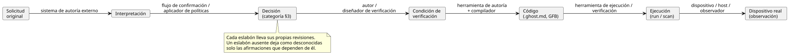
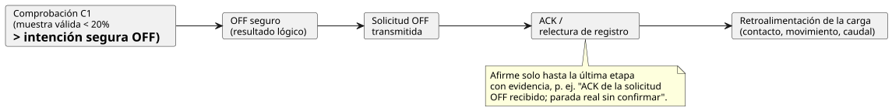

<!-- translation-source: docs/INTENT-CONSISTENCY-CONTRACT.en.md -->
[Original en inglés](INTENT-CONSISTENCY-CONTRACT.en.md)

# Contrato de responsabilidad y evidencia para la consistencia de la intención

[Original en coreano](INTENT-CONSISTENCY-CONTRACT.md)

Estado: contrato de diseño compartido para [#565](https://github.com/callin2/ghostflow-language/issues/565).
Las cinco funciones de seguimiento de [#559](https://github.com/callin2/ghostflow-language/issues/559) aplican este contrato a sus entradas, resultados y criterios de finalización.

- Las obligaciones de este documento son **criterios de diseño para el trabajo de seguimiento**. No significan que se hayan implementado nuevas API, esquemas de almacenamiento ni UI de aprobación.
- Este documento no cambia la sintaxis existente del lenguaje, la semántica de ejecución ni la política de despliegue.

El registro de evidencia compartido ya cuenta con una API de autoría, un validador, una CLI y persistencia/recuperación implementados. Siguen el [contrato de implementación de la evidencia de intención](INTENT-EVIDENCE.es.md). Comprueban la estructura, las revisiones y los vínculos explícitos. **No** realizan los cuatro juicios que se describen a continuación.

En este documento:

1. **Qué se juzga y quién tiene autoridad**: cuatro juicios separados.
2. **Responsabilidades por capa**: quién es responsable de qué, desde el agente de autoría hasta el dispositivo.
3. **Estados de decisión**: cuatro categorías de decisión y cómo se corresponden con los metadatos de ancla existentes.
4. **Evidencia mínima y vínculos de revisión**: la cadena desde la solicitud original hasta el dispositivo real.
5. **Ejemplo de la bomba**: confirmación y verificación vinculadas por separado.
6. **Casos de revisión habituales**: juicios erróneos que hay que evitar.
7. **Criterios de diseño para las cinco issues de seguimiento.**
8. **Evidencia existente y límite de finalización.**

## 1. Qué se juzga y quién tiene autoridad

Es fácil confundir dos preguntas:

- ¿Se ajusta una interpretación a la intención de quien hace la solicitud?
- ¿Cumple el código las condiciones explícitas?

Son juicios separados. Si el mismo LLM escribe tanto el código como las pruebas a partir de una interpretación errónea, el código y las pruebas pueden coincidir entre sí y aun así apartarse de la intención original.
Los vínculos de evidencia hacen que estos juicios sean rastreables. Un vínculo por sí solo no demuestra que una interpretación sea adecuada.

La tabla siguiente enumera cuatro juicios. Para cada uno muestra quién decide, qué entradas se necesitan, qué evidencia hay que conservar y qué se puede afirmar.

| Juicio | Autoridad de decisión y actor | Entradas necesarias | Evidencia que se debe conservar | Afirmación permitida y límite |
|---|---|---|---|---|
| ¿Coincide la interpretación con la intención de quien hace la solicitud? | Decide el usuario, o un responsable del dominio al que se delegó autoridad para ese alcance. Un LLM externo o una herramienta de autoría puede proponer interpretaciones, preguntas y alternativas. | Solicitud original y contexto, revisión de la interpretación, elementos que requieren decisión, política de aprobación aplicable | Exactamente qué interpretación se confirmó, por quién y con qué autoridad, incluidos el alcance, el momento y el fundamento de la confirmación | Puede afirmar que se confirmaron la interpretación y el alcance especificados. El silencio, una compilación correcta, una redacción plausible o el acuerdo de otro modelo no sustituyen a la confirmación. |
| ¿Entran en conflicto entre sí los requisitos explícitos? | Las herramientas comprueban los conflictos entre las condiciones que pueden representar. Un LLM puede señalar ambigüedades y posibles conflictos. La autoridad de decisión correspondiente establece o cambia la precedencia entre políticas. | Condiciones, supuestos, prioridades y alcance fijados por revisión, más el alcance admitido por el comprobador | Condiciones en conflicto, contraejemplo/resultado de la comprobación y áreas no comprobadas | Un resultado de conflicto o ausencia de conflicto solo para la forma, el modelo y el alcance admitidos. No establece automáticamente la consistencia de todo el lenguaje natural, la ausencia de omisiones ni qué política se debe dejar sin efecto. |
| ¿Satisface el código las condiciones explícitas? | El compilador, el verificador y el simulador comprueban cada uno dentro de sus propias capacidades. El significado de las condiciones y los valores esperados se establecen externamente. | Código/artefacto, fundamento de las condiciones y de los valores esperados, estado inicial, entradas, reloj, ajustes y contrato de ejecución | Diagnósticos, ejecución/contraejemplo, alcance admitido y observado, y revisiones exactas | Distinga la comprobación de tipos, la superación de un escenario concreto y una prueba formal acotada. Una compilación correcta no demuestra el cumplimiento de requisitos arbitrarios, y superar las pruebas no establece la equivalencia para todas las entradas. |
| ¿Satisface el dispositivo real las condiciones? | El sistema del dispositivo/observación recoge los hechos. El responsable de aceptación designado, o una política de aceptación aprobada, decide si se cumplen. | Revisión desplegada, dispositivo, vinculación instalada, procedimiento de prueba, puntos de observación, criterios de calidad y de tiempo, y condiciones de aceptación | Comandos, respuestas, relecturas, retroalimentación física y sus fuentes, resultados, omisiones y discrepancias | Las afirmaciones se aplican solo al dispositivo, las condiciones, el momento y la magnitud física observados. La simulación, una transmisión correcta, un ACK o el valor de un registro no demuestran el comportamiento completo de la carga. |

Separar la autoridad de la capacidad de comprobación **no** significa que una persona deba inspeccionar a mano cada valor cada vez.

- Una política aprobada puede automatizar juicios dentro de su alcance declarado.
- En ese caso, la herramienta debe recibir la política, la autoridad, el alcance, la revisión y el fundamento para aplicarla.
- Un LLM o un comprobador no debe crear una decisión fuera de esa autoridad y tratarla como aprobada.

## 2. Responsabilidades por capa

| Capa | Es responsable de | Debe aportar |
|---|---|---|
| Agente de autoría externo / API / flujo de confirmación de requisitos | Interpretación del lenguaje natural, descubrimiento de candidatos sin decidir, preguntas, registros de confirmación, aplicación de políticas de aprobación y conservación de revisiones | Identificadores y fuentes del original, de la interpretación y de las condiciones; estado de la decisión; fundamento y alcance de la autoridad |
| `.ghost.md` canónico de GhostFlow | Explicaciones, intención, supuestos y código ejecutable escritos explícitamente por el autor | Las anclas/vínculos existentes y la revisión canónica. Las reglas ejecutables permanecen en esta fuente y en sus artefactos derivados. |
| Lenguaje, compilador y herramientas de verificación | Comprobación de la estructura, los tipos y las relaciones explícitas; trazado de la fuente; verificación de las condiciones admitidas | Alcance realmente comprobado, diagnósticos, vinculación entre código, condiciones y resultados de ejecución, y motivos de los resultados no admitidos/desconocidos |
| Runtime y herramientas de explicación | Ejecución con la semántica definida y proyección de las trazas de evaluación reales | Resultados exactos de run/scan y de requested/safe, distinguiendo los casos evaluados, no evaluados y con error |
| Dispositivo / host / driver / renderizador | Instalación/despliegue, comunicación con el dispositivo, calidad de las entradas y aplicación/observación reales de las salidas | Revisiones del dispositivo/instalación, tiempo y calidad, evidencia de aplicación/retroalimentación, y fallos/omisiones |
| UI consumidora / agente externo | Presentar la evidencia y ayudar con las preguntas y los juicios | Explicaciones que conserven el nivel de evidencia y el alcance sin resolver |

De esta tabla se derivan cuatro límites:

- No suponga que existe un agente de interpretación del lenguaje natural dentro del lenguaje GhostFlow, de su cadena de herramientas o del runtime.
- Los registros de decisión de un sistema de autoría externo no son un segundo DSL que reemplace al programa ejecutable.
- Los mapas derivados, el IR y las visualizaciones se generan a partir de la fuente canónica. No crean una semántica de control editable por separado.
- Las herramientas del lenguaje pueden verificar los vínculos explícitos admitidos. No pueden autenticar la veracidad de un registro externo, ni la autoridad de un usuario, solo a partir de la forma de los campos.

## 3. Estados de decisión y su relación con los metadatos existentes

Las cuatro categorías siguientes describen qué significa un registro de decisión externo. **No** definen nuevos valores de enumeración para las anclas existentes.
La fuente, el estado de confirmación y el alcance son datos separados. La autoría humana por sí sola no hace que algo esté confirmado, y derivar un resultado de una política no confiere autoridad por sí mismo.

| Categoría | Evidencia necesaria | Vínculo con las anclas existentes | Promoción no permitida |
|---|---|---|---|
| Decisión confirmada | Autoridad de decisión, revisión y alcance de la interpretación/condición confirmada, y el registro de confirmación | `status=confirmed` en un `intent` o `premise` para el que existe confirmación; `origin` conserva la fuente real | No extienda la confirmación de un elemento a la aprobación de todo el documento. |
| Decisión derivada de una política aprobada | Identificador, revisión, autoridad y alcance efectivo de la política; entradas aplicadas y fundamento de la derivación; el alcance de decisión delegado por esa política | Vincule a un `intent/premise` adecuado y conserve la política y el fundamento de la derivación en el registro externo. Trátela como decisión confirmada solo cuando la política cubra esa decisión. | No llame política aprobada a una convención arbitraria o a un valor predeterminado, ni la convierta en una declaración directa del usuario. |
| Supuesto del LLM | Actor que lo propone, fundamento, condiciones/código afectados y estado sin confirmar | `kind=assumption status=unconfirmed origin=ai`; el código candidato usa `relation=assumes` | No lo promueva automáticamente a `confirmed`. Tras la confirmación, reclasifíquelo como `intent/premise` y conserve la evidencia de la confirmación. |
| Elemento sin decidir | La pregunta/opción, la autoridad de decisión (o el hecho de que no está especificada) y las afirmaciones/trabajo afectados | Consérvelo en el registro externo y en la explicación canónica. Un supuesto sin confirmar ya escrito puede vincularse usando la forma existente. | No infiera automáticamente un elemento sin decidir a partir de un comportamiento ausente del código, ni invente una sintaxis `status=undecided` inexistente. |

Cómo se corresponde esto con el [contrato de anclas](INTENT-ANCHOR-MAP.es.md) existente:

- `kind` es `intent/premise/assumption`, `status` es `confirmed/unconfirmed/superseded` y `origin` es `user/operator/engineer/ai/imported`.
- `implements/constrains/fallback/assumes` son relaciones escritas por el autor. Un comentario `implements` no demuestra que la implementación sea correcta.
- Un `assumption` no puede ser `confirmed`, y un ancla `superseded` no puede vincularse a un nodo actual.
- El texto `origin=user` y `status=confirmed` no sustituye a la evidencia de que un usuario confirmó realmente algo.

Los elementos sin decidir no justifican un bloqueo general:

- No añada una regla que bloquee toda la autoría, la simulación o el despliegue simplemente porque algo esté sin decidir.
- En su lugar, identifique las afirmaciones y el trabajo que dependen de ese elemento. Si ese trabajo se permite, se aplaza o se bloquea depende de la política explícita del producto/instalación para ese trabajo.
- Los errores existentes del lenguaje para las declaraciones que omiten entradas de política obligatorias no cambian.

## 4. Evidencia mínima y vínculos de revisión que se deben transmitir

Los siguientes son requisitos de información **lógicos**. No fijan nombres de campos, formato de transporte, almacenamiento ni una API de aprobación.
Las funciones de seguimiento deberían reutilizar la identidad y el trazado de la fuente existentes, y definir un esquema versionado que se ajuste al límite real del consumidor.

El diagrama muestra los seis eslabones en orden y el productor principal de cada uno. La tabla enumera la información mínima que lleva cada eslabón.

| Eslabón | Información mínima | Productor principal |
|---|---|---|
| Original → interpretación | Identificador del original, revisión/referencia inmutable y alcance pertinente; identificador, revisión y contenido de la interpretación; supuestos adicionales y alcance omitido | Sistema de autoría externo |
| Interpretación → decisión | Categoría del §3, fuente, fundamento de confirmación/política y alcance de la autoridad, momento de la decisión, elementos sin decidir | Flujo de confirmación de requisitos / aplicador de políticas |
| Decisión → condición de verificación | Identificador y revisión de la condición; variable observada, unidad y base temporal; precondiciones/valores esperados; la decisión de la que se derivó; fundamento de los valores esperados revisados de forma independiente | Autor / diseñador de la verificación |
| Condición → código | Revisión/digest del documento canónico, vínculo de ancla a nodo/rango de código, relación entre la condición y el destino, revisiones del bytecode/compilador y del comprobador | Herramienta de autoría y compilador |
| Código → ejecución | Revisiones del artefacto, los ajustes, el estado inicial, la cinta de entradas y el contrato de runtime/destino; run/scan/tiempo lógico; comprobaciones realizadas y alcance de la observación | Herramienta de ejecución/verificación |
| Ejecución → dispositivo real | Identidad del despliegue, del dispositivo y del perfil/vinculación, clave de correlación entre comando y observación, momento de la observación/base del reloj/calidad/punto | Dispositivo / host / observador |

**Reglas de informe.**

- Cada consumidor comprueba los eslabones que necesitan sus propias afirmaciones. Si falta información aguas arriba, solo los eslabones que faltan y las afirmaciones afectadas pasan a ser desconocidos/no disponibles.
- No reduzca todas las etapas a un único resultado `passed` o `intent matches`. Devuelva y muestre por separado el resultado de la verificación, el estado de confirmación de la interpretación y el estado de confirmación física.
- Un contraejemplo o una ubicación de fallo es un punto de violación observado. Por sí solo no establece dónde está la causa raíz ni qué se debe corregir.

**Fuentes, copias y firmas.**

- La solicitud original puede almacenarse en un sistema externo. Las explicaciones de la fuente canónica se leen del documento fuente existente.
- Si se copia texto explicativo, conserve su revisión de origen y la relación de transformación/extracto, para que la copia no se convierta en una fuente de verdad editada de forma independiente.
- Los vínculos de documento/hash/ancla ligan el contenido y la revisión. Eso es independiente de la idoneidad semántica y de la autenticación de la autoridad.
- Una firma autentica un artefacto dentro del alcance de lo que atestigua el firmante de confianza. Una firma por sí sola no afirma que una interpretación del lenguaje natural sea correcta.

### Alcance de validez de la evidencia tras los cambios

**La confirmación está ligada al contenido, la revisión y el alcance.**

- La confirmación está ligada al contenido, la revisión y el alcance de la interpretación. Cuando la interpretación cambia, no traslade sin más la confirmación antigua, aunque su ID o su bytecode sigan siendo los mismos.
- Para afirmar que una decisión existente también se aplica a una nueva revisión, registre el impacto del cambio y el fundamento para aplicarla.
- Un cambio puramente editorial que no altera el significado puede actualizar las ubicaciones de los vínculos y los digests. No cree una política que exija incondicionalmente volver a preguntar cada decisión.

**Otros cambios provocan una reevaluación.**

- Cuando cambian la política, la condición, el código, los ajustes, la vinculación de la instalación o el runtime, reevalúe los eslabones afectados y el alcance de la verificación.
- Conserve los resultados anteriores como evidencia de sus revisiones históricas. No los reetiquete como resultados de una nueva revisión.
- Si no se pueden comprobar la validez de la política o el alcance de la autoridad, mantenga el estado derivado de la política separado de su aplicabilidad actual.
- El contrato aplicable aporta la vida útil/antigüedad máxima. No invente un valor de vigencia común para todos los dispositivos.
- No vincule una explicación del scan 0 de una ejecución anterior con el scan 0 de una nueva ejecución. No correlacione comandos y retroalimentación solo por el tiempo cuando sus relojes son incompatibles.

## 5. Ejemplo de la bomba: vincular la confirmación y la verificación por separado

Los números, identificadores y confirmaciones de esta sección son ejemplos **hipotéticos** que explican el contrato. No son la aprobación de operación de un usuario real ni el resultado de una prueba de ejecución.
Esta sección no añade sintaxis de ejecución ni hace ninguna elección implícita sobre el tiempo, la calidad de las entradas o el comportamiento del dispositivo.

Original `U1/r1`: «Detenga la bomba cuando haya poca agua».
Interpretación candidata del LLM `I1/r1`: «Detener en menos de 1 segundo cuando el nivel esté por debajo del 20 %, y volver a arrancar automáticamente cuando el nivel se recupere».

La interpretación candidata añade tres detalles que el original no indicaba. Cada uno empieza como un supuesto del LLM:

| Elemento | Estado inicial | Significado que hay que confirmar |
|---|---|---|
| Bajo significa por debajo del 20 % | Supuesto del LLM | Qué sensor y qué unidad, qué calidad se aplica y cómo tratar el valor límite y los fallos de medición |
| Detener en menos de 1 segundo | Supuesto del LLM | Si el instante inicial es el nivel bajo físico o la recepción de una muestra válida, y si la finalización significa OFF seguro o parada real |
| Rearranque automático tras la recuperación | Supuesto del LLM | Condición y autoridad del rearranque. El original no lo decide. |

### Comprobación acotada tras una confirmación parcial

Suponga que, en la decisión hipotética `D1/r1`, la persona autorizada confirma solo esto: «Un scan aceptado con una muestra de nivel válida por debajo del 20 % debe tener la intención segura de la bomba en OFF».

- Actualice la interpretación a `I1/r2` y vincule `D1/r1` solo con esa condición.
- La parada física en menos de 1 segundo y el rearranque automático siguen sin resolverse.

Esta decisión basta para definir la siguiente comprobación:

| Eslabón | Qué registrar |
|---|---|
| Condición `C1/r1` | Para un scan aceptado con una muestra de nivel válida por debajo del 20 %, intención segura de la bomba = OFF. El funcionamiento normal y el comportamiento de rearranque quedan fuera del alcance de comprobación de esta condición. |
| Código `P1/r1` | Digests del documento canónico y de GFB, el nodo/ancla de la restricción de nivel bajo y su vínculo con `C1/r1`. Marque por separado cualquier otro supuesto del código candidato. |
| Escenario `S1/r1` | Con estado inicial, ajustes, contrato de destino y reloj lógico fijos, aporte una muestra válida del 19 % en el scan A y del 20 % en el scan B. Registre el run/scan exacto. |
| Valor esperado | A debe ser OFF seguro según C1. Para B, la precondición de C1 es falsa, así que C1 por sí sola no exige ni ON ni OFF. Derive los valores esperados de D1/C1, no copiando la salida del código. |
| Interpretación del resultado | Si A es OFF, eso es evidencia de cumplimiento de C1 en este escenario. No demuestra todas las políticas de operación (incluido el comportamiento en B), el rearranque automático ni la parada física en menos de 1 segundo. No registre un aprobado antes de obtener el resultado real. |

**Muestras no válidas u obsoletas.** Una muestra no válida u obsoleta no se convierte en un nivel válido que satisfaga la precondición de esta condición.

- No la sustituya por 0 % ni la cuente como «condición de nivel bajo superada».
- En su lugar, exponga el estado de calidad y si se necesita una política de fallos aparte.
- El comportamiento concreto ante fallos debe provenir de condiciones aprobadas.

### Afirmaciones físicas posteriores y cambios

Para comprobar la «parada real en menos de 1 segundo», establezca por separado los puntos de observación de inicio/fin, la base temporal y la tolerancia, la vinculación del dispositivo y la condición de aceptación de la parada.

Cada etapa de la ruta de salida es una evidencia distinta. Una afirmación solo puede llegar hasta la última etapa que tiene evidencia:

El OFF seguro, la solicitud de transmisión, el ACK, la relectura del registro y el contacto/movimiento/caudal reales son evidencias distintas.
Por ejemplo, si hay un ACK de OFF pero no hay retroalimentación de la carga, registre «ACK de la solicitud OFF recibido; parada real sin confirmar».
La simulación existente de C1 sigue siendo válida dentro de su alcance. Su resultado no sustituye a afirmaciones físicas adicionales.

**Cuando cambia la política.** Si más adelante el umbral de nivel bajo cambia al 15 %:

- Vincule las nuevas revisiones de la interpretación, la decisión, la condición y el código con el escenario correspondiente.
- No reutilice el éxito de C1/r1 al 19 % (donde C1/r1 exigía OFF) como evidencia de la nueva política del 15 %.
- No infiera un rearranque automático confirmado solo porque el original no prohíba rearrancar. Este ejemplo tampoco decide si se permite el despliegue.

## 6. Casos de revisión habituales

Las funciones de seguimiento deberían establecer comprobaciones de resultados y de regresión dentro de su alcance que eviten los juicios erróneos siguientes. Este documento no implementa un nuevo motor de comprobación.

| Situación | Juicio que se debe preservar |
|---|---|
| El LLM escribe código y pruebas a partir de la misma suposición del 20 %, y todo se supera | La interpretación sin confirmar sigue sin confirmar. Se necesita un fundamento de decisión independiente para los valores esperados. |
| Solo existe un vínculo `implements` o una etiqueta `confirmed` | Solo se establece la presencia del vínculo/etiqueta. No autentica una confirmación autorizada ni el cumplimiento semántico. |
| Solo se confirmó parte de un documento, o solo coincidieron algunos escenarios | Separe el alcance confirmado/comprobado del alcance restante. |
| Un LLM señala un posible conflicto en el lenguaje natural | Distinga un candidato de un conflicto verificado. No elija arbitrariamente la precedencia entre políticas. |
| Existe una política aprobada, pero su alcance, su revisión o su validez actual son desconocidos | La afirmación de que se aplica es desconocida. No bloquee trabajo no relacionado. |
| Se declara una capacidad, pero falta la evidencia de instalación actual o es antigua | Preserve la distinción entre declarado/instalado/observado, la fuente/el momento y el motivo de la incertidumbre. |
| La fuente/run/scan de una explicación difiere de la muestra de salida | Marque la unión como fallida/obsoleta. No la use como motivo de la salida actual. |
| Una rama no se evaluó, o una entrada falta o está en fallo | No lo disfrace como un false/0 normal. |
| La lógica está en OFF o existe un ACK, pero no hay observación de la carga | Afirme solo hasta la etapa de evidencia disponible. Deje el resultado físico sin confirmar. |
| Se encuentra un elemento sin decidir | Identifique las condiciones/el trabajo afectados. Bloquee la ejecución en su conjunto solo cuando una política explícita se aplique a ese alcance. |

## 7. Criterios de diseño para las cinco issues de seguimiento

#565 establece los límites de responsabilidad compartidos. Cada issue de seguimiento decide su propio esquema de transmisión, algoritmo, UI, almacenamiento e implementación.
Quienes implementen deberían incluir los criterios siguientes en las condiciones de finalización de esa issue y en su verificación real.

| Issue de seguimiento | Contrato para entradas y resultados | Detalles que quedan para esa issue |
|---|---|---|
| [#560 Diferencia de comportamiento](https://github.com/callin2/ghostflow-language/issues/560) | Recibir dos programas, un escenario, el estado inicial, el destino, el alcance de observación/tiempo y los cambios/invariantes esperados establecidos externamente. Separar las diferencias observadas del cumplimiento/violación de las condiciones aportadas. | Unidad de comparación, alineación temporal, esquema de resultados y límites de la reproducción. Es posible un diff sin juicio de intención; sin condiciones esperadas, se desconoce si un cambio era intencionado. |
| [#561 Reducción de fallos](https://github.com/callin2/ghostflow-language/issues/561) | Fijar las condiciones de fallo/aserciones aportadas externamente y su fundamento en los requisitos. Producir resultados de reproducción/reducción que conserven la misma violación. | Medida del coste de la reducción, alcance de la búsqueda y garantía de reproducción. Afirmar «el más corto» solo dentro del alcance demostrado. Un vínculo con un requisito por sí solo no establece que el oráculo sea adecuado. |
| [#562 Consulta de contratos disponibles](https://github.com/callin2/ghostflow-language/issues/562) | El lenguaje/las herramientas validan y consultan los contratos aportados. El dispositivo/host aporta los hechos reales de instalación, ocupación y observación con identidad, revisión y momento. Quien llama aporta el alcance de la consulta, y el agente juzga la pertinencia para la tarea. | Definir por separado la interfaz de consulta, el proveedor, el comportamiento ante vigencia/desconocido y el filtro de pertinencia. No promover las capacidades declaradas a hechos de instalación actuales. |
| [#563 Motivos de ejecución](https://github.com/callin2/ghostflow-language/issues/563) | Vincular el resultado/valor/fuente de la evaluación real con la procedencia externa de la intención. Validar la identidad de fuente/run/scan y de comando/observación, e indicar cuándo falta un vínculo. | Definir la reutilización/el alcance adicional respecto de #88/#553 existentes. Distinguir la explicación de la evaluación interna de la explicación de la intención externa, y preservar la evidencia requested/safe/applied/confirmed. |
| [#564 Intención sin decidir](https://github.com/callin2/ghostflow-language/issues/564) | El agente externo/flujo de autoría descubre los candidatos, pregunta por ellos y los resuelve. El lenguaje/las herramientas expresan y diagnostican el estado aportado explícitamente y las omisiones según un esquema obligatorio. | Interfaz de descubrimiento/expresión/resolución y el modelo de estado externo necesario. No inferir una intención omitida a partir de la ausencia de código, ni añadir una política universal de bloqueo del despliegue. |

## 8. Evidencia existente y límite de finalización

Línea base de revisión: `e664687259e7b66fa1a3f8db0a49cf823cdb9815` en `dev`.
Este documento integra las responsabilidades y la transmisión de evidencia a partir de los siguientes contratos e implementaciones existentes.

- [Contrato de fuente canónica/anclas](INTENT-ANCHOR-MAP.es.md), [extractor](../tools/literate.mjs), [traza de la fuente](../tools/source-trace.mjs): metadatos explícitos y vinculación con la revisión. Esto es distinto de autenticar la autoridad de confirmación.
- [Responsabilidades del lenguaje/dispositivo](reference/08-language-runtime-and-device-boundaries.es.md), [etapas de evidencia de las salidas](reference/04-sensors-constraints-control.es.md#47-requested-safe-applied-confirmed), [límite del dispositivo](LLM-TOOLCHAIN-ARCHITECTURE.es.md): titularidad de la política de operación y de la observación física.
- [Explicación actual de salidas booleanas](BOOLEAN-OUTPUT-EXPLANATION.es.md): una implementación limitada que explica los resultados booleanos solicitados (requested) de un scan completado. No la amplíe hasta afirmar que están disponibles todas las explicaciones de temporizadores/estado/seguridad/física.
- [Ejemplo de autoría externa](LLM-AUTHORING-WORKFLOW.es.md): un ejemplo de fuente canónica, revisiones, supuestos y salidas virtuales sin llamar a un modelo.
- [#553](https://github.com/callin2/ghostflow-language/issues/553), [#88](https://github.com/callin2/ghostflow-language/issues/88), [#545](https://github.com/callin2/ghostflow-language/issues/545): trabajo relacionado sobre diagnósticos, explicaciones de ejecución y capacidad/reproducción. #565 no declara estas issues completamente terminadas.

**Qué cuenta como finalización de #565.** La evidencia de finalización es: la tabla de responsabilidades de los cuatro juicios, los vínculos de estado/revisión, los límites entre capas, el ejemplo de la bomba y la transmisión a las cinco issues.

- Las comprobaciones de documentos, traducciones e índices son comprobaciones de consistencia de artefactos. No son una prueba automática de la consistencia de la intención ni de la aceptación del dispositivo.
- El estado real de la implementación de las funciones de seguimiento y de la integración en el repositorio se registra por separado en las issues/PR vinculadas.
