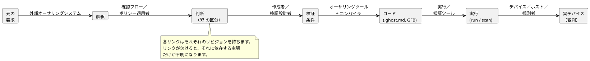
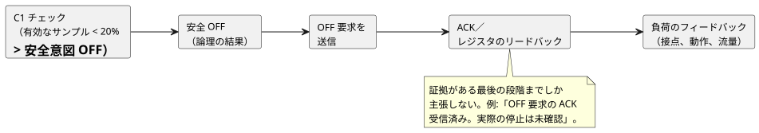

<!-- translation-source: docs/INTENT-CONSISTENCY-CONTRACT.en.md -->
[英語の原文](INTENT-CONSISTENCY-CONTRACT.en.md)

# 意図の整合性に関する責任と証拠の契約

[韓国語の原文](INTENT-CONSISTENCY-CONTRACT.md)

ステータス：[#565](https://github.com/callin2/ghostflow-language/issues/565)の共有設計契約。
[#559](https://github.com/callin2/ghostflow-language/issues/559)の5つの後続機能は、この契約をそれぞれの入力、結果、完了基準に適用します。

- ここでの義務は**後続作業のための設計基準**です。新しいAPI、ストレージスキーマ、承認UIが実装済みであることを意味するものではありません。
- この文書は、既存の言語構文、実行の意味論、デプロイポリシーを変更しません。

共有の証拠レコードには、実装済みのオーサリングAPI、検証器、CLI、永続化／復元がすでにあります。これらは[意図証拠の実装契約](INTENT-EVIDENCE.ja.md)に従います。構造、リビジョン、明示的なリンクをチェックします。以下で説明する4つの判断は**行いません**。

この文書の内容：

1. **何を判断し、誰が権限を持つか** — 4つの別々の判断。
2. **レイヤーごとの責任** — オーサリングエージェントからデバイスまで、誰が何を所有するか。
3. **判断状態** — 判断の4つの区分と、既存のアンカーメタデータへの対応。
4. **最小限の証拠とリビジョンのリンク** — 元の要求から実デバイスまでの連鎖。
5. **ポンプの例** — 確認と検証を別々にリンクする。
6. **よくあるレビューケース** — 防ぐべき誤判断。
7. **5つの後続issueのための設計基準。**
8. **既存の証拠と完了の境界。**

## 1. 何を判断し誰が権限を持つか

混同しやすい問いが2つあります。

- 解釈は要求者の意図に合っているか。
- コードは明示的な条件を満たしているか。

これらは別々の判断です。同じLLMが誤った解釈からコードとテストの両方を書けば、コードとテストは互いに一致したまま、元の意図から外れることがあります。
証拠のリンクは、これらの判断を追跡可能にします。リンクそれ自体は、解釈が適切であることを証明しません。

次の表は4つの判断を示します。それぞれについて、誰が判断するか、どの入力が必要か、どの証拠を残すか、何を主張してよいかを示しています。

| 判断 | 判断権限と行為者 | 必要な入力 | 保持すべき証拠 | 許される主張と限界 |
|---|---|---|---|---|
| 解釈は要求者の意図に一致しているか | ユーザー、またはその範囲について権限を委任されたドメインオーナーが判断します。外部のLLMやオーサリングツールは、解釈、質問、代替案を提案できます。 | 元の要求とその文脈、解釈のリビジョン、判断が必要な項目、適用される承認ポリシー | どの解釈が、誰によって、どの権限のもとで確認されたか。確認の範囲、時刻、根拠を含みます | 指定された解釈と範囲が確認されたことは述べてかまいません。沈黙、コンパイルの成功、もっともらしい文言、他のモデルの同意は、確認の代わりになりません。 |
| 明示的な要件同士が矛盾していないか | ツールは、表現できる条件の間の矛盾をチェックします。LLMは曖昧さや起こりうる矛盾を指摘できます。ポリシー間の優先順位は、該当する判断権限が設定または変更します。 | リビジョンが固定された条件、仮定、優先順位、範囲、およびチェッカーがサポートする範囲 | 矛盾する条件、反例／チェック結果、チェックされていない領域 | サポートされる形式、モデル、範囲についての矛盾あり／矛盾なしの結果だけです。すべての自然言語の整合性、漏れがないこと、どのポリシーを放棄するかを自動的に確立するものではありません。 |
| コードは明示的な条件を満たしているか | コンパイラ、検証器、シミュレータが、それぞれの能力の範囲でチェックします。条件の意味と期待値は外部で確立されます。 | コード／成果物、条件と期待値の根拠、初期状態、入力、クロック、設定、実行契約 | 診断、実行／反例、サポートされた範囲と観測された範囲、厳密なリビジョン | 型チェック、特定のシナリオの合格、有界な形式証明を区別します。コンパイルの成功は任意の要件への準拠を証明せず、テストの合格はすべての入力に対する等価性を確立しません。 |
| 実デバイスは条件を満たしているか | デバイス／観測システムが事実を収集します。指定された受け入れ責任者、または承認された受け入れポリシーが、それが満たされているかを判断します。 | デプロイされたリビジョン、デバイス、設置されたバインディング、試験手順、観測点、品質とタイミングの基準、受け入れ条件 | コマンド、応答、リードバック、物理的なフィードバックとその出所、結果、欠落、不一致 | 主張は、観測されたデバイス、条件、時間、物理量にのみ適用されます。シミュレーション、送信の成功、ACK、レジスタの値は、負荷の完全な動作を証明しません。 |

権限とチェック能力を分けることは、人が毎回すべての値を手で調べなければならないという意味では**ありません**。

- 承認されたポリシーは、その明記された範囲内で判断を自動化してかまいません。
- その場合、ツールはポリシー、権限、範囲、リビジョン、適用の根拠を受け取らなければなりません。
- LLMやチェッカーは、その権限の外で判断を作り出し、それを承認済みとして扱ってはなりません。

## 2. レイヤーごとの責任

| レイヤー | 所有するもの | 提供しなければならないもの |
|---|---|---|
| 外部オーサリングエージェント／API／要件確認フロー | 自然言語の解釈、未決定の候補の発見、質問、確認レコード、承認ポリシーの適用、リビジョンの保持 | 原文、解釈、条件の識別子と出所、判断状態、権限の根拠と範囲 |
| 正本のGhostFlow`.ghost.md` | 作成者が明示的に記述した説明、意図、仮定、実行可能なコード | 既存のアンカー／リンクと正本のリビジョン。実行可能な規則は、このソースとその派生成果物にとどまります。 |
| 言語、コンパイラ、検証ツール | 明示的な構造、型、関係のチェック、ソーストレース、サポートされる条件の検証 | 実際にチェックした範囲、診断、コード・条件・実行結果の間のバインディング、サポート外／不明の結果の理由 |
| ランタイムと説明ツール | 定義された意味論のもとでの実行と、実際の評価トレースの投影 | 厳密なrun／scanとrequested／safeの結果。評価済み、未評価、エラーのケースを区別します |
| デバイス／ホスト／ドライバ／レンダラー | 設置／デプロイ、デバイス通信、入力品質、実際の出力の適用／観測 | デバイス／設置のリビジョン、時刻と品質、適用／フィードバックの証拠、失敗／欠落 |
| 利用側UI／外部エージェント | 証拠の提示と、質問や判断の支援 | 証拠のレベルと未解決の範囲を保った説明 |

この表から、4つの境界が導かれます。

- 自然言語の解釈エージェントが、GhostFlowの言語、ツールチェーン、ランタイムの内部に存在すると想定しないでください。
- 外部のオーサリングシステムからの判断レコードは、実行可能なプログラムを置き換える第2のDSLではありません。
- 派生マップ、IR、可視化は正本ソースから生成されます。別に編集可能な制御の意味論を作るものではありません。
- 言語ツールは、サポートされる明示的なリンクを検証できます。フィールドの形だけから、外部レコードの真実性やユーザーの権限を認証することはできません。

## 3. 判断状態と既存メタデータとの関係

以下の4つの区分は、外部の判断レコードが何を意味するかを説明するものです。既存のアンカーに新しい列挙値を定義するものでは**ありません**。
出所、確認状態、範囲は別々の情報です。人が書いたというだけで確認済みになるわけではなく、ポリシーから結果を導いたというだけで権限が与えられるわけでもありません。

| 区分 | 必要な証拠 | 既存アンカーとの対応 | 許されない昇格 |
|---|---|---|---|
| 確認された判断 | 判断権限、確認された解釈／条件のリビジョンと範囲、確認レコード | 確認が存在する`intent`または`premise`の`status=confirmed`。`origin`は実際の出所を保持します | 1つの項目の確認を、文書全体の承認に広げないでください。 |
| 承認されたポリシーから導かれた判断 | ポリシーの識別子、リビジョン、権限、有効範囲。適用された入力と導出の根拠。そのポリシーが委任する判断の範囲 | 適切な`intent/premise`にリンクし、ポリシーと導出の根拠は外部レコードに保持します。ポリシーがその判断をカバーする場合にのみ、確認された判断として扱います。 | 任意の慣習や既定値を承認されたポリシーと呼ばないでください。また、それをユーザーの直接の発言に変えないでください。 |
| LLMの仮定 | 提案した行為者、根拠、影響を受ける条件／コード、未確認の状態 | `kind=assumption status=unconfirmed origin=ai`。候補コードは`relation=assumes`を使います | 自動的に`confirmed`に昇格させないでください。確認後は`intent/premise`に再分類し、確認の証拠を保持します。 |
| 未決定の項目 | 質問／選択肢、判断権限（または未指定であるという事実）、影響を受ける主張／作業 | 外部レコードと正本の説明の中に保持します。すでに記述された未確認の仮定は、既存の形式でリンクしてかまいません。 | コードにない振る舞いから未決定の項目を自動的に推論しないでください。また、存在しない`status=undecided`構文を作り出さないでください。 |

既存の[アンカー契約](INTENT-ANCHOR-MAP.ja.md)への対応は次のとおりです。

- `kind`は`intent/premise/assumption`、`status`は`confirmed/unconfirmed/superseded`、`origin`は`user/operator/engineer/ai/imported`です。
- `implements/constrains/fallback/assumes`は、作成者が記述した関係です。`implements`コメントは、実装が正しいことを証明しません。
- `assumption`は`confirmed`になれず、`superseded`アンカーは現在のノードにリンクできません。
- `origin=user`や`status=confirmed`という文字列は、ユーザーが実際に何かを確認したという証拠の代わりにはなりません。

未決定の項目は、一律のブロックを正当化しません。

- 何かが未決定であるというだけで、すべてのオーサリング、シミュレーション、デプロイをブロックする規則を追加しないでください。
- 代わりに、その項目に依存する主張と作業を特定してください。その作業を許可するか、延期するか、ブロックするかは、その作業についての明示的な製品／設置ポリシーに従います。
- 必要なポリシー入力を省略した宣言に対する既存の言語エラーは、変わりません。

## 4. 引き継ぐべき最小限の証拠とリビジョンのリンク

以下は**論理的な**情報要件です。フィールド名、転送形式、ストレージ、承認APIを固定するものではありません。
後続機能は、既存の同一性とソーストレースを再利用し、実際の利用側の境界に合うバージョン付きスキーマを定義すべきです。

この図は、6つのリンクを順に示し、それぞれの主な生成者を示しています。表は、各リンクが持つ最小限の情報を示します。

| リンク | 最小限の情報 | 主な生成者 |
|---|---|---|
| 原文 → 解釈 | 原文の識別子、不変のリビジョン／参照、関連する範囲。解釈の識別子、リビジョン、内容。追加された仮定と省略された範囲 | 外部オーサリングシステム |
| 解釈 → 判断 | §3の区分、出所、確認／ポリシーの根拠と権限の範囲、判断の時刻、未決定の項目 | 要件確認フロー／ポリシー適用者 |
| 判断 → 検証条件 | 条件の識別子とリビジョン。観測する変数、単位、時間の基準。前提条件／期待値。導出元の判断。独立にレビューされた期待値の根拠 | 作成者／検証設計者 |
| 条件 → コード | 正本文書のリビジョン／ダイジェスト、アンカーとコードのノード／範囲のリンク、条件と対象の関係、バイトコード／コンパイラとチェッカーのリビジョン | オーサリングツールとコンパイラ |
| コード → 実行 | 成果物、設定、初期状態、入力テープ、ランタイム／ターゲット契約のリビジョン。run／scan／論理時間。実施したチェックと観測の範囲 | 実行／検証ツール |
| 実行 → 実デバイス | デプロイ、デバイス、プロファイル／バインディングの同一性、コマンドと観測の相関キー、観測の時刻／クロックの基準／品質／観測点 | デバイス／ホスト／観測者 |

**報告の規則。**

- 各利用側は、自らの主張に必要なリンクをチェックします。上流の情報が欠けている場合、不明／利用不可になるのは、欠けたリンクとそれに影響される主張だけです。
- すべての段階を1つの`passed`や「意図が一致」という結果にまとめないでください。検証の結果、解釈の確認状態、物理的な確認状態を、別々に返し、別々に表示してください。
- 反例や失敗箇所は、観測された違反点です。それだけでは、根本原因がどこにあるか、何を直すべきかは確立されません。

**出所、コピー、署名。**

- 元の要求は外部システムに保存されていてもかまいません。正本ソースの中の説明は、既存のソース文書から読み取ります。
- 説明のテキストをコピーする場合は、その出所のリビジョンと、変換／抜粋の関係を保持してください。そうすれば、コピーが独立に編集される真実の源になることはありません。
- 文書／ハッシュ／アンカーのリンクは、内容とリビジョンを結び付けます。これは意味的な適切さとも、権限の認証とも別のものです。
- 署名は、信頼できる署名者が証明する範囲内で成果物を認証します。署名だけで、自然言語の解釈が正しいと主張することはありません。

### 変更後の証拠の有効範囲

**確認は内容、リビジョン、範囲に結び付けられます。**

- 確認は、解釈の内容、リビジョン、範囲に結び付けられます。解釈が変わったときは、IDやバイトコードが同じままでも、古い確認をそのまま引き継がないでください。
- 既存の判断が新しいリビジョンにも適用されると主張するには、変更の影響と、それを適用する根拠を記録してください。
- 意味を変えない純粋に編集上の変更では、リンクの位置とダイジェストを更新してかまいません。すべての判断を無条件に問い直すことを要求するポリシーを作らないでください。

**その他の変更は再評価のきっかけになります。**

- ポリシー、条件、コード、設定、設置のバインディング、ランタイムが変わったときは、影響を受けるリンクと検証の範囲を再評価してください。
- 以前の結果は、その当時のリビジョンについての証拠として保持してください。新しいリビジョンの結果として付け替えないでください。
- ポリシーの有効性や権限の範囲をチェックできない場合は、ポリシー由来の状態を、現在の適用可能性とは別に保ってください。
- 有効期間／最大経過時間は、該当する契約が提供します。すべてのデバイスに共通する1つの鮮度の値を作り出さないでください。
- 以前のrunのscan 0についての説明を、新しいrunのscan 0にリンクしないでください。クロックに互換性がないときに、時刻だけでコマンドとフィードバックを相関させないでください。

## 5. ポンプの例：確認と検証を別々にリンクする

この節の数値、識別子、確認は、契約を説明するための**仮想の**例です。実際のユーザーの運用承認や実行テストの結果ではありません。
この節は実行構文を追加せず、時間、入力品質、デバイスの動作について暗黙の選択をしません。

原文`U1/r1`：「水が少ないときはポンプを止めてください。」
LLMの候補解釈`I1/r1`：「水位が20%未満のときは1秒以内に停止し、水位が回復したら自動的に再始動する。」

候補解釈は、原文に述べられていない3つの詳細を追加しています。それぞれ、最初はLLMの仮定です。

| 項目 | 初期状態 | 確認すべき意味 |
|---|---|---|
| 「少ない」は20%未満を意味する | LLMの仮定 | どのセンサと単位か、どの品質が適用されるか、境界値と測定失敗をどう扱うか |
| 1秒以内に停止する | LLMの仮定 | 開始時点が物理的な低水位か有効なサンプルの受信か、完了が安全OFFか実際の停止か |
| 回復後に自動的に再始動する | LLMの仮定 | 再始動の条件と権限。原文はこれを決めていません。 |

### 部分的な確認後の有界なチェック

仮想の判断`D1/r1`で、権限を持つ人が次のことだけを確認したとします：「20%未満の有効な水位サンプルを持つ受け入れられたscanでは、ポンプの安全意図はOFFでなければならない。」

- 解釈を`I1/r2`に更新し、`D1/r1`をその条件だけにリンクします。
- 1秒以内の物理的な停止と自動再始動は、未解決のまま残ります。

この判断があれば、次のチェックを定義するのに十分です。

| リンク | 記録する内容 |
|---|---|
| 条件`C1/r1` | 20%未満の有効な水位サンプルを持つ受け入れられたscanについて、ポンプの安全意図 = OFF。通常の運転と再始動の動作は、この条件のチェック範囲外です。 |
| コード`P1/r1` | 正本文書とGFBのダイジェスト、低水位の制約のノード／アンカー、および`C1/r1`へのリンク。候補コード中のその他の仮定は別に印を付けます。 |
| シナリオ`S1/r1` | 初期状態、設定、ターゲット契約、論理クロックを固定したうえで、scan Aで有効な19%のサンプルを、scan Bで20%を与えます。厳密なrun／scanを記録します。 |
| 期待値 | C1のもとでAは安全OFFでなければなりません。Bでは、C1の前提条件が偽なので、C1だけではONもOFFも要求されません。期待値はコードの出力をコピーするのではなく、D1／C1から導きます。 |
| 結果の解釈 | AがOFFなら、それはこのシナリオにおけるC1準拠の証拠です。すべての運用ポリシー（Bでの動作を含む）、自動再始動、1秒以内の物理的な停止を証明するものではありません。実際の結果を得る前に合格を記録しないでください。 |

**無効なサンプルや古いサンプル。** 無効なサンプルや古いサンプルが、この条件の前提条件を満たす有効な水位になることはありません。

- それを0%に置き換えて「低水位条件に合格」と数えないでください。
- 代わりに、品質の状態と、別の故障ポリシーが必要かどうかを明らかにしてください。
- 具体的な故障時の動作は、承認された条件から得なければなりません。

### その後の物理的な主張と変更

「1秒以内の実際の停止」をチェックするには、開始／終了の観測点、時間の基準と許容誤差、デバイスのバインディング、停止の受け入れ条件を別途確立してください。

出力経路の各段階は、それぞれ別の証拠です。主張は、証拠のある最後の段階までしか進められません。

安全OFF、送信要求、ACK、レジスタのリードバック、実際の接点／動作／流量は、それぞれ別の証拠です。
たとえば、OFFのACKはあるが負荷のフィードバックがない場合は、「OFF要求のACK受信済み。実際の停止は未確認」と記録します。
既存のC1のシミュレーションは、その範囲内で引き続き有効です。その結果が、追加の物理的な主張の代わりになることはありません。

**ポリシーが変わったとき。** 後で低水位のしきい値が15%に変わった場合：

- 解釈、判断、条件、コードの新しいリビジョンを、関連するシナリオとリンクします。
- 19%でのC1/r1の成功（C1/r1がOFFを要求した場面）を、新しい15%のポリシーの証拠として再利用しないでください。
- 原文が再始動を禁止していないというだけで、確認された自動再始動を推論しないでください。この例は、デプロイが許可されるかどうかも決めません。

## 6. よくあるレビューケース

後続機能は、以下の誤判断を防ぐための、範囲内の結果チェックと回帰チェックを用意すべきです。この文書は新しいチェックエンジンを実装しません。

| 状況 | 保つべき判断 |
|---|---|
| LLMが同じ20%の推測からコードとテストを書き、すべて合格する | 未確認の解釈は未確認のままです。期待値には、独立した判断の根拠が必要です。 |
| `implements`リンクや`confirmed`ラベルだけが存在する | 確立されるのはリンク／ラベルの存在だけです。権限のある確認や意味的な準拠を認証するものではありません。 |
| 文書の一部だけが確認された、または一部のシナリオだけが一致した | 確認／チェック済みの範囲を、残りの範囲と分けてください。 |
| LLMが自然言語上の矛盾の可能性を指摘する | 候補と検証済みの矛盾を区別してください。ポリシーの優先順位を恣意的に選ばないでください。 |
| 承認されたポリシーは存在するが、その範囲、リビジョン、現在の有効性が不明 | それが適用されるという主張は不明です。無関係な作業をブロックしないでください。 |
| ケイパビリティは宣言されているが、現在の設置の証拠がないか古い | 宣言済み／設置済み／観測済みの区別、出所／時刻、不確実性の理由を保ってください。 |
| 説明のソース／run／scanが出力サンプルと異なる | 結合を失敗／stale（古い）としてマークしてください。現在の出力の理由として使わないでください。 |
| 分岐が評価されなかった、または入力が欠落／故障している | 通常のfalse／0に見せかけないでください。 |
| 論理はOFFでACKもあるが、負荷の観測がない | 利用可能な証拠の段階までだけを主張してください。物理的な結果は未確認のままにします。 |
| 未決定の項目が見つかる | 影響を受ける条件／作業を特定してください。実行全体をブロックするのは、その範囲に明示的なポリシーが適用される場合だけです。 |

## 7. 5つの後続issueのための設計基準

#565は共有の責任境界を確立します。各後続issueは、それぞれのワイヤスキーマ、アルゴリズム、UI、ストレージ、実装を決めます。
実装者は、以下の基準をそのissueの完了条件と実際の検証に含めるべきです。

| 後続issue | 入力と結果の契約 | そのissueに残る詳細 |
|---|---|---|
| [#560 振る舞いの差分](https://github.com/callin2/ghostflow-language/issues/560) | 2つのプログラム、シナリオ、初期状態、ターゲット、観測／時間の範囲、外部で確立された期待される変化／不変条件を受け取ります。観測された差分を、与えられた条件の充足／違反と分けます。 | 比較の単位、時間の位置合わせ、結果のスキーマ、リプレイの制限。差分は意図の判断なしでも可能ですが、期待される条件がなければ、変化が意図されたものかどうかは不明です。 |
| [#561 失敗の縮小](https://github.com/callin2/ghostflow-language/issues/561) | 外部から与えられた失敗条件／表明と、その要件の根拠を固定します。同じ違反を保つ再現／縮小の結果を生成します。 | 縮小コストの尺度、探索範囲、再現の保証。「最短」と主張できるのは、証明された範囲内だけです。要件へのリンクだけでは、オラクルが適切であることは確立されません。 |
| [#562 利用可能な契約の照会](https://github.com/callin2/ghostflow-language/issues/562) | 言語／ツールは、与えられた契約を検証し、照会します。デバイス／ホストは、実際の設置、占有、観測の事実を、同一性、リビジョン、時刻とともに提供します。呼び出し側が照会の範囲を与え、エージェントがタスクとの関連性を判断します。 | 照会インターフェース、プロバイダ、鮮度／不明時の動作、関連性フィルタを別途定義します。宣言されたケイパビリティを、現在の設置の事実に昇格させないでください。 |
| [#563 実行の理由](https://github.com/callin2/ghostflow-language/issues/563) | 実際の評価結果／値／出所を、外部の意図の来歴にリンクします。ソース／run／scanとコマンド／観測の同一性を検証し、リンクがない場合はそれを明示します。 | 既存の#88／#553に対する再利用／追加の範囲を定義します。内部の評価の説明と外部の意図の説明を区別し、requested／safe／applied／confirmedの証拠を保ちます。 |
| [#564 未決定の意図](https://github.com/callin2/ghostflow-language/issues/564) | 外部エージェント／オーサリングフローが、候補を発見し、質問し、解決します。言語／ツールは、明示的に与えられた状態と、必須スキーマのもとでの欠落を表現し、診断します。 | 発見／表現／解決のためのインターフェースと、必要な外部状態モデル。コードがないことから省略された意図を推論せず、普遍的なデプロイブロックのポリシーを追加しないでください。 |

## 8. 既存の証拠と完了の境界

レビューの基準：`dev`上の`e664687259e7b66fa1a3f8db0a49cf823cdb9815`。
この文書は、以下の既存の契約と実装に基づいて、責任と証拠の受け渡しを統合しています。

- [正本ソース／アンカー契約](INTENT-ANCHOR-MAP.ja.md)、[抽出器](../tools/literate.mjs)、[ソーストレース](../tools/source-trace.mjs)：明示的なメタデータとリビジョンのバインディング。これは確認の権限を認証することとは別です。
- [言語／デバイスの責任](reference/08-language-runtime-and-device-boundaries.ja.md)、[出力の証拠の段階](reference/04-sensors-constraints-control.ja.md#47-requestedsafeappliedconfirmed)、[デバイスの境界](LLM-TOOLCHAIN-ARCHITECTURE.ja.md)：運用ポリシーと物理的な観測の所有権。
- [現在のブール出力の説明](BOOLEAN-OUTPUT-EXPLANATION.ja.md)：完了した1つのscanについて、要求されたブール結果を説明する限定的な実装。これを、すべてのタイマー／状態／安全／物理的な説明が利用可能だという主張に広げないでください。
- [外部オーサリングの例](LLM-AUTHORING-WORKFLOW.ja.md)：モデル呼び出しなしの、正本ソース、リビジョン、仮定、仮想出力の例。
- [#553](https://github.com/callin2/ghostflow-language/issues/553)、[#88](https://github.com/callin2/ghostflow-language/issues/88)、[#545](https://github.com/callin2/ghostflow-language/issues/545)：診断、実行の説明、ケイパビリティ／リプレイに関する関連作業。#565は、これらのissueが完全に完了したとは宣言しません。

**#565にとって完了とみなすもの。** 完了の証拠は次のとおりです：4つの判断についての責任の表、状態／リビジョンのリンク、レイヤーの境界、ポンプの例、5つのissueへの引き継ぎ。

- 文書、翻訳、インデックスのチェックは、成果物の整合性チェックです。意図の整合性やデバイスの受け入れを自動的に証明するものではありません。
- 後続機能の実装とリポジトリ統合の実際の状況は、リンク先のissue／PRで別途記録されます。
